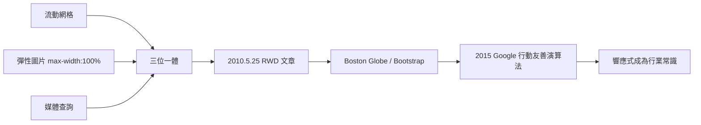

# 流動網格、彈性圖片與媒體查詢的三位一體

## 一篇文章的憲法地位

2010 年 5 月 25 日，伊桑·馬科特在網頁設計聖經 A List Apart 上發表〈Responsive Web Design〉。文章的篇幅不長，卻做了一件設計理論上極為漂亮的事：把三個已存在的技術，組織成一個有哲學的完整方法論。馬科特明確地指出，他沒有發明任何一項技術——流動網格源自早期設計師的實驗，媒體查詢是 CSS 既有功能，彈性圖片的技巧來自社群。他的貢獻是綜合與命名。

三位一體的第一位是流動網格（fluid grid）：拋棄固定像素版面，改用百分比與相對單位（馬科特借鑒了約翰·阿爾賓·約翰森 2009 年提出的比例計算公式），讓版面隨容器寬度流動，而不是斷裂重排。

第二位是彈性圖片（flexible images）：圖片也要能縮放，用 `max-width: 100%` 這樣的一行 CSS，讓任何圖片永不超出它的容器——這個如今寫進每一個 CSS 重置（reset）的小技巧，在當年是革命性的補漏。

第三位是媒體查詢（media queries）：CSS 3 的新功能，讓樣式表可以根據裝置的特性（螢幕寬度、方向）條件生效。`@media (min-width: 768px) { ... }` 讓同一份 HTML 在不同寬度下套用不同版面。

三者合起來的意思是：一份內容、一份程式碼，自己流動、自己縮放、自己在斷點處換姿態。設計的對象從「幾種裝置」變成了「所有可能的寬度」。

## 哲學轉向：從控制到接納

馬科特在文章中引用了建築界的「響應式建築」概念（機器人學家羅德尼·布魯克斯的響應式架構理念被他在 2011 年的書中正式追溯）——空間能感知使用者而自我調整。他提出的核心哲學可以概括為一句話：放棄對版面的絕對控制，接納流動的未知。

這是對網頁設計傳統的一次價值觀革命。平面設計師出身的網頁設計師習慣了「印刷式思維」：版面是固定的藝術品，設計師的權力在於精確到像素的控制。RWD 宣告這種思維已死：網頁的本質是流體，設計師的新工作是設計「系統如何回應變化」，而不是「畫面最終長什麼樣」。斷點（breakpoints）取代了固定的畫布；比例取代了像素；「內容優先」（content first）取代了「版面優先」。

## 產業的閃電採納

RWD 的採納速度在網頁史上罕見。2011 年，Boston Globe 完成了第一個大型 RWD 新聞網站（由馬科特親自參與，Filament Group 協作）；同年，Twitter Bootstrap 開源，內建網格系統與 RWD 樣板，把響應式變成了前端開發的預設出廠設定。2012 年，美國行動網路流量爆發，Google 開始提示行動友善。2015 年 4 月 21 日，Google 正式把「行動友善度」納入搜尋排名（業界稱之為 Mobilegeddon），RWD 從設計品味變成了商業生死線。W3C 也在 2015 年正式把 RWD 列為推薦做法。

到 2010 年代中期，RWD 已是行業常識。往後的十年，它的遺產繼續擴張：CSS Grid 與 Flexbox 提供了更強大的流動版面原生能力；容器查詢（container queries）讓元件也能響應；「行動優先」（mobile first, Luke Wroblewski 2009 年提出、馬科特等人推廣）成為設計流程的默認起點。

一篇文章、三項技術、一次哲學轉向，解決了行動時代的生存危機。而 RWD 的成功還揭示了更深的一層：改變全人類瀏覽資訊的習慣——這是下一節的主題。
