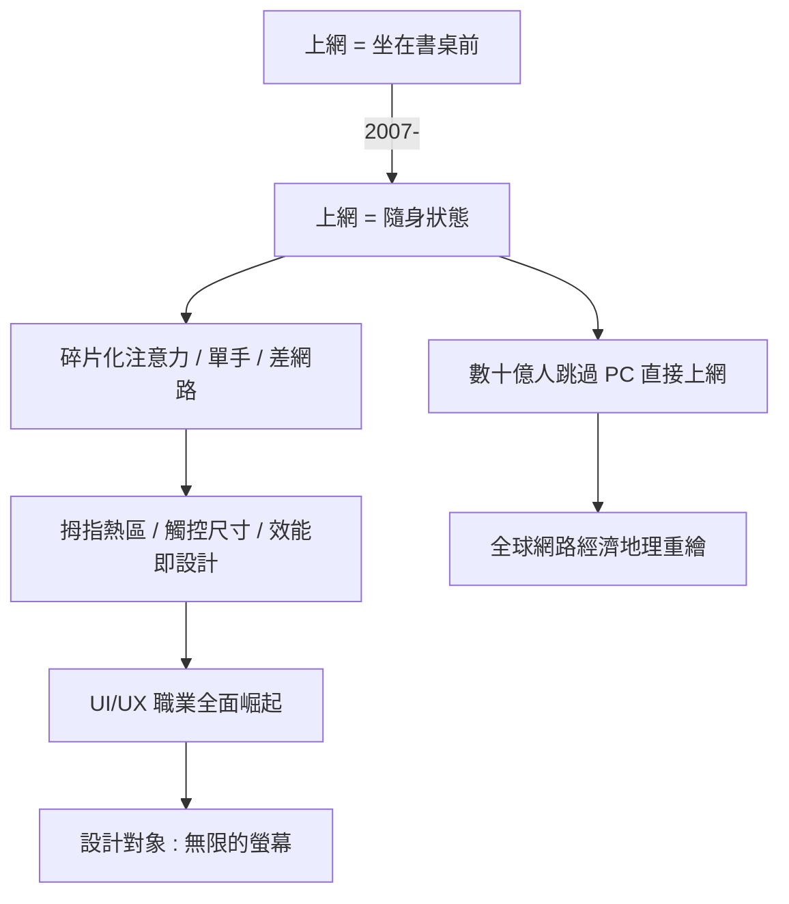

# 從單一桌機到流體適應：瀏覽習慣的徹底革命

## 人類第一次把網路放進口袋

RWD 的最終意義，要放在人類資訊行為史的尺度上衡量。1990 到 2007 年，「上網」是一種坐在特定位置的行為：書桌前、網咖裏、辦公室中。2007 年之後，上網變成了持續的背景狀態：排隊時、通勤時、睡前躺在床上。人類與資訊的關係，從「定期造訪圖書館」變成了「隨身攜帶圖書館」。

這個行為革命對設計的要求是殘酷的。行動場景的注意力是碎片化的（一次看十五秒）、單手操作是常態、頻寬與電量是稀缺資源、環境光與噪音千變萬化。RWD 解決了「畫面如何適應螢幕」，但它的哲學餘波——內容優先、效能即設計、觸控優於點擊——重塑了整個設計方法論。

幾條新法則值得一提。拇指熱區（thumb zone）：單手操作時，螢幕下方三分之一才是舒適區，導覽與主要按鈕必須下移——這與桌機時代「導覽在上」的傳統完全相反。觸控目標尺寸：蘋果與 Google 的平台指南都規定按鈕最小 44 到 48 像素，因為指尖遠不如滑鼠精確。效能即體驗：Google 的研究顯示行動頁面載入超過三秒，過半使用者直接離開——載入速度從工程指標升格為設計指標。

## 經濟地理的重繪

行動優先也重繪了全球網路經濟的地理。在桌面時代，落後地區的網路滲透率受制於 PC 的昂貴；智慧型手機讓數十億人直接「跳過 PC 時代」進入網路世界——中國、印度、非洲、東南亞的第一台「電腦」就是手機。這些市場的網頁設計需求與矽谷完全不同：更低階的裝置、更不穩定的網路、更高的流量成本。輕量級網頁（如 Google AMP 的嘗試，儘管爭議不斷）與離線優先架構（PWA）因此成為重要議題。

對設計師職業的影響同樣深刻。RWD 之後，網頁設計師無法迴避互動設計與使用者研究——你必須知道人們在什麼場景、什麼握姿、什麼心理狀態下使用你的介面。UI/UX 作為職業的全面崛起、設計系統（design system）的流行、Figma 等協作工具在 2010 年代的誕生，都是這場「從畫面到系統」轉向的產物。

## 無限的螢幕

回望 2010 年，馬科特的洞察之所以不朽，在於他回答的不是「iPhone 怎麼辦」，而是「螢幕將永遠變化怎麼辦」。事實證明他的抽象是對的：此後十年，摺疊機、平板、電視、錶、車機、直立的社群短影音——螢幕的種類有增無減，而「一份內容、流動適應」的架構從未失效。2020 年代 W3C 推出的容器查詢，本質上仍是 RWD 哲學的延伸：響應的單位從頁面細化到元件。

行動革命完成了人類瀏覽方式的物理轉型。而就在同一個年代，另一場更深的工程革命正在醞釀——它不發生在螢幕上，而是發生在「畫面是如何被製造出來」的層次。主角是臉書，一個為了聊天框而改寫前端歷史的工程師。
