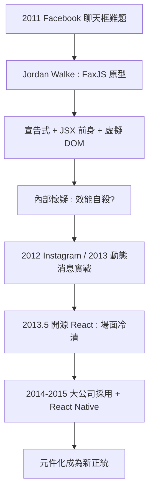

# Jordan Walke 與 Facebook 內部的 React 原型

## 起點是一個聊天框

2011 年，Facebook 的內部工程正面臨一個具體而微小的難題：廣告部門的聊天框（Ads Organizer），以及隨後更大的難題——整個 Facebook 網站的動態消息。這些介面的特點是：資料頻繁變化，而且多處 UI 依賴同一份資料。你收到新訊息，聊天視窗要更新、頭像旁的小鈴鐺要更新、訊息計數要更新——用當時主流的 jQuery 式命令編程，這意味著到處手動同步，而遺漏任何一處就是 bug。

Facebook 的工程師喬丹·沃克（Jordan Walke）當時正在研究一個冷門的語言：PHP 團隊開發的 XHP（讓 PHP 裏可以嵌入 XML 標籤），以及函數式編程。他把這些想法帶進了瀏覽器端：如果介面不是「被命令的對象」，而是「資料的函數」呢？給定狀態，畫面就唯一確定；狀態變了，畫面整個重算——工程師永遠不用手動碰 DOM。

2011 到 2012 年間，沃克做出了原型，取名 FaxJS。這個原型包含了日後 React 的所有核心基因：用 JavaScript 描述 UI 的宣告式語法（JSX 的前身）、把狀態映射為畫面的純函數思想、以及一個讓「整個重算」在效能上可行的關鍵發明——虛擬 DOM。

## 內部的懷疑與逆襲

原型的命運並非一帆風順。2012 年前後，React 的想法在 Facebook 內部遭遇大量懷疑：在 JavaScript 裏寫 HTML 標籤？把整個畫面重算一遍？這違反了所有當時的最佳實務——手動優化 DOM 更新是工程師的職業本能，宣告式重算聽起來像效能自殺。

關鍵的轉折是實戰。2012 年，Instagram 被 Facebook 收購，其網站全面採用這套技術；2013 年初，Facebook 的動態消息團隊也將其投入正式生產。事實證明，虛擬 DOM 的整體比對（diff）演算法雖然「理論上浪費」，實際上遠快於人手維護的命令式更新——因為人會犯錯，而 diff 不會。

2013 年 5 月，Facebook 在美國的 JSConf US 會議上正式開源 React。開源初期的反應同樣冷淡：JSX 的語法被嘲諷為異端（「在 JS 裏寫 HTML 是對關注點分離的背叛」），發表現場甚至有人中途離席。但接下來兩年，劇情徹底反轉：2014 到 2015 年，Instagram、Netflix、Airbnb 等公司相繼公開採用；React Native（2015）把同一套思想帶進行動原生開發，震驚業界。到 2010 年代末，React 已成為全球使用最廣的前端框架，JSX 從異端變成主流語法。

## 為什麼是 Facebook 發明了它

歷史的必然藏在 Facebook 的業務結構裏。沒有哪家公司像 Facebook 一樣，把「介面的極端動態性」作為商業核心：動態消息無限更新、通知即時轟炸、多端（網頁、iOS、Android、Messenger）體驗必須一致。命令式的 DOM 操作在這種規模下必然崩潰——不是技術不行，而是人的腦力不夠。

這也再次印證了網頁史的一條規律：革命性的工具誕生於被問題逼到極限的組織。jQuery 誕生於設計師對瀏覽器破碎的憤怒，React 誕生於工程師對狀態同步地獄的絕望。而 Google 的 Angular（2010）與社群的 Vue（2014，尤雨溪作品）在同一時期的崛起，則說明元件化不是一家的發明，而是整個時代的需求。

下一節，我們深入 React 改寫的兩個核心概念——虛擬 DOM 與單向資料流——看它們如何把前端從手工業變成工程學。
