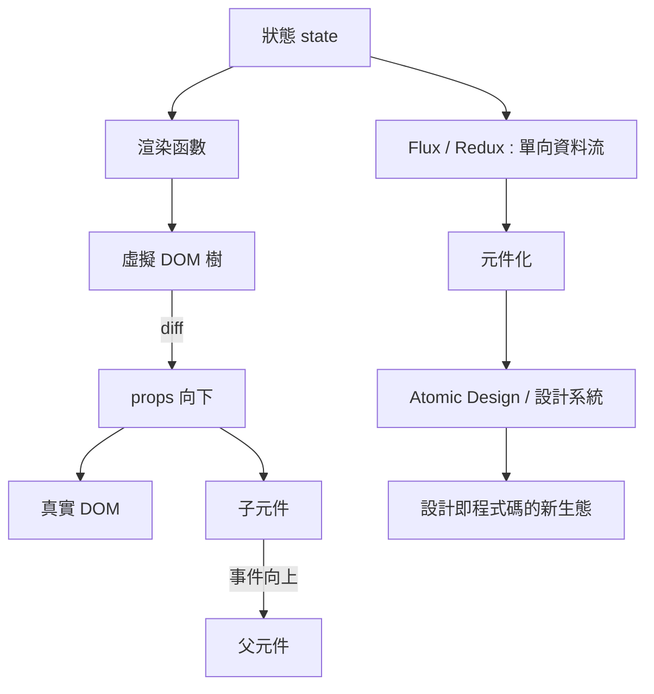

# 虛擬 DOM 與單向資料流：元件化開發的降臨

## 虛擬 DOM：用重算換取確定性

React 的第一根支柱是虛擬 DOM（Virtual DOM）。它的邏輯是：把真實 DOM 樹的輕量 JavaScript 副本留在記憶體裏；當狀態變化時，不直接改 DOM，而是先重算出一棵新的虛擬樹，與舊樹做 diff 比對，算出最小差異，再一次批次地套用到真實 DOM 上。

這個設計的哲學底蘊遠比技術細節深刻。它把「效能優化」從工程師的責任轉移給了機器：開發者只管宣告「這個狀態對應這個畫面」，機器負責找出最省事的更新路徑。工程師從「如何改」的細節中解放，專注於「該長什麼樣」的本質。這是宣告式編程在 UI 領域的勝利——而它的思想源頭，可以一路追溯到 CSS（宣告樣式而非命令繪製）與 SQL（宣告你要什麼資料而非怎麼找）。

2010 年代後期，業界曾流行「虛擬 DOM 其實不快」的技術批評，Svelte 等編譯時框架宣稱可以直接產出更省的程式碼。這個批評在技術上成立，但沒有動搖 React 的統治——因為虛擬 DOM 買賣的不是速度，而是「確定性」：開發者永遠不必思考「現在畫面處於什麼狀態」。

## 單向資料流：狀態的憲法

第二根支柱是單向資料流（unidirectional data flow）。傳統的雙向綁定（Angular 1 的成名特性）讓資料與畫面互相同步，短暫爽快，但規模一大就變成「誰改了誰、改了幾次」的偵探劇。React 的規則嚴格得多：資料只從父元件流向子元件（props 往下），子元件要改變狀態，只能發出事件（callbacks 往上），由頂端重新渲染。

2014 年，Facebook 在 F8 大會上補上了狀態管理的最後一塊拼圖：Flux 架構，隨後社群的 Redux（2015）把它簡化為事實標準。其核心是把所有狀態集中在一個 store，所有變化都透過明確的 action 描述。複雜的應用第一次擁有了可預測的狀態憲法——「時間旅行除錯」（回放所有 action 重演畫面）成為可能。

## 元件化：設計與工程的和解

兩根支柱合起來，托起的是元件化（component-based）這個範式本身。React 把介面拆成一個個自包含的元件：按鈕是一個元件、卡片是一個元件、整個頁面是元件的樹。每個元件封裝自己的結構（JSX）、樣式與邏輯。

這對網頁設計史的意義，怎麼估計都不過分。在元件化之前，「設計」與「工程」是兩條平行線：設計師交付 Photoshop 稿，工程師切成 HTML/CSS，改版時兩邊都痛苦。元件化之後，雙方有了共同語言：設計系統（design system）——原子（atom）、分子（molecule）、模板的階層，恰好對應元件的樹。2013 年 Brad Frost 提出 Atomic Design 方法論，與 React 的元件模型一拍即合。Google 的 Material Design（2014）、Figma（2016 年上線）的元件功能、Storybook（2016）這類元件開發工具，共同構成了一個「設計即程式碼」的新職業生態。設計師與工程師之間那條交付稿（handoff）的鴻溝，第一次被填平。

虛擬 DOM 與單向資料流把前端從手工業變成了工程學。但工程化是有代價的——下一節，我們來看 React 時代的建置工具鏈如何讓前端工程師變成了「全端架構師」。
