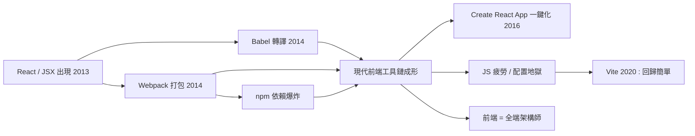

# Webpack、Babel 與前端工程的過度膨脹

## 從一個 `<script>` 標籤到編譯鏈

2013 年之前，寫一個網頁的「建置流程」是：存檔、刷新瀏覽器。React 改變了這一切。JSX 不是瀏覽器認得的語法，ES6 模組也不是，於是「寫網頁」和「跑網頁」之間出現了一道必須由工具填補的鴻溝。

Babel（原名 6to5，2014 年誕生）負責翻譯：把 JSX 與最新的 JavaScript 語法轉譯成瀏覽器能跑的舊版程式碼。Webpack（2012 年由 Tobias Koppers 開始開發，2014 年前後成為主流）負責打包：把成百上千個模組、圖片、樣式表，依賴關係圖計算後打包成瀏覽器可載入的檔案。加上 npm 進行依賴管理（2010 年誕生，2014 年後爆發式成長），一套「現代前端工具鏈」就此成形。

工具鏈的膨脹程度可以用幾個數字感受：一個用 Create React App（2016，Facebook 推出的一鍵工具）生成的空專案，node_modules 資料夾動輒兩三百 MB、數萬個檔案；一次完整建置數十秒；要啟動開發，得先裝 Node.js、跑 npm install、再跑 npm start。2016 年前後，前端社群著名的段子是：一位大神用 200 行就寫出了 TodoMVC，卻表示自己「已經跟不上 React 生態」。甚至出現了「JS 疲勞」（JavaScript fatigue）這個專門的詞彙——框架一年一換、狀態管理庫五年內出現 Redux/MobX/Recoil/XState 十幾個選項、建置工具從 Gulp、Grunt 到 Webpack、Rollup、Parcel、Vite、Turbopack 層層疊代。

而當 Webpack 的配置複雜到催生大量「最佳化模板」時，歷史開始自我修正：Parcel（2017）主打零配置；Vue 團隊的 Vite（2020）利用瀏覽器原生 ESM 把開啟速度提升到毫秒級，數年內成為新主流；Rspack 等以 Rust 重寫的打包器把建置速度再提升一個數量級。每一波的共同主題都是同一個：把「配置地獄」還給開發者一個「開箱即用」。

## 工程師身分的質變：前端變全端

工具鏈的膨脹帶來的是職業身分的質變。2005 年的「前端工程師」懂 HTML、CSS、一點 jQuery 就能履職；2016 年以後的公司職缺描述裏，同樣的職稱背後是一整套工程學科：模組化與打包原理、編譯器常識（AST、babel plugin）、測試（Jest、Cypress）、CI/CD、TypeScript 型別系統、Node.js 伺服器、狀態機與資料流架構、效能剖析（Lighthouse、Core Web Vitals）、無障礙規範、安全（CSRF、XSS、CSP）……

說得更極端些：2010 年代末的前端工程師，其工作內容的寬度已經超過了 2005 年的「全端工程師」。網頁的複雜度沒有消失，只是從「伺服器端模板」搬到了「瀏覽器裏的作業系統」。這個轉變的經濟學解釋很簡單：Web 2.0 之後，網路公司的主戰場就是瀏覽器——誰能把使用者留在頁面上更久、誰能把體驗打磨得更細，誰就能贏得估值。前端從「美工的延伸」升格為「產品的決定戰場」，薪資與職業地位隨之起飛。

過度膨脹的代價也真实存在：入門門檻被工具鏈拉高了十倍；小團隊被迫維護自己根本不需要的複雜度；頁面效能因為過度打包而惡化（打包出幾 MB 的 JavaScript 首屏是 2010 年代末的流行病）；生態的碎片化讓「看教學就要過時」成為日常焦慮。2016 到 2020 年間，社群裡「React 是不是過度工程了」的反思此起彼落，甚至出現了「回到 HTML」的復古運動（比如後來流行的 HTMX 思潮）。

那麼，膨脹的盡頭在哪裡？歷史的答案出人意表：不是某個新工具統一了亂象，而是「部署與內容」這兩件事從頭到尾被重新發明——它們催生了 JAMstack、Headless CMS 與邊緣運算的下一章。
