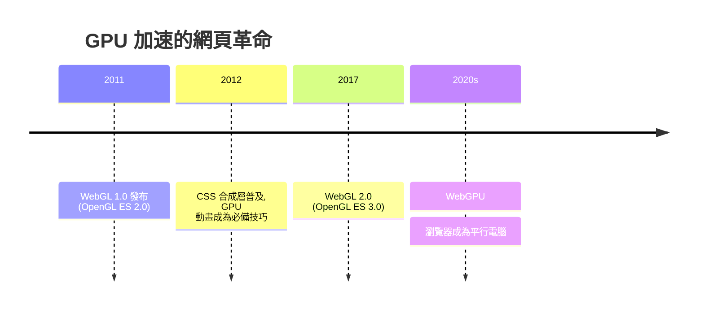

# 瀏覽器硬體加速的解放：從 2D 像素到 WebGL

## 被閒置的超級電腦

2010 年前後，出現了一個怪異的技術錯位：使用者的電腦裏插著一塊擁有數百個核心、能即時渲染大型 3D 遊戲的顯示卡（GPU），而瀏覽器裏的網頁卻只能在 CPU 上用 JavaScript 一格一格地算畫面。一台能跑《魔獸世界》的機器，跑不動一個網頁貪吃蛇。

原因有三。第一，網頁的渲染模型從 1990 年代繼承而來，是「文件模型」——排文字、排圖片，從未設想過即時 3D。第二，瀏覽器是跨平台的沙盒：讓網頁程式直接觸碰顯示卡驅動，在安全上不可想像。第三，各家的 GPU API 不同（Windows 的 DirectX、蘋果的 OpenGL、後來的 Metal、安卓的 Vulkan），瀏覽器要提供的是一個統一的抽象。

工人們（標準委員會）選擇了一條務實的路線：不做新發明，直接把已經 mature 的嵌入式圖形標準——OpenGL ES 2.0（手機用的精簡版 OpenGL）——搬到瀏覽器裏，翻譯成 JavaScript 介面。這就是 WebGL，2011 年由 Khronos Group 發布 1.0 版，主要推手是 Mozilla 的 Vladimir Vukicevic 與後來成為 Cesium 之父的 Patrick Cozzi 等人的推動。實作上，各瀏覽器在自己內部把 WebGL 呼叫轉譯成原生 GPU API（Chrome 用 ANGLE 專案在 Windows 上轉譯成 DirectX）。

## 技術的三次躍遷

WebGL 1.0（2011）：基於 OpenGL ES 2.0，提供可程式化的頂點著色器與片段著色器——從此，網頁可以跑手機等級的即時 3D。

WebGL 2.0（2017）：基於 OpenGL ES 3.0，支援更多紋理格式、更強的著色器能力。

WebGPU（2023 年 W3C 共識、2023 到 2024 各瀏覽器相繼可用）：不再依附 OpenGL，而是借鑑蘋果 Metal、Vulkan、DirectX 12 的「下一代 API」設計，提供計算著色器（compute shader）——GPU 不只畫圖，還能做平行運算。今天，瀏覽器裏的 AI 推理（ONNX Runtime Web、transformers.js）正是跑在 WebGPU 上。

每一波躍遷，帶來的都是新的設計可能性：從「網頁能放 3D 物件」到「網頁能做即時光照與粒子系統」，再到「網頁本身就是一台平行電腦」。

## 硬體加速的全面滲透

WebGL 只是硬體加速滲透網頁的入口，更大的圖景是整個瀏覽器的渲染管線在悄悄 GPU 化：

CSS transforms/opacity 的合成（compositing）交給 GPU。2012 年前後的「跑動畫要開 3D 加速」的 hack（`transform: translateZ(0)`），就是這段歷史的遺跡。Canvas 2D 在主流瀏覽器裏也是 GPU 加速的。CSS 的動畫、濾鏡、 blur 效果，如今大部分都在合成器執行緒（compositor thread）上，即使主執行緒卡住動畫也照跑。這些都是「網頁即原生應用」的體質基礎。

換言之，2010 到 2020 年，瀏覽器悄悄完成了它在 1993 年 Mosaic 時代完全無法想像的進化：從一個「顯示文字與圖片的工具」變成了「一個擁有 GPU 的工作系統」。你手機裏的每個滑順動畫、每個 blur 背景、每個地圖縮放，背後都是這場靜默革命。

GPU 打開了大門，但要讓普通人類設計師走進去，還需要一位翻譯者——一位阿根廷人，與他寫的一個叫 Three.js 的函式庫。這是下一節的故事。
