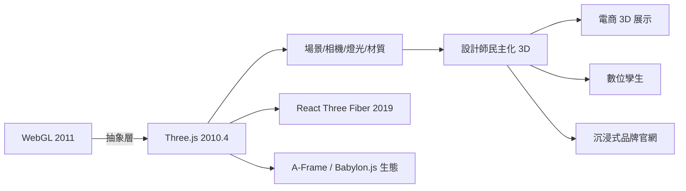

# Ricardo Cabello 與 Three.js：讓設計師揉捏 3D 光影

## 一個阿根廷人在柏林

2010 年前後，一位名叫 Ricardo Cabello 的阿根廷設計轉工程師（業界無人不曉的 Mr.doob）在柏林從事創意編程工作。他之前用 Blender 做 3D，也用 Flash 的 3D 引擎（Papervision3D、Alternative3D 等）做過網頁實驗。當 WebGL 開始在瀏覽器可用時，他察覺到一個絕佳的時機：Java 系的 3D 引擎人才與知識（Blender、Papervision3D 的社群）正好可以移植到全新的 WebGL 世界。

他做了一件相當「設計師」的事：不寫文檔說教，而是直接做出一組直觀的範例。2010 年 4 月，他發布了 Three.js 的第一版，並在隨後幾年用一連串令人過目不忘的 Demo（Rubber Duck、helix、球體粒子地圖等）展示了它的能力。Three.js 的哲學很簡單：把 WebGL 的底層細節（矩陣、著色器、緩衝區、著色語言 GLSL）包裝成設計師能懂的物件——場景（scene）、相機（camera）、燈光（light）、材質（material）、網格（mesh）。你不必懂著色器，只要建立一個球體、給它一個材質、放在場景裏、放一盞燈，就能渲染出一個有光影的 3D 物件。

這是典型的「抽象層民主化」策略——與 jQuery 對 DOM API 做的事如出一轍，只是這次的對象是 GPU。

## 生態的爆發

Three.js 迅速成為 WebGL 的事實標準，三個原因缺一不可。

第一，執着的迭代速度。Mr.doob 十幾年如一日地維護這個專案（今天依然是主要維護者），從搬到 GitHub、寫成百上千的範例、到建立線上編輯器，所有工作幾乎都是無償完成——這是開源史上的經典純利他案例。

第二，範例驅動的社群。Three.js 的官方文檔常被吐槽（API 變動太快），但它的 examples 資料夾成為了學習聖經——想要什麼效果，先去改最接近的官方範例。這種「從範例改起」的學習模式，與 Flash 時代的時間軸借鑑傳統一脈相承。

第三，上層的二次抽象。Brick、什麼是 React Three Fiber（2019，把 Three.js 封裝成 React 元件）、Tweakpane、GSAP 動畫整合、以及基於 Three.js 的 A-Frame（Mozilla 推出的 WebVR 框架）……一整個上層建築被搭建起來，讓「會 React 的設計師」「會視覺的程式設計師」都能找到自己的入口。

## 從玩具到產業

2020 年前後，Three.js 從創意編程圈的玩具升格為產業工具。三個應用場景特別值得記下。

1. 電子商務的 3D 產品展示：蘋果、宜家（IKEA）、家居與汽車品牌（保時捷、奧迪）的官網，都開始在瀏覽器裏提供可旋轉、可放大、可更換配色的 3D 產品視圖。
2. 數位孿生（Digital Twin）：工廠、建築、城市在瀏覽器裏的即時 3D 監控與模擬，成為工業物聯網的標配前端。台灣部分智慧工廠的儀表板亦採用此模式。
3. 沉浸式品牌官網：汽車、遊戲、NFT、時尚品牌願意花大錢做「會動的網站」，行銷產業出現了專門的「WebGL 工作室」（Lusion、Active Theory 等）。

有趣的是，Mr.doob 本人的立場相當特別：他多次表達對「炫技使用」的擔憂（過度的腳本、糟糕的效能），並在近年把心力轉向他更在意的方向（比如處理無障礙與基礎 quality）。這個「發明者不迎合潮流」的姿態，在開源史上的位置很微妙——它既是 Three.js 能保持技術純度的原因，也多少促成了 Babylon.js（微軟支持，文檔友好、功能更企業化）作為競品的興起。

Three.js 完成了對 3D 能力的民主化，把 GPU 放進了設計師的工具箱。但技術的民主化並不等於美學的成功——大量網站有了 3D 卻依舊醜陋。真正把「拒絕無聊」變成美學運動的，是一個評獎平臺與它背後的品味共同體。這是下一節的主題。
