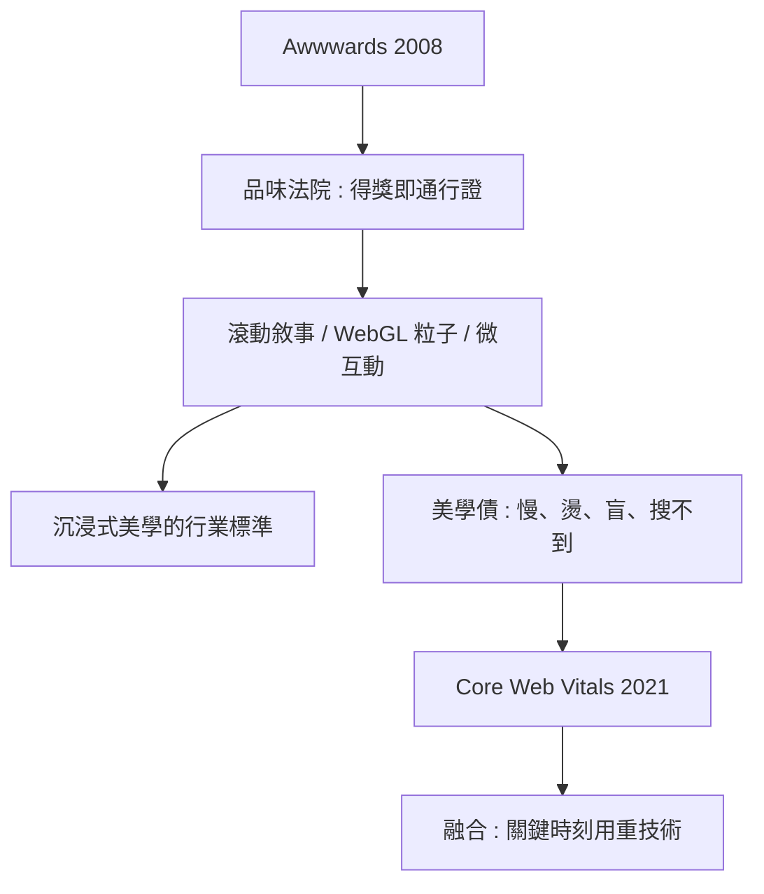

# Awwwards 與沉浸式美學復興：獲獎網站的技術解密

## 一個獎項的品味法院

2008 年，一家法國公司創辦了 Awwwards，一個專門評選「網站設計」的國際獎項。它做的事與 CSS 禪意花園時代不同：禪意花園證明了「HTML+CSS 能做多少」，Awwwards 則試圖回答「網頁的上限在哪裡」。

它的評選機制是有洞察力的：使用者投票（設計、可用性、創意、內容四項評分）與專家評審並行，最優作品取得「Site of the Day」，累積年度總榜。十幾年下來，它成為一種「品味法院」：得獎網站成為設計師作品的門面（portfolio 門票），取代了 Flash 時代的論壇朝聖。而 Awwwards 上獲獎作品的樣式潮流——大字排版、滾動敘事、3D 沉浸、微互動——反過來定義了整個設計行業的「前衛」標準。

## 沉浸式網站的技術配方

拆解一個 Awwwards 等級的沉浸式網站，幾乎都能找到同一組配方：

一、滾動敘事（scrollytelling）：把瀏覽器的滾動這一基本動作變成敘事的時間軸。使用者往下捲動，畫面展開劇情。眼動追蹤研究顯示，使用者的注意力與滾動位置高度相關——捲動本身就是網頁最強大的「動畫觸發器」。

二、WebGL 粒子與 shader 效果：數萬到百萬顆粒子受滑鼠、捲動、聲音驅動的即時變形，是 2018 到 2024 年最泛濫的視覺母題。實作上多用 Three.js 的 shader（GLSL 著色器）搭配 simplex noise。

三、流暢的頁面轉場：Page Transitions（頁面切換時的元素共享動畫），借助了路由層面的 Hack（barba.js 這類函式庫）或後來的原生 View Transitions API（Chrome 2022 開始支援）——五年前做頁面轉場要寫幾千行代碼，今天幾行 CSS。

四、精緻的微互動（micro-interaction）：游標自訂、磁吸按鈕、文字逐字浮現、hover 時的細膩回饋——這些每一處都在向使用者傳遞「這個作品被愛過」的訊息。

五、可變字型（variable fonts）與大字排版：字體本身成了動態元素，重量、寬度隨交互連續變化。

## 美學復興的經濟動機

沉浸式網站不是無償的藝術衝動，它有明確的商業帳本。第一，注意力經濟：在社群媒體時代，能讓使用者「在網站上停留更久」本身就是估值的一部分。第二，品牌溢價：汽車、時尚、酒類、遊戲等高溢價品牌，官網的功能不再是「告知」而是「造夢」——3D 沉浸式體驗被視為品牌資本的數位呈現。第三，人才市場的展示效應：Awwwards 得獎成為設計工作室獲取大客戶的通行證，整個產業投入沈沒成本去參賽。

但潮水的另一面同樣值得記下：轉化率與可及性。2020 年代中期，業界開始反思「WebGL 官網的美學債」——載入要 5 秒、手機燙手、螢幕閱讀器全盲、SEO 幾乎為零。一些獲獎網站動畫華麗但真正的「購買按鈕」要等 10 秒才出現。Google 的 Core Web Vitals（2021）把載入效能直接納入搜尋演算法，等於官方宣告「沈浸式不能犧牲可用性」。

新一代獲獎網站因此出現了一種融合的樣式：WebGL 用於關鍵的敘事時刻（首屏 hero），其餘部分回歸高效能的 HTML/CSS——「在最必要的時刻，用最重的技術」。這句話，也許最精確地總結了這場美學復興與它的前一代 Flash 黃金時代之間的鏡像關係：同樣是視覺野心，但這次不忘 SEO、不忘行動端、不忘睡眠中的手機處理器。

DFS3D 的渲染已經夢幻，頁面的切換已經絲滑，網頁的「呈現」似乎被推到了極致。但網頁的另一半——內容從哪裡來、部署到哪裡去——還在等一場自己的革命。下一章，我們看看 Headless CMS 與邊緣運算如何重塑「內容與部署」的版圖。
