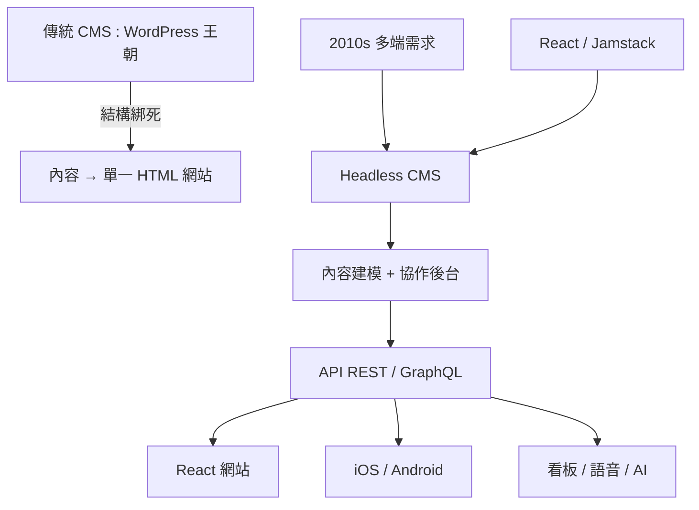

# Headless CMS：API 驅動的多端內容分發架構

## 內容管理的百年裂變

要理解 Headless CMS，得先回顧 CMS（內容管理系統）的王朝史。2000 年代，Drupal（2001）、WordPress（2003）、Joomla 相繼誕生，形成了 CMS 的「傳統王朝」：一個 PHP 套裝軟體，把資料庫、模板、後台編輯界面、前端渲染全部打包在一起。你買了一台「全功能印表機」：它統治了 2010 年代全球數億個網站，WordPress 至今仍供應著全球約四成的網站。

傳統 CMS 的架構有一個隱含假設：內容只有一個目的地——HTML 網頁。後台編輯的文章，最終被模板引擎渲染成頁面。這個假設在 2010 年代被三股力量擊碎：一、行動 App 與桌上應用的崛起，同一份內容要出現在網頁、iOS、Android、電子郵件、語音助理多個端點；二、前端框架的革命，React 工程師不願意被 PHP 模板綁手綁腳；三、Jamstack 思想（下一節詳談）的興起，主張把「內容、呈現、部署」三件事徹底拆開。

## 「無頭」的意思

Headless CMS 的「頭」（head）指的是渲染層、也就是前端的頁面展示把這個部分砍掉了。剩下的「無頭軀體」是一個純粹的內容服務：後台提供內容建模（content model —— 定義文章、產品、作者、分類的欄位結構）、提供編輯协作界面、提供資產（圖片、影片）管理；對外的出口是開放 API——REST 或 GraphQL——任何前端、任何裝置、任何語言都可以來取內容。

具代表意義的商業案例：Contentful（2013，德國柏林創立）、Sanity（2016）、Strapi（2015，開源）、Storyblok、Prismic，以及後來 WordPress 自身的轉型（推出 Rest API + Gutenberg 區塊編輯器，往 headless 路線靠攏）。

## 多端時代的内容法則

Headless CMS 的意義遠不只是「沒有模板」。它代表了數位內容工作流的一套新法則：

一、內容即資料：文章不再是一頁 HTML，而是一個遵循 schema 的結構化資料物件。「內容建模」成為一門新職業（content architect），設計師與資訊架構師的工作物件從「頁面」轉為「內容模型」。

二、一次創作、多端分發福利：同一份內容可以流到 React 網站、iOS App、Android App、智慧手錶、電子看板，甚至 AI 助理的知識庫。這是 2010 年代「全通路（omnichannel）」行銷的技術基礎。

三、-present 與 content 的職業分工重構：傳統上，網站公司要養一個 PHP 後端工程師；在 Jamstack 時代，後端的工作由「Headless CMS 的 SaaS 提供」取代——前端工程師不再需要自己寫後端，這直接改變了接案市場的技能需求。

四、權力關係的重分配：CMS 從「部署在你自己的主機上」變成了「訂閱制的 SaaS」——內容的所有權、可用性、資料隱私都與廠商绑定。這是 2010 年代 SaaS 最大的商業變革之一（同期的 Shopify 對電商、Salesforce 對 CRM 做了同樣的事）。

Headless CMS 解決了「內容在哪裡」的問題。但一個完整的網站還需要回答兩個問題：畫面怎麼生成（渲染策略），部署到哪裡（基礎設施）。這正是下一節的主題——靜態網站生成器、Vercel 與 Netlify、以及一場讓網頁載入達到毫秒級的邊緣運算革命。
