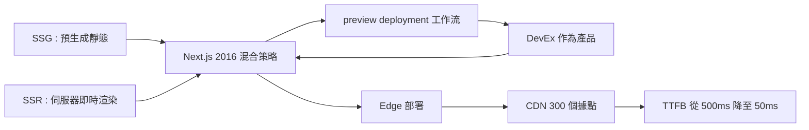

# SSG 與 SSR 混合架構：Vercel、Netlify 與邊緣部署革命

## 靜態網站的復活

2010 年代的後半，出現了一個看似倒退的趨勢：工程師們開始重新「預先生成 HTML」。在一個用戶訪問你的網站之前，就提前把 HTML 建置好，存成一堆靜態檔案，直接放在內容傳遞網路（CDN）上。使用者請求時，伺服器不用算任何東西——直接把預先準備好的檔案丟回去。

這就是靜態網站生成器（Static Site Generator，SSG）與 Jamstack 哲學的核心。 Jamstack 這個詞是 Mathias Biilmann（Netlify 執行長）在 2015 年促成的，原意是「JavaScript + APIs + Markup」——動態互動交給用戶端的 JavaScript，資料與內容交給 API（這裡 Headless CMS 就登場了），而頁面本身是預建好的靜態 Markup。

靜態路線的代表工具：Jekyll（2008，GitHub 上的部落格生成器）、Hugo（2013，Go 語言，極快）、Gatsby（2015，把 React 元件與 GraphQL 結合）、Astro（2021，主打零 JS 出廠）。

## React 框架的混合策略

但純靜態路線有致命弱點：資料要動態變化（登入、購物車、個人化推薦）時怎麼辦？React 界的新框架選擇了一條混合路線，代表人物是 Guillermo Rauch——2010 年代中期，他的 Node.js 伺服器渲染函式庫（Express 變種）成功讓 React 可以在伺服器上先渲染首頁（SSR，Server-Side Rendering）。

2016 年，Rauch 創立 Vercel（原名 Zeit），並推出 Next.js 框架。Next.js 的策略是一個操作的統一場：它同時支援 SSG（建置時生成靜態頁）、SSR（每次請求伺服器即時渲染）、ISR（增量靜態再生，每次銜接）、CSR（用戶端渲染）——工程師可以為每個頁面選擇合适策略。這幾乎是從 Mosaic 時代以來，網頁渲染思想的集大成。競品 Nuxt（Vue 生態，2016）與 SvelteKit（2020）採取了類似的混合策略。

## 邊緣計算革命：把地球縮小

SSG/SSR 解决了「生成策略」問題。但真正讓網頁達到「毫秒級」的，是部署架構的物理革命——邊緣運算（Edge Computing）。

傳統網站的部署是「集中式」的：你的伺服器在美國東部，亞洲的使用者每個請求要跨越太平洋，光是網路來回（roundtrip）就要 200 到 300 毫秒。CDN 解決了靜態檔案的物理距離問題，但動態渲染還是集中式的。

2010 年代末，Vercel 與 Cloudflare 意識到一件事：如果把「運算」也部署到邊緣（全世界幾百個資料中心）——那麼不只是檔案連算也離使用者近。技術上靠兩個突破：

一、V8 Isolate 與邊緣工作流程（Cloudflare Workers, 2017）：不用啟動整台伺服器，而是在 V8 引擎的隔離沙盒（isolate）裏跑一片 JavaScript 啟動時間幾毫秒，記憶體以 KB 計——這種輕量級的運算單元才能實現把「函數」複製到全世界幾百個資料中心。

二、邊緣渲染（Edge SSR）與邊緣資料：Next.js 的 Edge Runtime、Cloudflare Workers、以及后来 2023-2025 年間 Vercel/Cloudflare 的所謂「全球即時分布式資料庫」（Neon、Cloudflare D1）——資料不再是單點的，而是複製分佈在邊緣，讀取就近命中。

2020 年代的資料顯示：在邊緣架構下，一個動態頁面的「首次位元組時間」（TTFB）可以從傳統架構的 300 到 500 毫秒降到 20 到 50 毫秒。這個數字，是 1993 年一個頁面要下載 30 秒的比較天翻地覆——三十一年，載入速度提升了近千倍。

## 「公司級」的開發體驗（DevEx）

Vercel 與 Netlify 的商業成就還有一個非技術的理由：開發體驗（Developer Experience, DevEx）作為產品。你把 Git 儲存庫接上服務，從此每一次 git push 自動觸發建置、測試、部署；每個 Pull Request 自動生成一個臨時的線上預覽網址（preview deployment），讓設計師、PM、客戶可以直接點開連結查看實際效果。

這種工作流改變的不只是速度，而是組織的政治：設計師相信自己「可以直接改字」、產品經理「隨時可以看到預覽版」、工程師「可以有信心地 Run 部署」——網頁開發的協作摩擦被 SDK 化、體驗化。Netlify 的 Jamstack 哲學與 Vercel 的 Next.js 生態，本質上是在爭奪「前端部署的最佳實務」這個話語權——一場以開發者為選民的意識形態競賽。

渲染的哲學已經集大成，部署的物理已經達到光速下限。網頁技術的最後一塊拼圖，正在我們眼前拼上：當 AI 可以按下一句話就生成一整套前端，設計師的未來在哪裡？這是本書最後一個故事。
