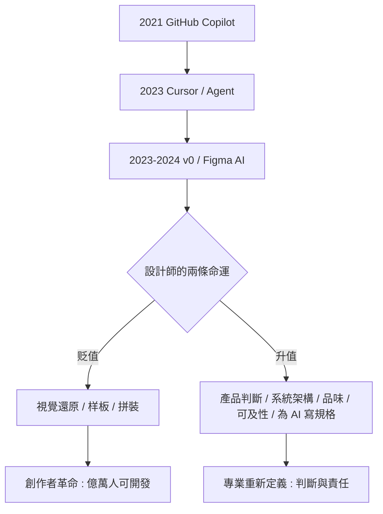

# 終極大哉問：v0、Cursor 與 AI 時代的人類設計師

## 從工具到合作者：AI 進入前端的三次浪潮

2020 年代的網頁設計史，被一件事徹底改寫：生成式 AI 開始直接作用於「網頁的產出物本身」。這段歷史可以分成三次浪潮。

第一浪（2021 到 2022）：代碼補全。GitHub Copilot（2021 年技術預覽，2022 年 6 月正式上市，底層是 OpenAI Codex）第一次讓程式開發中的「下一行」可以被預測生成。它像一個打字極快的見習生：你寫註解、它寫代碼。前端的样板代碼——React 元件骨架、Tailwind class 拼接、單元測試——被加速了數倍。

第二浪（2023 到 2024）：對話式開發。Cursor（Anysphere，2023 年上線）與各種 AI IDE 把模型塞進了編輯器核心，開發者的工作方式從「逐行寫」變成「下指令、審查、重試」。2024 到 2025 年間，「Agent 模式」出現：AI 可以自主讀取整個專案、修正錯誤、執行命令、完成多檔案的重構。

第三浪（2023 至今）：直接生成 UI。Vercel 的 v0（2023 年 3 月，根據一句提示生成完整的 React/Tailwind 介面並可立即部署）、Figma 的 AI 佈局工具（Figma AI, 2024）、以及 Framer 的 AI 頁面生成——「介面」第一次可以在「一行描述」與「可部署的產品」之間直接跳躍。設計師的 Photoshop 狀態、切圖、交付、手寫 CSS——這條 1990 年代延續至今的產業流水線，在三十年後被超高速壓縮。

## 誰在失業，誰在升值

AI 對前端職業的衝擊是不均勻的，值得記錄這張新的技能地圖。

正在贬值的部分：視覺还原（把設計稿切成頁面）、样板 CRUD 開發、簡單的元件拼裝、初級的網営、文案式 Landing Page 製作。這些工作 AI 的產出已經達到、「能賣出的」水準。

正在升值的部分：產品判斷力（知道該做「什麼」，不只是做得「像不像」）；系統與效能架構（AI 生成一個頁面容易，維護一個百萬人用的系統仍是人類地盤）；設計領導力（對品牌語言、多平台一致性的連貫判斷）；可及性与倫理（AI 生成的代碼不會替你思考視障使用者的權益）；以及——最有意思的一項——為 AI 寫規格（spec for AI）：把設計意圖轉譯成模型能理解的精確描述，已經成為 2025 年前後的新興核心技能。

本質上，這是網頁史上「抽象層抬高」的又一次重演：從手寫機器碼到高階語言，從手寫 CSS 到 Bootstrap，從命令式 DOM 到 React 宣告式——每一次，被抽象化的舊技能沒有消失，而是向「意圖描述與系統判斷」的上層轉移。AI 是迄今為止最強的一次抽象。

## 民主化的最終章 vs. 專業的重新定義

兩種敘事正在賽跑。第一種是「民主化的最終章」：過去三十年，做一個網站的門檻從懂工程（1990 年代）、懂設計工具（2000 年代）、懂框架（2010 年代），一路降到「一句話」（2020 年代）。世界上將有數十億人可以僅憑一個想法生成產品。這預示著一個史上最大的創作者革命。

第二種是「專業的重新定義」：當生成變得廉價，「選擇」與「品味」成為新的稀缺資源。當 AI 可以在一秒内產生一百個版本，辨別哪個「對」的能力——品牌語感的連貫、文化脈絡的細膩、可及性的責任、倫理的判斷——比任何時候都更值錢。歷史上已有一個前例：攝影術沒有殺死繪畫，而是逼迫繪畫放棄「像」的重擔，走向印象派與抽象。生成式 AI 没有殺死設計，而是逼迫設計師放棄「製作」的重擔，走向判斷、品味與責任。

2026 年的今天，這兩種敘事都還在進行中。本書無法給出結論——這正是網頁史的常態：每一代新技術誕生時，默哀與狂歡總是同時上演，而歷史的最終裁決，往往在十年後。

本書的故事，就停在這個沒有句號的句子前面。下一節（也是最後一節），我們回到五十六年的人類歷程，作一個總結的回望：當所有螢幕都在流動，網頁設計者究竟留下了什麼。
