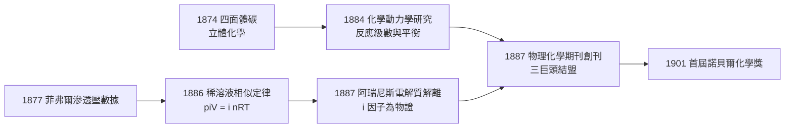

# 1901 · 凡特荷夫與物理化學

> 1901 諾貝爾化學獎：雅各布斯·亨里克斯·范托夫（Jacobus Henricus van 't Hoff，1852–1911，荷蘭）——表彰「化學動力學定律與溶液滲透壓定律的發現」。首屆諾貝爾化學獎。

## 懸案（案情提要）

十九世紀末，化學是一門「會做但不會算」的學科。有機化學家能把分子一個個接起來，但兩個問題懸而未決，像兩樁陳年懸案：

1. **親和力之謎**：化學反應憑什麼發生？為什麼有的反應快、有的慢、有的到一半就「停車」？「化學親和力」這個詞從貝托萊、柏濟力阿斯時代就開始流傳，卻始終沒有一個可以量測的定義。
2. **溶液之謎**：氣體有波以耳定律、查理定律，行為可以用 $PV = nRT$ 精確描述；但溶質溶進水裡之後，彷彿人間蒸發——既不占體積也不施壓力，鹽水為什麼會讓水面升高、讓凝固點下降？

同一時間還有一樁附案：1874 年一位 22 歲的荷蘭年輕人宣稱碳原子是**立體的四面體**，被德國化學界的大老柯爾貝（Hermann Kolbe）撰文痛罵「騎著獸醫學校的飛馬奔向化學的帕納索斯山」。立體化學是否只是空想？

偵辦這三案的核心人物，就是雅各布斯·亨里克斯·范托夫。

## 前因

| 年份 | 事件 |
| --- | --- |
| 1828 | 維勒（Wöhler）用氰酸銨合成尿素，有機化學告別活力論，化學開始要求定量規律。 |
| 1848 | 巴斯德（Pasteur）用鑷子分開酒石酸鈉銨的兩種晶體，發現旋光異構——但「分子為什麼有手性」無人能答。 |
| 1858 | 凱庫勒（Kekulé）與庫珀確立碳的四價鍵概念，結構式成為有機化學的通緝照片——只是平面照片。 |
| 1869 | 門得列夫發表週期表；化學開始相信背後有統一的秩序，而非一堆經驗規則。 |
| 1873 | 凡德瓦耳斯（van der Waals）完成氣液狀態方程，物理學的統計方法證明可以馴服分子。 |
| 1874 | 范托夫自費印行荷蘭文小冊子，提出**四面體碳原子**與不對稱碳；法國勒貝爾（Le Bel）同年獨立提出同樣想法。立體化學誕生，旋光懸案有了解剖圖。 |
| 1876 | 吉布斯（Gibbs）在美國發表《論非均相物質之平衡》，化學熱力學的寶藏埋在無人翻閱的期刊裡。 |
| 1877 | 植物學家菲弗爾（Pfeffer）測得植物細胞的滲透壓數據——這份「植物學」測量紀錄，後來成為本案的關鍵物證。 |
| 1884 | 范托夫出版《化學動力學研究》（*Études de dynamique chimique*），把熱力學第二定律引進化學平衡，並給出測定反應級數的方法。 |
| 1887 | 范托夫與奧斯特瓦德創辦《物理化學期刊》（*Zeitschrift für physikalische Chemie*），阿瑞尼斯隨即投稿電解質解離學說——三人在萊比錫結盟，新學科宣告建國。 |

## 調查

**第一條偵查線：滲透壓現場的重勘。**

范托夫注意到菲弗爾 1877 年的數據：蔗糖水溶液透過半透膜產生的滲透壓，竟然只跟濃度與溫度有關。他重新分析這些資料，發現一個驚人的相似性：

$$\pi V = nRT$$

其中 $\pi$ 是滲透壓、$V$ 是溶液體積、$n$ 是溶質莫耳數、$R$ 是**同一個**氣體常數、$T$ 是絕對溫度。稀溶液中的溶質，行為彷彿一種理想氣體：溶質分子「看不見」溶劑，各自施壓。

更精確的實測顯示，對許多物質（如蔗糖）$i = 1$，但對食鹽等電解質，表觀壓力總是偏大，於是引入校正因子：

$$\pi V = i\,nRT$$

這個**凡特荷夫因子** $i$ 對 $\mathrm{NaCl}$ 約為 2、對 $\mathrm{CaCl_2}$ 約為 3——食鹽在水裡彷彿變成了兩個、三個「分子」。這正是電解質解離學說最硬的物證：$i$ 不是誤差，是鹽在水中**自己拆開**的指紋。阿瑞尼斯 1887 年的解離學說因此從異端變成定論，$i$ 就是那張簽了名的供詞。

**第二條偵查線：反應速率的偵測器。**

《化學動力學研究》建立了動力學的標準作業程序：測濃度隨時間的變化、判定反應級數。對一級反應：

$$-\frac{d[\mathrm{A}]}{dt} = k[\mathrm{A}], \qquad [\mathrm{A}](t) = [\mathrm{A}]_0\, e^{-kt}$$

取對數得直線 $\ln[\mathrm{A}] = \ln[\mathrm{A}]_0 - kt$，斜率即速率常數 $k$。對二級反應 $-\frac{d[\mathrm{A}]}{dt} = k[\mathrm{A}]^2$，則 $\frac{1}{[\mathrm{A}]} - \frac{1}{[\mathrm{A}]_0} = kt$。數據落在哪一條直線上，反應的「作案手法」就現形——這是化學動力學第一次擁有自己的偵查術。

**第三條偵查線：溫度——把速率與平衡串成因果鏈。**

范托夫整理實驗數據時發現，平衡常數 $K$ 與速率常數 $k$ 都強烈依賴溫度。1889 年他為阿瑞尼斯的溫度公式提供了物理詮釋（活化能 $E_a$ 的概念）：

$$k = A\, e^{-E_a/RT}$$

$$\ln \frac{k_2}{k_1} = -\frac{E_a}{R}\left(\frac{1}{T_2} - \frac{1}{T_1}\right)$$

這條公式把「溫度升高反應變快」從廚房常識變成可測量活化能的定量工具。

## 理論裁決

法院對三案一併宣判，判決書的核心是兩組方程式。

**判決一：化學親和力的真身是吉布斯自由能，而 $K$ 是它的目擊證人。**

對反應 $a\mathrm{A} + b\mathrm{B} \rightleftharpoons c\mathrm{C} + d\mathrm{D}$，范托夫把平衡定義為淨速率為零，並確立：

$$\Delta G = \Delta G^\circ + RT \ln Q, \qquad \text{平衡時 } \Delta G = 0,\ \Delta G^\circ = -RT \ln K$$

「親和力」不再是一種神祕的力，而是 $-\Delta G$——可由平衡常數 $K$ 反推的量。

**判決二：溫度如何搬動平衡——凡特荷夫方程式。**

把 $\Delta G^\circ = \Delta H^\circ - T\Delta S^\circ$ 與 $\Delta G^\circ = -RT\ln K$ 聯立，對 $1/T$ 微分，得：

$$\frac{d\ln K}{dT} = \frac{\Delta H^\circ}{RT^2}$$

積分形式：

$$\ln \frac{K_2}{K_1} = -\frac{\Delta H^\circ}{R}\left(\frac{1}{T_2} - \frac{1}{T_1}\right)$$

$\Delta H^\circ < 0$（放熱反應）時升溫使 $K$ 變小、平衡回頭——這正是後來勒沙特列原理的數學化身。薩巴捷的氫化、哈伯的合成氨，日後都要靠這條方程式挑反應溫度。

**判決三：稀溶液與氣體同構。**

$$\pi = \frac{nRT}{V} = cRT$$

滲透壓、凝固點下降 $\Delta T_f = K_f m$、沸點上升 $\Delta T_b = K_b m$ 被統一在依數性（colligative properties）框架下，成為測定分子量的標準方法——高分子化學家施陶丁格 1920 年代證明大分子存在時，用的正是這套。

## 後果

| 領域 | 影響 |
| --- | --- |
| 學科建制 | 「物理化學」正式建國：1887 年創刊的《物理化學期刊》成為國際旗艦，阿瑞尼斯（1903）、奧斯特瓦德（1909）、能斯特（1920）沿著范托夫開出的道路連續得獎。 |
| 立體化學 | 四面體碳從被柯爾貝痛罵的空想，變成整個有機化學的骨架；勒沙特列之後的立體選擇性、1902 年起費歇爾的醣類立體化學，全都站在這份 1874 年的小冊子上。 |
| 工業 | 晚年轉任柏林普魯士科學院，研究斯塔斯富特（Stassfurt）鹽礦的結晶相平衡，直接支撐德國鉀肥與鹽業化學工業。 |
| 諾獎譜系 | 首獎得主選定物理化學家，等於為化學獎定調：化學不只是製備分子，更是可以計算的科學。這個基調延續到 1998 年（量子化學計算）與 2013 年（多尺度模擬）。 |
| 教科書 | $K$、$\Delta G$、反應級數、滲透壓公式寫進全世界化學系教材，沿用至今超過一世紀。 |

## 關聯

- [1903-阿瑞尼斯與離子解離疑案](1903-阿瑞尼斯與離子解離疑案.md)：$i$ 因子的物證由阿瑞尼斯的解離學說接手結案；阿瑞尼斯方程式 $k = A e^{-E_a/RT}$ 亦由本案先行鋪路。
- [1909-奧斯特瓦德與催化](1909-奧斯特瓦德與催化.md)：三巨頭同盟的第二人，把平衡與動力學工具轉成催化理論與硝酸工業。
- [1920-能斯特與熱力學第三定律](1920-能斯特與熱力學第三定律.md)：$\Delta G^\circ = -RT \ln K$ 的能斯特方程式版本、第三定律補齊了 $\Delta S$ 的絕對零點，完成本案的熱力學拼圖。
- [1912-格林納與薩巴捷](1912-格林納與薩巴捷.md)：薩巴捷的接觸催化氫化，正是用本案的平衡—溫度關係挑選操作條件的工程實踐。
- [1931-博施與貝吉烏斯](1931-博施與貝吉烏斯.md)：高壓化學——滲透壓與氣體相似性的下一步，是把化學平衡推進到數百大氣壓的戰場。
- [../物理學獎/1910-凡德瓦耳斯分子間作用力](../物理學獎/1910-凡德瓦耳斯分子間作用力.md)：同為「用物理統一化學」的荷蘭偵辦案件，狀態方程與稀溶液定律是姊妹篇。
