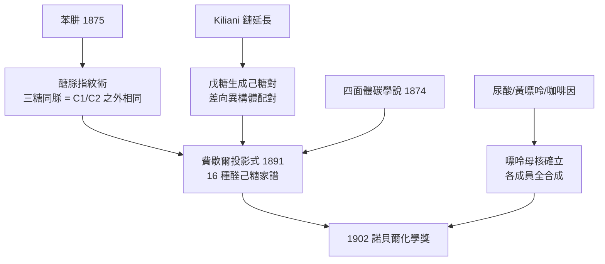

# 1902 · 費歇爾與醣類偵探學

> 1902 諾貝爾化學獎：赫爾曼·埃米爾·費歇爾（Hermann Emil Fischer，1852–1919，德國）——表彰「其在醣類與嘌呤合成上之非凡貢獻」。

## 懸案（案情提要）

1900 年前後，化學界手裡有一份最常見卻最陌生的物證：葡萄糖，化學式 $\mathrm{C_6H_{12}O_6}$。它無處不在——葡萄汁裡、血液裡、澱粉與纖維素裡——卻沒有人能回答三個基本問題：

1. **身份不明**：化學式相同的糖有好多種（葡萄糖、果糖、半乳糖、甘露糖……），它們到底差在哪裡？沒有指紋鑑定術。
2. **構型不明**：分子是直鏈還是環？五個不對稱碳能產生 $2^5 = 32$ 種立體異構體，哪一個才是葡萄糖？
3. **家族譜不明**：咖啡因、茶鹼、尿酸、鳥糞嘌呤——這批鹼性物質散落各處，看似雜姓，是否其實同宗？

德國化學家埃米爾·費歇爾接下了這樁雙重懸案——醣類與嘌呤——並且發明了一整套偵查方法，把「結構測定」從手藝變成可複製的程序。

## 前因

| 年份 | 事件 |
| --- | --- |
| 1848 | 巴斯德分離酒石酸兩種晶體，旋光性成為分子手性的第一個物證，但成因不明。 |
| 1852 | 費歇爾生於科隆附近的奧伊斯基興；父親本要他繼承家業，見他「不適合做生意」才放他讀化學。 |
| 1872–1874 | 入波恩大學，隨後跟隨拜耳（Adolf von Baeyer）至斯特拉斯堡，1874 年以酞顏料研究取得博士學位——本案偵辦人的師承就緒。 |
| 1874 | 凡特荷夫提出四面體碳與不對稱碳學說，立體化學有了理論武器（見 [1901-凡特荷夫與物理化學](1901-凡特荷夫與物理化學.md)）。 |
| 1875 | 費歇爾發現並命名**苯肼**（$\mathrm{C_6H_5NHNH_2}$）——日後醣類偵查的核心試劑，也是百年後火箭燃料偏二甲肼的親戚。 |
| 1885 | 基里安尼（Kiliani）發表氰化氫鏈延長法，把戊糖變己糖——醣類「加長一節」的技術問世。 |
| 1890 | 費歇爾發表〈葡萄糖之合成〉：從甘油出發手工搭出 D-$(+)$-葡萄糖，宣告糖可以由化學家從零製造。 |
| 1891 | 費歇爾投影式問世：用十字形平面圖編碼立體資訊，成為醣類的標準身分證格式。 |
| 1894 | 費歇爾提出酵素「鎖與鑰」學說——分子識別的概念先行於酵素化學。 |

## 調查

**偵查術一：苯肼指紋術（osazone 醣脎）。**

苯肼與還原糖的羰基作用，生成高度結晶、易於辨認的**醣脎**。標準計量反應：

$$\mathrm{C_6H_{12}O_6} + 3\,\mathrm{C_6H_5NHNH_2} \rightarrow \mathrm{C_6H_{10}O_4(NNHC_6H_5)_2} + \mathrm{C_6H_5NH_2} + \mathrm{NH_3} + \mathrm{H_2O}$$

關鍵證詞：葡萄糖、果糖、甘露糖三種「嫌疑人」生成**同一種**醣脎。這說明它們只有第 1、第 2 個碳的排布在反應中被抹平——三者僅在 C1、C2 附近不同，其餘骨架相同。一管結晶，同時鎖定三人並洗清其餘。

**偵查術二：鏈長手術（Kiliani–Fischer 合成）。**

把戊糖經 $\mathrm{HCN}$ 加成再水解還原，鏈長加一、產生兩個只差一個碳構型的差向異構體：

$$\mathrm{R{-}CHO} \xrightarrow{\mathrm{HCN}} \mathrm{R{-}CH(OH){-}CN} \xrightarrow{\mathrm{H_3O^+}} \mathrm{R{-}CH(OH){-}COOH} \xrightarrow{\mathrm{Na(Hg)}} \mathrm{R{-}CH(OH){-}CH_2OH}$$

每延長一節，嫌疑人數就翻倍；再逐一做成醣脎比對，就能把家譜一層層釘死。這是化學版的「親子鑑定」：由短鏈糖逐級生出長鏈糖，繪出整棵立體異構家族樹。

**偵查術三：費歇爾投影式與構型判決。**

把主鏈豎直、氧化端朝上，橫向鍵代表朝向觀察者、縱向鍵代表離開觀察者。葡萄糖 C2 至 C5 的 OH 位置寫成一排：

$$\mathrm{C2:\ 右,\quad C3:\ 左,\quad C4:\ 右,\quad C5:\ 右}$$

D-葡萄糖就此定案。不對稱碳有 $n$ 個，理論上就有 $2^n$ 個立體異構體：醛己糖 $n=4$，共 $2^4 = 16$ 種，費歇爾推導並合成了其中多種，逐一與天然糖對照——凡特荷夫的 $2^n$ 預言在醣類這塊案發現場被驗證得毫髮無傷，四面體碳學說正式結案（見 [1901-凡特荷夫與物理化學](1901-凡特荷夫與物理化學.md)）。

**第二現場：嘌呤家族的族譜整理。**

另一組嫌疑人——尿酸 $\mathrm{C_5H_4N_4O_3}$、黃嘌呤、咖啡因 $\mathrm{C_8H_{10}N_4O_2}$、可可鹼——被費歇爾逐一解剖，發現共用同一個母核：**嘌呤**（咪唑併嘧啶雙環）。1881–1899 年間他定出各成員結構、完成黃嘌呤與咖啡因的首度合成，並以母核嘌呤本身的合成收尾。散落的嫌疑人其實是同一個家族。

## 理論裁決

**判決一：立體異構計數律。** 不對稱碳數 $n$ 對應 $2^n$ 個立體異構體、$2^{n-1}$ 對鏡像對。醣類是這條定律的第一個大規模實證場；分子手性自此可以從結構式**預測**，不必等到合成後再測旋光。

**判決二：分子識別的幾何學（鎖與鑰）。** 費歇爾以 $\alpha$-與 $\beta$-甲基葡萄糖苷被同一酵素（苦杏仁酶）水解能力不同為據，主張酵素活性部位與基質有嚴格的幾何互補。用他的話說：酵素與基質必須「像鎖與鑰匙般契合」。這是超分子化學（見 [1987-克拉姆與超分子化學](1987-克拉姆與超分子化學.md)）與受體藥理學（見 [2012-萊夫科維茨與克比爾卡](2012-萊夫科維茨與GPCR.md)）最早的理論草圖。

**判決三：蛋白質是胜肽鏈。** 1899–1906 年間，費歇爾以氨基酸逐一縮合，合成甘胺醯甘胺酸等上百條胜肽，最長達 18 個殘基，並能通過蛋白質的所有標準檢驗（雙縮脲反應、蛋白酶水解）。裁決：蛋白質不是鬆散膠體，而是**氨基酸以醯胺鍵串成的確定序列**——這一紙判決書直接預告了桑格的胰島素定序（見 [1958-桑格與胰島素序列](1958-桑格與胰島素序列.md)）。

## 證物與數據

| 醣 | 碳數 | 天然形態 | 鑑定特徵 |
| --- | --- | --- | --- |
| D-葡萄糖 | 6 | 血液與葡萄中的主要單糖 | 與 D-甘露糖、D-果糖同脎（C3 以下構型全同） |
| D-果糖 | 6 | 蜂蜜、蔗糖的組分之一 | 酮糖但生成與葡萄糖相同的脎 |
| D-甘露糖 | 6 | 植物多醣水解產物 | C2 差向異構體（與葡萄糖只差一個碳的構型） |
| D-半乳糖 | 6 | 乳糖與瓊脂的組成 | 與葡萄糖差兩個碳的構型，脎亦不同 |
| L-阿拉伯糖 | 5 | 樹膠水解 | 鏈延長法的起始原料（戊糖→己糖對） |

嘌呤家族的合成序：黃嘌呤（1897）→ 咖啡因（1898 首度合成）→ 可可鹼 → 母核嘌呤本身（1899）。一族結構全部歸檔後，日後的腺嘌呤與鳥糞嘌呤（DNA 鹼基）只是同一棵樹上尚未定罪的兩個名字。

## 後果

| 領域 | 影響 |
| --- | --- |
| 醣類化學 | D/L 命名系統、投影式、醣脎鑑定成為百年標準；環狀半縮醛結構（哈沃思，1920s）與維生素 C 合成（1937 霍沃思）在其地基上起樓。 |
| 藥物工業 | 巴比妥酸衍生物研究結出鎮靜劑佛羅拿（巴比妥，1904 與梅林）——第一批現代安眠藥；嘌呤化學後來長出抗癌藥 6-巰基嘌呤一系。 |
| 生命科學 | 嘌呤母核日後被證明是 DNA/RNA 的鹼基（腺嘌呤、鳥糞嘌呤）——本案的族譜在 1953 年 DNA 雙螺旋與 1962 年結構解析中成為關鍵底圖。 |
| 酵素學 | 鎖鑰學說引導酵素特異性研究，直至 1946 年薩姆納結晶尿素酶、1965 年溶菌酶結構把「鑰匙孔」畫出來。 |
| 學界制度 | 1897 年倡議成立國際原子量委員會；柏林實驗室培養出奧托·迪爾斯（1950）、阿爾弗雷德·施托克等一代化學家。 |

## 關聯

- [1901-凡特荷夫與物理化學](1901-凡特荷夫與物理化學.md)：四面體碳學說是本案的理論前提，費歇爾的 16 種己糖是它的最大規模實證。
- [1905-拜耳與靛藍案](1905-拜耳與靛藍案.md)：費歇爾的博士導師；其靛藍研究中的吲哚化學正接在費歇爾 1886 年由苯肼縮合製吲哚的路徑上。
- [1946-薩姆納與酵素結晶](1946-薩姆納與酵素結晶.md)：鎖與鑰的「鎖」最終以蛋白質結晶的形式被扣押到案。
- [1958-桑格與胰島素序列](1958-桑格與胰島素序列.md)：費歇爾的胜肽合成證明蛋白質有確定序列，桑格則用層析讀出第一條完整序列。
- [1984-梅里菲爾德與固相合成](1984-梅里菲爾德與固相合成.md)：把費歇爾手工逐一縮合的胜肽工法搬上樹脂珠，自動化量產。
- [1930-漢斯費歇爾與血紅素](1930-漢斯費歇爾與血紅素.md)：另一位費歇爾（無親屬關係），同樣用「母核＋側鏈」的家譜法解剖葉綠素與血紅素——本案方法學的直系傳承。
