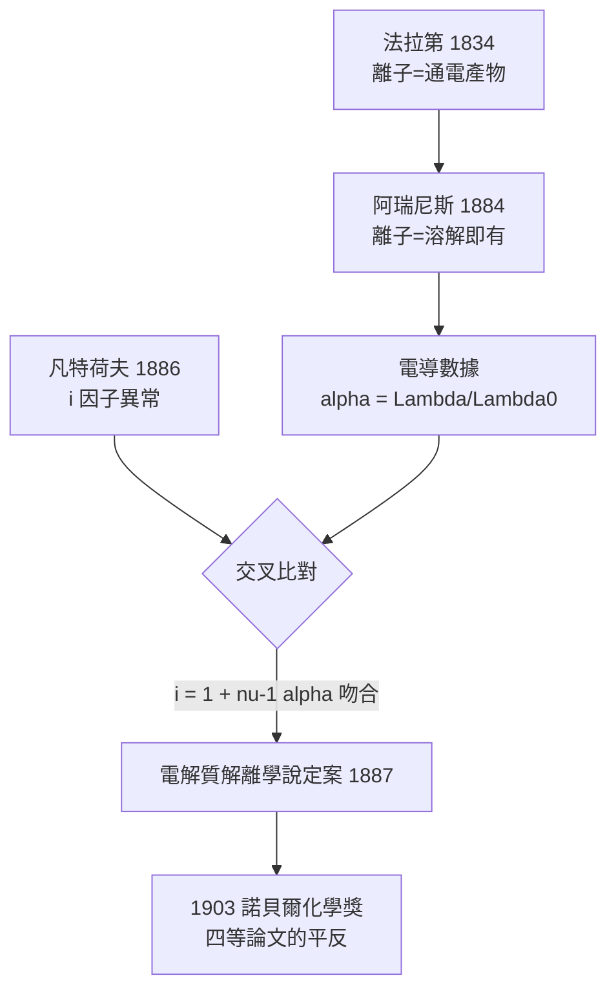

# 1903 · 阿瑞尼斯與離子解離疑案

> 1903 諾貝爾化學獎：斯凡特·奧古斯特·阿瑞尼斯（Svante August Arrhenius，1859–1927，瑞典）——表彰「電解質解離理論對化學進展之貢獻」。瑞典首位諾獎得主。

## 懸案（案情提要）

鹽溶於水為什麼會導電？這是十九世紀化學最古老的懸案之一。法拉第（Faraday）在 1830 年代確立了「離子」（ion）一詞，但他的定義是：離子是**通電之後**才產生的碎片——沒有電流，就沒有離子；電解是因，離子是果。

這套說法留下一個反常現象無人能辦：**為什麼不通電，鹽水自己就會導電？為什麼固體食鹽明明不導電，一溶進水裡導電率就爆表？**更弔詭的是凡特荷夫的滲透壓數據（見 [1901-凡特荷夫與物理化學](1901-凡特荷夫與物理化學.md)）：食鹽溶液的滲透壓比同濃度蔗糖溶液**高了近一倍**，彷彿一個氯化鈉「分子」在水中變成了兩個質點。

1884 年，一位 25 歲的瑞典研究生阿瑞尼斯提交了一篇 150 頁的博士論文，給出了一段石破天驚的證詞：鹽溶解時**根本不需要電流**，就會自己拆解成帶電的離子。烏普薩拉大學的教授們給了這篇論文四等分——勉強及格的分數。誰也沒想到，正是這篇論文替化學贏來了第三座諾貝爾獎。

## 前因

| 年份 | 事件 |
| --- | --- |
| 1800 | 伏打（Volta）電堆問世，尼科爾森與卡萊爾隨即電解水——電化學案發現場成立。 |
| 1833–1834 | 法拉第電解定律：析出量與電量成正比；「離子」一詞登場，但被設定為通電後的產物。 |
| 1857 | 克勞修斯（Clausius）提出電解質導電可能源自分子微弱的、部分可逆的解離——正確方向的第一縷線索，但無定量。 |
| 1884 | 阿瑞尼斯博士論文《電解質的電導研究》：56 條命題，核心是「溶液中恆有離子，不需外電流」。教授們評為四等；他把論文寄給克勞修斯、奧斯特瓦德、凡特荷夫，後兩者大為激賞，奧斯特瓦德甚至親赴烏普薩拉挖人。 |
| 1885 | 阿瑞尼斯獲瑞典科學院旅費，輾轉里加、萊比錫（奧斯特瓦德）、符茲堡（科爾勞施）、格拉茨（波茲曼）、阿姆斯特丹（凡特荷夫）——把歐洲物理化學三巨頭的實驗室走了一圈，結成同盟。 |
| 1886–1887 | 凡特荷夫公布稀溶液理論與 $i$ 因子異常；阿瑞尼斯 1887 年正式發表電解解離學說，宣稱 $i$ 之謎即「分子自行拆開」的直接證據。 |
| 1889 | 在萊比錫期間發表溫度—速率公式（阿瑞尼斯方程式），提出**活化能**概念——本案的副產品成為動力學百年基石。 |
| 1896 | 同一位阿瑞尼斯以物理化學方法計算大氣 $\mathrm{CO_2}$ 增加倍增的溫度效應，寫下人類第一份全球暖化定量預估——本案偵辦人的另一樁跨界懸案。 |

## 調查

**物證一：電導率的濃度奇譜。**

阿瑞尼斯彙整科爾勞施（Kohlrausch）等人的電導數據，發現電解質溶液的當量電導 $\Lambda$ 隨濃度稀釋而**增大**，極限值記為 $\Lambda_0$。若溶液中存在「已解離」與「未解離」兩種分子之間的平衡：

$$\mathrm{AB} \rightleftharpoons \mathrm{A^+} + \mathrm{B^-}$$

則電導應與解離分率成正比。他定義解離度 $\alpha$：

$$\alpha = \frac{\Lambda}{\Lambda_0}$$

以「弱電解質」醋酸為例：$0.001\,\mathrm{M}$ 時 $\alpha$ 約為 0.12，越稀越完全。這個可從電導**直接算出**的 $\alpha$，是本案的第一枚指紋。

**物證二：兩套獨立測量互相咬合。**

關鍵的交叉偵查在此：用電導算出的 $\alpha$，與用**凝固點下降**（依數性）算出的質點倍數 $i$，是否能對上？理論上：

$$i = 1 + ( \nu - 1)\,\alpha$$

其中 $\nu$ 是一個「分子」解離出的離子總數（$\mathrm{NaCl}$：$\nu = 2$；$\mathrm{CaCl_2}$：$\nu = 3$）。以 $\mathrm{NaCl}$ 稀溶液為例，若 $\alpha = 0.9$，則 $i = 1 + 0.9 = 1.9$——與凡特荷夫測得的 $i \approx 1.87$ 吻合。兩條完全獨立的偵查線（電學與熱學）指向同一結論：鹽在水裡**大部分已經拆開**。孤證不立，雙證定案。

**物證三：酸鹼的重新命名。**

阿瑞尼斯進一步裁定：酸是在水中釋放 $\mathrm{H^+}$ 的物質，鹼是釋放 $\mathrm{OH^-}$ 的物質；酸鹼中和的本質是：

$$\mathrm{H^+} + \mathrm{OH^-} \rightarrow \mathrm{H_2O}$$

「酸為什麼都相似」這樁老懸案，被還原成同一種離子的行為——酸鹼化學自此有了離子級的統一敘事。

## 理論裁決

**判決一：溶液反應是離子之間的反應。** 沉澱、中和、置換的「分子式反應」全是表象，真正發生的是：

$$\mathrm{Ag^+} + \mathrm{Cl^-} \rightarrow \mathrm{AgCl}\,\downarrow$$

反應速寫從此改以離子方程式書寫；平衡常數（溶度積 $K_{sp}$ 等）也以離子濃度定義。

**判決二：活化能與溫度律。** 1889 年，阿瑞尼斯解釋「為什麼加熱反應變快」：反應分子必須越過一道能量障壁。速率常數：

$$k = A\, e^{-E_a/RT}$$

取對數得 $\ln k = \ln A - \frac{E_a}{RT}$，以 $\ln k$ 對 $1/T$ 作圖得直線，斜率 $-E_a/R$。這條「阿瑞尼斯圖」至今仍是動力學分析的標準偵查程序；日後的化學反應速率理論（1930 年代 Eyring 過渡態理論 $k = \frac{k_B T}{h} e^{-\Delta G^\ddagger/RT}$）都是在為它補充微觀解釋。

**判決三（副案）：溫室效應的定量首審。** 1896 年阿瑞尼斯依朗萊的月球紅外觀測與斯特凡—波茲曼定律計算，得出「$\mathrm{CO_2}$ 幾何級數增加、溫度算術級數上升」的規則，今日寫成輻射強迫公式：

$$\Delta F = \alpha \ln\!\left(\frac{C}{C_0}\right), \qquad \alpha \approx 5.35\ \mathrm{W/m^2}$$

並預估 $\mathrm{CO_2}$ 倍增使地表升溫約 $4\,^\circ\mathrm{C}$——與現代氣候模型（IPCC 估計約 $2.5$–$4\,^\circ\mathrm{C}$，含回饋修正）的量級驚人地一致。物理化學第一次替行星體溫立案。

## 後果

| 領域 | 影響 |
| --- | --- |
| 電化學工業 | 電解煉鋁（1886 霍爾—埃魯法）、氯鹼工業、電鍍均以離子學說為理論地基；電動勢與電導測量成為工業分析標準。 |
| 溶液理論 | 1923 年德拜—許克爾強電解質理論修正了阿瑞尼斯對強電解質的「未完全解離」誤判（離子互吸效應），但「溶液中有自由離子」的核心判決屹立不搖（德拜 1936 年亦獲化學獎）。 |
| 酸鹼與分析化學 | 氫離子概念引出 pH、緩衝溶液、指示劑理論；醫學的酸鹼平衡、土壤化學、水處理全部受益。 |
| 動力學 | 活化能概念使催化劑可被定義為「降低 $E_a$ 的物質」——直通 1909 年奧斯特瓦德的催化獎與 1912 年薩巴捷的接觸催化。 |
| 氣候科學 | 1896 年計算被視為現代氣候變遷科學的起點；化石燃料排放改變大氣的警告，一百年後成為全球議程（可對照 [1995-克魯岑與臭氧層](1995-克魯岑與臭氧層.md) 的大氣化學後續）。 |
| 諾獎史話 | 阿瑞尼斯日後身兼物理獎委員與化學獎委員事實成員，大力推舉凡特荷夫、奧斯特瓦德、理查茲得獎——本案偵辦人同時是「偵探聯盟」的後勤總管。 |

## 關聯

- [1901-凡特荷夫與物理化學](1901-凡特荷夫與物理化學.md)：$i$ 因子異常是本案的案發現場；滲透壓數據與電導數據的咬合是決定性的雙重證據。
- [1909-奧斯特瓦德與催化](1909-奧斯特瓦德與催化.md)：第一個賞識阿瑞尼斯的人；把解離學說與活化能概念擴展成催化與平衡的通用理論。
- [1936-德拜與偶極矩](1936-德拜與偶極矩.md)：強電解質問題的「重審上訴」——離子互吸理論修正了原始判決的細節。
- [1995-克魯岑與臭氧層](1995-克魯岑與臭氧層.md)：阿瑞尼斯 1896 年開啟的大氣化學懸案，在平流層臭氧案中續審。
- [2019-鋰離子電池](2019-古迪納夫與鋰離子電池.md)：離子在電解液中遷移的化學，是本案判決一百年後最大規模的工程應用。
- [1904-拉姆齊與稀有氣體家族](1904-拉姆齊與稀有氣體家族.md)：同屆物理獎頒給瑞利與塞曼（塞曼效應），而稀有氣體的不活潑性恰是「不解離、不成離子」的極端對照。
