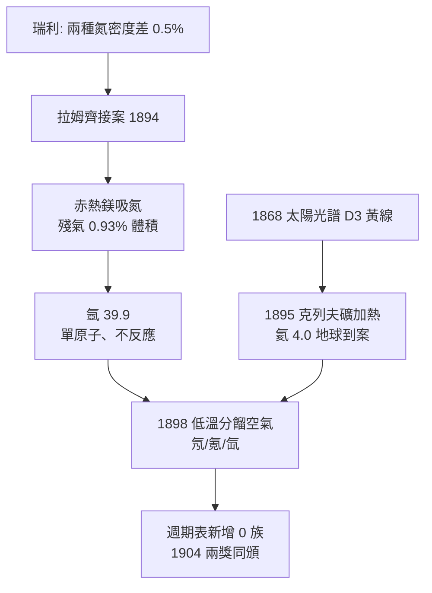

# 1904 · 拉姆齊與稀有氣體家族

> 1904 諾貝爾化學獎：威廉·拉姆齊（William Ramsay，1852–1916，英國蘇格蘭）——表彰「其發現空氣中惰性氣體元素之貢獻」。同年物理獎頒給瑞利勳爵，兩人因發現氬而分得兩座獎。

## 懸案（案情提要）

1894 年之前的教科書寫得斬釘截鐵：空氣由氮、氧、少量水汽與二氧化碳組成，成分清楚，案子已結。瑞利勳爵（Lord Rayleigh）在測氣體密度時，卻撞上 0.5% 的帳目不符：

- 用化學方法（氨分解等）「人工製造」的氮：密度 $\rho \approx 1.2505\ \mathrm{g/L}$；
- 把空氣除去氧、水汽、二氧化碳後剩下的「大氣氮」：$\rho \approx 1.2572\ \mathrm{g/L}$。

差了約千分之五——以瑞利的儀器與嚴謹，這絕非誤差。用瑞利自己的話說，這個差值「小到不值得注意，大到無法忽視」。空氣裡顯然藏著一個從未到案的共犯：它比氮重，而且**完全不肯發生化學反應**。

更懸的是第二案：1868 年天文學家在太陽光譜裡看到一條 $587.6\ \mathrm{nm}$ 的黃線，當時地球上任何元素都對不上號，被命名為「氦」（helium，太陽之意）。一種只存在於太陽的元素？化學家普遍當作光譜誤讀。兩樁懸案同時懸在化學的頭上。

拉姆齊接案。十年之內，他把整個化學界認定「完整」的空氣解剖出一整個元素家族，在週期表上憑空開出一縱行。

## 前因

| 年份 | 事件 |
| --- | --- |
| 1868 | 讓桑與洛克耶在日食光譜中發現 $\mathrm{D_3}$ 黃線（$587.6\ \mathrm{nm}$），提出太陽元素「氦」假說。 |
| 1869–1871 | 門得列夫與邁爾發表週期表，但表中並未預留惰性氣體的空位——嫌犯集團完全不在戶籍資料裡。 |
| 1876 | 拉姆齊以乙炔與氰化氫在鐵管爐中合成吡啶，完成首個雜環芳香族化合物的全合成——日後「無機物也能像有機物」信念的伏筆。 |
| 1882–1894 | 瑞利重測各常見氣體密度，為計算原子量建檔，意外撞出「兩種氮」的密度差。 |
| 1894-04-19 | 瑞利在皇家學會演講報告此異常；會後拉姆齊主動接案，兩人分工：瑞利追物理測量，拉姆齊追化學分離。 |
| 1894-08 | 拉姆齊以赤熱鎂吸收氮的方法，從大氣氮中分出約 100 毫升不反應氣體；光譜顯示陌生的紅、綠線組。命名「氬」（argon，希臘語「懶惰」）。 |
| 1895 | 拉姆齊聽聞希爾布蘭德報告鈾礦加熱放出惰性氣體，取得克列夫礦（cleveite）重做實驗，光譜中除氬線外赫然出現 $\mathrm{D_3}$ 黃線——太陽元素在地球落網。同年獲戴維獎章。 |

## 調查

**偵查一：密度差的重勘——分餾空氣。**

拉姆齊的推理：大氣氮較重，代表其中混有更重的未知氣體。他先用化學法「洗走」所有已知成分：

$$3\,\mathrm{Mg} + \mathrm{N_2} \xrightarrow{\Delta} \mathrm{Mg_3N_2}\ (\text{赤熱鎂吸氮})$$

再用赤熱氧化銅吸收氧、鹼液吸收二氧化碳。殘餘氣體約占大氣體積的 $0.93\%$，密度 $\rho \approx 1.78\ \mathrm{g/L}$——比氮重近一半。單原子分子假設（等熱比 $\gamma = c_p/c_v \approx 1.66$，由瑞利的音速實驗佐證）確立其原子量 $A_r \approx 39.9$：門得列夫表中氯（35.5）與鉀（39.1）之間正好有一個空位。

**偵查二：礦石裡的太陽元素。**

1895 年拉姆齊從 3 克克列夫礦（含鈾礦物）中加熱酸液收集氣體，分離出約 2 毫升。光譜比對：$\mathrm{D_3}$ 黃線、$447\,\mathrm{nm}$、$502\,\mathrm{nm}$——與 1868 年太陽光譜逐條吻合。氦，地球現行犯逮捕到案。地質學與化學在光譜線上完成了第一次跨域筆錄交換。

**偵查三：低溫蒸餾空氣——挖出整個家族。**

1898 年，拉姆齊與助理特拉弗斯（Morris Travers）引入林德（Linde）液化空氣技術：先把約 20 升氬原料富集，再以液態空氣冷卻、減壓分步蒸餾。蒸餾液逐段放光譜檢驗：

- **氪**（krypton，「隱藏」）：沸點較高段，綠、黃光譜線，$A_r \approx 83.8$，沸點 $-153\,^\circ\mathrm{C}$；
- **氖**（neon，「新的」）：低沸點段第一餾分，標誌性的橙紅光譜，$A_r \approx 20.2$，沸點 $-246\,^\circ\mathrm{C}$；
- **氙**（xenon，「陌生」）：更重餾分，藍光譜，$A_r \approx 131.3$，沸點 $-108\,^\circ\mathrm{C}$。

加上氦（4.0）與氬（39.9），五個元素依原子量排成一列，恰好插在鹵素與鹼金屬之間——週期表被迫增開一縱行。1910 年拉姆齊再與格雷分離並測得鐳射氣（氡）密度，家族到齊。

## 理論裁決

**判決一：原子價的飽和與「0 族」成立。** 惰性氣體的化學惰性，在 1904 年當時的解釋是：其原子價已被「填滿」。要等到 1916 年路易士八隅體學說（以及後來的量子力學殼層填充）才寫出完整判決書：

$$\mathrm{He}:\ 1s^2,\qquad \mathrm{Ne}:\ [\mathrm{He}]\,2s^2 2p^6,\qquad \mathrm{Ar}:\ [\mathrm{Ne}]\,3s^2 3p^6$$

閉殼層結構使失去或獲得電子都須付出巨大能量（游離能極高、電子親和能近零），故不形成化合物。拉姆齊用實驗逼出來的空位，成為原子結構理論最硬的約束條件——稀有氣體的「不動」，反過來解釋了其他所有元素的「愛動」。

**判決二：光譜即指紋。** 本案確立了「元素鑑定以光譜線系為準」的程序正義：樣本量不必以克計，氣體放電管＋稜鏡即可。這套方法後來直接哺育了原子光譜學——1913 年玻爾以氫光譜定出電子能階（見 [../物理學獎/1922-波耳與原子結構](../物理學獎/1922-波耳與原子結構.md)），其經驗基礎正是本案鋪設的光譜鑑識術。

**判決三：稀有氣體不是絕對惰性。** 拉姆齊曾斷言它們永不化合。1962 年巴特萊特以 $\mathrm{PtF_6}$ 氧化 $\mathrm{O_2}$ 的游離能相近原理，合成 $\mathrm{Xe^+[PtF_6]^-}$，證明氙在極強氧化劑下可以成鍵——「惰性」被判為程度問題而非絕對禁令，原判決書加註但未推翻。

## 證物與數據

| 元素 | 發現年 | 原子量 | 沸點 | 光譜特徵 | 主要發現者 |
| --- | --- | --- | --- | --- | --- |
| 氦 He | 1868 太陽／1895 地球 | 4.0 | $-269\,^\circ\mathrm{C}$ | $\mathrm{D_3}$ 黃線 $587.6\ \mathrm{nm}$ | 讓桑、洛克耶；拉姆齊 |
| 氖 Ne | 1898 | 20.2 | $-246\,^\circ\mathrm{C}$ | 橙紅光譜（今日霓虹燈色） | 拉姆齊與特拉弗斯 |
| 氬 Ar | 1894 | 39.9 | $-186\,^\circ\mathrm{C}$ | 紅、綠線組 | 瑞利與拉姆齊 |
| 氪 Kr | 1898 | 83.8 | $-153\,^\circ\mathrm{C}$ | 綠、黃線組 | 拉姆齊與特拉弗斯 |
| 氙 Xe | 1898 | 131.3 | $-108\,^\circ\mathrm{C}$ | 藍線組 | 拉姆齊與特拉弗斯 |
| 氡 Rn | 1900 射氣／1910 測密度 | 222 | $-62\,^\circ\mathrm{C}$ | （放射性） | 多恩；拉姆齊與格雷 |

空氣體積組成（當時測定）：氮 $78.1\%$、氧 $20.9\%$、氬 $0.93\%$、稀有氣體總計約 $1\%$——被化學界忽略了一百年的百分之一。

## 後果

| 領域 | 影響 |
| --- | --- |
| 週期表 | 0 族（第 18 族）成立，門得列夫體系的唯一一次「增行」；原子序概念（莫斯萊，1913）確認氬-鉀排序的反常為真。 |
| 照明工業 | 氖氣放電管（1910 年起巴黎車展霓虹燈）、氬氣保護焊接與白熾燈填充氣、氪/氙高強度燈——整個氣體照明產業自本案餾分瓶中誕生。 |
| 低溫物理 | 分餾液化技術累積的低溫工藝，直通 1908 年昂內斯液化氦、1911 年發現超導（見 [../物理學獎/1913-昂內斯與超導](../物理學獎/1913-昂內斯與超導.md)）。 |
| 放射化學 | 1910 年氡的密度測定把放射與化學接軌；氦在鈾礦中的來源（$\alpha$ 粒子即氦核）成為盧瑟福蛻變理論的物證（見 [1908-盧瑟福與元素蛻變](1908-盧瑟福與元素蛻變.md)）。 |
| 同位素前身 | 氬（39.9）與鉀（39.1）、鈣（40.1）的原子量交錯，是「原子量排序並非絕對」的第一批反常，為 1921 年索迪同位素學說埋線（見 [1921-索迪與同位素](1921-索迪與同位素.md)）。 |
| 教學史話 | 拉姆齊的學生海羅夫斯基日後發明極譜法獲 1959 年化學獎；而拉姆齊晚年為「海水提金」公司背書的失敗投資，則成為偵辦人自己也會辦錯案的著名註腳。 |

## 關聯

- [1908-盧瑟福與元素蛻變](1908-盧瑟福與元素蛻變.md)：$\alpha$ 粒子被證實即氦核——本案「礦石中的氦」成為放射蛻變理論的關鍵證據。
- [1911-居里夫人與0.1克鐳](1911-居里夫人與0.1克鐳.md)：鐳的射氣（氡）屬於拉姆齊家族；拉姆齊晚年亦投身放射性研究，兩案共享同一批氣體物證。
- [1921-索迪與同位素](1921-索迪與同位素.md)：氬-鉀原子量反常由同位素理論終審平反。
- [1959-海羅夫斯基與極譜](1959-海羅夫斯基與極譜.md)：拉姆齊門下的電化學血脈。
- [../物理學獎/1913-昂內斯與超導](../物理學獎/1913-昂內斯與超導.md)：稀有氣體分餾的低溫技術，是液化氦與超導發現的工程台階。
- [../物理學獎/1904-瑞利與氬的密度差](../物理學獎/1904-瑞利與氬的密度差.md)：同一懸案的物理分卷——瑞利以密度與音速測量立案，與拉姆齊的化學分離互為對照。
