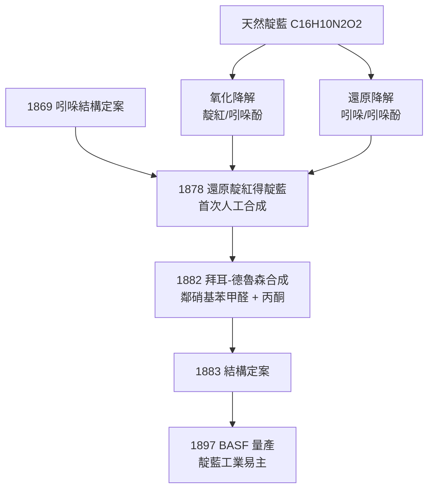

# 1905 · 拜耳與靛藍案

> 1905 諾貝爾化學獎：阿道夫·馮·拜耳（Adolf von Baeyer，本名 Johann Friedrich Wilhelm Adolf von Baeyer，1835–1917，德國）——表彰「其在有機染料與氫化芳香族化合物之研究對有機化學與化學工業的推進」。

## 懸案（案情提要）

靛藍（indigo）是史上最古老的商品之一：四千年前埃及木乃伊裹布、印度出口英倫的藍染布、普魯士軍服，用的都是同一種分子——$\mathrm{C_{16}H_{10}N_2O_2}$。十九世紀末，靛藍產業是印度的經濟支柱，德國的染料公司每年從南亞進口數以千噸計的天然靛藍草。

懸案在於：**這種藍色分子的結構是什麼？能不能用煤焦油裡的苯在實驗室造出來？**

這不只是學術問題。1870 年代煤焦油染料工業（苯胺紫、茜素）已經證明：誰能解開天然染料的結構並合成之，誰就能接管一個產業。茜素已在 1869 年被德英兩國同時合成、重創天然茜草市場；下一個標的，就是那個十三歲男孩用兩枚泰勒買下第一塊樣品的藍色分子。懸而未決的還有一個理論副案：五元、六元碳環為何安穩，三元、四元環卻易爆易變？**環的幾何與「張力」**尚無人能定量。

## 前因

| 年份 | 事件 |
| --- | --- |
| 1835 | 拜耳生於柏林，父親是大地測量學家；十三歲生日那天買下兩泰勒的靛藍開始實驗——本案自童年立卷。 |
| 1856 | 珀金（Perkin）意外合成苯胺紫（mauveine），煤焦油染料工業開張。 |
| 1858 | 拜耳以二甲基胂氯化物研究取得博士學位，師承本生與凱庫勒，並隨凱庫勒赴根特——結構化學的正統訓練。 |
| 1864 | 拜耳發現巴比妥酸（barbituric acid）——日後鎮靜劑巴比妥類的母核；此名一說源自其當日所去酒館「Barbärchen」。 |
| 1869 | 拜耳提出吲哚的正確結構式並完成首次合成——靛藍分子的半張通緝照已經到手。 |
| 1869 | 格雷貝與利伯曼（皆拜耳門生）在 BASF 支持下合成茜素，天然茜草產業崩潰——「合成取代天然」的判例既立，靛藍成為下一案。 |
| 1875 | 拜耳接替李比希執掌慕尼黑大學化學講座，成立染料研究所，靛藍攻堅戰全面開始。 |
| 1897 | BASF 與赫希斯特以黑尼曼（Heumann）路線量產合成靛藍，數年內席捲全球市場——本案的工業結案陳詞。 |

## 調查

**偵查一：拆解——把藍色分子一節節削下來。**

拜耳的策略是系統性降解：用強鹼熔融、氧化、還原，把靛藍拆成可以辨認的碎片。他發現靛藍經氧化降解產生靛紅（isatin，$\mathrm{C_8H_5NO_2}$）與松脂吲哚（oxindole）；經還原產生吲哚酚（indoxyl）。碎片指向一個核心事實：靛藍是**兩個吲哚酚單元**的組合。1869 年已定案的吲哚結構，成為拼圖的兩個邊框。

**偵查二：逆組裝——從碎片重組藍色。**

1878 年拜耳以磷與氫碘酸還原靛紅，第一次「人工」造出靛藍；1880 年完成完整的結構判定；1882 年與德魯森（Drewsen）發表最經典的實驗室路線——拜耳—德魯森合成：鄰硝基苯甲醛與丙酮在稀鹼中縮合，一步成環、一步脫水：

$$2\,\mathrm{o{-}O_2N{-}C_6H_4{-}CHO} + 2\,(\mathrm{CH_3})_2\mathrm{CO} \xrightarrow{\mathrm{OH^-}} \mathrm{C_{16}H_{10}N_2O_2}\ (\text{靛藍}) + 2\,\mathrm{H_2O}$$

中間體先經羥醛縮合成鄰硝基苯亞甲基丙酮，再還原關環為吲哚酚、二聚氧化為靛藍。一管藍色沉澱，同時證明了結構與可合成性——偵查與重演在同一個燒瓶裡完成。

**偵查三：氫化芳香族與張力理論——為什麼有的環會「爆」。**

靛藍案之外，拜耳同時審理脂環族副案。1885 年他提出**拜耳張力學說**：環烷烴的碳—碳鍵角若偏離正四面體角 $109.5^\circ$，分子內就積蓄「張力」，偏離越大越不穩定。以內角 $\alpha$ 表述：

$$\text{每鍵偏離角} = \frac{1}{2}\left(109.5^\circ - \alpha\right)$$

三元環（$\alpha = 60^\circ$）每鍵偏離 $24.75^\circ$，故環丙烷極不安穩；六元環（$\alpha = 120^\circ$）偏離 $5.25^\circ$，且可用船式／椅式構象近似四方角，故最安定。學說在三元到六元環區間與實驗高度吻合（日後薩克斯—莫爾 Mohr 理論以非平面椅式修正了大環部分，但「張力決定穩定性」的判決原則沿用至今，並在 1969 年構象分析獎中續審）。

## 理論裁決

**判決一：靛藍結構。** 拜耳裁定靛藍為兩個吲哚酚單元經中央 $\mathrm{C=C}$ 雙鍵反式相連的二聚體——今日寫成：$\mathrm{(C_6H_4)(NH)(CO){-}C{=}C{-}(CO)(NH)(C_6H_4)}$。藍色的來源是其共軛 $\pi$ 系統跨越兩個苯環與中央雙鍵，吸收帶落在可見光橙黃區（$\lambda_{\max} \approx 610\ \mathrm{nm}$ 反射呈藍）；不溶於水的性質源自分子間多重氫鍵，這也解釋了為何染缸必須先以鹼還原成可溶的「靛白」（吲哚酚鹽）再氧化上色：

$$\mathrm{C_{16}H_{10}N_2O_2} + 2\,e^- + 2\,\mathrm{OH^-} \rightarrow 2\,\mathrm{C_8H_6NO^-} + \mathrm{H_2O}$$

**判決二：合成取代天然的路線圖。** 黑尼曼 1890 年提出的工業路線以苯胺為起點：$\mathrm{N}$-苯基甘胺酸鹼熔成吲哚酚，氧化二聚成靛藍。1897 年 BASF 量產當年即 600 噸，1900 年超過 6000 噸；印度靛藍種植業十年內崩潰。化學第一次以全合成方式接管一個全球農業產業。

**判決三：脂環張力理論。** 環的穩定性由鍵角偏離定量決定，這是有機化學第一個「幾何決定性質」的理論模型，也使拜耳的環狀化合物命名法（拜耳命名法）成為今日 IUPAC 脂環命名的前身。

## 證物與數據

張力學說的預測與實測對照（拜耳 1885 年的原始計算）：

| 環 | 內角 $\alpha$ | 每鍵偏離 | 預測穩定性 | 實測結論 |
| --- | --- | --- | --- | --- |
| 環丙烷 | $60^\circ$ | $24.75^\circ$ | 極不穩定 | 確認：易開環、易加成 |
| 環丁烷 | $90^\circ$ | $9.75^\circ$ | 不穩定 | 確認：可開環但較緩 |
| 環戊烷 | $108^\circ$ | $0.75^\circ$ | 極穩定 | 幾乎吻合（實際因非平面構象而有張力） |
| 環己烷 | $120^\circ$ | $5.25^\circ$ | 穩定 | 確認：椅式完全抵消角張力 |

靛藍的工業帳目：1897 年 BASF 產量約 600 噸，1900 年逾 6,000 噸；同期印度靛藍出口縮減至原先的一小部分。染料化學史上第一次，「實驗室的合成路線圖」直接改寫了跨國貿易的流向。

## 後果

| 領域 | 影響 |
| --- | --- |
| 染料工業 | 靛藍成為德國化學工業的皇冠商品；BASF 靠本案利潤擴建，直通 1913 年合成氨的資本後盾（見 [1918-哈伯與合成氨](1918-哈伯與合成氨.md)）。 |
| 經濟史 | 印度比哈爾的靛藍種植經濟崩解，是世界貿易史上「科學合成取代農業原料」的首例，也被視為殖民經濟轉型的標誌事件。 |
| 教學與命名 | 酚酞（1871）、螢光素（1871）成為分析化學指示劑與螢光化學的百年標配；螢光素一系直通 2008 年 GFP 獎的螢光蛋白化學。 |
| 醫藥 | 巴比妥酸母核經費歇爾與梅林發展為佛羅拿（1904）——首類合成鎮靜劑。 |
| 理論化學 | 張力學說開啟構象化學譜系：1915 年後薩克斯—莫爾修正、1969 年巴頓—哈塞爾構象分析、1994 年碳正離子與非經典結構之辯皆在此案卷宗上追加註記。 |
| 師承網 | 拜耳門下的費歇爾（1902）、格雷貝、利伯曼與日後的慕尼黑講座傳承，構成德國有機化學學派的骨幹網。 |

## 關聯

- [1902-費歇爾與醣類偵探學](1902-費歇爾與醣類偵探學.md)：拜耳的博士生；其苯肼化學與拜耳的吲哚合成共用同一批含氮試劑譜系。
- [1918-哈伯與合成氨](1918-哈伯與合成氨.md)：靛藍利潤養大的 BASF，正是把哈伯法推上工業線的公司——染料案與肥料案共享同一個金主。
- [1969-巴頓與構象分析](1969-巴頓與構象分析.md)：張力學說的三維化續篇——環己烷的椅式構象最終審結了拜耳未竟的大環問題。
- [1906-莫瓦桑與氟的二十年追捕](1906-莫瓦桑與氟的二十年追捕.md)：同屆競爭者的電爐高溫化學，與拜耳的染料化學同屬「把極端條件變成常規手段」的時代浪潮。
- [2008-下村脩與GFP](2008-下村脩與GFP.md)：拜耳的螢光素是第一個人工螢光分子；GFP 則把「發光」寫進活細胞的基因組。
- [1930-漢斯費歇爾與血紅素](1930-漢斯費歇爾與血紅素.md)：同屬慕尼黑學派的大分子色素結構案，方法論上直接繼承拜耳的「降解—重組」雙向偵查術。
