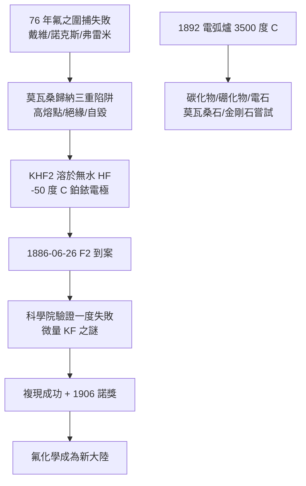

# 1906 · 莫瓦桑與氟的二十年追捕

> 1906 諾貝爾化學獎：亨利·莫瓦桑（Henri Moissan，本名 Ferdinand Frédéric Henri Moissan，1852–1907，法國）——表彰「對氟之單質的分離，及以電爐命名之莫瓦桑電爐開展的研究」。得獎數月後病逝。

## 懸案（案情提要）

週期表第七族（鹵素）的通緝名單上，氯、溴、碘都已歸案，唯獨最頭號的嫌犯——氟——逍遙法外七十六年。

氟的化合物（螢石 $\mathrm{CaF_2}$、冰晶石）早就人盡皆知；但要把氟從它的化合物裡「解放」出來，竟讓化學界折損了幾代人：戴維（Davy）電解失敗、諾克斯兄弟（Knox brothers）中毒、蓋呂薩克與泰納爾吸入氫氟酸幾乎喪命、弗雷米（Frémy）反覆功敗垂成——「氟的墓地」成了化學史的黑色傳說。理由後來清楚：$\mathrm{F_2}$ 的鍵能異常低（$158\ \mathrm{kJ/mol}$）、氟的電負度全表最高（4.0），一經產生立刻攻擊周圍一切，連實驗容器也在劫難逃。

副案同樣棘手：炭在什麼條件下能熔？碳的熔點高得超越一切坩堝的承受極限——要研究高熔點金屬與礦物，化學家需要一種**沒有溫度上限的爐子**。兩案由同一個人偵辦：藥師出身的巴黎化學家莫瓦桑。

## 前因

| 年份 | 事件 |
| --- | --- |
| 1769–1810 | 舍勒、戴維、安培等逐步確認「氫氟酸」中有一種未知元素；安培為之命名 fluorine，始終無人分離成功。 |
| 1813 | 戴維以電解嘗試拆解氫氟酸失敗——「氟墓地」的第一塊墓碑。 |
| 1836 | 諾克斯兄弟以氯與氟化銀反應企圖置換氟，雙雙中毒重傷；此後數十年實驗者中毒、致殘、致死案例持續。 |
| 1860s | 弗雷米（Edmond Frémy）以電解熔融氟化鈣、氟化鉀多番嘗試：電極被腐蝕、氣體一出現就被吞回——正確路線已有雛形，工具尚差一步。 |
| 1872 | 莫瓦桑入弗雷米實驗室做學徒，親眼見證氟攻堅的連續挫敗——未來的偵辦人在案發現場受訓。 |
| 1874 | 與德赫蘭（Dehérain）合作發表首篇論文（植物對 $\mathrm{CO_2}$ 與氧的代謝），隨後轉向無機化學。 |
| 1880 | 以氰及其反應之研究取得博士學位，師承德布雷（Debray）。 |
| 1880s | 借用弗雷德爾（Friedel）實驗室的 90 只本生電池，展開氟的電解圍捕。 |
| 1892 | 莫瓦桑電弧爐定型，開啟超高溫化學；1893 年起研究隕石碎片，發現碳化矽。 |

## 調查

**偵查一：為什麼前人全軍覆沒——反常的排除法。**

莫瓦桑整理前案卷宗，歸納出三重陷阱：其一，氟化物熔點太高（$\mathrm{CaF_2}$ 熔點 $1418\,^\circ\mathrm{C}$，熔融時已腐蝕一切）；其二，氫氟酸不含水時**不導電**，含水的話則電解出氧而得不到氟；其三，氟一旦產生，立即與電極、與容器、與自身裂解的產物反應。結論：需要一種**導電、低溫、鈍性**的三合一系統。

**偵查二：$\mathrm{KHF_2}$–$\mathrm{HF}$ 混合物的破案瞬間。**

解方是配方而非蠻力：把氟氫酸鉀 $\mathrm{KHF_2}$ 溶於**無水**液態氫氟酸中。$\mathrm{KHF_2}$ 電離供應載流子（$\mathrm{K^+}$ 與 $\mathrm{HF_2^-}$），使絕緣的 $\mathrm{HF}$ 變成導體；溫度壓到 $-50\,^\circ\mathrm{C}$ 大幅壓制氟的反應性。電解池以鉑銥合金電極、鉑質槽體（氫氟酸對鈍化後的鉑近乎免疫）：

$$2\,\mathrm{HF} \xrightarrow{\text{電解}} \mathrm{H_2}\ (\text{陰極}) + \mathrm{F_2}\ (\text{陽極})$$

1886 年 6 月 26 日，陽極冒出一股淡黃綠色氣體，能點燃矽、與水猛烈反應放出氧——氟現行犯逮捕到案。莫瓦桑觀察到 $\mathrm{F_2}$ 呈淡黃色的記錄（1892）成為本案的目擊證詞。

**偵查三：複現審查——差一撮鹽的驚魂。**

法國科學院派出貝特洛、德布雷、弗雷米三人驗證委員會到場，莫瓦桑卻**當場複現失敗**——原來上一批試劑含有微量氟化鉀雜質，純化的 $\mathrm{HF}$ 反而不導電。補回 $\mathrm{KF}$（即回到 $\mathrm{KHF_2}$ 系統）後連續成功。這次「差一撮鹽」的驚魂成為實驗史的名場面：痕量雜質可以是致命誤差，也可以是必要觸媒。科學院隨即頒發一萬法郎獎金。

**偵查四：電弧爐——沒有上限的爐子。**

1892 年莫瓦桑以垂直碳電極電弧爐達到約 $3500\,^\circ\mathrm{C}$，史上第一次把白金、金剛石級的溫度變成常規儀器。用它他系統地合成了碳化鈣、碳化矽、各種碳化物與硼化物，並從亞利桑那隕石坑隕鐵中鑑出微小碳化矽晶體（1905 年命名為 moissanite——莫瓦桑石，今日珠寶市場的鑽石替身）。他還宣稱以電爐＋水壓從石墨造出微小金剛石：此說日後備受質疑，較可信的解釋是樣品遭到碳化矽等污染——本案的工業分卷至今仍有餘訟（真正的可控金剛石合成要到 1954 年奇異公司的超高壓裝置）。

## 理論裁決

**判決一：電解熱力學的下限審查。** 為什麼氟只能用電解而不能用化學置換？以標準電極電位裁定：$\mathrm{F_2/F^-}$ 的還原電位高達 $E^\circ = +2.87\ \mathrm{V}$，是全表最強的氧化對；任何化學氧化劑若能奪走 $\mathrm{F^-}$ 的電子，自己必然先與氟反應——化學法在熱力學上被關死，只剩「直接通電從外部注入電子能」一途。今日工業製氟仍沿用莫瓦桑法（現代以碳電極、$\mathrm{KF}\cdot 2\mathrm{HF}$ 熔鹽於 $70\,^\circ\mathrm{C}$ 運轉），判決書百年未改。

**判決二：低溫策略的動力學邏輯。** $-50\,^\circ\mathrm{C}$ 的選擇符合阿瑞尼斯定律（見 [1903-阿瑞尼斯與離子解離疑案](1903-阿瑞尼斯與離子解離疑案.md)）：氟與電極的反應速率 $k = A e^{-E_a/RT}$，溫度每降 $10\ \mathrm{K}$ 速率約減半——產物存活到被收集的時間窗就是這樣用溫度硬擠出來的。

**判決三：高溫化學的新疆域。** 電弧爐證明「溫度也是一種試劑」：$\mathrm{CaCO_3}$ 之外的碳化物、硼化物、氮化物家族在高溫下逐一現形。碳化鈣 $\mathrm{CaC_2}$ 遇水放出乙炔：

$$\mathrm{CaC_2} + 2\,\mathrm{H_2O} \rightarrow \mathrm{C_2H_2} + \mathrm{Ca(OH)_2}$$

乙炔化學（焊接、合成橡膠與乙烯系原料）由此起飛。

**副案裁決：金剛石案部分懸而未決。** 金剛石—石墨轉變需數萬大氣壓（日後由碳的相圖定量），莫瓦桑當年的冷卻收縮假說不足以達成；但其「以人工條件逼近地質過程」的想法，為半世紀後的高壓合成技術與 2011 年後的碳材料熱（石墨烯等）開了案卷首頁。

## 證物與數據

氟與同族元素的「乖張程度」對照：

| 性質 | F | Cl | Br | I |
| --- | --- | --- | --- | --- |
| 電負度（鮑林標度） | 4.0（全表最高） | 3.2 | 3.0 | 2.7 |
| $E^\circ(\mathrm{X_2/X^-})$ | $+2.87\ \mathrm{V}$ | $+1.36\ \mathrm{V}$ | $+1.07\ \mathrm{V}$ | $+0.54\ \mathrm{V}$ |
| $\mathrm{X_2}$ 鍵能 | $158\ \mathrm{kJ/mol}$（異常低） | $243\ \mathrm{kJ/mol}$ | $193\ \mathrm{kJ/mol}$ | $151\ \mathrm{kJ/mol}$ |
| 分離難度 | 76 年、賠上多位實驗者 | 1774 年即得 | 1826 年 | 1811 年 |

$\mathrm{F_2}$ 鍵能異常低的原因（後世解釋）：孤對電子間的排斥在短鍵長下極強，使「兩個氟聚在一起」本身就不划算——這正是氟瘋狂搶奪其他元素電子的能量動機。莫瓦桑當年只能看到現象，理論要等鮑林的化學鍵理論（1954）補齊（見 [1954-鮑林與化學鍵](1954-鮑林與化學鍵.md)）。

## 後果

| 領域 | 影響 |
| --- | --- |
| 氟化學 | 全氟化合物、六氟化硫（1901 與勒博，絕緣氣體）、含氟藥物（今日約五分之一新藥含氟）、鋰電池電解鹽 $\mathrm{LiPF_6}$——皆自本案的黃綠色氣體開枝散葉。 |
| 核工業 | 鈾濃縮的六氟化鈾 $\mathrm{UF_6}$ 氣體擴散／離心法完全建立在氟化學上——原子能時代的隱形基礎設施。 |
| 冶金與材料 | 電弧爐成為電弧焊、電弧煉鋼、碳化物硬質合金（車刀、鑽頭）的工業原型。 |
| 建材與照明 | 電石—乙炔—焊接氣的完整產業鏈；電石燈在電氣化之前照亮了礦井與鄉間。 |
| 科學史 | 莫瓦桑 1907 年 2 月猝逝（闌尾炎，後世懷疑與多年氟／一氧化碳暴露有關），距領獎不足兩月——氟墓地的最後一位犧牲者，以勝利者身分入土。 |

## 關聯

- [1904-拉姆齊與稀有氣體家族](1904-拉姆齊與稀有氣體家族.md)：鹵素與 0 族的兩面鏡——氟是「什麼都要搶」的極端，稀有氣體是「什麼都不要」的極端，兩案共同畫出電子結構的邊界。
- [1911-居里夫人與0.1克鐳](1911-居里夫人與0.1克鐳.md)：同以「分離一種元素」為案由的化學獎；居里夫人日後的研究亦多次借重電化學與放射化學的分解技術。
- [1918-哈伯與合成氨](1918-哈伯與合成氨.md)：莫瓦桑電爐與哈伯高壓法同屬「極端條件工程化」的譜系，法德兩國化學工業的兩條軍備線。
- [1931-博施與貝吉烏斯](1931-博施與貝吉烏斯.md)：高壓化學獎——莫瓦桑高溫化的下一級台階。
- [1995-克魯岑與臭氧層](1995-克魯岑與臭氧層.md)：破壞臭氧層的氟氯碳化物（CFC）是氟化學的子孫——本案開出的枝，一百年後長成環境訴訟。
- [2023-量子點](2023-巴文迪與量子點.md)：莫瓦桑石（碳化矽）由隕石鑑定起家，而碳化矽正是今日寬能隙半導體與量子光源的候選材料之一。
