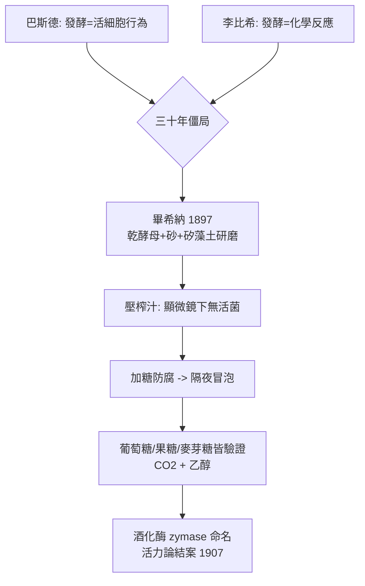

# 1907 · 畢希納與無細胞發酵

> 1907 諾貝爾化學獎：愛德華·畢希納（Eduard Buchner，1860–1917，德國）——表彰「其生化學之研究與無細胞發酵之發現」。他把化學的疆界推進到生命的房間。

## 懸案（案情提要）

發酵是人類最老的工藝（啤酒、葡萄酒、麵包），卻是十九世紀科學最吵的法庭。案情的兩造：

- **活力論（vitalism）**：巴斯德於 1860 年代以鵝頸瓶實驗擊敗自然發生說後主張：發酵是**活酵母細胞**的生理行為，「沒有生命就沒有發酵」。化學不可觸及生命。
- **化學論**：李比希一派堅持發酵只是化學分解，酵母不過是催化性雜質。可惜化學派拿不出實驗證據——把酵母殺死、磨碎，發酵就停了，這是活力論最硬的物證。

1871 年起瑪麗亞·馬納西娜（Maria Manasseina）等人曾宣稱實現過「無細胞發酵」，但證據不堪覆核。懸案就這樣僵了三十年：**發酵的力量，究竟是藏在細胞這個「活物」裡，還是藏在可以倒出來的某種化學物質裡？**

1897 年，圖賓根大學的畢希納發表了只有七頁的論文《無酵母細胞的酒精發酵》，一槍結案。

## 前因

| 年份 | 事件 |
| --- | --- |
| 1837–1839 | 施萬（Schwann）、卡尼亞爾德拉圖爾（Cagniard de la Tour）確認酵母是活的微生物，發酵與生命掛鉤。 |
| 1860s | 巴斯德《酒精發酵之研究》定調：發酵＝活細胞的呼吸；活力論佔上風。 |
| 1876 | 庫恩（Wilhelm Kühne）提出「酵素」（enzyme，意為「在酵母中」）一詞，與「有機體」（organism）分開命名——概念上為本案留了門。 |
| 1884 | 畢希納入慕尼黑，隨拜耳（見 [1905-拜耳與靛藍案](1905-拜耳與靛藍案.md)）學化學、隨內格利學植物學。 |
| 1888 | 以有機化學研究（師從庫爾提烏斯）取得慕尼黑博士學位；兄長漢斯·畢希納是衛生學／細菌學家，家中實驗室一半是免疫學案卷。 |
| 1893–1896 | 轉赴基爾、圖賓根任教；為免疫學研究（與兄長合作血清治療）需要不含活菌的酵母汁，開始磨酵母。 |
| 1897-01 | 論文《無酵母細胞的酒精發酵》（*Berichte der Deutschen Chemischen Gesellschaft* 30: 117）發表——無細胞發酵現身。 |
| 1898 | 就任柏林農業大學普通化學講座；把「酒化酶」（zymase）命名並系統化。 |

## 調查

**物證一：砂磨與壓榨——把酵母「解剖」。**

畢希納的程序嚴格得近乎偏執：取**乾燥**酵母與石英砂、矽藻土（kieselguhr）共研，細胞壁被磨碎後內容物滲出使混合物潮潤；再以水壓機壓榨，收集滲出液——「壓榨汁」（press juice）。關鍵的偵查紀律：顯微鏡檢查確認**無任何活酵母細胞**；並以各種方式排除污染。

**物證二：一夜冒泡的「防腐劑」。**

據畢希納自述的傳奇細節：為了保存這份壓榨汁（當時他本想做免疫學實驗），他像藥師一樣加入**濃糖液**防腐。隔天，混合物竟然劇烈冒泡——二氧化碳滾滾而出。糖被「發酵」成了酒精，而瓶中沒有任何活著的酵母。防腐用的糖變成了呈堂證供。

**物證三：系統驗證。**

1897–1899 年與拉普（Rapp）接力驗證：加入葡萄糖、果糖或麥芽糖，壓榨汁都持續產生 $\mathrm{CO_2}$ 與酒精，**有時連續數日**；對照組（單純糖液、單純壓榨汁）皆無反應；顯微鏡下無活菌。總化學計量與巴斯德時代一致：

$$\mathrm{C_6H_{12}O_6} \rightarrow 2\,\mathrm{C_2H_5OH} + 2\,\mathrm{CO_2}$$

活力論的核心物證——「死酵母不能發酵」——被推翻了：不是死酵母在發酵，而是**死酵母體內本來就有的化學物質**在發酵。畢希納把這批物質命名為**酒化酶**（zymase）。

## 理論裁決

**判決一：化學反應不需要生命。** 發酵的力量封裝在**蛋白質類催化劑**裡，可以像任何化學品一樣被研磨、壓榨、加熱破壞、過濾分離。生命過程第一次被證明是**可分解為普通化學反應**的系統——活力論從此在化學界失去管轄權。這是化學與生物化學的分水嶺：生化學（biochemistry）作為學科由此立案。

**判決二：酵素是化學實體。** 酒化酶的行為符合催化劑的所有定義（見 [1909-奧斯特瓦德與催化](1909-奧斯特瓦德與催化.md)）：改變速率、不進入產物、極少量即可、加熱即失活（蛋白質變性）。費歇爾 1894 年的鎖鑰學說（見 [1902-費歇爾與醣類偵探學](1902-費歇爾與醣類偵探學.md)）由此獲得實體嫌疑人。

**判決三（畢希納自己的誤判）：發酵在細胞內而非細胞外。** 畢希納主張酵母把酵素「分泌」到環境中發酵——日後證明發酵其實在細胞內部進行；他的實驗無誤，解釋半錯。同時酒化酶也非單一酵素，而是十幾種酵素與輔酶的組合——這個誤差要到 1905–1930 年代才被哈登與奧伊勒-克爾平（見 [1929-哈登與發酵化學](1929-哈頓與發酵化學.md)）拆解成磷酸化中間物與輔酶，最終由糖解途徑（恩布登—邁爾霍夫，1959 年醫學獎）完整重演。

## 證物與數據

1897–1899 年的對照組設計（本案的偵查紀律）：

| 實驗組 | 內容 | 結果 |
| --- | --- | --- |
| 甲 | 葡萄糖水溶液（對照） | 無氣泡、無乙醇 |
| 乙 | 壓榨汁單獨放置（對照） | 無發酵跡象 |
| 丙 | 壓榨汁 ＋ 葡萄糖 | 持續數日冒出 $\mathrm{CO_2}$，乙醇定量累積 |
| 丁 | 壓榨汁 ＋ 果糖／麥芽糖 | 同樣發酵 |
| 戊 | 壓榨汁（加熱煮沸） ＋ 葡萄糖 | 完全不發酵——酵素遇熱變性 |
| 己 | 壓榨汁 ＋ 醚/甲苯殺菌處理 | 仍發酵——排除活菌嫌疑 |

計量核對：發酵生成之 $\mathrm{CO_2}$ 與乙醇莫耳數比符合 $\mathrm{C_6H_{12}O_6} \rightarrow 2\,\mathrm{C_2H_5OH} + 2\,\mathrm{CO_2}$，與巴斯德時代對活酵母的測量一致——「化學帳目完全相同，只是不再需要細胞」。

**優先權訴訟：** 俄國化學家馬納西娜（Manasseina）聲稱早一代就發現無細胞發酵；畢希納與拉普的裁定是：她「主觀上相信有發酵酵素存在」，但提交的實驗證據不足以覆核——科學法庭的判決依證據品質，不依構想先後。

## 後果

| 領域 | 影響 |
| --- | --- |
| 生物化學建國 | 「試管裡的生命」成為標準研究法；酵素學、代謝途徑研究全面開展，直通 1946 年酵素結晶獎與 1961 年光合作用碳途徑獎。 |
| 工業發酵 | 酵母壓榨汁、後來的菌體抽提物成為工業催化劑；發酵工程（酒精、甘油、丙酮丁醇）改用科學參數控制。 |
| 醫學 | 免疫化學、維生素與輔酶研究皆以「無細胞系統」為工具；1905 年後畢希納式抽提法是病毒學與藥理學的日常裝備。 |
| 諾貝爾譜系 | 本案是化學獎第一次頒給純粹的「生命過程化學」，為 1929（發酵）、1946（酵素結晶）、1955（催產素合成）等一整條生化線定調。 |
| 時代註腳 | 畢希納 1914 年志願從軍，1917 年 8 月在羅馬尼亞福克沙尼前線遭彈片擊中陣亡——本案偵辦人死於一戰，與化學獎 1916–1917 年連續從缺同年（見 README 年表）。 |
| 史料趣聞 | 實驗室常用的布赫納漏斗與布赫納瓶其實紀念同姓的工業化學家恩斯特·布赫納，與本案偵辦人無關——一場持續百年的張冠李戴。 |

## 關聯

- [1902-費歇爾與醣類偵探學](1902-費歇爾與醣類偵探學.md)：鎖與鑰的「鎖」在本案首次以壓榨汁形式被扣押；糖類正是本案的反應基質。
- [1909-奧斯特瓦德與催化](1909-奧斯特瓦德與催化.md)：催化理論的正式法典化，使「酵素＝生物催化劑」有法可依。
- [1929-哈登與發酵化學](1929-哈頓與發酵化學.md)：把酒化酶拆成酵素＋輔酶＋磷酸化中間物——本案判決書的精修版。
- [1946-薩姆納與酵素結晶](1946-薩姆納與酵素結晶.md)：尿素酶結晶直接把「酵素是蛋白質」定案，終結本案遺留的物質性爭議。
- [1961-卡爾文與光合作用](1961-卡爾文與光合作用.md)：無細胞系統＋放射性追蹤的組合技，把另一個「生命反應」（光合作用）拆成流程圖——畢希納方法的第二代應用。
- [2018-阿諾德與定向演化](2018-阿諾德與定向演化.md)：酵素從被研究對象變成可設計的工業催化劑——本案開啟的酵素化學的百年終章。
