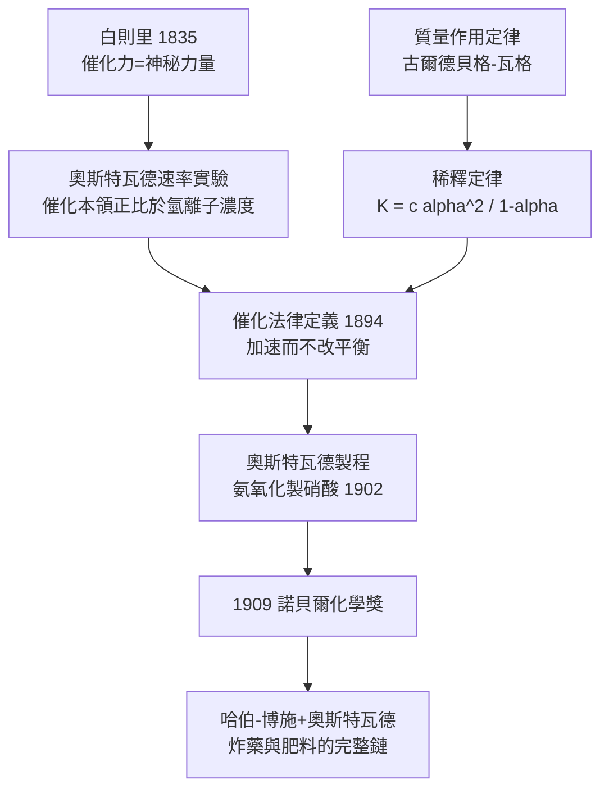

# 1909 · 奧斯特瓦德與催化

> 1909 諾貝爾化學獎：威廉·奧斯特瓦德（Wilhelm Ostwald，1853–1932，德國／波羅的海德意志人，生於里加）——表彰「其對催化之研究，及化學平衡與反應速率基本原理的探討」。物理化學三巨頭的最後一位登頂者。

## 懸案（案情提要）

「催化」一詞由白則里（Berzelius）1835 年提出，但此後七十年它一直是化學的**超自然辭彙**：鉑海綿能點燃氫氧混合氣、澱粉能自己水解、酵母汁能消化糖——催化劑彷彿有一股神祕的「催化力」（catalytic force），活動在化學定律的轄區之外。三大懸案：

1. **催化劑是什麼？** 它參與反應卻不出現在方程式裡；它被消耗嗎？它改變平衡嗎？
2. **平衡為什麼存在？** 貝托萊早就注意到可逆反應，但「反應會停在中途」的定量規律（質量作用定律）沒有嚴格的化學表述。
3. **速率由什麼決定？** 為什麼同樣的反應，換個酸鹼度、換個表面，速度就天差地遠？

奧斯特瓦德——里加釀酒桶匠之子、多爾帕特大學的旁聽研究者——用三十年時間把「催化」從謠言辦成了法典，順手把整門物理化學的制度基礎（期刊、學會、教科書、實驗室）也建了起來。

## 前因

| 年份 | 事件 |
| --- | --- |
| 1835 | 白則里提出「催化」與「催化力」概念：催化劑引發反應但不被消耗——定義即謎團。 |
| 1864–1879 | 古爾德貝格與瓦格（Guldberg–Waage）在挪威發表質量作用定律 $v = k[\mathrm{A}]^a[\mathrm{B}]^b$ 的早期形式，但以挪威文發表，歐陸幾乎無人讀到。 |
| 1872–1878 | 奧斯特瓦爾德就讀多爾帕特大學（今塔爾圖），在施密特實驗室與倫貝格處學得平衡與速率測量——師承的是「地質現象的化學解釋」傳統。 |
| 1881 | 任里加工業學院化學教授，開始系統研究酸鹼對反應速率的影響。 |
| 1887 | 任萊比錫大學物理化學教授（該領域史上第一個專任講座）；與凡特荷夫創辦《物理化學期刊》（見 [1901-凡特荷夫與物理化學](1901-凡特荷夫與物理化學.md)）。 |
| 1887 | 阿瑞尼斯攜解離學說論文來訪（見 [1903-阿瑞尼斯與離子解離疑案](1903-阿瑞尼斯與離子解離疑案.md)），成為其萊比錫學派核心；能斯特 1887 年亦在其門下完成電化學研究。 |
| 1890 | 發表《論自催化》，把催化從「外加物質」擴展到「產物自身加速反應」的動力學機制。 |
| 1901–1902 | 氨氧化製硝酸的專利（奧斯特瓦德製程）；催化理論的第一次工業總動員。 |
| 1906 | 自萊比錫退休，轉向哲學、色彩學與國際語言（Ido）——本案偵辦人的後半生是多學科的全才現象。 |

## 調查

**偵查一：酸鹼的「隱形指印」——催化量的速率實驗。**

奧斯特瓦德選用乙酸乙酯水解、蔗糖轉化（旋光儀可即時追蹤）等反應，系統改變酸的濃度與種類，測速率常數：

$$v = k_{\mathrm{H^+}}\,[\mathrm{H^+}]\,[\text{酯}]$$

發現速率與 $\mathrm{H^+}$ 濃度成**正比**、且同濃度下不同酸的催化本領與其電導（即解離度）成正比——「催化本領＝有效氫離子濃度」。催化劑於是現出原形：它不是神祕力場，而是**以濃度參與速率定律的普通化學物種**。這套測量後來成為分析化學的標準程序（「奧斯特瓦德滴定」邏輯），其學生惠特尼（W. R. Whitney）在奇異公司把物理化學方法帶進工業實驗室。

**偵查二：稀釋定律——平衡的定量判決。**

配合阿瑞尼斯的解離度 $\alpha$，奧斯特瓦德導出**稀釋定律**（1888）：對弱電解質 $\mathrm{AB} \rightleftharpoons \mathrm{A^+} + \mathrm{B^-}$，初始濃度 $c$：

$$K = \frac{c\,\alpha^2}{1-\alpha}$$

以醋酸驗證：$c$ 增大百倍，$\alpha$ 約縮小十倍，$K$ 恆定。質量作用定律第一次有了電導級的精確驗證——平衡常數 $K$ 成為可測、可比、可編表的物質常數。

**偵查三：催化的法律定義。**

奧斯特瓦德對催化劑下了沿用至今的判決式定義：**催化劑是改變反應速率、而不改變該反應熱力學結果、且不出現在淨方程式中的物質。**兩條推論成為鐵律：

- 催化劑**不能**改變平衡常數 $K$——它同時加速正向與逆向反應，只是讓系統**更快到達**平衡；
- 催化劑不創造「不可能的反應」——它降低的是動力學障壁（活化能 $E_a$，見 [1903-阿瑞尼斯與離子解離疑案](1903-阿瑞尼斯與離子解離疑案.md)），不是熱力學勢壘。

自催化（autocatalysis）則被形式化為產物進入速率定律的場合，如 $\mathrm{A} \rightarrow \mathrm{P}$ 而 $\mathrm{P}$ 又催化之：$v = (k_0 + k_{\mathrm{cat}}[\mathrm{P}])[\mathrm{A}]$——這條曲線的 S 形，日後在化學振盪（貝洛烏索夫—札鮑廷斯基反應）與生命起源研究中反覆出現。

**偵查四：結晶的動力學旁支。**

順帶結案的還有兩樁結晶懸案：**奧斯特瓦德階段律**（先析出的常是最不安定的多晶型）與**奧斯特瓦德熟化**（小晶粒溶解、大晶粒長大，$RT\ln(c/c_0) \approx \frac{2\gamma V_m}{r}$，即奧斯特瓦德—弗羅因德利希方程）——後者今日是材料化學、製藥（奈米晶溶解度）與冰淇淋結晶的日常定律。

## 理論裁決

**判決一：平衡常數的普適地位。** 對反應 $a\mathrm{A}+b\mathrm{B} \rightleftharpoons c\mathrm{C}+d\mathrm{D}$：

$$K = \frac{[\mathrm{C}]^c[\mathrm{D}]^d}{[\mathrm{A}]^a[\mathrm{B}]^b}$$

平衡不是「反應停止」，而是正逆速率相等。此判決統合了質量作用定律與熱力學：$\Delta G^\circ = -RT\ln K$（見 [1901-凡特荷夫與物理化學](1901-凡特荷夫與物理化學.md)、[1920-能斯特與熱力學第三定律](1920-能斯特與熱力學第三定律.md)）。化學工程從此可以「算著辦」。

**判決二：催化劑的能階解釋。** 催化劑提供一條活化能更低的路徑 $E_a' < E_a$，速率比為：

$$\frac{k_{\text{催化}}}{k_{\text{未催化}}} = e^{(E_a - E_a')/RT}$$

$E_a$ 每降低 $10\ \mathrm{kJ/mol}$，室溫速率約快 55 倍；降低 $50\ \mathrm{kJ/mol}$ 則快上億倍——「催化力」的定量真身。此判決日後在 1912 年薩巴捷（接觸催化）、2005 年烯烴複分解（金屬卡賓）、2021 年有機催化接力續審。

**判決三：奧斯特瓦德製程的反應鏈。** 氨在鉑銠網上高溫氧化：

$$4\,\mathrm{NH_3} + 5\,\mathrm{O_2} \xrightarrow{\mathrm{Pt},\ 900\,^\circ\mathrm{C}} 4\,\mathrm{NO} + 6\,\mathrm{H_2O}$$

$$2\,\mathrm{NO} + \mathrm{O_2} \rightarrow 2\,\mathrm{NO_2}, \qquad 3\,\mathrm{NO_2} + \mathrm{H_2O} \rightarrow 2\,\mathrm{HNO_3} + \mathrm{NO}$$

選擇率貼近理論極限的條件（接觸時間約 0.3 毫秒、$900\,^\circ\mathrm{C}$）由其動力學與平衡分析精算得出——催化理論的第一次工程總動員。

**哲學餘案：原子論的敗訴者自首。** 奧斯特瓦德長期以「唯能論」反對原子假說（與馬赫並列最後的堡壘），並在 1900 年前後首創「莫耳」（mole）一詞。1908 年佩蘭以布朗運動實驗測得亞佛加厥常數後，他公開承認原子為實在——一個偵辦人對自己舊判決的撤回，成為科學誠實的教科書案例。1901 年他曾拒絕年輕愛因斯坦求職申請，1910 與 1913 年卻兩度提名愛因斯坦諾獎——案件關係人關係的兩極反轉。

## 後果

| 領域 | 影響 |
| --- | --- |
| 化學工業 | 奧斯特瓦德製程與哈伯—博施工序（見 [1918-哈伯與合成氨](1918-哈伯與合成氨.md)）構成「空氣造炸藥與肥料」的完整鏈條：氨（哈伯法）→ 硝酸（奧斯特瓦德法）→ 硝銨炸藥與氮肥。兩條製程至今仍是全球氮化學的動脈。 |
| 物理化學建制 | 《物理化學期刊》、德國電化學會（1889）、物理化學首任專任講座、500 篇論文與 45 本專著——本學科的行政卷宗櫃幾乎全部由本案偵辦人建立。 |
| 學脈 | 其門生與客座者包括阿瑞尼斯（1903）、能斯特（1920）等；增田君男（鮮味發現者）、諾伊斯、惠特尼（奇異公司研究實驗室之父）亦出自萊比錫學派。 |
| 材料科學 | 奧斯特瓦德熟化與階段律成為奈米材料合成、藥物晶型、礦物學的日常工具；李塞根環的週期沉澱模型預示了非平衡態圖案形成（見 [1977-普里高津與耗散結構](1977-普里高津與耗散結構.md)）。 |
| 色彩學 | 退休後的奧斯特瓦德色彩立體體系影響包豪斯與蒙德里安；一個化學家在藝術史的尾聲留下注腳。 |
| 國際語言 | 捐出諾獎獎金的大半推動國際語 Ido——「化學也要世界語」的系統化執念的延伸。 |

## 關聯

- [1901-凡特荷夫與物理化學](1901-凡特荷夫與物理化學.md)：三巨頭之首，共同創刊《物理化學期刊》；平衡常數的熱力學基礎出自其手。
- [1903-阿瑞尼斯與離子解離疑案](1903-阿瑞尼斯與離子解離疑案.md)：解離學說是稀釋定律與「催化本領＝氫離子濃度」判決的物理基礎；阿瑞尼斯本人是萊比錫學派的門生。
- [1912-格林納與薩巴捷](1912-格林納與薩巴捷.md)：薩巴捷的接觸催化氫化是本案判決二的工業續篇，兩人也曾在「表面中間體」機制上論戰。
- [1918-哈伯與合成氨](1918-哈伯與合成氨.md)：氨的前半段（哈伯法）與硝酸後半段（本案製程）合成同一條產業鏈——兩案應併卷閱讀。
- [1920-能斯特與熱力學第三定律](1920-能斯特與熱力學第三定律.md)：萊比錫學派最後一位掌旗官，以第三定律補齊平衡的絕對溫標。
- [2005-格拉布與烯烴複分解](2005-格拉布與烯烔複分解.md)：催化的世紀續審——從鉑網到設計的金屬卡賓催化劑。
