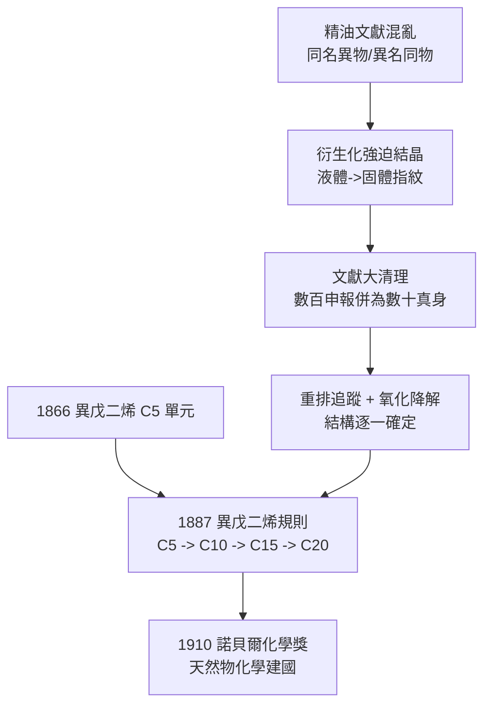

# 1910 · 瓦拉赫與萜類家族樹

> 1910 諾貝爾化學獎：奧托·瓦拉赫（Otto Wallach，1847–1931，德國）——表彰「其在脂環族化合物領域的開創性工作，對有機化學與化學工業之貢獻」。

## 懸案（案情提要）

蒸餾松節油、柑橘皮、薄荷、玫瑰花瓣得到的揮發性油——「精油」——是香水、醫藥與調味的百年原料，但在 1880 年代之前，它們是有機化學的**法外之地**：

1. **身份混沌**：同一株植物蒸出來的油，不同店家、不同產地成分各異；許多「新發現」其實是舊化合物的重複申報——文獻裡同名異物、異名同物堆積如山。
2. **純化無門**：多數萜烯是**液體**，無法用當時金標準的結晶法鑑定；沸點相差僅數度的液體，蒸餾塔也拆不乾淨。
3. **結構無解**：這批 $\mathrm{C_{10}}$、$\mathrm{C_{15}}$ 化合物帶環、帶雙鍵、彼此互變，還常在蒸餾時就「變臉」（重排）——結構測定手法幾乎全數失效。

懸案的本質：**自然界是否用某種統一的方法搭出這批香料分子？** 如果答案是肯定的，那麼一整座天然物化學的家族樹就可以畫出來。偵辦人：波恩大學凱庫勒實驗室出身的奧托·瓦拉赫。

## 前因

| 年份 | 事件 |
| --- | --- |
| 1847 | 瓦拉赫生於柯尼斯堡（康德之城），父親是普魯士公務員；少年在波茨坦自學化學實驗。 |
| 1867–1869 | 入哥廷根大學（當時有機化學掌門是維勒），在柏林隨霍夫曼讀過一學期，1869 年於哥廷根取得博士學位。 |
| 1870–1889 | 任教波恩大學，進入凱庫勒實驗室——凱庫勒當時正研究苯的結構，瓦拉赫則被分配到「最髒最亂」的天然精油部門。 |
| 1866 | 威廉士（Williams）提出橡膠裂解得異戊二烯（$\mathrm{C_5H_8}$）；「$\mathrm{C_5}$ 單元」概念埋線。 |
| 1884–1887 | 瓦拉赫累積十餘年精油數據，發表萜烯分類與**異戊二烯規則**的最初表述：萜類是異戊二烯單元的集合。 |
| 1889 | 轉任哥廷根大學教授，接掌有機化學講座；同年獲科特紐斯獎章。 |
| 1909 | 出版《萜烯與樟腦》（*Terpene und Campher*），把三十年偵查整理成法典。 |

## 調查

**偵查一：液體的指紋術——強迫結晶。**

結晶熔點比對是當時最可靠的「同一性鑑定」，但萜烯是油。瓦拉赫的解方：**把液體變成晶體**。他利用萜烯的雙鍵逐步加成衍生化——例如與氫鹵酸加成得氫鹵化物（松烯 pinene hydrochloride，即「人工樟腦片」的原料）、與亞硝基氯加成得亞硝基氯化物、溴加成得二溴化物——這些固體衍生物各有特徵熔點與晶形：

$$\mathrm{C_{10}H_{16}} + \mathrm{HCl} \rightarrow \mathrm{C_{10}H_{17}Cl}\ (\text{晶體})$$

一個油滴就此有了身分證。他靠這招替上百種精油成分**除重**，把文獻裡數百個「新化合物」併成幾十個真實個體——這是有機化學史上第一次大規模的文獻打假。

**偵查二：重排的偵訊——讓嫌疑人自己招供。**

環烯萜在酸、熱下會發生重排（今日稱瓦拉赫重排）。對未知萜烯，瓦拉赫刻意施加重排條件，追蹤它「變成」哪個已知結構——未知者藉由**可重排至已知者**而間接定罪。這是「結構測定＝反應網路溯源」的早期範式，與同時期費歇爾的醣類家譜法（見 [1902-費歇爾與醣類偵探學](1902-費歇爾與醣類偵探學.md)）異曲同工。

**偵查三：氧化階梯——瓦拉赫降解。**

以鹼性高錳酸鹽等逐步氧化，把環上側鏈一段段削去，取得可辨認的酮或酸碎片（瓦拉赫降解）。片段拼合後，單環萜（薄荷酮、香芹酮）、雙環萜（蒎烯、莰烯）與倍半萜的骨架逐一現形。

**偵查四：異戊二烯規則——家族樹的合成定律。**

綜合所有結構，瓦拉赫判決：萜類分子是異戊二烯單元 $\mathrm{C_5H_8}$ 的「頭尾相接」集合：

$$\mathrm{C_5}\ (\text{半萜}) \rightarrow \mathrm{C_{10}}\ (\text{單萜}) \rightarrow \mathrm{C_{15}}\ (\text{倍半萜}) \rightarrow \mathrm{C_{20}}\ (\text{雙萜}) \rightarrow \cdots$$

例：香葉醇 $\mathrm{C_{10}H_{18}O}$ 恰為兩個異戊二烯單元頭尾相連；檸檬烯為兩個單元首尾閉環。數百種香料分子原來共用一張**積木藍圖**——這是化學史上第一條「生物合成規則」的經驗法典。

## 理論裁決

**判決一：脂環族成為獨立疆域。** 拜耳的張力理論（見 [1905-拜耳與靛藍案](1905-拜耳與靛藍案.md)）預言了環的幾何規律；瓦拉赫則證明環的**化學多樣性**足以支撐一整個天然物宇宙。五元環、六元環萜骨架安定、易重排、易氧化——脂環化學自此與芳香化學並列為有機化學的兩大陸塊。

**判決二：異戊二烯規則的生物意義。** 「自然以 $\mathrm{C_5}$ 為積木」在 1950 年代被證明有生化機制基礎：乙酸→甲羥戊酸→異戊烯焦磷酸（IPP）的類異戊二烯生物合成途徑（Bloch 與 Lynen 1964 年醫學獎）。瓦拉赫的經驗規則成為代謝途徑研究的預言書；今日膽固醇、橡膠、維生素 A、視黃醛、紫杉醇全部歸檔在同一棵家族樹下。

**判決三：瓦拉赫規則（結晶學判決）。** 晚年他統計發現：外消旋體比光學純化合物更常結晶於**有對稱中心**的空間群——外消旋晶體比單一鏡像異構物晶體更穩定（$\Delta\Delta G$ 約 $1$–$4\ \mathrm{kJ/mol}$ 量級）。這條「瓦拉赫規則」在 2008 年被大規模晶體結構統計重新確認，成為拆分外消旋體（優先結晶法）的理論依據。

**副案：命名與工具。** 「terpene（萜烯）」與「pinene（蒎烯）」的命名、第一次系統性蒎烯研究、瓦拉赫重排、瓦拉赫降解、洛伊卡特—瓦拉赫胺化反應——本案貢獻的不只是結論，還有整套詞彙與操作手冊。

## 證物與數據

異戊二烯規則下的家族樹抽樣（瓦拉赫時代已定案者）：

| 類別 | 碳數 | 代表分子 | 來源 |
| --- | --- | --- | --- |
| 單萜（開鏈） | $\mathrm{C_{10}}$ | 香葉醇、檸檬醛 | 香茅油、檸檬油 |
| 單萜（單環） | $\mathrm{C_{10}}$ | 檸檬烯、薄荷腦 | 橘皮油、薄荷油 |
| 單萜（雙環） | $\mathrm{C_{10}}$ | 蒎烯、莰烯、樟腦 | 松節油、樟樹 |
| 倍半萜 | $\mathrm{C_{15}}$ | 杜松烯、法呢醇 | 杜松、八角 |
| 雙萜 | $\mathrm{C_{20}}$ | 松香酸系 | 松脂 |

例證：香葉醇 $\mathrm{C_{10}H_{18}O}$ 的碳骨架恰為兩個 $\mathrm{C_5H_8}$ 單元頭尾相接；蒎烯則為兩個單元首尾閉環再橋接。凡不合規則的「例外」，日後幾乎都被證明是重排產物或文獻錯誤——規則的例外反而增強了規則。

## 後果

| 領域 | 影響 |
| --- | --- |
| 香精香料工業 | 萜類化學使香蘭素、香茅醛、薄荷腦等的合成與半合成量產成為可能；德瑞化學公司在精油化學上建立的優勢延續至今。 |
| 天然物化學 | 「衍生化定結構＋降解拼碎片＋生物合成規則」成為天然物化學的標準三件套，直通魯日奇卡（1939 萜烯與麝香酮）、魯賓遜（1947 生物鹼）、伍德沃德（1965 全合成）的卷宗。 |
| 醫藥 | 樟腦、薄荷腦、青蒿素（倍半萜內酯）、紫杉醇（雙萜）——瓦拉赫家族樹上的藥用枝條陸續結果。 |
| 高分子 | 異戊二烯單元概念直通天然橡膠的結構（順式聚異戊二烯）與 1950 年代的合成橡膠工業（齊格勒催化，見 [1963-齊格勒與納塔](1963-齊格勒與納塔.md)）。 |
| 晶體學 | 瓦拉赫規則成為外消旋拆分與晶體工程（多組分晶體設計）的經驗支柱。 |
| 師承 | 門生瓦爾特·霍沃思（Walter Haworth，1937 年化學獎，維生素 C 與醣環結構）——瓦拉赫的講座直接孕育了下一代的醣化學。 |

## 關聯

- [1902-費歇爾與醣類偵探學](1902-費歇爾與醣類偵探學.md)：同時代並行的兩套結構偵查術——費歇爾的家譜法與瓦拉赫的重排/降解法互為鏡像。
- [1905-拜耳與靛藍案](1905-拜耳與靛藍案.md)：張力理論為脂環族提供了幾何框架，瓦拉赫補上化學多樣性的實證。
- [1927-威蘭與膽汁酸](1927-威蘭與膽汁酸.md)：萜類家族樹向固醇/類異戊二烯大分子的延伸——膽酸骨架正是 $\mathrm{C_{30}}$ 萜的降解產物。
- [1939-布特南特與魯日奇卡](1939-布特南特與魯日奇卡.md)：魯日奇卡的獲獎理由正是「聚亞甲基與萜烯」——瓦拉赫家族樹的直接續辦卷宗。
- [1963-齊格勒與納塔](1963-齊格勒與納塔.md)：異戊二烯的立體規整聚合——家族樹的積木由催化劑量產成橡膠。
- [2015-青蒿素與DNA修復](2015-林達爾與DNA修復.md)：青蒿素（倍半萜內酯）由屠呦呦自傳統藥材中拆解——瓦拉赫式天然物化學在抗瘧藥上的世紀成果。
