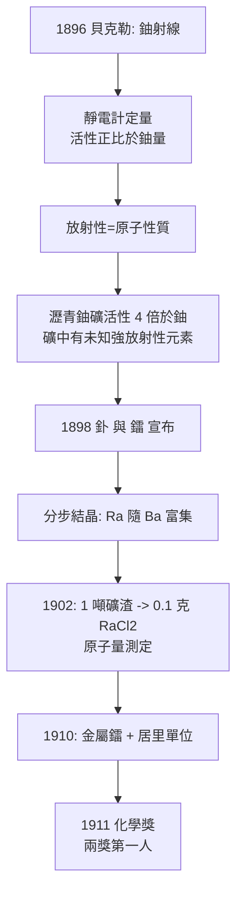

# 1911 · 居里夫人與 0.1 克鐳

> 1911 諾貝爾化學獎：瑪麗·居里（Marie Curie，本名 Maria Salomea Skłodowska，1867–1934，波蘭裔法國籍）——表彰「其發現鐳與釙兩元素、分離鐳並研究此一卓越元素之性質與化合物，對化學進展之貢獻」。史上第一位兩度獲諾貝爾獎者（1903 物理、1911 化學），也是至今唯一在兩門自然科學領域各獲一獎的人。

## 懸案（案情提要）

1898 年前的物理化學有一樁不敢明說的懸案：貝克勒發現鈾鹽自己放射線，但這股能量從哪來？沒有外加能源、沒有化學反應的帳目，物理學的守恆律在鈾鹽面前首次露出生縫。

瑪麗·居里以一支靈敏的壓電靜電計（皮埃爾與其兄雅克十五年前發明的儀器）量測「放射性」（radioactivity——這個詞是她造的），並在 1898 年做出本案的關鍵證詞：**放射性強度只與鈾的「量」成正比，與化合物形式無關**——放射性是**原子的**性質，不是分子的。這一句話已經把槍口對準了「原子不可分割」的憲法。

更可疑的物證隨即出現：瀝青鈾礦（pitchblende）的放射性是純鈾的**四倍**。帳目對不上——礦裡必定藏著比鈾活潑得多的未知元素。懸案升級：**如何從一噸石頭裡，找出連光譜儀都看不見的新元素，並把它完整押送到案？**這是有史以來最勞力密集的一場化學偵查。

## 前因

| 年份 | 事件 |
| --- | --- |
| 1867 | 瑪麗亞·斯克沃多夫斯卡生於華沙（帝俄統治下的波蘭）；家中為教師，父親把實驗器材帶回家教子女——女性不得入大學，她先在秘密「飛行大學」受教。 |
| 1891 | 隨姊赴巴黎，考入索邦；靠節衣縮食與獎學金先後取得物理、數學學位。 |
| 1895 | 與皮埃爾·居里結婚；同樣不以宗教儀式、同騎單車、同守實驗桌。倫琴發現 X 射線。 |
| 1896 | 貝克勒發現鈾鹽的穿透性射線——本案立案。 |
| 1897 | 女兒伊倫出生；居里夫人選定放射性為博士論文題目（導師李普曼）。 |
| 1898-04 | 測得瀝青鈾礦活性四倍於鈾、銅鈾雲母二倍——推斷礦中另有強放射性新元素。 |
| 1898-07 | 宣布第一個新元素「釙」（polonium），紀念祖國波蘭。 |
| 1898-12-26 | 宣布第二個新元素「鐳」（radium，源自拉丁文 radius，射線）。 |
| 1903 | 0.1 克氯化鐳到手，原子量測定在望；夫婦與貝克勒共享物理獎。 |
| 1906 | 皮埃爾死於巴黎街頭馬車事故；居里夫人接任索邦物理講座——巴黎大學第一位女教授。 |

## 調查

**偵查一：靜電計的定量證詞。**

皮埃爾—居里靜電計測的是樣品使空氣電離產生的電流 $I$，與放射性活度 $A$ 成正比。居里夫人的系統普查發現：氧化鈾、磷酸鈾、硝酸鈾——不論化合物為何，$A$ 只隨鈾含量變動：

$$A \propto n_{\mathrm{U}}$$

（釷的放射性亦被她獨立記錄，僅晚於施密特數週的優先權競爭。）「放射性是原子性質」從此成為整個放射化學的定性試劑：**活性強度就是新元素的濃度計**。

**偵查二：一噸礦渣的化學手術。**

要說服化學界「新元素存在」，必須拿出**可稱重的純物質**。夫婦二人（日後由德比爾納接手釙的部分）把奧地利波希米亞聖約阿希姆斯塔爾礦場捐贈的鐳礦渣（提鈾後的殘渣，放射性反而更富集）搬進漏雨棚屋。程序是數年的重複蒸發、結晶、過濾：

1. 酸溶礦渣，硫化物沉澱分組；
2. 釙隨鉍組沈澱——釙的化學性質酷似鉍；
3. 鐳隨鋇組——以**分步結晶**反覆富集：氯化鐳與氯化鋇共晶，但鐳鹽溶解度略低，每輪結晶鐳都在固相中增濃。

數千次結晶循環後，1902 年從約一噸礦渣取得 **0.1 克**純氯化鐳 $\mathrm{RaCl_2}$，並測定鐳的原子量約 225（今值 226）。1910 年居里夫人與德比爾納電解熔融氯化鐳、氫氣氛蒸餾，取得**金屬鐳**——元素存在的最終證明。釙則因半衰期僅 138 天，始終未能分離出可稱量的純品。

**偵查三：鐳的性質檔案。**

鐳的行為紀錄徹底改寫化學常識：持續發熱（每克鐳約 $100\ \mathrm{cal\, h^{-1}}$，帳目上無處開銷——成為 [1908-盧瑟福與元素蛻變](1908-盧瑟福與元素蛻變.md) 蛻變理論的熱力學證據）；使鑽石發螢光、殺死腫瘤細胞快於健康細胞（1899–1902 年間論文——放射治療的原始文獻）；呼出「鐳射氣」（即氡，由拉姆齊與格雷 1910 年測密度——見 [1904-拉姆齊與稀有氣體家族](1904-拉姆齊與稀有氣體家族.md)）。居里夫人還制定了放射性強度的國際標準，單位後來命名為「居里」（$\mathrm{Ci}$，$1\ \mathrm{Ci} = 3.7 \times 10^{10}$ 蜕變/秒，即約 1 克 $^{226}\mathrm{Ra}$ 的活度）。

**場外風暴：1911 年的兩場圍攻。** 同年，法蘭西科學院以一票之差拒絕她入會；右翼報紙以《蘭之戀情》緋聞（與郎之萬）與排外言論圍剿。諾貝爾化學委員會主席阿瑞尼斯甚至欲勸阻她出席典禮，她回覆：獎是頒給釙與鐳的發現，「科學工作與私生活無關」——照赴斯德哥爾摩，發表〈鐳與化學中的新概念〉演講。

## 理論裁決

**判決一：放射性是原子核性質。** 「活性只隨元素量變動」加上礦中異常活性，裁定放射性不屬於化學鍵或分子，而屬於**原子本身**——這是核化學的第一紙判決，與盧瑟福的蛻變理論（1902–03）共同把「原子不可分割」送進歷史。

**判決二：放射化學方法學。** 「以活性為濃度計」加上系統分組沉澱與分步結晶，確立了放射化學的分離典範：極低濃度（一噸中 0.1 克，質量分數約 $10^{-7}$）下的元素追捕。此方法學直接哺育德比爾納（錒，1899）、哈恩與邁特納的核分裂案（1938 年鋇的異常，見 [1944-哈恩與核分裂](1944-哈恩與核分裂.md)）、以及 1943 年德海韋西的示蹤法（見 [1943-德海韋西與同位素示蹤](1943-德海韋西與同位素示蹤.md)）。

**判決三：鐳作為物理化學試劑。** 鐳成為核物理的標準光源：盧瑟福以其 $\alpha$ 射線完成散射與人工核反應實驗；居里學派的實驗裝置反過來供養了整個核物理。判決的因果鏈是雙向的——本案發現了「試劑」，1908 案卷用它解釋了「原理」。

**代價的帳目：** 居里夫人 1934 年死於再生不良性貧血，長期輻射暴露為最可能的成因；其實驗筆記至今仍具放射性、存於鉛盒。她拒絕為鐳分離法申請專利，理由是「科學應自由流通」——本案的工業利益因此盡歸鐳錶盤與放射療產業，而她本人終生未富。

## 證物與數據

本案核心量測的精度帳目：

| 量 | 數值 | 意義 |
| --- | --- | --- |
| 瀝青鈾礦活性 | $4\times$ 純鈾 | 礦中另有強放射性元素的帳目缺口 |
| 一噸礦渣 → 產出 | $0.1\ \mathrm{g\ RaCl_2}$（1902） | 質量分數約 $10^{-7}$ 的分離工程 |
| 鐳原子量（當年測定） | 約 225（今值 226） | 新元素化學身分的最終確證 |
| 鐳的比放射性 | 約 $3.7\times 10^{10}$ 蜕變/秒（即 $1\ \mathrm{Ci}$） | 後世的國際放射強度標準 |
| 鐳持續發熱 | 約 $100\ \mathrm{cal\, h^{-1}\, g^{-1}}$ | 化學帳目無法開銷——核能量的暗線 |
| $^{226}\mathrm{Ra}$ 半衰期 | 約 1600 年 | 她的筆記本至今仍有放射性 |
| 釙半衰期 | 138 天 | 為何始終無法分離出可稱量的純品 |

## 後果

| 領域 | 影響 |
| --- | --- |
| 核科學 | 鐳標準品與居里單位成為全世界的放射量尺；鐳學院（1914 建成）與卡文迪許、維也納鐳研究所、威廉皇帝化學研究所並列四大放射研究中心。 |
| 醫學 | 鐳療（近接放射治療）與一戰 20 輛「小居里」野戰 X 光車——逾百萬傷兵受其影像服務；腫瘤放射治療的源頭。 |
| 女性科學史 | 首位諾獎女得主、首位兩獎得主、索邦首位女教授；其門生佩爾耶（釙的發現者，1939）1962 年才成為法蘭西科學院首位女院士——距她被拒已五十一年。 |
| 居里家族 | 五座諾貝爾獎：夫婦（1903 物理）、她本人（1911 化學）、伊倫與女婿約里奧-居里（1935 化學，人工放射性）——科學史上最密的家族卷宗櫃。 |
| 文化 | 1995 年遷葬先賢祠（首位憑自身功績入祠的女性）；第 96 號元素命名 curium；波蘭 20 茲羅提與法國 500 法郎鈔票皆有其像。 |

## 關聯

- [1908-盧瑟福與元素蛻變](1908-盧瑟福與元素蛻變.md)：鐳的持續發熱是蛻變理論的能量證據；兩案共享放射性化學的卷宗櫃。
- [1904-拉姆齊與稀有氣體家族](1904-拉姆齊與稀有氣體家族.md)：鐳射氣（氡）由拉姆齊測定密度歸入稀有氣體家族——兩案的證物互換。
- [1921-索迪與同位素](1921-索迪與同位素.md)：鐳與釙的蛻變鏈是同位素概念的原始現場。
- [1935-約里奧-居里與人工放射性](1935-約里奧-居里與人工放射性.md)：女兒伊倫與女婿把鐳學院的技術推進到人造放射核素——家族卷宗的第二代。
- [1944-哈恩與核分裂](1944-哈恩與核分裂.md)：放射化學方法（本案確立）在柏林被用於發現核分裂。
- [../物理學獎/1903-貝克勒與居里放射性](../物理學獎/1903-貝克勒與居里放射性.md)：同一發現的物理分卷（1903 年物理獎），本案是其化學續章。
