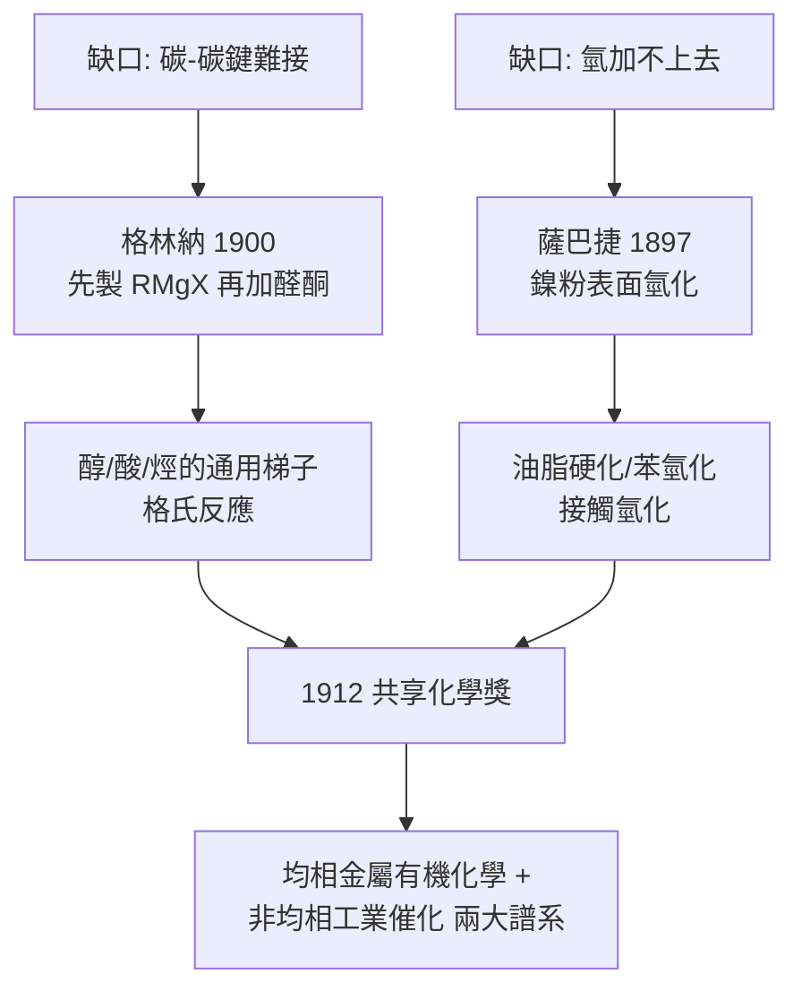

# 1912 · 格林納與薩巴捷——合成化學的兩把鑰匙

> 1912 諾貝爾化學獎（共享）：維克多·格林納（François Auguste Victor Grignard，1871–1935，法國）——表彰「有機鎂化合物之發現及其對有機合成之貢獻」；保羅·薩巴捷（Paul Sabatier，1854–1941，法國）——表彰「其以微細分散金屬氫化有機化合物之方法，對近年有機化學之推進」。同一年，兩位法國人分別給了有機化學**均相**與**非均相**兩把開碳—碳鍵與碳—氫鍵之鎖的鑰匙。

## 懸案（案情提要）

1900 年前後，有機化學家的工具箱裡有一個致命缺口：**碳—碳鍵很難想接就接**。

- 卤烷與鈉（武茲反應）只會把兩個烷基自我相連，用途狹隘；與鋅（巴比爾的老方法）反應產率慘不忍睹，且被自己的原料「卡死」——醛酮一在場，鋅試劑就罷工。
- 另一邊，工業化學的缺口同樣刺眼：**氫不能想加就加**。乙烯、苯、油脂中的雙鍵對氫氣視若無睹——氫與不飽和化合物在室溫下「互不相識」，除非有神明調停。

兩案表面無關，其實同源：**都缺一個「中間調停人」**。均相的一邊，需要一個能把碳變成親核試劑的金屬載體；非均相的一邊，需要一個能把氫氣拆開、按在雙鍵上的表面。1912 年的共享獎，就是把這兩位調停人——格林納試劑與金屬鎳——一起送進名人堂。

## 前因

| 年份 | 事件 |
| --- | --- |
| 1854 | 薩巴捷生於卡爾卡松；1880 年與友人共同通過當年巴黎高師最難的教師會考。 |
| 1871 | 格林納生於瑟堡，帆布匠之子；先攻數學，兵役後重返里昂大學。 |
| 1880s | 薩巴捷在圖盧茲大學研究金屬硫化物氫化，發現還原性金屬氧化物（如鎳）特別有效——非均相催化的線索。 |
| 1884 | 格林納轉入化學，投入巴比爾（Philippe Barbier）門下——本案均相偵查線的指揮官。 |
| 1891–1896 | 巴比爾以鋅／鎂試劑讓卤烷與醛酮縮合，產率低、條件苛刻——失敗現場是格林納日後的案發起點。 |
| 1897 | 薩巴捷與桑德朗（Senderens）以細鎳粉實現乙烯氫化為乙烷——「氫加得上去」的第一次公開演示。 |
| 1900-05 | 格林納發表《論鎂的若干新有機金屬化合物》：乾醚中先製 $RMgX$、再加醛酮——產率暴增，均相案破題。 |
| 1901 | 格林納博士論文《有機鎂混合化合物及其在有機酸、醇、烴合成上的應用》。 |
| 1905–1910 | 格林納先後執教里昂、南錫；把試劑從甲基、乙基推廣到芳基與複雜骨架。 |

## 調查

**均相偵查線：格林納的「分步」策略。**

巴比爾的老做法是把卤烷、鎂、醛酮**一鍋煮**——格林納的假設：醛酮一在場就毒化了鎂表面，卤烷根本活化不了。解法是**分兩步**：先讓卤烷與鎂在無水乙醚中單獨反應，生成試劑後再滴入醛酮。

$$\mathrm{R{-}X} + \mathrm{Mg} \xrightarrow{\text{無水乙醚}} \mathrm{R{-}MgX}$$

$$\mathrm{R{-}MgX} + \mathrm{R'CHO} \rightarrow \mathrm{R'CH(OMgX)R} \xrightarrow{\mathrm{H_3O^+}} \mathrm{R'CH(OH)R}$$

酮得三級醇、醛得二級醇、甲醛得一級醇、$\mathrm{CO_2}$ 得羧酸、酯兩步得三級醇、與 $\mathrm{PBr_3}$/鹵素反應得鹵烷——**一種試劑，通吃整個含氧官能團地圖**。格林納本人並不知其精確結構（聚集成絡合物的 $\mathrm{R_2Mg}$ 與 $\mathrm{MgX_2}$ 混合物，舒倫克 1912–1931 才逐步解剖；今日晶體結構證實為 Schlenk 平衡 $2\,\mathrm{RMgX} \rightleftharpoons \mathrm{R_2Mg} + \mathrm{MgX_2}$），但「碳上帶部分負電、鎂上帶部分正電」的極性敘事（$\mathrm{R}^{\delta-}{-}\mathrm{Mg}^{\delta+}\mathrm{X}$）足以預測所有產物。

**非均相偵查線：薩巴捷的「表面婚介」。**

薩巴捷的推理路徑與格林納完全對稱：氫分子自己太穩定，那就找一個能把 $\mathrm{H{-}H}$ 拆開的表面。他系統比較還原態的金屬氧化物，判定**鎳**最優；乙烯在 $80\,^\circ\mathrm{C}$ 以上、細鎳粉表面順利吃氫：

$$\mathrm{C_2H_4} + \mathrm{H_2} \xrightarrow{\mathrm{Ni},\ \Delta} \mathrm{C_2H_6}$$

推廣到苯（→ 環己烷）、油脂（→ 硬化油）、醛酮（→ 醇）。薩巴捷的機構直覺——底物先在金屬表面**化學吸附**、氫同時被解離吸附、兩者「同席」後反應——是現代表面化學吸附態概念的直系祖先。他還留下日後被稱為「薩巴捷原理」的經驗法則：催化劑與底物的吸附**不能太弱**（不活化）、也**不能太強**（不脫附）——催化活性是吸附強度的火山型函數。今日的火山圖（volcano plot）正是這句話的定量版。

**兩線相會：機制之辯。** 薩巴捷主張氫化經「表面氫化物中間體」，格林納的恩師一系則傾向純物理吸附解釋，兩派論戰多年。判決要等現代表面科學：兩者各對一半——氫確以原子態存在於表面（薩巴捷對），但吸附動力學細節遠比想像複雜（最終由 2007 年埃特爾的表面化學結案，見 [2007-埃特爾與表面化學](2007-埃特爾與表面化學.md)）。

## 理論裁決

**判決一：碳負離子等價物的量產。** 格氏試劑把「碳作為親核試劑」標準化。其反應本質是對極性雙鍵的親核加成：

$$\delta^- \mathrm{R} \cdots \mathrm{C}^{\delta+}{=}\mathrm{O}^{\delta-} \rightarrow \mathrm{C{-}C}\ \text{新鍵}$$

以今日語言：$\mathrm{R{-}MgX}$ 是軟碳親核試劑，$\mathrm{C=O}$ 的 LUMO 在碳端。它使全合成設計第一次可以「由官能團反推合成路徑」——本質上，這是 1990 年科里逆合成分析（見 [1990-科里與逆合成分析](1990-科里與逆合成分析.md)）的第一個系統性反應資料庫。

**判決二：表面氫化的機構與選擇性。** 鎳表面的氫化遵循吸附—反應—脫附三段式；其立體選擇性（氫從金屬面同側加入，得順式加成產物）與毒化現象（微量硫把鎳「毒死」）都指向**表面中間體**實在論。薩巴捷原理的現代定量版本即 1950 年代後的吸附能—活性火山關係，是單原子催化與觸媒高通量篩選的設計準則。

**判決三：工業氫化的立即可用性。** 油脂硬化（不飽和脂肪酸甘油酯 → 硬脂）在 1902–1905 年即由諾爾曼（Normann）以鎳催化申請專利並工業化——人造奶油產業誕生，食品化學從此可以「定制熔點」。薩巴捷反應（$\mathrm{CO_2} + 4\,\mathrm{H_2} \xrightarrow{\mathrm{Ni}} \mathrm{CH_4} + 2\,\mathrm{H_2O}$）在今日國際太空站被用於回收水、在火星探測概念中用於原位資源利用——1900 年代的實驗室配方成為太空工程的物料單。

**戰時副卷：** 一戰中格林納被徵召，先站哨、後轉入炸藥與毒劑偵測研究（碘化鈉戰場檢測芥子氣，可測 $0.01\ \mathrm{g/m^3}$）；他的德方對手正是 1918 年化學獎得主哈伯——化學獎得主在毒氣戰兩側對峙的黑色註腳（見 [1918-哈伯與合成氨](1918-哈伯與合成氨.md)）。

## 證物與數據

格氏試劑的官能團地圖（格林納 1901–1905 年間建立的轉換表）：

| 試劑 | 試劑 ＋ 格氏試劑 ＋ 水解 | 產物 |
| --- | --- | --- |
| 甲醛 $\mathrm{HCHO}$ | $\mathrm{RMgX} + \mathrm{HCHO}$ | 一級醇 $\mathrm{RCH_2OH}$（碳鏈加一） |
| 醛 $\mathrm{R'CHO}$ | $\mathrm{RMgX} + \mathrm{R'CHO}$ | 二級醇 $\mathrm{R'CH(OH)R}$ |
| 酮 $\mathrm{R'_2CO}$ | $\mathrm{RMgX} + \mathrm{R'_2CO}$ | 三級醇 $\mathrm{R'_2C(OH)R}$ |
| 二氧化碳 $\mathrm{CO_2}$ | $\mathrm{RMgX} + \mathrm{CO_2}$ | 羧酸 $\mathrm{RCOOH}$ |
| 酯 $\mathrm{R'COOR''}$ | $2\,\mathrm{RMgX}$ | 三級醇（雙加成） |
| 氰 $\mathrm{R'CN}$ | $\mathrm{RMgX} + \mathrm{R'CN}$ | 酮（經亞胺水解） |

薩巴捷氫化的工業帳目：以鎳粉氫化液態油脂，碘值（不飽和度指標）可由 120–140 降至 30 以下，熔點可定制；德國、英國在 1906 年後陸續建廠，硬油自產取代了部分椰子油與鯨油進口。

## 後果

| 領域 | 影響 |
| --- | --- |
| 有機合成工業 | 格氏反應到 1935 年已有約六千篇應用論文；香水（香葉醇系）、藥物（維生素 A/E 等全合成）、農藥大量依賴。它至今仍是大學有機實驗課與製藥廠（如抗抑鬱藥合成）的日常反應。 |
| 金屬有機化學 | 格氏試劑是金屬有機化學的第一個「大眾化」品種，為 1973 年二茂鐵獎（金屬有機結構）、2010 年鈀偶聯獎（見 [2010-赫克與鈀催化偶聯](2010-赫克與鈀催化偶聯.md)）鋪設了譜系。 |
| 催化工業 | 鎳催化氫化成為油脂、化肥、製藥（氫化可的松等）的基礎工序；薩巴捷原理成為催化劑設計的準則，直通 1963 年齊格勒—納塔（見 [1963-齊格勒與納塔](1963-齊格勒與納塔.md)）與 2007 年表面化學。 |
| 教科書 | 格氏反應與接觸氫化寫進所有有機化學教材，「簡單、可預測、可放大」成為合成方法的評審標準。 |
| 法國學派 | 圖盧茲（薩巴捷）與南錫—里昂（格林納）兩座省級大學因本案成為國際重鎮——法蘭西科學中心的「外省化學」全盛期。 |

## 關聯

- [1909-奧斯特瓦德與催化](1909-奧斯特瓦德與催化.md)：催化理論的法典在前，薩巴捷的表面氫化是它的第一場工業實戰。
- [1918-哈伯與合成氨](1918-哈伯與合成氨.md)：同以「氫＋催化劑」為核心的高壓案；哈伯是格林納戰時的德方對手。
- [1931-博施與貝吉烏斯](1931-博施與貝吉烏斯.md)：薩巴捷氫化與煤氫化液化的技術譜系相連。
- [1963-齊格勒與納塔](1963-齊格勒與納塔.md)：金屬催化劑（有機鋁＋鈦）把氫化/聚合催化推進立體定向時代。
- [1979-布朗與維蒂希](1979-布朗與維蒂希.md)：格氏化學的改良續篇——硼氫化與葉立德成烯，兩把新鑰匙開格氏開不了的門。
- [2010-赫克與鈀催化偶聯](2010-赫克與鈀催化偶聯.md)：碳—碳鍵接合的鈀時代，是格氏試劑百年之後的接班人。
