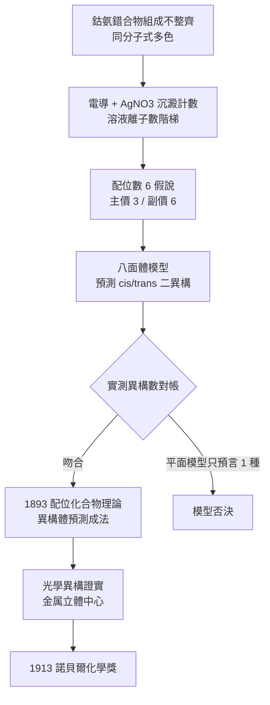

# 1913 · 維爾納與配位化學

> 1913 諾貝爾化學獎：阿爾弗雷德·維爾納（Alfred Werner，1866–1919，瑞士）——表彰「其提出原子價理論、配位化合物之概念，尤其鈷錯合物的立體化學理論」。第一位獲諾貝爾化學獎的無機化學家。

## 懸案（案情提要）

1880–1890 年代，無機化學家手上有一堆無法寫出合理化學式的化合物，它們的行為也完全無法預測：

- **氯化鈷氨**：$\mathrm{CoCl_3 \cdot 6NH_3}$、$\mathrm{CoCl_3 \cdot 5NH_3}$、$\mathrm{CoCl_3 \cdot 4NH_3}$、$\mathrm{CoCl_3 \cdot 3NH_3}$——同一種鈷與氯、氨，比例卻浮動；而每個比例又各有色彩鮮明的黃、紫、綠、玫瑰紅版本。
- **同一分子式卻有不同顏色**：$\mathrm{CoCl_3 \cdot 4NH_3}$ 在溶液裡能變出**兩個**互不相同的物種——這在「分子式決定物質」的古典憲法下，等同於同一張身分證長出兩張臉。
- ** Werner 的核心問題**：為什麼「同樣的原子、同樣的比例」會給出不同的物質？鈷的價數明明只有二與三，氨與氯卻像有「兩種不同的價」在作用？

這樁「同一分子式、多種物質」的懸案，被標為**異構問題**。它不是碳的問題——碳的立體異構已被范托夫的四面體說明（見 [1901-凡特荷夫與物理化學](1901-凡特荷夫與物理化學.md)）；這是金屬的問題，必須另立一套幾何。

## 前因

| 年份 | 事件 |
| --- | --- |
| 1866 | 維爾納生於米魯斯（德語：米爾斯堡，現屬德國），先在德國讀化工，後赴蘇黎世聯邦理工學院（ETH）。 |
| 1885–1888 | 在德國卡爾斯魯厄理工學院完成博士學位（師從卡爾·威爾肯斯），後赴德國多家工廠實習，再回蘇黎世，1888 年起在 ETH 講授化學。 |
| 1889 | 「鈷氨錯合物」謎題被系統整理：鈷(III) 可與氨、氯、水、胺、碳酸根等形成數十種配合物，組成卻常常「不整齊」。 |
| 1890–1893 | 維爾納以**電導法**逐一測量這些溶液：不同「組成」的化合物電導差極大——證明它們在溶液中解離出的離子數根本不同（如 $\mathrm{[Co(NH_3)_6]Cl_3}$ 給出 4 個離子，$\mathrm{[Co(NH_3)_5Cl]Cl_2}$ 給出 3 個，$\mathrm{[Co(NH_3)_4Cl_2]Cl}$ 給出 2 個）。 |
| 1893 | 出版《配位化合物理論論集》（*Beiträge zur Theorie der Koordinationsverbindungen*），提出「配位數 6、八面體排列」與「主價／副價」模型——本案破題。 |
| 1893–1898 | 鉀、銨、鏽等錯合物的異構體數目逐一預測成功，包括 $\mathrm{[Co(en)_2Cl_2]^+}$ 的順反（cis/trans）二形。 |
| 1899 | Pope 與 Peachey 拆分出 $[\mathrm{Co(en)_3}]^{3+}$ 的光學異構體——維爾納預言的**光學異構**獲得證實。 |
| 1905–1913 | 維爾納在蘇黎世大學建立瑞士的無機化學教研體系，並為 ETH 學生寫成經典教材《無機化學教本》（*Lehrbuch der anorganischen Chemie*）。 |

## 調查

**偵查一：電導是「解離計數器」。**

維爾納的實驗設計極為克制：取配合物溶液，接上電導計，測電導率；再以硝酸銀滴定，數出自由 $\mathrm{Cl^-}$ 的沉澱量。兩組數據合成一張表：

| 化合物（溶液態） | 電導（相對） | $\mathrm{AgNO_3}$ 可沉澱 $\mathrm{Cl^-}$ | 溶液中的離子 |
| --- | --- | --- | --- |
| $[\mathrm{Co(NH_3)_6}]\mathrm{Cl_3}$ | 最高 | 3 | $[\mathrm{Co(NH_3)_6}]^{3+} + 3\,\mathrm{Cl^-}$ |
| $[\mathrm{Co(NH_3)_5Cl}]\mathrm{Cl_2}$ | 次高 | 2 | $[\mathrm{Co(NH_3)_5Cl}]^{2+} + 2\,\mathrm{Cl^-}$ |
| $[\mathrm{Co(NH_3)_4Cl_2}]\mathrm{Cl}$ | 較低 | 1 | $[\mathrm{Co(NH_3)_4Cl_2}]^{+} + \mathrm{Cl^-}$ |
| $[\mathrm{Co(NH_3)_3Cl_3}]$ | 最低 | 0 | 中性分子，僅微溶 |

電導階梯與沉澱階梯**完全同步**——這就把「組成不同」從怪事變成線索：溶液中的粒子數由公式直接決定，而每個鈷周圍固定被 6 個配體占滿；變化的只是「哪幾個配位位置被氯占據」。

**偵查二：異構體數目的檢驗——預測→搜尋→對帳。**

維爾納的破案手法是現代版的「組合理論驗算」：先由模型算出某分子式應有幾種異構體，再回頭到文獻與實驗裡找，找不到就是模型錯。

以鈷(III) 配位數 6 為例，$\mathrm{[MA_4B_2]}$ 型若為八面體，兩個 B 可以佔**鄰位（cis，夾角 $90^\circ$）**或**對位（trans，夾角 $180^\circ$）**——預言 2 種，實測 2 種（紫、綠），吻合。而平面六邊形模型只能預言 1 種，模型當場被否決。$\mathrm{[MA_3B_3]}$ 型八面體預言 2 種（面式 fac 與經式 mer），實測亦為 2 種（紫、綠）。

更關鍵的驗算在**配位數 3 與 4 的場合**：鈷(III) 偏好 6，但 $\mathrm{Ni(II)}$ 走平面正方形（配位數 4）、$\mathrm{Cu(II)}$ 走拉長八面體（$4 + 2$ 拉長軸）——同一套理論用不同配位數解出不同幾何，逐一命中。

**偵查三：光學異構——金屬也能有手性。**

$\mathrm{[Co(en)_2Cl_2}]^{+}$ 有一種形式能旋轉偏極光。維爾納立刻看出：這是**鏡像不可重疊**的立體異構，其成因與 1874 年凡特荷夫論碳原子時完全相同——四面體碳的手性。1899 年 Pope 與 Peachey 真的把它拆成 $\Delta$ 與 $\Lambda$ 兩個對映體並分別旋光。裁決：金屬中心可以成為立體化學的手性中心，與碳手性平起平坐。

## 理論裁決

**判決一：配位數與八面體。** 維爾納裁定：中心金屬周圍有固定的**配位數**（coordination number），鈷(III) 為 6，六個配體位於**正八面體**的六個頂點，相鄰配體夾角 $90^\circ$、相對夾角 $180^\circ$：

$$\text{八面體：} \; 6 \text{ 頂點、} \; 12 \text{ 條邊（}90^\circ\text{）、} \; 3 \text{ 條軸（}180^\circ\text{）}$$

八面體的選擇並非任意：六配位時正八面體的配體—配體排斥能最小（相鄰角一律 $90^\circ$，無 $60^\circ$ 的擁擠角），這是後來「配位場理論」的靜電前提。

**判決二：主價與副價——金屬價數的雙軌制。** 維爾納提出：金屬與配體間有兩種不同的「價」——**主價**（primary valence，電中性化合物中金屬的氧化數，以 $\mathrm{Co(III)}$ 計）與**副價**（secondary valence，即配位數，以 6 計）。今日改寫為氧化數 + 配位數兩套參數：

$$\mathrm{Co^{3+}}:\; \text{氧化數} = +3, \qquad \text{配位數} = 6, \qquad \text{總電荷} = +3 - 6 + 3 = 0$$

這套「兩軌參數」正是今日配位化學教科書的第一課。

**判決三：配位數 6 為何是主流——配體場的靜電判準。** 以八面體模型計算，$\mathrm{Co^{3+}}$ 配位 $\mathrm{NH_3}$ 的晶體場分裂能 $\Delta_o$ 極大（$d^6$ 低自旋配位，$t_{2g}^6 e_g^0$，全配位電子對，性質穩定），正是鈷(III) 錯合物如此穩定、如此色彩鮮明的原因之一：

$$\Delta_o \approx \text{配體場強度} \times \frac{1}{\text{金屬—配體距離}^5}$$

（此式為後續理論補完，但選擇 $\mathrm{Co(III)}$ + 氨的判斷邏輯與維爾納一致。）

**判決四：螯合效應。** 維爾納注意到雙齒配體（如乙二胺 $\mathrm{en}$、草酸根 $\mathrm{ox^{2-}}$）形成的錯合物遠比同配位數的單齒配體穩定——因為形成多個螯合環、熵與焓雙重有利。此為**螯合效應**（chelate effect）的最早系統觀察：

$$K_f(\text{螯合}) \gg K_f(\text{單齒})$$

這條效應在 1946 年之後成為金屬藥物（順鉀）、EDTA 滴定與超分子設計的理論基礎。

## 後果

| 領域 | 影響 |
| --- | --- |
| 無機化學 | 配位化學成為獨立學科；「配位數 + 氧化數 + 幾何 + 磁矩」成為無機結構的標準描述框架。 |
| 工業 | 鈷錯合物（催化劑、前驅物）、鎳配合物（催化劑）、鉑錯合物（順鉀化療）皆由此體系衍生；1900 年後氰化提金工藝亦源於錯合物的形成常數概念。 |
| 分析化學 | 電導滴定與配位滴定（EDTA，1940s 後）成為定量分析的標準配備；電化學中的能斯特方程亦在此框架中被重新表述。 |
| 生物化學 | 血紅蛋白的 $\mathrm{Fe^{2+}}$ 與血基質的配位結構、葉綠素的 $\mathrm{Mg^{2+}}$ 配位（見 [1930-漢斯費歇爾與血紅素](1930-漢斯費歇爾與血紅素.md)）皆沿用維爾納語言；金屬酶的模型由「配位幾何」重新檢視。 |
| 結構化學 | 光學異構（$\Delta/\Lambda$）的命名法為今日金屬錯合物立體化學的標準，串起 1901 年碳立體化學與 1969 年構象分析。 |
| 師承 | 助手保羅·卡勒（Paul Karrer）日後獲 1937 年化學獎（維生素 A、B$_2$、胡蘿蔔素）——維爾納實驗室的直系傳承。 |

## 關聯

- [1901-凡特荷夫與物理化學](1901-凡特荷夫與物理化學.md)：四面體碳與 $2^n$ 立體異構律，是維爾納推算金屬異構體數目的方法論母法。
- [1902-費歇爾與醣類偵探學](1902-費歇爾與醣類偵探學.md)：費歇爾的「立體異構計數」在醣類的實證，正是維爾納在鈷錯合物上的推演。
- [1905-拜耳與靛藍案](1905-拜耳與靛藍案.md)：拜耳的張力理論提供了「環的幾何決定性質」的先例；維爾納把同一思路搬到配位多面體。
- [1930-漢斯費歇爾與血紅素](1930-漢斯費歇爾與血紅素.md)：血基質的 $\mathrm{Fe^{2+}}$ 配位六配位結構，正是維爾納幾何的直接應用。
- [1936-德拜與偶極矩](1936-德拜與偶極矩.md)：電偶極矩成為量測錯合物幾何與電子結構的探針——維爾納模型的實驗審計工具。
- [1963-齊格勒與納塔](1963-齊格勒與納塔.md)：過渡金屬配位化學的工業應用（單體聚合催化）。
