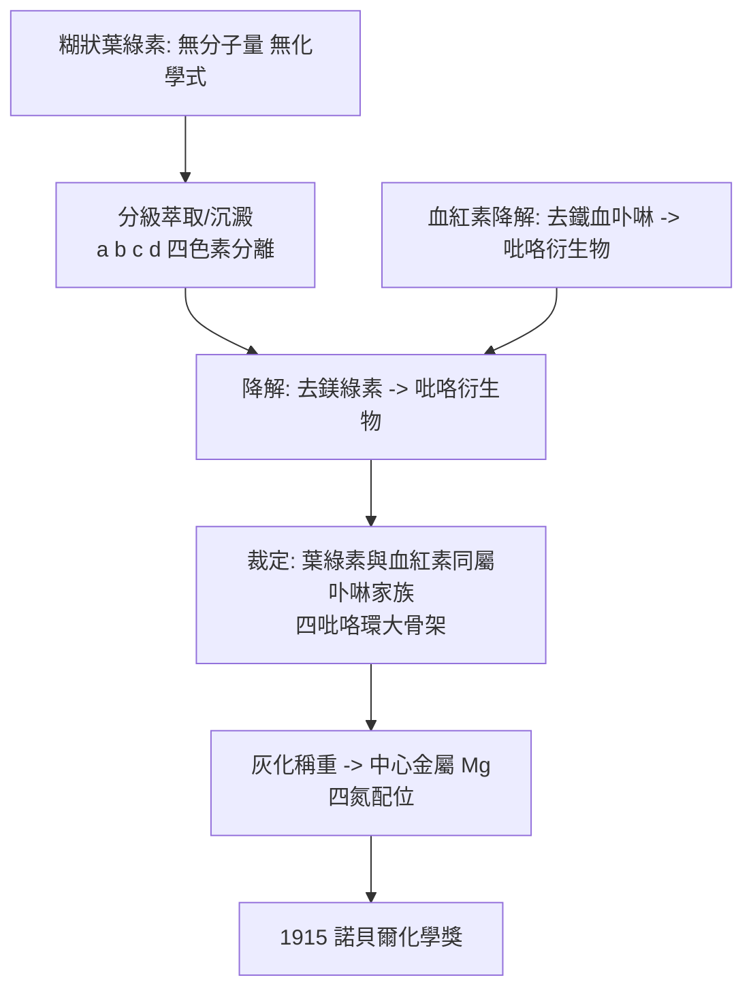

# 1915 · 維爾施泰特與葉綠素

> 1915 諾貝爾化學獎：里夏德·馬丁·維爾施泰特（Richard Martin Willstätter，1872–1942，德國）——表彰「其對植物色素，尤其葉綠素之研究」。因第一次世界大戰，德國得主的獎章實際頒發延至 1920 年。

## 懸案（案情提要）

1900 年的化學教科書上，葉綠素是化學界最大的集體尷尬：

- 它是**世界上最重要的有機物**——幾乎所有食物鏈都靠它啟動，地球的大氣與海洋都因它而改變；
- 它是**純綠色**的，但「葉綠素」這個名字下其實是一團黃綠、藍綠、褐綠、墨綠的糊狀物，沒有人能說出它到底是幾種物質；
- 它在十九世紀幾乎無法結晶，因此**分子量無法測定**、化學式無法確定；
- 它與血紅素（hemoglobin）在化學上明明不像，但都與生物的「呼吸」與「光合」有關——它們之間到底有沒有共同骨架？

更早還有一樁已結案卻留下兩案的舊懸案：可卡因（cocaine）——1880 年代 von Coca 帶回歐洲的「古柯」活性成分，1890 年代德國化學家爭論它在植物體內的形態與藥理作用的關係，其結構長期無法確定。

偵辦人：慕尼黑的里夏德·維爾施泰特——一個把「不純的東西」當成案件核心來處理的程序主義者。

## 前因

| 年份 | 事件 |
| --- | --- |
| 1872 | 維爾施泰特生於卡爾斯魯厄；父為報紙編輯，家境小康，靠獎學金讀慕尼黑大學。 |
| 1894 | 以芳香族硝基化合物研究取得博士學位，師從阿道夫·馮·拜耳（見 [1905-拜耳與靛藍案](1905-拜耳與靛藍案.md)）——化學結構研究的訓練。 |
| 1896–1898 | 破解可卡因結構：確定其骨架為**托烷烷（tropane）雙環**（$\mathrm{C_8H_{13}N}$ 含氮橋環），並定出苯甲酸酯與甲基酯的位置。這是天然生物鹼結構史上第一次精確解剖，托烷烷生物鹼研究自此開展（古柯鹼、莨菪鹼、東莨菪鹼的關係被逐一理清）。 |
| 1905 | 慕尼黑大學教授，主持「植物色素」研究計畫。 |
| 1906–1907 | 用**分級沉澱與分級萃取**（在色層分析誕生前）把「葉綠素」拆成**葉綠素 a**（藍綠）與**葉綠素 b**（黃綠）——本案的第一份分離證物。 |
| 1910–1912 | 與漢斯·費歇爾（見 [1930-漢斯費歇爾與血紅素](1930-漢斯費歇爾與血紅素.md)）合作，以降解法確立葉綠素的**四吡咯環大環骨架**：葉綠素降解可得吡咯衍生物，去鎂後得血卟啉類物質——證明葉綠素與血紅素同屬卟啉家族。 |
| 1912–1915 | 測定含鎂量確立中心金屬為 $\mathrm{Mg}$；確立大環的次甲基（$=\mathrm{CH}{-}$）橋結構。 |
| 1915 | 獲諾貝爾化學獎。 |
| 1917–1924 | 轉入生物化學，研究生理活性物質（前列腺素、腸泌素等）。 |

## 調查

**偵查一：分離術——用「分級」而非「溶解」。**

維爾施泰特面對的是糊狀混合物：葉片先以丙酮萃取得綠色溶液，再以石油醚處理，綠色物質分成兩層——上層石油醚層帶走黃綠素（a），下層留下黃綠素（b）。他再以分級沉澱（用 $\mathrm{BaCl_2}$、$\mathrm{CuCl_2}$ 等金屬鹽在不同濃度下選擇性沉澱）分離得更細。關鍵在於：**每一輪分級都以再分析確認組成**，而不是看顏色。

| 色素 | 溶解性 | 顏色 | 螢光 | 後來確定的分子式 |
| --- | --- | --- | --- | --- |
| 葉綠素 a | 溶於石油醚 | 藍綠 | 紅色 | $\mathrm{C_{55}H_{72}MgN_4O_5}$ |
| 葉綠素 b | 溶於丙酮 | 黃綠 | 紅褐 | $\mathrm{C_{55}H_{70}MgN_4O_6}$ |
| 葉綠素 c | — | 褐綠 | — | $\mathrm{C_{53}H_{70}MgN_4O_5}$ |
| 葉綠素 d | — | 灰綠 | — | （與 a 異構體） |

1915 年他已分離出 a、b、c、d 四種——「葉綠素」這個詞從此被廢止，改為複數。

**偵查二：降解——把大分子拆成可指認的碎片。**

維爾施泰特的方法是化學偵查的古典套路：葉綠素以酸處理 → **去鎂的綠素（chlorin）**；再以強鹼高溫降解 → 一系列**吡咯衍生物**（吡咯、吡咯甲酸等）。而關鍵比對是：

$$\text{葉綠素} \xrightarrow{\text{去鎂}} \text{綠素} \xrightarrow{\text{降解}} \text{吡咯衍生物} \quad \text{vs.} \quad \text{血紅素} \xrightarrow{\text{去鐵}} \text{血卟啉} \xrightarrow{\text{降解}} \text{吡咯衍生物}$$

兩條降解路徑給出同族碎片——**葉綠素與血紅素是同一家族的兩名成員**。這是本案最漂亮的結構結論：光合作用與呼吸作用，在分子層面共享骨架。

**偵查三：中心金屬與配位——鎂的重量。**

以灰化與灼燒稱量，維爾施泰特測出葉綠素含鎂約 $2.1\%$（對 $\mathrm{C_{55}H_{72}MgN_4O_5}$ 計理論值約 $2.7\%$，當時測值偏低）。鎂的存在，配合卟啉四吡咯環的氮孤對電子排布，確立了中心金屬被**四個氮原子平面配位**的結構模型——這正是 1913 年維爾納的配位幾何（見 [1913-維爾納與配位化學](1913-維爾納與配位化學.md)）在生物分子上的首次應用。

**偵查四：光譜證詞——兩條吸收帶。**

葉綠素的綠色來自它只吸收紅光與藍紫光：

$$\lambda_{max}(\text{a}) \approx 430\ \mathrm{nm} \ (\text{藍紫})\ \text{與}\ 662\ \mathrm{nm}\ (\text{紅}) \quad ; \quad \lambda_{max}(\text{b}) \approx 453\ \mathrm{nm}\ \text{與}\ 642\ \mathrm{nm}$$

以光子的能量公式對照：

$$E = \frac{hc}{\lambda};\qquad E(430\ \mathrm{nm}) \approx 2.88\ \mathrm{eV},\quad E(662\ \mathrm{nm}) \approx 1.87\ \mathrm{eV}$$

兩個吸收帶對應大環 $\pi$ 系統的兩類電子躍遷（$S_1$、$S_2$）——1915 年時這還只是經驗規律，但它預告了 1940–50 年代葉綠素光化學與光合作用能量傳遞理論的問題意識。

## 理論裁決

**判決一：卟啉大環結構。** 維爾施泰特與費歇爾裁定葉綠素含四個吡咯環（pyrrole），各環以次甲基橋相連形成環狀共軛大環，鎂居中央由四氮配位：

$$\text{吡咯環} \times 4 \;\xrightarrow{\;\text{四次縮合}\;}\; \text{大環骨架}\ (\text{bilatriene})$$

其電子系統的 $\pi$ 電子雲延展造成可見光吸收帶；共振結構（含互變異性）說明其顏色深度與螢光壽命。

**判決二：去鎂與去鐵的對稱實驗——跨系統的同一性證據。** 葉綠素去鎂得綠素、血紅素去鐵得血卟啉；兩者的降解產物同族。此「**去金屬對稱實驗**」是生物化學史上第一次跨分子的結構對齊，開啟了血基質、膽色素、葉綠素共祖的「卟啉王國」研究。

**判決三：色素命名法與分離倫理。** 「葉綠素 a/b/c/d」的命名規則與「先分離、後命名、再研究」的次序成為植物化學的標準作業程序；維爾施泰特堅持任何被稱為「葉綠素」的物質都必須有**熔點、元素分析、吸收光譜**三份證詞——今日化學品純度報告的雛形。

## 後果

| 領域 | 影響 |
| --- | --- |
| 光合作用 | 葉綠素結構與吸收光譜是理解光合作用能量傳遞的基礎；卡爾文循環（見 [1961-卡爾文與光合作用](1961-卡爾文與光合作用.md)）的同位素追蹤實驗建立在同一套色素化學上。 |
| 結構生物學 | 「卟啉大環」家族的解碼，直接導向血紅蛋白結構（見 [1962-佩魯茨與血紅蛋白](1962-佩魯茨與血紅蛋白.md)）與觸發反應中心（見 [1988-光合作用反應中心](1988-光合作用反應中心.md)）的結構解析。 |
| 藥理學 | 可卡因的托烷烷骨架破解開啟了生物鹼化學；其後的局部麻醉藥（古柯鹼 → 普魯卡因 → 利多卡因）與抗膽鹼藥均沿此線。 |
| 醫學 | 光動力療法（血卟啉衍生物accumulate 於腫瘤，受光產生單態氧殺傷細胞）是葉綠素—卟啉家族的醫療應用。 |
| 學派 | 慕尼黑門生出了溫道斯（1928，維生素 D）、施陶丁格（1953，高分子）、威蘭（1927，膽汁酸）——維爾施泰特的實驗室是德國化學的黃金世代搖籃。 |
| 科學史地位 | 維爾施泰特 1915 年得獎時，德國身處戰爭；他的植物色素研究幾乎被同時代的化學武器研究遮蔽（本人在戰時亦參與戰地化學工作），但其色素與生物鹼成果在戰後重獲評價。 |

## 關聯

- [1902-費歇爾與醣類偵探學](1902-費歇爾與醣類偵探學.md)：費歇爾的生物鹼與嘌呤工作，是維爾施泰特在慕尼黑的同校前輩傳統（降解—重組法的共同源頭）。
- [1913-維爾納與配位化學](1913-維爾納與配位化學.md)：中心鎂的四氮平面配位，直接借用維爾納的配位幾何模型。
- [1930-漢斯費歇爾與血紅素](1930-漢斯費歇爾與血紅素.md)：費歇爾與維爾施泰特合作的卟啉骨架判定，在此由漢斯·費歇爾完成大環合成的續篇。
- [1937-霍沃思與維生素C](1937-霍沃思與維生素C.md)：維爾施泰特的學生霍沃思把植物色素與醣類結構帶入維生素 C 的合成——門派直系。
- [1962-佩魯茨與血紅蛋白](1962-佩魯茨與血紅蛋白.md)：血基質的結構是卟啉王國的另一座城堡，1962 年以 X 射線破解。
- [1988-光合作用反應中心](1988-光合作用反應中心.md)：葉綠素之外的 bacteriochlorophyll 與反應中心結構，把本案的大環化學推進到 3.6 埃解析。
