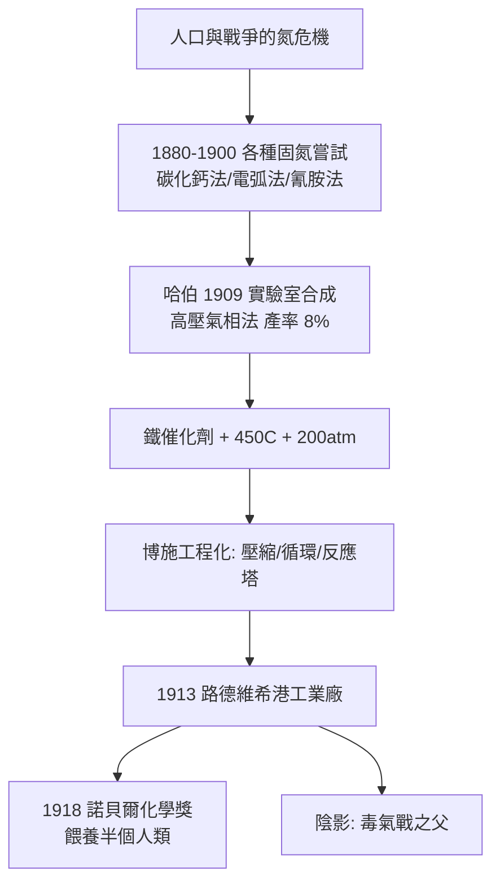

# 1918 · 哈伯與合成氨

> 1918 諾貝爾化學獎：弗里茨·雅各布·哈伯（Fritz Jakob Haber，1868–1934，德國）——表彰「其合成氨之發明——由空氣中元素直接合成氨之大工業化方法」。這是化學史上影響人口最多的發明之一，也是道德史上最沉重的諾獎之一。

## 懸案（案情提要）

1914 年前的歐洲面對一樞人口級的懸案：**氮從哪裡來？**

人類的蛋白質需要氮，農作物的產量需要氮肥，而可用的高氮來源只有三處：智利的硝石礦（$\mathrm{NaNO_3}$）、煤礦裡的氨（煤氣副產，量少）、以及固氮植物的根瘤（慢得來不及用）。1914 年德國在戰爭中失去法屬的硝酸鹽產區（亞爾薩斯—洛林的安那寧鈉礦）、又無法突破英國對智利硝石航線的封鎖——**德國的「氮危機」直接決定了一戰的持久戰形態**（硝化甘油與 TNT 的原料）。

懸案的物理核心是一條極其頑固的化學鍵：

$$\mathrm{N \equiv N}, \qquad D(\mathrm{N \equiv N}) \approx 945\ \mathrm{kJ/mol}$$

氮分子的三鍵太強，化學家面對「把空氣變成肥料」時近乎絕望：直接反應 $\mathrm{N_2} + 3\,\mathrm{H_2} \rightleftharpoons 2\,\mathrm{NH_3}$ 在熱力學上可行（放熱），但需要極端的條件（高壓、高溫、催化劑）才能跑得有實際速率。這不是「能不能」的問題，而是「**划算嗎**」的問題。

答案在 1909–1913 年由一位被後世稱為「空氣麵包之父」的德國化學家給出，並在七年內被工程化。

## 前因

| 年份 | 事件 |
| --- | --- |
| 1868 | 哈伯生於布雷斯勞（今日波蘭弗羅茨瓦夫）；出身猶太商人家庭，祖父converted，改信基督教。 |
| 1886–1891 | 留學Karlsruhe、柏林，師從克魯岑貝格、霍夫曼等人，研究硝基化合物與偶氮染料的還原。 |
| 1894–1911 | 任卡爾斯魯厄理工學院教授，研究氧化還原、氮的固定（1909 年首次報告氨的催化合成實驗）。 |
| 1909 | 以**氣相高壓法**在實驗室完成氨的催化合成實驗——用高壓氫氣在 200 atm 下還原氮氣，產率約 $8\%$；用**鉛基底催化劑**還用**鉑絲網**。哈伯的著名一時失言：「一位年輕人必須在某個時候相信某件事，否則不會有什麼收穫。」（在卡爾斯魯厄演講：「一位年輕化學家應該相信自己的假設……」） |
| 1909–1911 | 與巴斯夫（BASF）的卡爾·博施（見 [1931-博施與貝吉烏斯](1931-博施與貝吉烏斯.md)）結盟：博施解決「高壓工程」，哈伯解決「化學與催化劑」。 |
| 1909 | 奧斯特華德（見 [1909-奧斯特瓦德與催化](1909-奧斯特瓦德與催化.md)）公開質疑其工業可行性，預言工廠要長達 300 公里；哈伯與博施以實測數據回應。 |
| 1910–1911 | 開發鐵催化劑（磁鐵礦還原製得，摻 $\mathrm{K_2CO_3}$ 助劑、$\mathrm{Al_2O_3}$ 載體），在 $450$–$500\,^\circ\mathrm{C}$、$150$–$300\ \mathrm{atm}$ 下運轉；取得多項專利。 |
| 1913 | 路易斯安那州博取的工業化：BASF 於路德維希港（Ludwigshafen）興建世界第一座合成氨廠。 |
| 1914–1918 | 一戰中德國以合成氨保障炸藥與氮肥供應，成為「氮危機」的最終解方。 |
| 1918 | 獲諾貝爾化學獎（1919 年公布；因戰後德國處境，頒獎過程一波三折）。 |
| 1916–1918 | 另一條平行罪證：哈伯是氯氣等毒氣武器的倡導者，被稱為「化學戰之父」；同事聯名請願要求他停止，他未停止。 |

## 調查

**偵查一：熱力學帳本——為什麼要用高壓。**

氨合成的平衡為：

$$\mathrm{N_2(g)} + 3\,\mathrm{H_2(g)} \rightleftharpoons 2\,\mathrm{NH_3(g)}, \qquad \Delta_r H^\circ = -92.4\ \mathrm{kJ/mol}\ (\text{在 298 K})$$

由凡特荷夫方程式（見 [1901-凡特荷夫與物理化學](1901-凡特荷夫與物理化學.md)）：

$$\frac{d\ln K_p}{dT} = \frac{\Delta_r H^\circ}{RT^2} \;\Longrightarrow\; \ln\frac{K_2}{K_1} = -\frac{\Delta_r H^\circ}{R}\left(\frac{1}{T_2}-\frac{1}{T_1}\right)$$

放熱反應的 $K_p$ 隨升溫而下降，因此**低溫對平衡有利**。另一方面，莫爾分率變化：

$$4\ \text{ mol 氣體} \longrightarrow 2\ \text{ mol 氣體}$$

高壓有利於生成氨（勒沙特列原理）。兩條線夾出一個矛盾：低溫平衡好但速率太慢；高溫速率好但平衡差。此矛盾正是整個偵查的核心。

**偵查二：溫度—壓力—轉化率的三角最佳化。**

哈伯與博施在實際工廠條件下測得轉化率（單程）與溫度、壓力的關係，典型數據：

| 溫度 | 壓力 | 平衡 $K_p$ 量級 | 單程轉化率 | 速率 |
| --- | --- | --- | --- | --- |
| $450\,^\circ\mathrm{C}$ | $200\ \mathrm{atm}$ | $\sim 10^{-4}\ (\mathrm{atm^{-2}})$ | 約 15–20% | 可接受 |
| $500\,^\circ\mathrm{C}$ | $200\ \mathrm{atm}$ | 更小 | 明顯下降 | 較快 |
| $450\,^\circ\mathrm{C}$ | $400\ \mathrm{atm}$ | 同溫同值 | 上升 | 更好 |

結論是工業的「折衷點」：**$450$–$500\,^\circ\mathrm{C}$、$150$–$300\ \mathrm{atm}$**，靠催化劑解決速率、靠高壓解決平衡、靠**循環未反應氣體**解決單程轉化率不足。化學與工程的分工在此無縫咬合。

**偵查三：催化劑的篩選——不是所有催化劑都堪用。**

哈伯試過多種催化劑，最終選定的鐵基催化劑必須同時滿足：活性足、能耐 $500\,^\circ\mathrm{C}$、便宜、壽命長。最終配方（後續工藝化）為：還原鐵（由磁鐵礦製得）＋ $\mathrm{K_2CO_3}$ 助催化劑 ＋ $\mathrm{Al_2O_3}$／$\mathrm{CaO}$ 載體。**氫氣本身是毒物**——不純的氮氣（$\mathrm{O_2}$、$\mathrm{CO}$、$\mathrm{H_2S}$、$\mathrm{CH_4}$）會毒化催化劑，故需精製——這正是理查茲的純度倫理（見 [1914-理查茲與精密原子量](1914-理查茲與精密原子量.md)）在工業上的直接應用。

**偵查四：工程實作——把反應器做成塔。**

博施的貢獻是把高壓反應搞成可持續運轉的工廠：多級壓縮機、循環機（未反應氣體回收）、耐 $200\ \mathrm{atm}$ 的反應塔（在 1909 年這已是舉世無雙的技術奇蹟）。哈伯在 1910–1911 年先後申請多國專利，把合成氨與合成甲醇的路線一併保護——**今日全球最賺錢的兩種化工品，其專利藍圖出自同一間實驗室**。

## 理論裁決

**判決一：平衡與反應速率的分工——哈伯法的全部物理內容。** 判決以兩個獨立機制達成：靠**熱力學**（$K_p$、高壓、勒沙特列）確定可行區間，靠**動力學**（催化劑降低 $E_a$、提高速率）確定可操作點。以阿瑞尼斯方程式量化催化劑的貢獻：

$$k = A e^{-E_a/RT}; \qquad \frac{k_{\text{催化}}}{k_{\text{無催化}}} = e^{(E_a - E_a')/RT}$$

在 $723\ \mathrm{K}$ 下，若催化劑把 $E_a$ 降低 $50\ \mathrm{kJ/mol}$，速率提升：

$$\exp\left(\frac{50\,000}{8.314 \times 723}\right) \approx e^{8.3} \approx 4 \times 10^{3}$$

即約四千倍——這正是「用催化劑換取可在 $500\,^\circ\mathrm{C}$ 操作」的物理理由。

**判決二：反應熱與平衡的量化審計。** 由哈伯平衡式可得：

$$\ln K_p = -\frac{\Delta_r H^\circ}{RT} + \frac{\Delta_r S^\circ}{R}$$

代入 $\Delta_r H^\circ = -92.4\ \mathrm{kJ/mol}$、$\Delta_r S^\circ \approx -198\ \mathrm{J/(mol\cdot K)}$：

- 在 $723\ \mathrm{K}$：$\ln K_p \approx -\dfrac{-92\,400}{8.314 \times 723} + \dfrac{-198}{8.314} \approx 15.36 - 23.81 \approx -8.45$，故 $K_p \approx 2.1\times 10^{-4}\ \mathrm{atm^{-2}}$；
- 在 $500\,^\circ\mathrm{C}$（$773\ \mathrm{K}$）：$K_p$ 進一步下降至約 $10^{-4}$ 量級。

這與工廠實測的「單程轉化率僅約 15–20%」完全吻合——**理論與工業數據在案卷上對帳成功**，這是當時最令人信服的大規模化學工程驗證。

**判決三：熱力學與凱爾文原理的攜手。** 若 $\Delta_r U < 0$、$\Delta_r S < 0$，則在臨界溫度 $T_c$ 之上 $\Delta_r G > 0$，反應在標準壓力下不自發。此「臨界溫度」概念是能斯特（見 [1920-能斯特與熱力學第三定律](1920-能斯特與熱力學第三定律.md)）與能斯特定理在同一時期補上的工具；哈伯法的成功，本質上正是**用高壓跨過了那個臨界溫度**。

## 後果

| 領域 | 影響 |
| --- | --- |
| 人口與糧食 | 全球約每年生產約 1.8 億噸氨，約**三分之一的世界糧食生產**依賴哈伯—博施法；以之估算約支撐全球近半人口（維基百科語）。這是單一化學發明對人類存續影響最大的案例。 |
| 能源與氣候 | 合成氨消耗全球約 1–2% 的一次能源，並貢獻全球約 1–3% 的二氧化碳排放——今日「綠氨」（綠氫 + 電催化固氮）正是在拆解這份帳。 |
| 軍備 | 一戰中保障德國炸藥與氮肥；哈伯的毒氣研究則被二戰的齊克隆 B 沿用，造成逾百萬猶太人遇害——本案的成果與罪行同框。 |
| 化學工業 | 帶動高壓工程（壓縮機、耐壓材料）、催化劑工業（鐵催化劑的量產與再生）、以及費歇爾—特羅普普合成甲醇、合成燃料的整條鏈。 |
| 科學制度 | 哈伯–博什組合是「大學成果—企業工程」協作的原型，深刻影響德國化工研究所（如 1911 年創立的開爾斯研究院）與二十世紀的產學模式。 |
| 晚年 | 1933 年納粹掌權後辭職；1934 年在魏茨曼研究院（以色列）任所長途中於巴塞爾病逝。 |

## 關聯

- [1901-凡特荷夫與物理化學](1901-凡特荷夫與物理化學.md)：凡特荷夫方程式正是選擇反應溫度的數學工具，哈伯法即其工業級應用。
- [1903-阿瑞尼斯與離子解離疑案](1903-阿瑞尼斯與離子解離疑案.md)：活化能與阿瑞尼斯方程式，是催化劑降低 $E_a$ 的理論基礎。
- [1909-奧斯特瓦德與催化](1909-奧斯特瓦德與催化.md)：哈伯面對的質疑者兼引路人；催化理論的通行版本正是在催化的第一場工業戰役中被打磨出來。
- [1914-理查茲與精密原子量](1914-理查茲與精密原子量.md)：哈伯的戰略搭檔之一；高純氮氣與氫氣是精確原子量觀念的工業應用。
- [1920-能斯特與熱力學第三定律](1920-能斯特與熱力學第三定律.md)：同屬萊比錫學派譜系的熱力學工具，直接支撐氨合成的平衡計算。
- [1931-博施與貝吉烏斯](1931-博施與貝吉烏斯.md)：博施因合成氨的工業化再獲諾獎，是本案的直接後續卷宗。
- [1961-卡爾文與光合作用](1961-卡爾文與光合作用.md)：固氮與固碳，一體兩面——哈伯把氮送進生物圈，卡爾文把碳送進生物圈。
