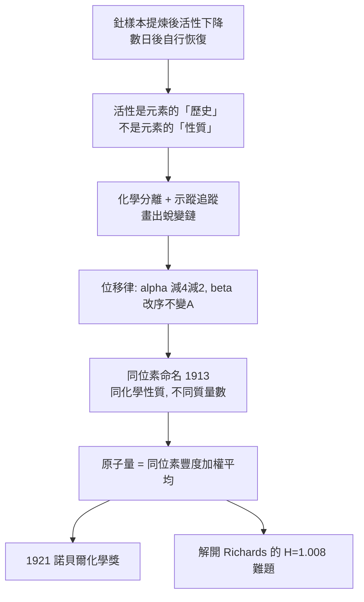

# 1921 · 索迪與同位素

> 1921 諾貝爾化學獎：弗雷德里克·索迪（Frederick Soddy，1877–1956，英國）——表彰「其對放射性物質化學之貢獻，及對同位素之起源與本質的研究」。史上第二位諾貝爾化學獎得主，放射化學與核物理的雙棲者。

## 懸案（案情提要）

1900–1903 年在加拿大麥吉爾大學的地下室裡，一組放射性物質把化學家的世界觀拆了：

- **釷的「射氣」**（thoron）——一種會從礦物裡冒出來、卻對任何化學試劑都無動於衷的惰性氣體，化學家的元素表裡沒有它的位置；
- **釷 X**——可以化學分離、能在溶液裡沉澱下來的新物質；
- **最詭異的一項**：同一批釷礦，**提煉過的樣本放射性較低，放置數日後卻自行恢復**，好像活性會「記得」自己的出身。

這意味著放射性物質的行為**不是元素的性質**，而是元素**歷史**的性質。元素被化學手續「改造」了嗎？原子會變質嗎？——這正是盧瑟福與索迪 1902–1903 年的聯手偵查。而他們越查越發現：**元素不但會變質，同一個元素還能同時有好幾種「體重」**。

## 前因

| 年份 | 事件 |
| --- | --- |
| 1877 | 索迪生於英國索塞克斯，牧師家庭；於南岸學院、倫敦大學學習，1898 年任瓦爾特斯化學講師（研究鉛的放射性，1900 年發現「含鉛礦石的放射性與鉛的含量無關」）。 |
| 1900 | 赴加拿大麥吉爾大學任盧瑟福的研究員——本案兩人組隊成立。 |
| 1900–1902 | 與盧瑟福發現釷射氣（thoron）：從釷化合物中不斷生成、不反應的惰性氣體；索迪命名（thorium + emanation）。 |
| 1902–1903 | 與盧瑟福發表《放射性變化》（*Radioactive Change*）與《放射性變化定律》：放射性的指數衰變律；並提出**放射性是原子自發蛻變**——元素可變的立案。 |
| 1903 | 與拉姆齊（見 [1904-拉姆齊與稀有氣體家族](1904-拉姆齊與稀有氣體家族.md)）在倫敦大學建立「放射性示蹤」方法，用化學分離追蹤衰變鏈。 |
| 1909 | 任阿伯丁大學（後轉愛丁堡）講師；關鍵觀察：**來自釷礦的「放射性鉛」與普通鉛的原子量不同**（約 208 對 207.2），而兩者化學性質完全相同——同位素現象的第一份硬證據。 |
| 1913 | 與卡齊米爾・法揚斯（Kazimierz Fajans）提出**位移律**：$\alpha$ 蛻變使原子序減 2、質量數減 4；$\beta$ 衰變使原子序變化而質量數不變。索迪為「同位素」（isotope）一詞命名——希臘語 *isos*（相同）+ *topos*（位置），意為「佔同一位置的」。 |
| 1914 | 發表放射元素的週期表：以原子序排列、**同位素排成同一格內的橫列**——今日週期表的雛形。 |
| 1920–1921 | 確認鉛有三種同位素，並推論「原子量只是同位素混合比例的統計平均」。 |
| 1921 | 獲諾貝爾化學獎。 |

## 調查

**偵查一：衰變律——活性的指紋。**

索迪與盧瑟福發現：放射性物質的衰變服從純指數律，與樣本量無關：

$$\frac{dN}{dt} = -\lambda N \;\Rightarrow\; N(t) = N_0 e^{-\lambda t}, \qquad t_{1/2} = \frac{\ln 2}{\lambda}$$

關鍵的「同量半衰」性質（不論樣本多大多小，半衰期恆定）是「隨機單一事件」的決定性指紋——對比化學反應速率正比於濃度（質量作用律），放射性衰變**與質量無關**，只能是每個原子各自擲骰子。

**偵查二：化學分離追蹤——「示蹤法」的原型。**

索迪在 1903 年首度使用的偵查術至今仍在用：把樣品用化學方法「分組」（例如把鐳與銅一同以硫酸鹽沉澱、把釷與鐵分開），再分別測量各組的放射性。由各組活性的此消彼長，就能**畫出蛻變鏈**：

$$\mathrm{Th} \xrightarrow[\;T_{1/2}=1.3\times10^{10}\,\mathrm{yr}\;]{\alpha} \mathrm{ThX} \xrightarrow[\;3.8\,\mathrm{d}\;]{\beta^-} \mathrm{ThA} \xrightarrow[\;0.16\,\mathrm{s}\;]{\alpha} \cdots \xrightarrow{\beta^-} \mathrm{Pb\text{-}208}$$

一個「元素」其實是一整條**家族鏈**；鏈上的每一步都在改變化學身份。

**偵查三：「同體重異元素」——同位素的硬證據。**

1909–1911 年，索迪測量由釷系與鈾系礦石得來的「鉛」：它們**化學性質與普通鉛完全相同**（同樣的硫酸鹽沉澱、同樣的氧化），但**原子量不同**：

$$\mathrm{Pb}_{\text{釷系}}\ A_r \approx 208 \quad\neq\quad \mathrm{Pb}_{\text{普通}}\ A_r \approx 207.2$$

這是元素「可能有多個原子量」的第一份證據。索迪隨即給這種現象命名：**同位素**。

**偵查四：位移律——把原子序與質量數分家。**

與法揚斯聯手，索迪確立：

| 蛻變類型 | 質量數 $A$ 變化 | 原子序 $Z$ 變化 | 電荷變化 |
| --- | --- | --- | --- |
| $\alpha$ | $-4$ | $-2$ | 減 2 價 |
| $\beta^-$ | $0$ | $+1$ | 增 1 價（射出電子） |
| $\beta^+$ | $0$ | $-1$ | 減 1 價（射出正電子） |

這張表解釋了為什麼「化學性質」（電子數 $= Z$）會隨蛻變改變，而「質量數」遵循 $4$ 的整數規則。

**偵查五：原子量其實是平均值——理查茲難題的解。**

索迪最終提出並證實的觀點：元素沒有單一的「原子量」，只有**同位素的平均原子量**：

$$A_r(\text{元素}) = \sum_i x_i\,A_i \quad \left(\sum_i x_i = 1\right)$$

這直接解答了理查茲（見 [1914-理查茲與精密原子量](1914-理查茲與精密原子量.md)）十年未解的兩道難題：

- 氫的 $A_r = 1.008$：若氫有 $^{1}\mathrm{H}$ 與 $^{2}\mathrm{H}$（氘）兩種，平均自然不是 1.000；
- 氯的 35.45：若氯為 $^{35}\mathrm{Cl}$（75.8%）與 $^{37}\mathrm{Cl}$（24.2%），則 $A_r = 35 \times 0.758 + 37 \times 0.242 = 35.45$，恰好吻合。

（阿斯頓於 1922 年以質譜儀直接測出這些豐度，見 [1922-阿斯頓與質譜儀](1922-阿斯頓與質譜儀.md)。）

## 理論裁決

**判決一：原子序才是元素的身份证。** 索迪的位移律最終導向一個更深刻的命題：決定化學性質的是**原子序（質子數）** $Z$，而非原子量 $A$。他的 1914 年放射元素週期表已把同位素排在同一格內——這是「以 $Z$ 排列週期表」的早期實踐。1913 年莫斯萊的 X 射線譜工作（見 [../物理學獎/1913-莫斯萊與原子序](../物理學獎/1913-莫斯萊與原子序.md)）給出實證，1922 年阿斯頓的「整數定則」再給出質量數的整齊性。

**判決二：原子量的統計解。** 把「元素有唯一原子量」從公理降格為**近似**，代之以「元素是同位素集合」的正確表述。化學公式中的原子量是一個約定平均值；真正的物理對象是原子核中的中子數。**化學的最小單位因此從「原子」細化為「核素」**。

**判決三：核反應的守恆與能帳。** 由位移律立刻得到兩條守恆式：

$$A_{\text{母}} = A_{\text{子}} + A_{\text{粒子}}, \qquad Z_{\text{母}} = Z_{\text{子}} + Z_{\text{粒子}}$$

能量則由質能等價給出（愛因斯坦 1905）：

$$E = \Delta m\,c^2, \qquad c \approx 3.0\times10^8\ \mathrm{m/s}$$

一顆 $^{226}\mathrm{Ra}$ 原子完全蛻變，質量損失約 4/226 ≈ 1.8%，對應能量約數百 MeV——足以解釋其持續發熱（見 [1911-居里夫人與0.1克鐳](1911-居里夫人與0.1克鐳.md)）與盧瑟福「地球很老」的論證（見 [1908-盧瑟福與元素蛻變](1908-盧瑟福與元素蛻變.md)）。

**判決四：放射性示蹤法的建立。** 「用化學方法標記原子、追蹤其行蹤」這套方法，後來由德海韋西發揚為完整的同位素示蹤術（見 [1943-德海韋西與同位素示蹤](1943-德海韋西與同位素示蹤.md)），並在 1943 年獲諾貝爾化學獎——**索迪的偵查術在二十八年後被官方寫成化學獎事由**。

## 後果

| 領域 | 影響 |
| --- | --- |
| 核化學 | 同位素與位移律是核反應分類學的基礎；「核素」概念統治了從人工放射性到重離子加速器的全部核化學。 |
| 原子量委員會 | 國際原子量委員會自 1919 年起改為定期發布「各元素及其同位素豐度」的權威表，原子量的定義逐步走向「按核素豐度加權」。 |
| 地質年代學 | 鉛同位素法（${}^{206}\mathrm{Pb}/{}^{238}\mathrm{U}$、${}^{207}\mathrm{Pb}/{}^{235}\mathrm{U}$、${}^{208}\mathrm{Pb}/{}^{232}\mathrm{Th}$ 三套時鐘）開啟地質年代學，是索迪 1911 年那個鉛原子量反常的直接後代。 |
| 核能 | 索迪 1914 年就在《放射元素》書中預言「能量儲存於原子之中」，並主張核能應和平利用——這份警告在 1930 年代無人理會。 |
| 跨域 | 索迪晚年轉向金融與經濟學，並發明「同位素」一詞的經濟學應用（以「存量—流量」對照同位素豐度），跨界才子的形象延續至今。 |
| 師承與世家 | 索迪的學生與助手包括梅里費爾德（見 [1984-梅里菲爾德與固相合成](1984-梅里菲爾德與固相合成.md)）的導師之一；其同代合作者法揚斯、哈恩皆在核化學譜系中。 |

## 關聯

- [1904-拉姆齊與稀有氣體家族](1904-拉姆齊與稀有氣體家族.md)：釷射氣的歸屬——索迪的無機化學家不可能案，正是拉姆齊的稀有氣體家族收留了它。
- [1908-盧瑟福與元素蛻變](1908-盧瑟福與元素蛻變.md)：本案是 1908 年那樁「元素蛻變」案的共同偵辦人續審；衰變律、位移律、原子核三者在十三年後拼合。
- [1911-居里夫人與0.1克鐳](1911-居里夫人與0.1克鐳.md)：鐳系蛻變鏈上的元素由居里學派提供樣品，索迪以化學分離追蹤其命運。
- [1914-理查茲與精密原子量](1914-理查茲與精密原子量.md)：氫的 $1.008$ 難題在此以「同位素平均」結案；鉛的原子量反常則是同位素的第一份硬證據。
- [1922-阿斯頓與質譜儀](1922-阿斯頓與質譜儀.md)：同位素的物理量測工具誕生，把索迪的推論直接驗算。
- [1943-德海韋西與同位素示蹤](1943-德海韋西與同位素示蹤.md)：示蹤法在本案的偵查術基礎上成長為諾獎級方法。
