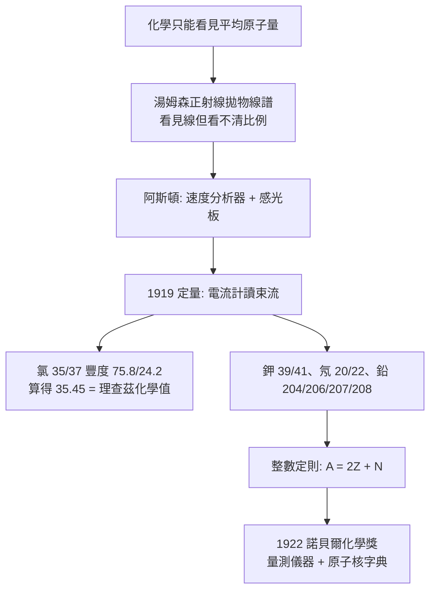

# 1922 · 阿斯頓與質譜儀

> 1922 諾貝爾化學獎：弗朗西斯·威廉·阿斯頓（Francis William Aston，1877–1945，英國）——表彰「其以質譜儀發現多種非放射性元素的同位素，及闡明整數定則」。諾貝爾獎史上唯一一次頒給「量測儀器與其量測」的年份。

## 懸案（案情提要）

1921 年索迪（見 [1921-索迪與同位素](1921-索迪與同位素.md)）已從化學側證明：**同一元素可以有好幾種原子量**。但化學方法只能告訴你「這批鉛的平均體重是 207.2」，無法告訴你「這個鉛原子究竟是 206、207 還是 208」。

懸案的癥結在於：**化學家的量測天生只能看見平均值。**所有化學性質（沉澱、還原、鍵結）都由電子數決定，與中子數無關——所以原子核的「體重分級」在化學的視野裡是完全隱形的。要看見它，必須量「質量本身」。

而量質量，需要一個把原子變成飛行離子、再按「每單位電荷的質量」分門別類的裝置。湯姆森已經在1911年用正離子束（canal rays）看見了模糊的拋物線譜——他甚至已經在1913年指出「有些原子有兩種質量」——但解析度太差、強度太弱，只能看見「有兩條線」，看不見「有多少比例」。

偵辦人：曾在湯姆森手下工作的阿斯頓。他要把模糊的拋物線，變成**能讀出比例的質譜**。

## 前因

| 年份 | 事件 |
| --- | --- |
| 1877 | 阿斯頓生於哈拉德郡，父親是鐵路工程師；自幼迷上電與真空管，15 歲自製真空泵。 |
| 1898 | 入劍橋三一學院，選修約翰·紐厄姆的「實驗物理」課程（研磨金剛石、研究光譜），獲得萊文斯坦獎學金赴德國慕尼黑（師從澤爾溫）。 |
| 1903 | 與約瑟夫·湯姆森同赴劍橋卡文迪許實驗室研究氣體放電。 |
| 1910–1911 | 加入 J. J. 湯姆森的「正射線」研究：確認陽極射線中含有多種離子，拋物線譜顯示**有些元素有多條譜線**。 |
| 1912 | 劍橋講師；同年湯姆森分離出兩種氯同位素（$^{35}\mathrm{Cl}$、$^{37}\mathrm{Cl}$）的初步證據——但僅止於「存在」。 |
| 1913 | 證實**鉀**由兩種同位素組成（$^{39}\mathrm{K}$、$^{41}\mathrm{K}$），這解開了「鉀原子量為何是 39.1 而非整數」的謎。 |
| 1919–1922 | 全面技術革新：速度分析器（velocity filter）、感光板偵測、放大電流計與質譜計配合的**相對量測**方法。 |
| 1922 | 諾貝爾演講《質譜儀》；同年獲諾貝爾化學獎。 |

## 調查

**偵查一：幾何——讓離子按「每單位電荷的質量」排隊。**

正離子束在電場 $\mathbf{E}$ 與磁場 $\mathbf{B}$ 中運動，運動學給出兩條約束：

$$\text{速度選擇器：} \; v = \frac{E}{B}, \qquad \text{磁場偏轉半徑：} \; r = \frac{mv}{zeB}$$

合併消去 $v$：

$$\boxed{\;\frac{m}{e} = \frac{B^2 r^2}{2VE}\;}$$

這是本案的核心量測式：只要量得電場強度、磁場強度與離子軌跡半徑，就得到**每單位電荷的質量**——正是「原子體重」的直接讀數。

**偵查二：技術革新——把模糊變成可讀。**

湯姆森的裝置問題在於：**能量分散太大**，同一 $m/e$ 的離子散成一片。阿斯頓的改進是一整套：

| 改進 | 作法 | 效果 |
| --- | --- | --- |
| 速度分析器 | 串聯第二組電場與磁場，只讓 $v = E/B$ 的離子通過 | 過濾能量分歧，光譜線變窄 |
| 感光板取代閃爍屏 | 以照相乾片直接記錄離子落點 | 解析度大幅提升、可長期保存、可重複測量 |
| 放大電流計 + 質譜計 | 以高靈敏度電流計讀出各束流強度 | 首次能**定量**測出同位素豐度 |
| 真空技術與均勻磁場 | 減少散射與場不均 | 譜線位置可信，才能算 $m/e$ |

1920 年代的「第三版」質譜儀已能在數分鐘內完成一次全掃描。

**偵查三：首次定量——豐度可讀了。**

用電流計讀出各譜線對應的電流，即得各同位素的**相對豐度**。以氯為例（後續精密測量確認）：

$$A_r(\mathrm{Cl}) = 35 \times 0.7578 + 37 \times 0.2422 = 35.453$$

與理查茲化學法測得的原子量吻合到小數點後第三位——**兩條完全獨立的路線（化學法與物理法）互相驗證成功**，同位素理論結案。

**偵查四：整數定則的驗算。**

阿斯頓將所有已知元素的同位素質量數排成一張表，發現驚人的規整：**除氫（1）與少數例外外，所有同位素的質量數都是整數**。他把它表述為：

$$A = 2Z + N$$

（$A$ = 質量數，$Z$ = 原子序，$N$ = 中子數）——當時尚無中子的概念，故以「質子數 + 中子數」描述之，物理意義要等 1932 年查兌克發現中子才補齊。

**整數定則的深意：** 原子量表裡那些「奇怪的小數」（氯 35.45、銅 63.55、鉀 39.10）全是**不同整數同位素的加權平均**——它們是統計，不是基本。真正的基本量是整數 $A$ 與 $Z$。

## 理論裁決

**判決一：質譜的運動學。** 對單一電荷 $e = 1.602\times10^{-19}\ \mathrm{C}$、質量 $m$（以 u 為單位，$1\ \mathrm{u} = 1.6605\times10^{-27}\ \mathrm{kg}$）的離子，$m/e$ 之比即「核素質量／基本電荷」，譜線位置直接讀出核素編號。

**判決二：豐度測量的統計學。** 相對豐度由束流強度給出，實際量測需修正積分與束流形狀；質量比由譜線位置給出，修正方式與儀器的「聚焦誤差函數」有關。1930 年代阿斯頓本人把這些修正整理成《質譜與同位素》（*Mass-Spectra and Isotopes*），成為原子核物理的第一本教科書。

**判決三：整數定則與核結構。** $A = 2Z + N$ 意味著核內「質子數」與「中子數」是兩個獨立參數；$N = A - Z$ 隨質量數增長，比重元素的中子比例較高（$Z/A$ 隨 $A$ 緩降），正是核稳定性（韋伯穩定性線）與核裂變、聚變的化學。此定則在 1932 年中子被發現後獲得完整解釋：質子與中子質量近似相同，$A \approx 2Z$ 之所以接近整數，只因 $m_p \approx m_n \approx m_H$：

$$\frac{A}{Z} \approx \frac{m_p + m_n}{m_p} \approx 2 \quad (\text{故 } A \text{ 近整數})$$

**判決四：元素 = 同位素集合。** 至此，元素的定義被徹底改寫：

$$\text{元素} = \{\text{核素}_1, \text{核素}_2, \dots\},\qquad A_r = \sum_i x_i A_i$$

化學家從此把「原子量」當作**約定的統計量**，而把「核素表」當作真正的元素描述。

## 後果

| 領域 | 影響 |
| --- | --- |
| 核物理 | 質譜儀成為核物理的標準儀器；人工加速器產生的新核素靠它鑑定，今日的「質譜定年」與「質譜分析」（蛋白質組學）皆承其緒。 |
| 元素同位素表 | 國際原子量委員會自 1920 年代起發布的原子量表改以核素豐度呈現，數十年不變的「35.45」終於被拆解為 35 與 37。 |
| 同位素分離 | 質譜儀提供了「如何把同位素分開」的理論依據；1931 年尤里以質譜儀預見氘的存在，1934 年製得重氫（見 [1934-尤里與重氫](1934-尤里與重氫.md)）——阿斯頓的儀器直接導向諾貝爾史上最快的一次「預言—實現」。 |
| 地質與考古 | 同位素比值測量（$^{14}\mathrm{C}$、$^{87}\mathrm{Sr}/{}^{86}\mathrm{Sr}$、鉛同位素）成為定年與溯源的常規武器。 |
| 醫學與分析 | 今日的質譜成像（mass spectrometry imaging）、穩定同位素標記臨床試驗、串聯質譜蛋白質鑑定，源頭都在這臺儀器。 |
| 儀器學 | 質譜儀成為二十世紀最成功的分析儀器之一，阿斯頓亦因其在科學儀器上的精巧設計獲頒克魯伊特獎章。 |

## 關聯

- [1921-索迪與同位素](1921-索迪與同位素.md)：化學側的推論在此獲得物理側的定量證據；兩案是同一懸案的雙卷。
- [1914-理查茲與精密原子量](1914-理查茲與精密原子量.md)：理查茲的化學原子量與阿斯頓的物理原子量互相驗證，把「原子量」從平均值的迷霧中釐清。
- [1913-維爾納與配位化學](1913-維爾納與配位化學.md)：同一時期「測量精度」精神的另一戰場。
- [1934-尤里與重氫](1934-尤里與重氫.md)：阿斯頓的質譜預言直接開啟重氫的搜捕。
- [1943-德海韋西與同位素示蹤](1943-德海韋西與同位素示蹤.md)：同位素一旦能被分辨與計數，放射性示蹤法便有了量測基礎。
- [1960-利比與碳-14定年](1960-利比與碳-14定年.md)：放射性測年所需的同位素計數，正是質譜技術的近親。
