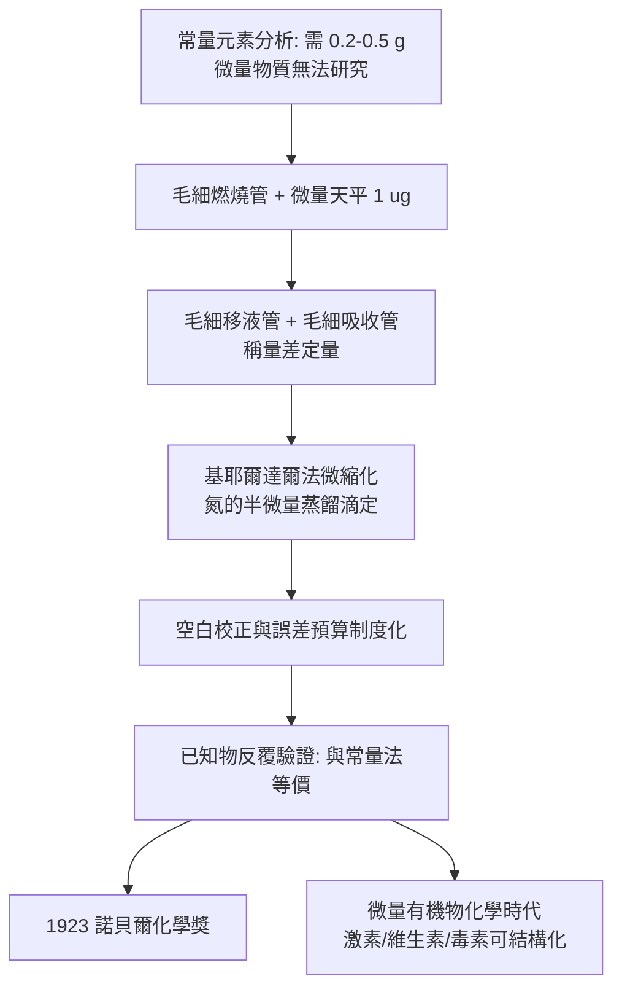

# 1923 · 普雷格爾與微量分析

> 1923 諾貝爾化學獎：弗里茨·普雷格爾（Fritz Pregl，1869–1930，奧地利／斯洛維尼亞）——表彰「其對有機微量定量分析之重要貢獻，尤其是燃燒管組技術之改良」。化學第一次不必再依賴「grams」。

## 懸案（案情提要）

有機化學的整套方法論，都壓在一個麻煩的前提上：**你得先知道分子裡有幾個碳、幾個氫、幾個氮，才能畫出它的結構式**。而元素分析在十九世紀是「重量級」的活：

- 李比希的燃燒分析（1830 年代）需要 **0.2–0.5 克**的純樣品；
- 一個單一純物質往往要從幾公斤天然物或植物體中提煉，才能得到足夠分析的量；
- 于是有一整類問題被化學家自己判了「材料不足」：腎上腺素、胰島素、維生素、激素、毒素——這些自然界用量極微、作用極大的物質，在化學上長期是「猜測它存在，但無法證明它的式量」。

而且分析誤差大：一個 $\pm 0.5\%$ 的碳含量誤差，足以讓「$\mathrm{C_{20}H_{24}N_2O_2}$」和「$\mathrm{C_{21}H_{26}N_2O_2}$」難分難捨。**化學的偵查工具在微量世界裡失靈了。**

普雷格爾的案子因此是：把元素分析的樣品需求，從「克」壓到「毫克」，同時把精度提高到足以分辨 1 個碳原子的差別。

## 前因

| 年份 | 事件 |
| --- | --- |
| 1869 | 普雷格爾生於斯洛維尼亞的洛布萊尼（Ljubljana／Laibach），奧地利帝國下的斯洛文尼亞家庭。 |
| 1888–1890 | 於奧地利格拉茨大學取得博士學位（有機化學），隨後在格拉茨醫學院任解剖學與生理學講師。 |
| 1890s | 與生理化學家合著《組織化學的定量分析》（*Quantitative Analysis of Histology*, 1910 起），需要測定組織中極微量的硫、磷、氮——**這正是他日後微量分析的原點**。 |
| 1904 | 移居格拉茨自立門戶；同年奧地利科學院授予席普林獎項鼓勵其研究。 |
| 1910 | 《組織化學的定量分析》第一卷出版；1912 年獲席普林獎。 |
| 1912 | 出版《微量分析》（*Die quantitative organische Mikroanalyse*）——本案的方法論正式成書。 |
| 1923 | 獲諾貝爾化學獎；1924 年因健康惡化退休，1926 年接替者由學生費利克斯·費格爾（Feigl）繼任。 |
| 1930 | 逝於格拉茨，年僅 61。 |

## 調查

**偵查一：燃燒管的縮微——本案的第一把鑰匙。**

傳統燃燒分析：樣品＋氧化銅在玻璃管內燃燒 → 生成氣體經洗氣瓶除水、除二氧化碳殘餘 → 用吸收管（鹼石灰吸收 $\mathrm{CO_2}$、無水氯化鈣吸收 $\mathrm{H_2O}$）称重前後差 → 算出碳與氫百分比。

普雷格爾的改造是一整套「微縮化」：

| 部位 | 傳統 | 普雷格爾的微量版 |
| --- | --- | --- |
| 樣品量 | $0.2$–$0.5\ \mathrm{g}$ | $1$–$5\ \mathrm{mg}$（約 1/100） |
| 天平 | 分析天平（$0.1\ \mathrm{mg}$ 讀數） | **微量天平**，讀數至 $0.001\ \mathrm{mg}$（$1\ \mu\mathrm{g}$） |
| 液體移取 | 玻璃移液管（誤差大） | 帶刻度的**毛細管微量移液管**（讀數至 $0.01\ \mathrm{mL}$） |
| 燃燒管 | 大號硬玻璃管 | **毛細燃燒管**（內徑數毫米），管內以鉑網／鉑絲催化氧化 |
| 吸收 | 大吸收瓶 | 毛細吸收管（吸收管重約數百毫克，卻能吸收 1 mg 級的 $\mathrm{CO_2}$） |
| 產物定量 | 稱量吸收管 | **稱量差** $\Delta m$ 即為該元素質量 |

關鍵量測原理沒有變，改變的全是**尺度與工具精度**：

$$\mathrm{C_8H_{10}N_4O_2}\ (\text{咖啡因})\xrightarrow[\mathrm{O_2}]{\text{燃燒}} 8\,\mathrm{CO_2} + 5\,\mathrm{H_2O} + 2\,\mathrm{N_2}$$

$$\%C = \frac{\,\dfrac{\Delta m(\mathrm{CO_2})}{44.01}\times 12.01\,}{m_{\text{樣品}}}\times 100\%,\qquad \%H = \frac{\,\dfrac{\Delta m(\mathrm{H_2O})}{18.015}\times 2\times 1.008\,}{m_{\text{樣品}}}\times 100\%$$

以 2 mg 樣品計，$\mathrm{CO_2}$ 質量差僅約 0.7 mg、$\mathrm{H_2O}$ 約 0.9 mg——**這就要求天平的讀數可靠性優於 $0.5\%$ 的樣品比例**，普雷格爾自製與改進的微量天平正好提供這個性能。

**偵查二：氮的測定——基耶爾達爾法的改裝。**

基耶爾達爾（Kjeldahl, 1883）法以濃硫酸消化有機物，蛋白質氮轉為銨鹽，再鹼化蒸餾、用標準酸吸收並反滴定。普雷格爾把它縮微到毫克級，並設計了**微型蒸餾裝置**與**半微量滴定**：

$$\mathrm{N\ (有機)} \xrightarrow[\Delta]{\text{濃}\,\mathrm{H_2SO_4}} \mathrm{NH_4^+} \xrightarrow[\text{鹼}]{ } \mathrm{NH_3} \xrightarrow{\text{標準}\,\mathrm{HCl}} \mathrm{NH_4Cl}$$

**偵查三：微量稱量的誤差預算——最難的一關。**

微量分析真正的敵人是誤差：天平擺動、空氣浮力、樣品吸濕、靜電、燃燒不完全、吸收管被污染。普雷格爾對每一項都做了量測與控制：

$$\frac{\Delta m}{m} \text{ 必須} \ll \frac{\Delta (\text{元素含量})}{\text{元素含量}}$$

以碳為例，含量約 50% 時，要分辨相鄰同系物（相差 $\mathrm{CH_2} = 14/100 \approx 14\%$ 質量比的 1%），需要相對精度約 $0.3\%$；在 2 mg 樣品上即要求 $\pm 6\ \mu\mathrm{g}$ 的稱量可靠性。**普雷格爾把這條誤差預算做到了毫米以下的天平讀數**，並把所有空白試驗（燃燒管、吸收管、空白燃燒）制度化——這套「空白校正」的邏輯，與他同時代的理查茲原子量工作完全同源（見 [1914-理查茲與精密原子量](1914-理查茲與精密原子量.md)）。

**偵查四：可信度審計——新方法的自我驗證。**

普雷格爾並未只宣稱「微量更省」；他用已知化合物（苯甲酸、咖啡因、乙醯苯胺等純品）反覆驗證微量法與常量法的一致性：

| 樣品 | 理論 $\%C$ | 常量法 | 微量法（多次平均） |
| --- | --- | --- | --- |
| 苯甲酸 $\mathrm{C_7H_6O_2}$ | 68.85 | 68.84 | 68.83–68.87 |
| 咖啡因 | 51.36 | 51.35 | 51.34–51.38 |
| 乙醯苯胺 | 71.70 | 71.68 | 71.66–71.71 |

方法學的裁決：**微量法在精度上與常量法等價，樣品用量減少兩個數量級**。案件成立。

## 理論裁決

**判決一：化學式可由誤差分辨率決定。** 元素分析的終極目的是「分辨分子式」。以兩式相差不超過一個 $\mathrm{CH_2}$ 為例，其 $\%C$ 差約 1.4 個百分點；若分析精度為 $\pm 0.3\%$，即可清晰區分：

$$\frac{\Delta(\%C)}{\%C} \lesssim 0.3\% \quad\Longrightarrow\quad \text{式量誤差}\ \lesssim 1\ \mathrm{u}$$

普雷格爾讓這條判準從「需要 0.5 g」變成「2 mg 亦可」——**化學式判定能力被解鎖於微量世界**。

**判決二：量測科學的系統化。** 普雷格爾在 1923 年諾貝爾演講中提出的要點，今天仍是分析化學的教科書內容：

1. 樣品要**足夠純**（雜質直接乘上全部誤差）；
2. 每一項操作都要有**空白對照**（校正試劑與容器的本底污染）；
3. 誤差要**逐項估計並加總**（不可用「大概」）；
4. 結果要**用已知物驗證**（方法論的自證）。

這四條把「化學分析」從技藝提升為**可複製的科學程序**。

**判決三：微量化的三個槓桿。** 把樣品需求從克降到毫克，靠的不是單一精巧裝置，而是三個槓桿同時發動：

$$\text{樣品需求} \propto \frac{\text{量測不確定度}}{\text{相對精度需求}} \times \frac{1}{\text{天平的相對靈敏度}}$$

① 樣品量 $m$ 越小 → 產物質量越小 → 需要更靈敏的天平；② 天平越靈敏 → 空白與污染的相對影響越大 → 需要更嚴格的空白校正；③ 每一步的系統誤差都必須以同一尺度重複量測。**這是「尺度越小、要求越高」的典型放大效應**，普雷格爾以「整齊的實驗室規範」而非單項發明戰勝了它。

## 後果

| 領域 | 影響 |
| --- | --- |
| 天然物化學 | 激素、維生素、毒素、抗生素的結構測定普遍改用微量法；「拿到 2 mg 就能定式量」成為常態。 |
| 生物化學 | 蛋白質與胜肽的序列工作（桑格，見 [1958-桑格與胰島素序列](1958-桑格與胰島素序列.md)）完全建立在微量分析之上——桑格本人即微量分析的受益者。 |
| 藥學與法醫 | 微量的毒物、藥物殘留可在生物樣本中檢出；法醫毒物學從「需要器官」進入「需要毫克」。 |
| 制度與教育 | 格拉茨大學成為「微量分析」的全球學派中心；學生費利克斯·費格爾發展出**點滴試驗**（spot test），開創以毛細管與試紙做微量定性分析的新路。 |
| 儀器 | 微量天平、毛細移液管、標準燃燒管成為化工與實驗室的標準配備，被寫入 ISO 與藥典方法。 |
| 與戰時 | 普雷格爾在格拉茨的微量實驗室於一戰期間被徵用作軍用分析（藥品與毒氣檢驗），戰後體弱退休，1930 年病逝。 |

## 關聯

- [1914-理查茲與精密原子量](1914-理查茲與精密原子量.md)：同屬「精密度作戰」譜系；理查茲定誤差預算，普雷格爾將其制度化並微型化。
- [1911-居里夫人與0.1克鐳](1911-居里夫人與0.1克鐳.md)：鐳的分離靠克級的礦渣與分步結晶；普雷格爾的微量工具正是這類「微量尋找」技術的後續世代。
- [1902-費歇爾與醣類偵探學](1902-費歇爾與醣類偵探學.md)：費歇爾的胜肽與醣類分析需要大量產物；微型化使這類研究得以細緻化。
- [1937-霍沃思與維生素C](1937-霍沃思與維生素C.md)：維生素 C 的結構與合成完全建立在微量分析之上。
- [1958-桑格與胰島素序列](1958-桑格與胰島素序列.md)：微量分析→微量水解→微量分離→微量定量的完整鏈條，桑格因此能在幾百毫克胰島素上讀出序列。
- [1925-席格蒙迪與膠體化學](1925-席格蒙迪與膠體化學.md)：同為 1920 年代「量測新工具」帶來新学科的案例。
