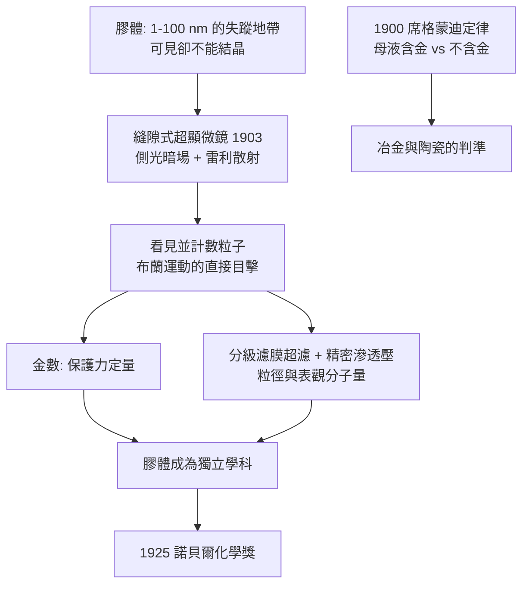

# 1925 · 席格蒙迪與膠體化學

> 1925 諾貝爾化學獎：里夏德·阿道夫·席格蒙迪（Richard Adolf Zsigmondy，1865–1929，奧地利）——表彰「其對膠體之研究，特別是膠體在各種科學領域之應用與重要性之發現」。他還發明了縫隙式超顯微鏡與分級濾膜，並留下今日仍在用的「席格蒙迪定律」。

## 懸案（案情提要）

十九世紀末，化學家發現有一整類物質，既不是分子，也不是通常意義的晶體，卻有完全獨特的性質：

- 尺寸在 $1$–$100\ \mathrm{nm}$ 之間——小到無法用普通顯微鏡看見，大到足以散射光線；
- 呈現**丁達爾效應**（Tyndall effect）：一束光穿過時出現光的路徑；
- 永遠不會沉澱（即使放上數年），卻能被極少量電解質「凝聚」成一團沉澱；
- 具有介於溶液與懸浮液之間的穩定性——**既不是真溶液，也不是真懸浮液**；
- 它們無法結晶，因此無法用當時唯一的結構測定法（X 射線）研究——直到 1912 年勞厄的發現。

這就是**膠體（colloid）**：一種介於分子世界與可見世界之間的「失蹤地帶」。懸案的核心是：這片地帶是什麼？它的粒子長什麼樣？為什麼它能懸浮那麼久？誰能**看見**它？

## 前因

| 年份 | 事件 |
| --- | --- |
| 1865 | 席格蒙迪生於奧地利帝國的維也納（父為匈牙利人），先在維也納大學學習法律，後轉讀化學。 |
| 1889–1892 | 於慕尼黑大學取得博士學位，隨索德·倫佩爾（Ludwig Kundt）從事光學研究，關注光的偏極與散射。 |
| 1894 | 前往萊比錫，隨奧斯特瓦德（見 [1909-奧斯特瓦德與催化](1909-奧斯特瓦德與催化.md)）研究膠體與滲透壓，獲得「顯微化學」與「超顯微鏡」的靈感。 |
| 1899–1900 | 在格拉茨大學任教期間完成膠體化學的奠基工作：**金數（gold number）**、金溶膠的製備法（甲醛還原氯化金）、以及**席格蒙迪定律**（金鹽水解時析出金屬金的判準）。 |
| 1903 | 與齊登托普（Siedentopf）共同發明**縫隙式超顯微鏡**（Spitzultramikroskop）——以側面照明讓納米粒子散射的光進入物鏡，等於給膠體粒子造了「暗場照明」。 |
| 1909 | 與齊登托普合著《超顯微鏡的原理與應用》（*Das Ultramikroskop*）。 |
| 1910s | 發明**分級濾膜**（以硝酸纖維素膜按孔徑大小過濾分離膠體）與**精密滲透壓法**（以半透膜量測膠體的滲透壓，從而估算粒子大小）。 |
| 1917 | 因與同事的爭執（席格蒙迪發動攻擊性人身指控）辭去斯圖加特教職，轉任私人研究。 |
| 1925 | 獲諾貝爾化學獎。 |

## 調查

**偵查一：讓膠體「現形」——超顯微鏡的幾何設計。**

普通顯微鏡的問題：膠體粒子（$<100\ \mathrm{nm}$）小於可見光波長，**根本不散射前向光**，因此在明場照明下是「看不見的空氣」。席格蒙迪與齊登托普的解法是**把光從側面打進樣品**，只收集被粒子散射到 $90^\circ$ 方向的光——暗場照明。散射的物理基礎是雷利公式：

$$I(\theta) \propto \frac{1+\cos^2\theta}{\lambda^4}\cdot \left|\frac{m^2-1}{m^2+2}\right|^2 \cdot V^2$$

三個關鍵因子的物理意義一目了然：

- $\lambda^{-4}$：**短波長散射更強**——這是天空呈藍、膠體呈藍紫色的原因（在同一公式裡，天空與金溶膠是同一門物理）；
- $\left|\dfrac{m^2-1}{m^2+2}\right|^2$：粒子的**折射率差**——這正是「金溶膠是紅色」的解釋（金屬粒子有異常大的折射率差與集體共振）；
- $V^2$：**粒子體積的平方**——散射強度對尺寸極其敏感，這讓超顯微鏡成為「量測粒徑」的定量工具。

**偵查二：金數——「保護力」的定量尺。**

膠體最工業化的性質是**保護膠體**：少許親液膠體（明膠、阿拉伯膠）能阻止溶膠被電解質凝聚。席格蒙迪定義**金數**：

$$\text{金數} = \text{阻止 } 1\ \mathrm{mL}\ \text{標準金溶膠被 } 10\%\ \mathrm{NaCl}\ \text{凝聚所需的保護膠體毫克數}$$

數值越小 = 保護力越強。從此「保護膠體」有了可比較、可量產的規格，藥用與工業用膠體（如阿拉伯膠、阿拉伯半數）有了等級標準。

**偵查三：穩定性機制的兩條解釋。**

膠體「為什麼能懸浮那麼久」有兩套機制，席格蒙迪的工作把它們都推上檯面：

1. **動力學穩定（布朗運動）**：粒子受分子撞擊而做無規則運動，抵抗沉降。以愛因斯坦—斯莫盧霍夫斯基的擴散方程描述：

$$D = \frac{k_B T}{6\pi\eta r}$$

（$D$ 為擴散係數、$\eta$ 為黏度、$r$ 為粒徑）。**粒子越小，布朗運動越強**，故沉降被抑制——這解釋了為何數十奈米的粒子可以懸浮數年。
2. **熱力學穩定（表面電荷／ζ 電位）**：粒子表面帶電，雙電層使粒子彼此排斥，凝聚需要克服排斥能。當加入電解質壓縮雙電層，$\zeta$ 電位下降，凝聚發生——**這是「加鹽就沉澱」的完整機制**。

席格蒙迪本人偏向動力學解釋並以超顯微鏡直接觀察布朗運動；而奧斯特華德的助手斯莫盧霍夫斯基（Smoluchowski, 1916–17）給出凝聚速率的統計描述（Smoluchowski 方程），德拜—許克爾的雙電層理論則在 1930–40 年代補上電學側。

**偵查四：席格蒙迪定律——冶金與膠體的交會。**

席格蒙迪在研究氯化金水解時發現一條判準（1900 年）：

> 當母液中仍含有金屬成分（$\mathrm{AuCl_4^-}$）時，加熱不會析出金屬金；但若母液中**金已耗盡**（水解完全），加熱即析出金屬金，且析出的金不是通常的黑色而帶紫色色調。

此判準今日稱**席格蒙迪定律**，在精煉黃金時用來判斷「溶液是否已完全還原」，在玻璃纖維與陶瓷著色中判斷金屬顆粒的生成機制（表面析出 vs 體相析出）——一條由膠體實驗室出生的工業律。

**偵查五：物理量測——壓 ultrafiltration 與滲透壓。**

席格蒙迪發明**分級濾膜**：以不同孔徑的膜過濾，可把膠體按粒徑分級（超濾）。並以**精密滲透壓法**量測膠體溶液的滲透壓，從 Van 't Hoff 關係（見 [1901-凡特荷夫與物理化學](1901-凡特荷夫與物理化學.md)）估算粒子的「表觀分子量」：

$$\frac{\pi V}{RT} = \frac{m_{\text{膠體}}}{M_{\text{表觀}}} \quad\Longrightarrow\quad M_{\text{表觀}} = \frac{m_{\text{膠體}}RT}{\pi V}$$

這是「把膠體當成大分子」的定量第一步。

## 理論裁決

**判決一：雷利散射律——天空與金溶膠的統一。** 散射強度 $I \propto \lambda^{-4}$ 立即解釋：

- 天穹呈藍：短波藍光散射最多；
- 日落呈紅：夕照路徑長，藍光散失；
- 金溶膠呈紅紫：$m^2-1/m^2+2$ 因子對金屬粒子極大（$m$ 遠大於 1），且有等離子體共振。

**判決二：粒徑與沉降的物理。** 沉降速度（斯托克斯定律）：

$$v = \frac{2\,r^2(\rho_p - \rho_f)g}{9\eta}$$

與布朗擴散 $D = k_B T/(6\pi\eta r)$ 對照：兩者對 $r$ 的依賴恰好相反（沉降 $\propto r^2$、擴散 $\propto 1/r$），因而存在一個**臨界粒徑**，低於它粒子永遠懸浮（膠體區），高於它則會沉降（粗分散區）。這條判準把「膠體」定義為一個有物理意義的**區間**，而非任意劃線。

**判決三：\zeta 電位與凝聚門檻。** 加入電解質壓縮雙電層、使 $\zeta$ 電位降到某臨界值以下，凝聚即發生——這是「凝聚臨界電位」的經驗規則，也是DLVO 理論（1941–45）與 Schulze–Hardy 規則（1912）的前身。

**判決四：席格蒙迪定律的熱力學解讀。** 「母液含金則加熱不析金」實際上是**溶解度積**與**成核能障**的競爭：若母液仍飽和，析出金屬需要外加成核劑（epitaxy），而金溶膠粒子正是最好的成核劑；母液耗盡後，析出則無需外核，故在較低過飽和度下即發生。

## 後果

| 領域 | 影響 |
| --- | --- |
| 膠體科學 | 席格蒙迪的超顯微鏡、濾膜與金數三件工具，讓「失蹤地帶」成為可研究的對象；1930–40 年代 DLVO 理論、史莫盧霍夫斯基凝聚動力學與超速離心機（斯韋德貝里，1926）接續擴張這塊疆域。 |
| 工業 | 陶瓷釉料著色（Au 金紅、Cu 紅）、玻璃纖維、感光乳劑、油墨、藥用懸浮液、化妆品、汙泥處理與土壤改良，皆以膠體科學為工程底盤。 |
| 冶金 | 席格蒙迪定律至今用於黃金精煉與金屬膠體的製備判準。 |
| 醫學 | 血液的懸浮特性、藥物的分散度與吸收、脂質體與乳劑型藥物的開發，皆屬膠體工程的應用面。 |
| 儀器 | 縫隙式超顯微鏡開啟「看見納米世界」；其後電子顯微鏡（1931）把極限再往下推，1980 年代原子力顯微鏡（見 [1986-李遠哲與分子束](1986-李遠哲與分子束.md) 同一世代的奈米技術）直達原子級。 |
| 學術制度 | 席格蒙迪於 1925 年獲獎時，德國學界正以「膠體科學是德國的驕傲」自居；此一自我宣傳的傳統在 1930 年代被納粹用於排除猶太科學家（費利克斯·哈恩被逐、萊納斯·鮑林失去教職）——一頁不能略過的史實。 |

## 關聯

- [1901-凡特荷夫與物理化學](1901-凡特荷夫與物理化學.md)：滲透壓公式是席格蒙迪量測膠體粒徑的工具；物理化學的三巨頭皆出身德國萊比錫—格拉茨—慕尼黑圈，本案即其延伸。
- [1909-奧斯特瓦德與催化](1909-奧斯特瓦德與催化.md)：席格蒙迪在萊比錫的導師；膠體穩定與催化劑表面吸附在當年是同一套「界面化學」問題。
- [1923-普雷格爾與微量分析](1923-普雷格爾與微量分析.md)：同為 1920 年代「量測工具帶來新學科」的案例；濾膜與超顯微鏡是膠體的度量衡。
- [1926-斯韋德貝里與超速離心機](1926-斯韋德貝里與超速離心機.md)：下一年的諾獎——膠體與蛋白質的粒徑量測被推到新的物理極限。
- [1932-朗繆爾與表面化學](1932-朗繆爾與表面化學.md)：膠體的界面問題在朗繆爾手中轉為可計算的表面物理。
- [1986-李遠哲與分子束](1986-李遠哲與分子束.md)：奈米尺度化學的現代端點——從超顯微鏡到分子束。
