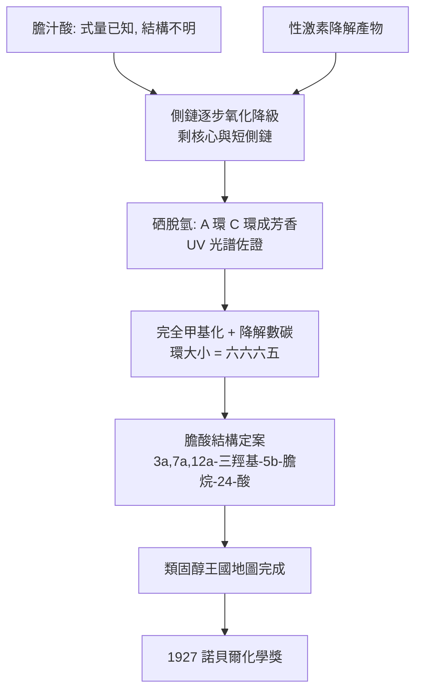

# 1927 · 威蘭與膽汁酸

> 1927 諾貝爾化學獎：海因里希·奧托·威蘭（Heinrich Otto Wieland，1877–1957，德國）——表彰「其對膽汁酸之研究」。他用結構測定證明：膽汁酸、膽固醇、性激素、維生素 D 是同一個家族——類固醇王國的國王。

## 懸案（案情提要）

1920 年代的有機化學界，有一批「人人看見、無人拆得動」的分子。

**膽汁酸**：一百多年前已從牛膽中分離出的四種物質（膽酸、去氧膽酸、鵝去氧膽酸、石膽酸），分子式已知（如膽酸 $\mathrm{C_{24}H_{40}O_5}$），但結構完全不明：羥基在環上的哪裡？側鏈有多長？環有幾個、多大？更關鍵的是——**它們與膽固醇、腎上腺皮質激素、性激素、維生素 D 是不是同一家的事？**所有人都覺得「像」，但沒有人能證明。

1930 年代德國化學界還加上一層火藥味：同一份「類固醇王國」的地盤上，威蘭與布特南特（Adolf Butenandt）正在展開一場慘烈的優先權戰爭——兩人都研究性激素，都想拿到同一頂皇冠。

威蘭接下了這樁案的**主線**：從最難啃的膽汁酸下手，把類固醇的骨架徹底畫出來。

## 前因

| 年份 | 事件 |
| --- | --- |
| 1877 | 威蘭生於巴伐利亞的弗爾斯貝格；父為醫師。 |
| 1901–1903 | 慕尼黑大學博士（師從約瑟夫·克諾爾），隨克諾爾研究吡咯與生物鹼；1904 年起任慕尼黑大學教授。 |
| 1910 | 與克諾爾合成「OCT」（後續成為維生素 B$_1$ 合成的重要中間體）；1913 年完成環狀酮（維生素 B$_1$ 的環）的全合成。 |
| 1915 | 與費利克斯·克諾爾（Josef Knorr）合作，發現環狀酮可經苯肼轉為吡唑類。 |
| 1919–1932 | 膽汁酸結構的系統研究（本案的十年主戰）：氧化法、脫氫法、降解法的組合攻擊。 |
| 1921 | 與 K. Scharrer 首次合成類固醇骨架的重要中間體；1922 年發表「B 環是六員環」的關鍵推論。 |
| 1924 | 與 H. O. Hölzer 合成「環戊烷多氫菲」骨架衍生物，證實類固醇骨架的可能拓撲。 |
| 1927 | 獲諾貝爾化學獎。 |
| 1932 | 與 Rudolf Kuhn 合作完成維生素 A 的結構（1931 公布）與部分全合成工作。 |
| 1935–1939 | 與 W. M. Kuhn 合成維生素 D$_2$（1936）；1937 年由普雷奧格（Prelog）完成構型測定，1938 年由諾貝爾委員會分別裁定 1938 年化學獎歸布特南特與魯日奇卡。 |

## 調查

**偵查一：氧化降級——從側鏈開始剝。**

膽汁酸的結構偵查採用「化學手術」：以強氧化（酸性高錳酸鉀、重鉻酸）逐步削去分子。先攻側鏈：

$$\text{膽酸} \xrightarrow{\text{氧化}} \text{膽酸衍生物（少 1 個 C）} \xrightarrow{} \text{去氧膽酸（少 2 個 C）} \xrightarrow{} \text{石膽酸（少 4 個 C）}$$

每削掉一截碳，就多一份「側鏈是直鏈、不是支鏈」的證據；最終得到只剩類固醇核心與短側鏈的產物，並能與從**性激素**降解得來的產物對上號——**「同一個核心」的物證在此成立**。

**偵查二：脫氫法——找出哪些環是芳香的。**

威蘭以硒（$\mathrm{Se}$）高溫脫氫，把飽和的類固醇環「拉直」成芳香環。結果：核心中有**兩個環變成芳香衍生物**（六員環 A 與六員環 C），另兩個環保持飽和——這正是「環戊烷多氫菲」骨架的拓撲特徵：

$$\text{核心} = \underbrace{\text{六員環 A}}_{\text{芳香}} + \underbrace{\text{六員環 B}}_{\text{飽和}} + \underbrace{\text{六員環 C}}_{\text{芳香}} + \underbrace{\text{五員環 D}}_{\text{飽和}}$$

芳香與否可用紫外光譜判定（苯環 $\lambda_{\max}\approx 240$–$260\ \mathrm{nm}$），這是把「結構假設」變成「光譜實證」的一手。

**偵查三：環大小的判定——彻底甲基化與降解的算術。**

威蘭的邏輯極為嚴密：把環與環的接頭碳（junction carbon）以「完全甲基化」轉成帶甲基的碳，然後觀察氧化降解時**每個甲基带走多少碳**，即可反推每個環的大小。四個環、三個接頭，降解產物的碳分佈給出唯一自洽的答案：六、六、六、五。

$$\text{降解損失的碳數} \;\longleftrightarrow\; \text{各環的碳原子數}$$

這套「先封鎖、再降解、數碳」的推理，是當時判定稠環系統環大小的標準手段（後由「完全甲基化降解法」定名）。

**偵查四：立體化學——那些箭頭才是重點。**

結構式寫出來只是骨架，真正的難題是**立體**：羥基在環上是朝上（$\beta$）還是朝下（$\alpha$）？這決定了分子的行為。威蘭與其合作者以**碘化氫／醋酸高溫脫羥基反應的立體專一性**、以及**酶促差向異構化**來定案，得到膽酸的結構：

$$\text{膽酸} = 3\alpha,7\alpha,12\alpha\text{-三羥基-}5\beta\text{-膽烷-24-酸}\ (\mathrm{C_{24}H_{40}O_5},\ M = 408.6)$$

**偵查五：與其他家族的聯繫——類固醇王國的地圖。**

同一個骨架在四個家族中出現，只是官能基不同：

| 家族 | 側鏈 $\mathrm{C_{17}}$ 的形式 | 代表 | 生理角色 |
| --- | --- | --- | --- |
| 膽汁酸 | $\mathrm{-CH_2CH_2COOH}$（24-酸） | 膽酸 | 乳化脂肪、促進吸收 |
| 膽固醇 | $\mathrm{-CH(CH_3)(CH_2)_3CH_2(CH_3)_2}$ | 膽固醇 | 細胞膜、膽酸前驅物 |
| 性激素 | 縮短或消失 | 睪固酮、雌酮 | 性徵、第二性徵 |
| 腎上腺皮質激素 | $\mathrm{-C(=O)CH_2OH}$ | 可的松、醛固酮 | 應激代謝、電解質平衡 |
| 維生素 D | 開環的 B 環 | 維生素 D$_2$ | 鈣磷代謝、抗佝僂病 |

威蘭的工作把這張地圖的骨架一次畫定，之後所有成員只需各自補上側鏈與官能基即可。

## 理論裁決

**判決一：類固醇骨架的拓撲。** 環戊烷多氫菲（cyclopentanoperhydrophenanthrene）骨架，四環稠合、三個六員環 + 一個五員環：

$$\text{稠環系統的立體化學} \;:\; \text{環 A/B 為順式或反式稠合決定立體家族}$$

膽固醇屬 **$5\beta$（A/B 順式稠合）** 家族，與之相對的是 **$5\alpha$（反式）** 家族——這兩大家族在生理活性上截然不同，是日後「立體化學決定藥效」的源頭。

**判決二：立體描述子的系統化。** 威蘭確立的 $\alpha/\beta$ 描述（相對於角甲基參考平面）成為類固醇立體化學的標準語言：

$$\text{膽酸：} \; 3\alpha\text{-}O\mathrm{H},\ 7\alpha\text{-}O\mathrm{H},\ 12\alpha\text{-}O\mathrm{H},\ 5\beta\text{-}H$$

**每一個箭頭方向都是一條實驗證詞**——它們由脫羥基反應的立體專一性、差向異構化酶的選擇性、以及消旋與光學活性共同鎖定。

**判決三：降解法的數學——碳帳目即結構。** 對稠環系統，每一條降解路徑都給出一條「碳流失方程」；所有方程聯立求解，唯一的非負整數解即候選骨架。**結構測定在本質上是求解一個以碳為未知數的整數方程組**——這是威蘭那一代人的方法論。

**判決四：威蘭–邁舍爾酮——全合成的樞紐。**

威蘭與同事從睪固酮的氧化降解產物製得 **威蘭–邁舍爾酮**（Wieland–Miescher ketone，$\mathrm{C_{11}\mathrm{H}_{14}\mathrm{O_2}$，含兩個手性中心與一個 $\alpha,\beta$ 不飽和酮）：

$$\text{威蘭–邁舍爾酮} \xrightarrow{\text{立體選擇性反應}} \text{三萜烯骨架} \;\xrightarrow{}\; \text{可的松、松節油烯、維生素 A}$$

它是**類固醇全合成的標準起點**：1950–60 年伍德沃德（見 [1965-伍德沃德與全合成](1965-伍德沃德與全合成.md)）合成可的松即以此為核心砌塊，一石激起 steroid total synthesis 的工業與學術浪潮。

## 後果

| 領域 | 影響 |
| --- | --- |
| 內分泌學 | 性激素、腎上腺皮質激素的結構確認（布特南特 1939）使「激素是類固醇」確立，腎上腺皮質素（可的松）於 1948 年成為治療風濕性關節炎的第一個奇蹟藥。 |
| 維生素 | 維生素 D$_2$（威蘭 1936 合成、普雷奧格 1937 定構）與維生素 A（威蘭–庫恩 1931）；維生素的化學年代全面開啟。 |
| 藥理與毒理 | 強心配糖體（毒毛旋花苷、地高辛）的類固醇骨架與糖的部分被分開破解，強心藥的構效關係得以建立。 |
| 合成工業 | 類固醇全合成帶動甾體藥物工業（避孕藥、皮質類固醇消炎藥、雌激素）；威蘭–邁舍爾酮至今仍是合成化學教科書的經典起點。 |
| 肝膽醫學 | 膽汁酸的化學確立了膽結石形成機制（膽固醇過飽和與膽汁酸失衡），並導出熊去氧膽酸等藥物。 |
| 歷史註記 | 1920–30 年代德國科學界的優先權戰爭極為激烈（威蘭 vs 布特南特、威蘭 vs 蘭登克）；1930 年代威蘭的研究所亦捲入納粹時代的科學清洗與戰時動員，本案的卷宗在 1930–45 年間留下數頁空白。 |

## 關聯

- [1902-費歇爾與醣類偵探學](1902-費歇爾與醣類偵探學.md)：費歇爾的生物鹼與嘌呤工作，與威蘭的生物鹼、環狀酮合成同屬一門「降解—重建」的結構學。
- [1905-拜耳與靛藍案](1905-拜耳與靛藍案.md)：拜耳的稠環化學（苯環張力、醌、吲哚）開啟的德國有機化學傳統，威蘭是其中的環化學一脈。
- [1923-普雷格爾與微量分析](1923-普雷格爾與微量分析.md)：微量元素分析是類固醇結構測定的必備工具；威蘭的十年降解工作正建立在微量分析之上。
- [1930-漢斯費歇爾與血紅素](1930-漢斯費歇爾與血紅素.md)：卟啉大環與類固醇骨架的結構思維互為鏡像；兩案皆由降解法主導。
- [1939-布特南特與魯日奇卡](1939-布特南特與魯日奇卡.md)：威蘭的對手與同時代人；性激素與萜烯兩張地圖在同一塊土壤上被分掉。
- [1965-伍德沃德與全合成](1965-伍德沃德與全合成.md)：威蘭–邁舍爾酮成為伍德沃德類固醇全合成的起點——本案最著名的後續。
