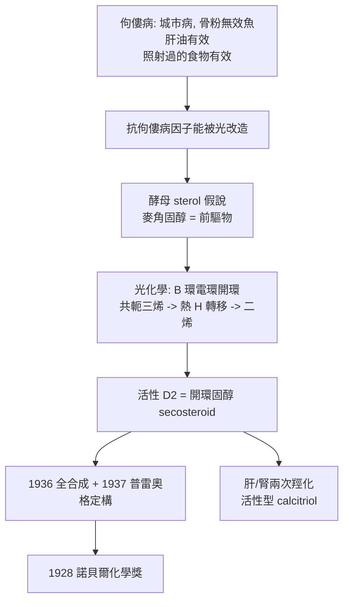

# 1928 · 溫道斯與維生素 D

> 1928 諾貝爾化學獎：阿道夫·奧托·萊因霍爾德·溫道斯（Adolf Otto Reinhold Windaus，1876–1959，德國）——表彰「其對固醇及其與維生素之關係的研究」。他把佝僂病從「陽光不足的怪病」變成一個有分子結構的案子。

## 懸案（案情提要）

1910 年代的歐洲城市裡，佝僂病（rickets）像一種城市病流行：兒童骨骼軟化、彎曲、壓迫胸腔；同時成人的骨軟化症（osteomalacia）與佝僂病被懷疑同源。城市裡的孩子在陰暗的地下室裡長大，鄉村孩子在戶外——1919 年英國醫師斯圖爾（Edward Mellanby）用狗做實驗，找到了驚人的規律：

- 餵含**骨粉**的狗會發病；
- 餵含**魚肝油**的狗不會發病；
- 把**紫外線照射過的**的食物餵狗，發病率大幅下降——**光是食物裡的什麼東西被改變了**。

於是懸案成形：**食物中有一種「抗佝僂病因子」，它能被紫外線轉換成活性形式。**但它到底是什麼？既然能被光「改變」，那它必定有特殊的不飽和結構——化學家立刻想到：**固醇**。膽固醇不就是這樣的不飽和環狀醇嗎？

偵辦人：溫道斯。他面對的子案是：哪一種固醇是維生素 D 的前驅物？那個被紫外線改造產物到底長什麼樣？佝僂病為什麼在陽光充足的地方也會發生（維生素 D 不足）？腎臟為什麼是必要的（活性化的最後一步在腎）？

## 前因

| 年份 | 事件 |
| --- | --- |
| 1876 | 溫道斯生於波恩，普魯士貴族家庭（父為醫院院長）。 |
| 1899 | 於慕尼黑取得博士學位，後隨阿道夫·馮·拜耳（見 [1905-拜耳與靛藍案](1905-拜耳與靛藍案.md)）學習，後與其子奧托·迪爾斯（1950 年化學獎得主）同為其學生。 |
| 1901–1903 | 與約瑟夫·雅各布（Josef Jacobi）研究毛地黃的固醇配糖體（強心配糖體的結構，案外收获）。 |
| 1919–1921 | 研究膽固醇與其衍生物；建立以**毛地黃皂苷（digitonin）沉澱**分離固醇的方法（今日仍稱「溫道斯法」），把固醇混合物拆成可比較的純品。 |
| 1921 | 梅蘭比發表佝僂病的實驗證據；赫斯（Hess）與溫道斯同期發現紫外線照射的酵母能治佝僂病。 |
| 1922–1923 | 溫道斯自麥角與酵母中分離出**麥角固醇（ergosterol）**，證明它是維生素 D 的**前驅物（provitamin）**；紫外線照射麥角固醇即得活性物質。 |
| 1924 | 與施泰本克（Steenbock）等人發現「維生素 D 可用紫外線照射食品製造」，並推動工業化奶類強化。 |
| 1928 | 獲諾貝爾化學獎。 |
| 1931–1932 | 與威蘭（見 [1927-威蘭與膽汁酸](1927-威蘭與膽汁酸.md)）完成膽固醇的**首次全合成**（以降解再重建的方式，1932 年發表）。 |
| 1932–1936 | 確立活性維生素 D（calciferol，維生素 D$_2$）的結構：**B 環被切開的「開環固醇」（secosteroid）**。 |
| 1936 | 合成維生素 D$_2$。 |

## 調查

**偵查一：前驅物的辨認——把維生素 D 的問題變成固醇的問題。**

溫道斯的策略非常漂亮：既然紫外線照射酵母能治療佝僂病，而酵母 sterol 含量極高（酵母 sterol 主要是麥角固醇），那麼**有效成分必然是某种固醇被光改造的產物**。他果然從被照射的酵母中提取出活性物質，而未照射的麥角固醇無活性——**光的作用被定位在分子上**。

$$\text{麥角固醇（provitamin D）} \xrightarrow{h\nu,\ \sim 300\ \mathrm{nm}} \text{活性維生素 D}$$

**偵查二：光化學的機制——B 環被打開。**

這是本案最漂亮的一步。麥角固醇的結構是經典的類固醇骨架，但**維生素 D$_2$ 與它的分子式完全相同**（$\mathrm{C_{28}H_{44}\mathrm{O}$，$M = 396.65$）——所以它不是氧化、不是加成，而是**異構化**。溫道斯以降解實驗證明：活性物質的 B 環**被切開了**，即第 9 與第 10 號碳之間斷鍵，形成開環固醇（secosteroid），並產生一個共軛三烯：

$$\text{麥角固醇（B 環閉合）} \xrightarrow{h\nu} \underbrace{\text{前維生素 D}}_{\text{開環 + 共軛三烯}} \xrightarrow{\Delta,\ [1,7]\text{-H 轉移}} \text{維生素 D}_2\ (\text{共軛二烯})$$

即：光化學步驟是六 $\pi$ 電子的**電環開環**（conrotatory），熱步驟則是 **[1,7]-氫轉移**的環己二烯互變——**這套機制正是 1981 年福井謙一與霍夫曼的前沿軌域理論最經典的示範之一**（見 [1981-福井與前沿軌域](1981-福井與前沿軌域.md)）。三十年前沒有理論，溫道斯靠降解把結果量出來；三十年後，理論精準預測了同一個轉移。

**偵查三：立體化學的最後拼圖。**

活性維生素 D 的幾何細節（兩個環的順反構型、$5E,7E,10(19)$ 三烯的構型）由普雷奧格（Prelog）在 1937 年以拆分與消旋實驗定案。

**偵查四：器官的追問——肝與腎為何都必要。**

1920 年代醫學界已發現：維生素 D 必須「先經肝臟、再經腎臟」才生效，但當時活性物質卻被認為是**一種**。溫道斯的研究預告了答案：光產物只是前驅物，真正作用於標的器官的是**兩次羥化**的產物——這要到 1960–70 年代才被證實：

$$\text{維生素 D}_3 \xrightarrow[\text{肝}]{25\text{-羥化酶}} \text{25-(OH)-D}_3 \ (\text{骨化三醇的前驅}) \xrightarrow[\text{腎}]{1\alpha\text{-羥化酶}} 1,25\text{-}(OH)_2\mathrm{D}_3\ (\text{骨化三醇，活性型})$$

**「肝與腎都必要」不是矛盾，而是兩段反應的真相**——本案埋下的線索，在四十年後由維生素 D 受體的研究接續。

**偵查五：工業化與法律戰。**

1923–25 年，溫道斯、施泰本克等人發現紫外線照射牛奶可增加維生素 D，Wisconsin 大學取得專利並課徵授權費，造成「維生素 D 奶」與「維生素 D 牛奶」的著名訴訟；1945 年美國國會通過「施泰本克修正案」，將食品維生素 D 強化排除於專利之外。**一條化學發現如何改變乳品工業與專利法，是本案最接地氣的後果。**

## 理論裁決

**判決一：光化學異構化的立體專一性。** 麥角固醇的 B 環開環是一個**光化學 Allowed 的 conrotatory 六 $\pi$ 電環反應**；而後的熱步驟是 **[1,7]-H 轉移**（suprafacial）。以 Woodward–Hoffmann 選擇定則表述：

$$\text{光化學 } 6\pi \text{ 開環：conrotatory（允許）；熱 } [1,7]\text{-H 轉移：suprafacial（允許）}$$

**這兩條規則要等到 1981 年才被寫成通則**——溫道斯的實驗結果，後來成了 Fukui–Hoffman 理論的實驗里程碑之一（維生素 D 合成被列為「 Woodward–Hoffmann 定則的經典教學案例」）。

**判決二：開環固醇的概念。** 「secosteroid」——**切開一個環的固醇**——是一個全新的結構類別（維生素 D、維生素 A 類視覺retinoid 的母體骨架亦屬此類的近親），它在「固醇骨架」與「開鏈多烯」之間開出了第三條路。此後的類固醇藥物（鈣三醇 analogs、雌酚酮的 A 環開環衍生物）皆沿此類別延伸。

**判決三：固醇的分離與比較方法學。** 溫道斯的**毛地黃皂苷沉澱法**提供了一個能系統分離固醇類的「分子篩」（皂苷與固醇形成不可溶的複合物，非固醇溶出）：

$$\text{混合物} + \text{digitonin} \xrightarrow{} \underbrace{\text{固醇–皂苷沉澱}}_{\text{可再溶解分離}} + \text{非固醇留在溶液}$$

配合衍生物結晶與比旋光測定，固醇類的「分子指紋鑑定」在 1920 年代趨於成熟。

**判決四：活性維生素的生理邏輯。** 以立體化學與構造關係解釋：$\Delta^5,7$ 三烯系統是 B 環結合蛋白受體（VDR）所必需；受體結合後促進 VDR–RXR 複合體與 DNA 的結合，調控鈣結合蛋白（calbindin）與磷酸酶等基因轉錄——**光化學產物因此成為基因表現的調控者**，這條機制在 1969 年由哈頓與普雷奧格（見 [1969-巴頓與構象分析](1969-巴頓與構象分析.md)）式的立體化學方法逐步確立，並在 1988 年後的受體結構研究中補上結構證據。

## 後果

| 領域 | 影響 |
| --- | --- |
| 公共衛生 | 維生素 D 強化乳與魚肝油的普及，使佝僂病在歐美工業化國家幾乎消失——「一場看不見的營養革命」。 |
| 醫學 | 骨質疏鬆症與骨折預防（骨密度、鈣吸收）、腎性骨病、維生素 D 缺乏症的臨床處理，皆建立在本案的分子發現上。 |
| 藥理 | 活性維生素 D 類似物（帕立骨化醇、卡法三醇）用於腎透析與甲狀腺功能低下患者的骨病治療；佝僂病藥物成為藥理學教科書的第一課。 |
| 化學工業 | 酵母菌發酵生產麥角固醇、紫外線照射維生素 D$_2$ 的工業製程、強化乳製品產業。 |
| 學術傳承 | 溫道斯是阿道夫·布特南特的博士導師（布特南特 1939 年因性激素獲獎），其實驗室同時產出威蘭式的類固醇全合成傳統——威蘭、溫道斯、迪爾斯、布特南特構成德國類固醇學派的核心網絡。 |
| 歷史註記 | 1920 年代德國科學界因維生素與激素的搶先權互相緊逼；1930 年代納粹執政後，溫道斯的研究所被軍方徵用並遷址，其科學家人際網被政治撕裂。 |

## 關聯

- [1905-拜耳與靛藍案](1905-拜耳與靛藍案.md)：拜耳—溫道斯的師承線；稠環與稠合環的德國化學傳統。
- [1927-威蘭與膽汁酸](1927-威蘭與膽汁酸.md)：類固醇骨架的同一塊地圖；本案把威蘭的結構工具用於維生素端。
- [1910-瓦拉赫與萜類家族樹](1910-瓦拉赫與萜類家族樹.md)：異戊二烯規則——維生素 A 的骨架（異戊二烯衍生）與類固醇骨架的關係在此交叉。
- [1939-布特南特與魯日奇卡](1939-布特南特與魯日奇卡.md)：溫道斯的學生奪下類固醇王國的另一頂皇冠（性激素）。
- [1981-福井與前沿軌域](1981-福井與前沿軌域.md)：維生素 D 的光化學開環，是前沿軌域理論最經典的實驗驗證之一——本案埋線、該案裁決。
- [1964-霍奇金與X射線晶體學](1964-霍奇金與X射線晶體學.md)：維生素 D 受體與鈣結合蛋白的結構研究，是六十年後的回访。
