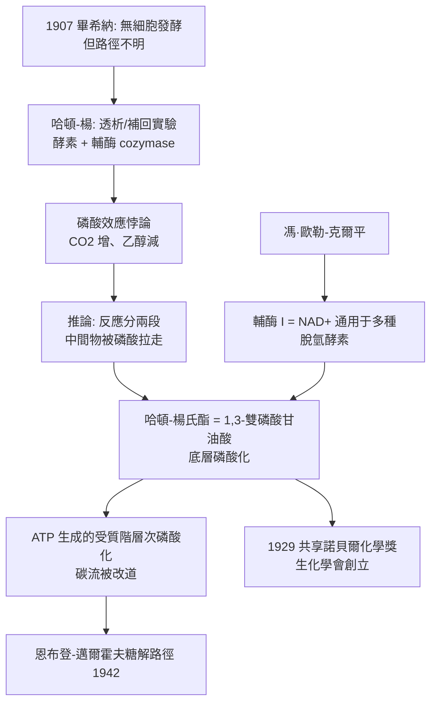

# 1929 · 哈頓與馮·歐勒-克爾平——發酵的解剖學

> 1929 諾貝爾化學獎（共享）：阿瑟·哈頓爵士（Sir Arthur Harden，1865–1940，英國）與漢斯·馮·歐勒-克爾平（Hans von Euler-Chelpin，1873–1964，瑞典）——表彰「其對醣類發酵與發酵酵素之研究」。兩人把畢希納（見 [1907-畢希納與無細胞發酵](1907-畢希納與無細胞發酵.md)）壓榨汁裡的黑箱，拆成一條可畫出的反應路徑。

## 懸案（案情提要）

1907 年畢希納證明了「沒有活細胞也能發酵」，但他留下的問題比解決的更多：壓榨汁裡到底發生了什麼？

- 糖變成乙醇與二氧化碳，走的是哪一條路？中間經過哪些化合物？
- 酵素只有一種嗎？
- 為什麼**加入無機磷酸鹽**會讓發酵突然加速，而且**乙醇產量反而下降**？這是發酵生物學裡最刺眼的悖論。

最後一條尤其像一份互相矛盾的證詞：磷酸鹽加速了整體反應，卻「偷走」了乙醇。任何人若認為反應是一條簡單的直線，都解釋不了這個現象——除非反應**分成兩段**，中間有某種可累積的東西。

偵辦人：哈頓（劍橋的酵母生理化學家）與馮·歐勒-克爾平（斯德哥爾摩的酵素化學家）。兩人分頭檢驗同一條反應鏈的兩端，最終在 1929 年共享諾獎。

## 前因

| 年份 | 事件 |
| --- | --- |
| 1865 | 哈頓生於倫敦；劍橋大學畢業後在生理學實驗室工作，研究酵母的酵素分泌。 |
| 1890s | 哈頓在酵母汁中發現一種**可被透析除去**的低分子輔因子，命名為 **cozymase**（後確認即 $\mathrm{NAD^+}$）——酵素之外的第二種必需品被發現。 |
| 1906 | 哈頓與 W. J. Young：酵母汁的發酵作用需要兩種成分——**可透析的耐熱輔酶（cozymase）**與**不可透析的熱敏酵素（zymase）**；首次系統比較「酵素 + 輔酶」的組合。 |
| 1906–1911 | **磷酸效應**：加入無機磷酸鹽，酵母汁的 $\mathrm{CO_2}$ 產量大幅上升，而乙醇產量下降——謎題正式立案。 |
| 1913 | 馮·歐勒-克爾平於斯德哥爾摩大學任普通與有機化學教授（1906 起），研究維生素 B$_2$（核黃素）與輔酶的關係，確立**輔酶是與酵素分離的小分子有機化合物**這一定義。 |
| 1923 | 哈頓、康威（Conway）與布羅布魯克（Brodbeck）證明：發酵中有**六碳磷酸酯**中間物，並分離出「哈頓—楊氏酯」（hexose diphosphate）。 |
| 1926 | 馮·歐勒-克爾平證明輔酶（$\mathrm{NAD^+}$）在多種脫氫酵素反應中通用，並分離出菸鹼醯胺（nicotinamide）部分。 |
| 1929 | 兩人共享諾貝爾化學獎；同年創立**英國生化學會**（《生化學期刊》由哈頓主編二十五年）。 |

## 調查

**偵查一：拆解壓榨汁——酵素與輔酶的分工。**

哈頓與楊的關鍵實驗是把酵母汁**分級處理**：

| 處理 | 結果 | 意義 |
| --- | --- | --- |
| 未處理汁 | 發酵 | 基準 |
| 加熱（煮沸） | 不發酵 | 熱敏的酵素（zymase）被破壞 |
| 超濾／透析（除去小分子） | 活性大幅下降 | 有一種**小分子輔酶**被一同除去 |
| 透析液 ＋ 新鮮未透析汁 | 活性恢復 | 輔酶可被補回——**兩種成分都被驗明** |

這是生物化學史上最乾淨的「分離—補回」實驗：酵素是蛋白質（熱敏、不可透析），輔酶是小分子（耐熱、可透析）。今日生化課本的「酵素 + 輔因子」框架，就此定型。

**偵查二：磷酸效應——用矛盾破案。**

1906–1911 年哈頓的實驗數據：

$$\begin{array}{l|cc}
\text{條件} & \mathrm{CO_2}\ \text{產量} & \text{乙醇產量}\\\hline
\text{酵母汁} & \text{基準} & \text{基準}\\
\text{＋ 無機磷酸鹽} & \text{大幅增加} & \text{顯著減少}
\end{array}$$

**如果發酵是一條直線（糖 → 乙醇 + $\mathrm{CO_2}$），加入磷酸鹽不可能同時增加 $\mathrm{CO_2}$ 又減少乙醇。**哈頓據此判斷：反應**分成兩段**，中間有能被磷酸鹽「拉走」的產物；加入磷酸鹽等於把中間物從第一段抽走，驅動整條鏈加速（**質子／磷酸的「拉動效應」**）。

這正是後來糖解作用的關鍵機制：**受質階層次的磷酸化**。哈頓–楊氏酯（今日已知為 **1,3-雙磷酸甘油酸**）正是被磷酸鹽「拉走」的那個中間物：

$$\text{甘油醛-3-磷酸} + \mathrm{P_i} + \mathrm{NAD^+} \xrightarrow{\text{GAPDH}} \text{1,3-雙磷酸甘油酸} + \mathrm{NADH} + \mathrm{H^+}$$

$$\text{1,3-雙磷酸甘油酸} + \mathrm{ADP} \xrightarrow{\text{磷酸甘油酸激酶}} \text{3-磷酸甘油酸} + \mathrm{ATP}$$

第一段消耗無機磷酸並產物被磷酸化（解釋「磷酸效應」），第二段把磷酸基轉給 ADP 產生 ATP（解釋「為什麼消耗乙醇產量」——**碳流被改道去做 ATP**）。

**偵查三：輔酶的通用性——馮·歐勒-克爾平的證詞。**

馮·歐勒-克爾平以肝與酵母的各種脫氫反應做交叉實驗，發現**同一個輔酶**（$\mathrm{NAD^+}$，他稱之為「輔酶 I」）能為多種不同的酵素所用——這在「酵素專一性」的框架下極其反直覺，卻是催化領域劃時代的觀念：**酵素的專一性由蛋白質部分負責，而氧化還原的「電子載體」由可攜帶的小分子負責**。

$\mathrm{NAD^+}$ 的結構包含兩個可分離的核：菸鹼醯胺（nicotinamide，電子受體）與腺嘌呤核苷（adenosine）——前者負責氧化還原，後者負責與酵素結合：

$$\mathrm{NAD^+} + \mathrm{H^+} + 2e^- \rightleftharpoons \mathrm{NADH} \quad (E^\circ \approx -0.32\ \mathrm{V})$$

（哈頓–楊氏酯的結構正是由這條 $\mathrm{NAD^+}/\mathrm{NADH}$ 氧化還原對所支持。）

**偵查四：路徑的總裝配——從零散片段到完整流程圖。**

1920 年代末，結合哈頓的中間物、馮·歐勒-克爾平的輔酶、以及 1930–40 年代的其他工作，醣解路徑被逐步畫出；1935–1942 年間由恩布登（Embden）、邁爾霍夫（Meyerhof）、霍夫曼（Hofmann）集大成，得到今日的：

$$\text{葡萄糖} \rightarrow \text{葡萄糖-6-磷酸} \rightarrow \text{果糖-6-磷酸} \rightarrow \text{果糖-1,6-雙磷酸} \rightarrow \text{甘油醛-3-磷酸} \rightarrow \text{1,3-雙磷酸甘油酸} \rightarrow \text{3-磷酸甘油酸} \rightarrow \text{2-磷酸甘油酸} \rightarrow \text{磷酸烯醇丙酮酸} \rightarrow \text{丙酮酸} \rightarrow \text{乙醛} \rightarrow \text{乙醇}$$

（無氧發酵的最後兩步：丙酮酸脫羧為乙醛、乙醇脫氫酶還原為乙醇，並把 $\mathrm{NADH}$ 氧化回 $\mathrm{NAD^+}$，讓循環得以持續。）

## 理論裁決

**判決一：受質階層次的磷酸化（底層磷酸化）。** 這是本案最重要的物理化學貢獻：**ATP 並不是先被「製造」出來，而是由一個「被磷酸化的中間物」直接交給 ADP**：

$$\text{高能磷酸鍵的傳遞} = \text{磷酸基從底物分子直接轉移給 ADP}$$

其自由能收益可以量化：

$$\Delta G^\circ_{\text{水解}}(\text{ATP}) \approx -30.5\ \mathrm{kJ/mol}, \qquad \Delta G^\circ_{\text{水解}}(1,3\text{-BPG}) \approx -49\ \mathrm{kJ/mol}$$

**磷酸化中間物比 ATP 還「富裕」**——這就是磷酸效應的全部物理內容：外加無機磷酸等於免費供應一份高能磷酸，因而使整條鏈加速。

**判決二：輔酶的可攜性原則。** 馮·歐勒-克爾平確立的通則：

$$\text{催化功能} = \underbrace{\text{酵素（蛋白質，專一性）}}_{\text{辨識 substrate}} + \underbrace{\text{輔酶（小分子，通用載體）}}_{\text{搬運電子／基團}}$$

「輔酶」從此不是雜湊概念，而是**催化系統的模組化設計**：同一模組（$\mathrm{NAD^+}$）服務多種酵素，同一酵素（LDH）服務多種輔酶受質。

**判決三：氧化還原電位的可攜性。** 每一種輔酶有自己的標準電位，決定它能從哪裡「拿走」電子：

| 輔酶／受質對 | $E^\circ'(\mathrm{pH}\,7)$ | 角色 |
| --- | --- | --- |
| $\mathrm{NAD^+/NADH}$ | $-0.32\ \mathrm{V}$ | 醣解、乳酸發酵的主載體 |
| 乙醯輔酶 A / 乙醯 | 兩步反應 | 碳骨架與乙醯基的轉運 |
| $FAD/\mathrm{FADH_2}$ | $-0.22\ \mathrm{V}$ | 琥珀酸去氫（鍵能釋放步驟） |
| 泛素（Ub） | 蛋白質修飾 | 見 [2004-切哈諾沃與泛素](2004-切哈諾沃與泛素.md) |
| $\mathrm{O_2/H_2O}$ | $+0.82\ \mathrm{V}$ | 電子傳遞鏈的最終受體 |

**判決四：能量的化學計量。** 完整能量帳（每分子葡萄糖）：

$$\text{葡萄糖} \rightarrow 2\,\text{丙酮酸} + 2\,\mathrm{ATP} + 2\,\mathrm{NADH} \xrightarrow{} 2\,\text{乙醇} + 2\,\mathrm{CO_2} + 2\,\mathrm{ATP}$$

即**每分子葡萄糖淨得 2 個 ATP**——一個在當時被視為少得可憐的數字，直到 1937–1941 年才由沃珀（Warburg）與克里布斯（Krebs）等人證明細胞呼吸的真正產量遠高於此（後來算得約 30–32 個 ATP），並在 1997 年由 ATP 合成酶的旋轉催化機制給出機制解釋（見 [1997-博耶與ATP合成酶](1997-博耶與ATP合成酶.md)）。

## 後果

| 領域 | 影響 |
| --- | --- |
| 生物化學建制 | 1929 年成立英國生化學會（《生化學期刊》創刊，哈頓主編 25 年）；生物化學從生理化學的分支升格為獨立學科。 |
| 醫學 | 醣解與乳酸发酵的分子基礎解釋了運動時的乳酸代謝、缺氧休克、糖尿病的乳酸酸中毒；費利格·梅耶霍夫（1922 年醫學獎）在此線上接棒。 |
| 輔酶家族 | $\mathrm{NAD^+}$ 與 FAD 的發現開啟輔酶生化學；今日輔酶 $\mathrm{B_{12}$（維生素 B$_{12}$）與其催化「不尋常碳—碳鍵重排」的機制，正是馮·歐勒-克爾平的兒子 UIf 與同事的線索。 |
| 工業 | 酒精發酵工業的現代化（補料、氧氣控制、副產物回收）；乳製品的乳酸發酵與乳酪製造。 |
| 家族榮譽 | 馮·歐勒-克爾平之子烏爾夫·馮·歐勒 1970 年獲生理醫學獎（前列腺素與放射免疫分析的首創應用）——生理學獎的父子檔。 |
| 學術制度 | 兩人獲獎同年即創立生化學會，說明：**科學社团的成立本身就是一條諾獎級的後果**。 |

## 關聯

- [1907-畢希納與無細胞發酵](1907-畢希納與無細胞發酵.md)：本案是畢希納那個「破瓶」的直接續審——從「不需要活細胞」到「路線圖長什麼樣」。
- [1901-凡特荷夫與物理化學](1901-凡特荷夫與物理化學.md)：$\Delta G$ 語言在能量帳中的運用；受質階層次磷酸化的自由能收益以 $\Delta G^\circ$ 表述。
- [1903-阿瑞尼斯與離子解離疑案](1903-阿瑞尼斯與離子解離疑案.md)：酵素與輔酶的「雙成分」觀念，可與阿瑞尼斯對電解質解離的「雙物種」分析比照。
- [1946-薩姆納與酵素結晶](1946-薩姆納與酵素結晶.md)：酵素的蛋白質身分被坐實，輔酶則被馮·歐勒-克爾平的體系定義為小分子——兩案合流即完整的催化圖像。
- [1997-博耶與ATP合成酶](1997-博耶與ATP合成酶.md)：受質階層次磷酸化的「化學端」與「機械端」在 1997 年合龍。
- [2004-切哈諾沃與泛素](2004-切哈諾沃與泛素.md)：輔酶觀念的現代延伸——泛素是一種可共價修飾蛋白質的「輔因子」。
