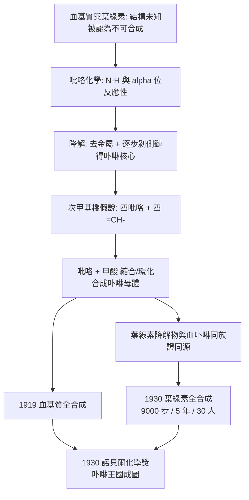

# 1930 · 漢斯·費歇爾與卟啉王國

> 1930 諾貝爾化學獎：漢斯·費歇爾（Hans Fischer，1881–1945，德國）——表彰「其對血基質與葉綠素結構的研究，尤其是其血基質的合成」。他把整個「卟啉王國」的成員——血紅素、葉綠素、細胞色素、過氧化物酶、維生素 B$_{12}$——畫在同一張圖上，並且把其中最難造的一個造了出來。

## 懸案（案情提要）

1920 年代的生化學界有兩個著名的「不可合成分子」：**血基質（haemin）**與**葉綠素（chlorophyll）**。它們在生物體中以極低濃度存在，卻執行著氧的運輸與光能的捕獲；它們的結構令人望而生畏（四個五員含氮環 + 金屬 + 側鏈），而最刺眼的一點是：

- 早在 1870 年代，人們就已知道**血基質與葉綠素有共同的「卟啉」骨架**（兩者降解都得到同一類吡咯衍生物）——但**沒有人寫得出它到底是什麼**；
- 更沒有誰敢保證：**這種大環分子，真的能被合成嗎？**費歇爾在 1900 年代初的報告裡曾說過一句話——自然的產物「幾乎肯定無法用人工方法製造」。他自己就是說這句話的人。

偵辦人：漢斯·費歇爾——費歇爾家族（非費歇爾投影式那位）的第三代，一位把「不可合成」當成挑戰書的德國化學家。

## 前因

| 年份 | 事件 |
| --- | --- |
| 1881 | 漢斯·費歇爾生於維爾茨堡（ Würzburg），祖父即著名的「費歇爾投影式」發明者埃米爾·費歇爾（1902 年化學獎）。 |
| 1904 | 慕尼黑大學博士（師從梅爾蒂修斯·德爾），後隨奧托·菲舍爾（Otto Fischer，即其堂兄）從事三苯基甲烷染料與吡咯化學。 |
| 1905–1915 | 研究吡咯的化學（與埃米爾·費歇爾並肩，一個搞醣類、一個搞吡咯）；確立吡咯的芳香性與 $\alpha$-位反應性——**這是卟啉合成的關鍵試劑**。 |
| 1915 | 首次分離出**血基質**的純品並測得分子式（$\mathrm{C_{34}H_{32}\mathrm{FeN_4O_4}$）。 |
| 1919 | 完成**血基質的首次全合成**——自然界色素首次被完整再造，本案的里程碑。 |
| 1925–1928 | 確立**血基質的結構**：四吡咯環由四個次甲基（$=\mathrm{CH}{-}$）橋連成大環，四個氮在環內平面配位 $\mathrm{Fe}$，環上帶兩個乙烯基與兩個丙酸側鏈。 |
| 1929–1930 | 與其子赫爾曼·費歇爾及馬格努松（Magnusson）等 30 餘人合作，以約 **9,000 個步驟、五年**完成**葉綠素的全合成**——1930 年公布。 |
| 1930 | 獲諾貝爾化學獎。 |
| 1938–1945 | 納粹時期其研究所被軍方徵用（研究維生素與藥物），他自己則被排除於學術事務之外；1945 年 3 月逝於慕尼黑。 |

## 調查

**偵查一：卟啉大環的拼接——「次甲基橋」的發現。**

費歇爾的結構工作建立在兩條線上：

1. **降解線**：血基質去鐵得**血卟啉**（haematoporphyrin），再以氧化還原逐步剝除側鏈，最終只剩核心——證明大環由四個五員含氮環組成。
2. **合成線**：以吡咯為磚，嘗試把四塊磚「拼」成同一個環。

拼接的關鍵是**次甲基橋**：大環不是四個吡咯直接相連，而是由四個 $=\mathrm{CH}-$ 橋隔開：

$$\underbrace{\text{吡咯環}}_{\text{四個，含 N-H}} \ + \ \underbrace{\text{次甲基橋}}_{\text{四個 } =\mathrm{CH}-} \;\Longrightarrow\; \text{環狀共軛大環（bilatriene / porphine）}$$

**偵查二：吡咯合成法——大環的可行製造路線。**

費歇爾找到一條能「閉環」的合成策略：吡咯衍生物與**甲酸**（一碳來源）在強酸中縮合，先成二吡咯鏈（鏈烯橋，meso-型），再環化：

$$\text{吡咯} + \mathrm{HCOOH} \xrightarrow{\text{濃酸}} \text{鏈烯（dipyrrylmethene）} \xrightarrow{\text{再環化}} \text{卟啉（porphine）}$$

這條「吡咯 + 甲酸」的路線，使「**自然界最複雜的色素之一可以在燒瓶裡造出來**」從信念變成事實。1919 年的血基質合成即依此路線完成——費歇爾的兒子赫爾曼·費歇爾後來把合成推進到數百個卟啉衍生物。

**偵查三：血基質的最終結構定案。**

$$\text{血基質} = \text{原卟啉 IX} \text{ 的 } \mathrm{Fe^{2+}} \text{ 錯合物} \quad (\mathrm{C_{34}H_{32}FeN_4O_4},\ M = 616.5)$$

結構要素：

| 要素 | 內容 |
| --- | --- |
| 大環 | 四吡咯 + 四次甲基橋，環內平面 |
| 金屬 | $\mathrm{Fe}$，居環心，四氮配位（與維爾納的配位幾何呼應，見 [1913-維爾納與配位化學](1913-維爾納與配位化學.md)） |
| 側鏈（2 個） | $-\mathrm{CH{=}CH_2}$（乙烯基） |
| 側鏈（2 個） | $-\mathrm{CH_2CH_2COOH}$（丙酸） |
| 氧化態 | 血紅素（$\mathrm{Fe^{2+}}$）／血基質（$\mathrm{Fe^{3+}}$） |

**偵查四：葉綠素與血基質的同源性——本案的核心實驗。**

把葉綠素降解：去鎂、加酸水解 → 得到**類血卟啉（葉啉，chlorin）**；再進一步氧化脫金屬 → 得到**血卟啉類**產物。**葉綠素與血基質降解後落在同一族產物上**，因此它們的大環骨架相同，差別只在：

- 金屬：$\mathrm{Mg}$ vs $\mathrm{Fe}$；
- 側鏈與還原程度（葉綠素的大環有一處「開鏈」與更多氫，費歇爾當時主張是「bilatriene」式的開鏈結構）；
- 葉綠素多一條植醇長尾（$\mathrm{C_{20}}$）。

**（後續更正）** 費歇爾的葉綠素大環「開鏈」模型在 1960 年代被修正為**閉環**：Mg 原子同時與四個氮及一個丙酸側鏈的羰基氧配位，使大環閉合——這由 X 射線結構（1960–70 年代）證實。**老案卷的判斷被新證據修正**，是科學史上誠實的註腳。

**偵查五：全合成的壯舉——九千步。**

1930 年公布的葉綠素全合成，由費歇爾、其子赫爾曼與同事在慕尼黑完成：

- 工作規模：三十餘人、五年、約 **9,000 個化學步驟**；
- 終點：把合成的葉綠素與天然品比較（吸收光譜、螢光、旋光、降解行為），確認同一物質；
- 意義：這是當時**最複雜分子的完全重建**，其深度至今仍是合成化學的標竿（對照 [1965-伍德沃德與全合成](1965-伍德沃德與全合成.md) 的可的松、維生素 B$_{12}$、以及 [1987-克拉姆與超分子化學](1987-克拉姆與超分子化學.md)）。

## 理論裁決

**判決一：卟啉大環的電子結構。** 四吡咯 + 四次甲基橋構成的環狀共軛系統，具有 22 個 $\pi$ 電子形成離域的環電流——這是**芳香性大環**。其能階分布解釋了：

- 卟啉的紫外可見吸收帶（強烈吸收約 400 nm 區的 Soret 帶，與弱得多的 $\alpha/\beta$ 帶）；
- 金屬插入前後吸收帶的巨大位移（$\mathrm{Fe}$ 插入後 Soret 帶移至約 415 nm，葉綠素 $\mathrm{Mg}$ 插入後則出現約 430 nm 與 662 nm 兩帶——見 [1915-維爾施泰特與葉綠素](1915-維爾施泰特與葉綠素.md)）。

**判決二：金屬配位的「赤道 + 軸向」雙層結構。** 四氮配位為赤道平面，金屬上方可再接軸向配體（血基質中為水／一氧化碳；葉綠素中為植醇的氧）：

$$\text{血基質：} \; \mathrm{Fe^{2+}} + \text{四氮赤道} + \mathrm{H_2O}\ (\text{軸向}) \rightleftharpoons \mathrm{O_2}\ \text{結合} \rightleftharpoons \text{氧合血基質}$$

**氧的結合是通過軸向配位**——這正是 1904 年拉姆齊證明 $\alpha$ 射線即氦核時所開的放射化學之外的另一條路：血基質與氧的結合，是呼吸生理學的化學核心。

**判決三：合成能力即理解深度。** 費歇爾最深刻的判決是方法論的：**「能否合成」是判斷「是否真正理解結構」的唯一嚴格檢驗**。因為只要結構有一處含糊，合成就會在該處失敗；反之，一次成功的全合成，等於宣告結構判斷全部正確。

$$\text{結構假設} \xrightarrow{\text{全合成}} \text{成功} \;\Longleftrightarrow\; \text{結構假設正確}$$

九千步的葉綠素合成，正是這條原理的史詩級示範。

## 後果

| 領域 | 影響 |
| --- | --- |
| 生物無機化學 | 卟啉王國的成員（血紅素、肌紅蛋白、細胞色素 $c$、過氧化物酶、觸酶、維生素 B$_{12}$ 的咕啉環、葉綠素）從此有了共同框架，今日的生物無機化學即由此起步。 |
| 血基質生物合成 | 費歇爾確立的卟啉結構，使 1950–60 年代的合成路線研究（甘胺酸 + 琥珀醯輔酶 A → $\delta$-胺基乙醯丙酸 → 卟啉）得以在正確的骨架上進行；鐮刀型貧血的分子病理學亦由此接續。 |
| 藥理 | 卟啉類光敏劑（血卟啉衍生物）用於光動力療法；卟啉骨架也是卟啉鐵（氧化劑）與鈷（維生素 B$_{12}$ 模型）的設計基礎。 |
| 合成化學 | 葉綠素全合成確立了「多步合成 + 分離鑑定 + 構型分析」的現代合成方法論，並訓練出德國的合成化學世代。 |
| 學術系譜 | 費歇爾家族三代（埃米爾 1902 醣類、漢斯 1930 卟啉）、堂兄弟奧托·菲舍爾、以及其子赫爾曼，構成德國化學的家族譜系；其慕尼黑學派與威蘭（1927）、溫道斯（1928）、布特南特（1939）共享實驗室與人力。 |
| 歷史註記 | 1933 年納粹掌權後，費歇爾被解除職務、研究所被軍方徵用；卟啉合成的一段工作被轉為戰時維生素與藥物生產，1945 年 3 月他在戰敗前夕去世。 |

## 關聯

- [1902-費歇爾與醣類偵探學](1902-費歇爾與醣類偵探學.md)：同族的兩條線——埃米爾·費歇爾定醣類立體化學，漢斯·費歇爾定卟啉結構；共享「結構—合成」互證的方法論。
- [1913-維爾納與配位化學](1913-維爾納與配位化學.md)：四氮平面的金屬配位幾何，是卟啉結構的骨架。
- [1915-維爾施泰特與葉綠素](1915-維爾施泰特與葉綠素.md)：葉綠素結構的先期工作；本案完成其合成並修正其大環模型。
- [1946-薩姆納與酵素結晶](1946-薩姆納與酵素結晶.md)：血基質與蛋白質（血紅蛋白）結合後的結構，是卟啉化學的下一站。
- [1962-佩魯茨與血紅蛋白](1962-佩魯茨與血紅蛋白.md)：卟啉王國最重要的一員的立體結構（費歇爾的化學＋X 射線＝現代結構生物學）。
