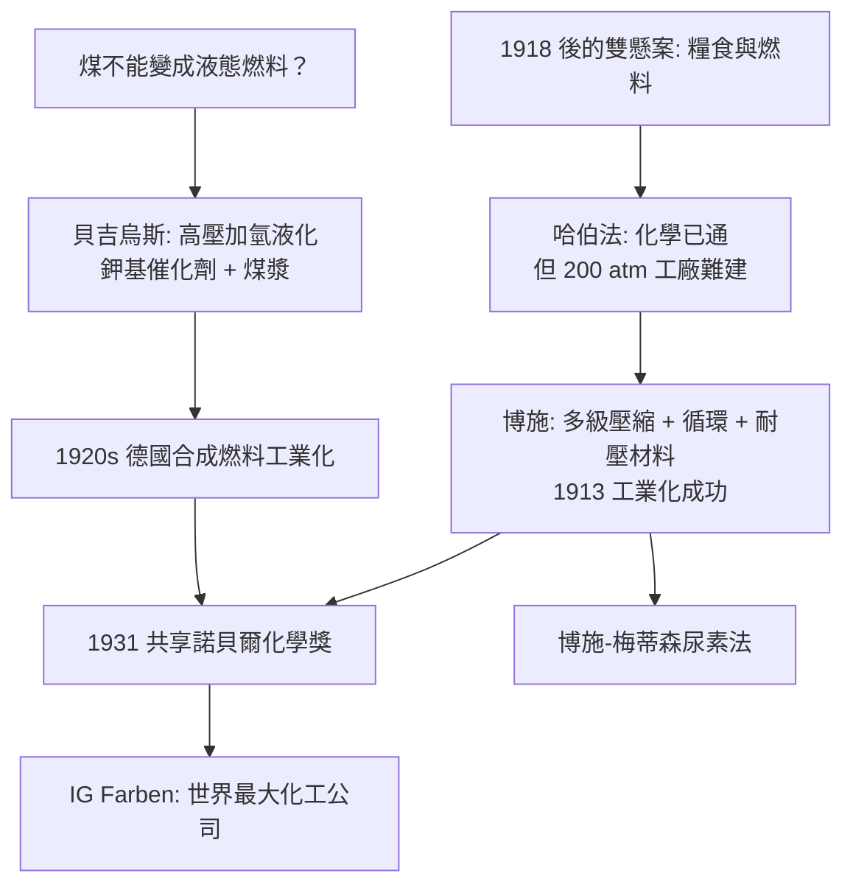

# 1931 · 博施與貝吉烏斯——高壓的兩條路

> 1931 諾貝爾化學獎（共享）：卡爾·博施（Carl Bosch，1874–1940，德國）與弗里德里希·貝吉烏斯（Friedrich Bergius，1884–1949，德國）——表彰「其對化學高壓方法之發明與發展的貢獻」。一人把氮氣變成化肥，一人把煤變成汽油；高壓技術把二十世紀的能源地盤翻了一遍。

## 懸案（案情提要）

1918 年大戰結束時，歐洲有兩個懸案，一個是**糧食**，一個是**燃料**：

1. **氮的懸案**（哈伯已解決一半）：哈伯法能把空氣變成氨，但要 200 atm 的高壓反應器——**誰能把這套高壓技術放大到工業規模、讓每克氮的電費與設備成本降到可接受？**
2. **燃料的懸案**：德國缺油（戰後喪失殖民地與油田），英國靠海上油田獨占，北美的原油開採已達極限；汽車、航空、戰爭都在搶液態燃料。**煤與氫能不能直接變成汽油？**

第二案在 1910 年代幾乎被判定為「不可能」：煤是固體、要加氫須同時處理固體與氣體、產物千變萬化。但德國化學家弗里德里希·貝吉烏斯在 1910 年代中期做到了，關鍵是**超高壓（最高達 300 atm 以上）與耐腐蝕的鉀基催化劑**。

第一案的工業化則由卡爾·博施完成：他不是化學家出身，而是**工程師**，他的天才在於把高壓反應從「化學家的高壓釜」變成「工業的流程」——多級壓縮、循環、特製的耐壓鋼與密封、每一步的熱力學與物料平衡。

## 前因

| 年份 | 事件 |
| --- | --- |
| 1874 | 博施生於柯爾姆；曾在化學廠與電鍍廠任技師出身（未受過大學化學教育），自學冶金與機械。 |
| 1909 | 設計並建造高壓實驗裝置（受高壓實驗室埃爾哈德·登南特與阿爾弗雷德·德爾的啟發，見 [1910-瓦拉赫與萜類家族樹](1910-瓦拉赫與萜類家族樹.md) 同期的高壓技術路線）；1911 年首次以「哈伯法」小試製得氨。 |
| 1913 | 路易斯安那州博取工業氨廠投產（年產數千噸），合成氨工業化成功——**世界第一次大規模的高壓化工生產**。 |
| 1916–1919 | 博施主持興建大型合成氨廠與煤焦油加工廠（費歇爾—特羅普普法合成甲醇與苯），並組織「戰時經濟研究委員會」，為德國化工總動員。 |
| 1922 | 博施以褐煤高壓加氫液化的成功經驗為基礎，與梅蒂森（Meiser）發展**尿素合成法**（$2\,\mathrm{NH_3} + \mathrm{CO_2} \to \mathrm{CO(NH_2)_2} + \mathrm{H_2O}$），開啟氮肥的第二次躍升。 |
| 1925 | 博施與美國杜邦合資成立 IG Farben（德國染料工業巨獸），成為二十世紀最大的化工公司；他因此獲得「德國工業化學之父」的名號。 |
| 1884 | 貝吉烏斯生於西里西亞的諾伊拉特（Neumarkt）；原為藥劑師學徒，後自修成化學家，1907 年取得博士學位。 |
| 1913–1925 | 與諾爾曼（Norman）合作**煤的加氫液化**：以高壓氫氣在催化劑存在下處理煤或煤焦油，取得液態烴——燃料懸案結案。 |
| 1927 | 《高壓化學》（*Chemische Technologie bei hohen Drucken*）出版，成為高壓工程的聖經。 |
| 1931 | 兩人共享諾貝爾化學獎。 |
| 1937 | 貝吉烏斯離德赴瑞士（因反猶迫害流失人才），其煤液化工藝在二戰中成為德國燃料戰略的核心之一。 |
| 1940 / 1949 | 博施逝於慕尼黑；貝吉烏斯戰後因國籍問題流亡阿根廷，1949 年卒於布宜諾斯艾利斯。 |

## 調查

**偵查一：高壓的物理——為什麼要壓？**

高壓改變兩件事：**平衡**與**速率**。以哈伯法為例（見 [1918-哈伯與合成氨](1918-哈伯與合成氨.md)）：

$$\mathrm{N_2(g)} + 3\,\mathrm{H_2(g)} \rightleftharpoons 2\,\mathrm{NH_3(g)} \quad (4 \text{ mol} \to 2 \text{ mol})$$

高壓使平衡向氨側移動（勒沙特列原理），同時提高反應物濃度，加速反應：

$$k_{\text{有效}} \propto k_0\,[c]^n \quad (\text{高壓提高 } c = \frac{nRT}{V})$$

對煤的加氫液化，高壓還有第二個作用：**把固體煤的表面反應「壓」進液相**——這是貝吉烏斯工藝的核心機制之一。

**偵查二：材料學的子案——什麼容器能扛住？**

這是本案最被低估、卻最決定成敗的一環。高壓（$200$–$300\ \mathrm{atm}$）＋高溫（$400$–$500\,^\circ\mathrm{C}$）＋氫氣＋氨的環境，會讓普通鋼迅速失效：

- 氫在高溫下擴散入鋼晶格，造成**氫脆（hydrogen embrittlement）**；
- 氨在高溫下與鋼中的碳反應形成碳氮化合物而脆化；
- 硫化物會毒化催化劑。

解方是一整套材料與工藝：**鎳合金反應器、多層包覆（composite）內壁、耐氫脆的合金鋼、焊接與密封技術**，以及壽命測試制度。博施的真正貢獻，是在**沒有現成材料的年代裡把材料問題與流程問題一起解掉**。

**偵查三：流程的數學——循環與轉化率。**

博施的工藝智慧可以寫成一個簡單的物料與能量平衡：

$$\underbrace{\text{單程轉化率}}_{15\text{–}20\%} \xrightarrow{\ \text{循環未反應氣體}\ } \underbrace{\text{總轉化率}}_{\approx 100\%}$$

工廠的實際設計：多級壓縮機把 $\mathrm{N_2}:\mathrm{H_2}$ 混氣壓到 200–300 atm，經催化塔反應，產物冷卻分離出氨（氨在高压下液化），未反應氣體循環回壓縮機——**一個連續流動的化學循環體**。這套設計後來被整個化工業（加氫、氧化、羰基合成）複製。

**偵查四：貝吉烏斯的煤液化工藝。**

其核心反應可以簡化為「加氫脫氧」：

$$\text{煤（近似 }(\mathrm{C})_{\text{大分子}} \text{）} + n\,\mathrm{H_2} \xrightarrow[\text{催化劑}]{\text{高壓高溫}} \text{液態烴混合物} + \text{水} + \text{氣體}$$

工藝難點被逐一破解：

| 難點 | 破解 |
| --- | --- |
| 煤難溶、難與氫接觸 | 研碎成粉、做成漿料（slurry）送入反應器 |
| 產物太雜（幾百種烴） | 用分餾切割成汽油、煤油、柴油各段 |
| 催化劑被硫、氮毒化 | 預處理脫硫脫氮（加氫精製） |
| 產品品質不佳（多環、含硫） | 二段加氫（加氫裂化＋加氫精製），得無硫低芳烴燃料 |
| 成本 | 以褐煤（德國 abundant）為原料，避開原油依賴 |

**偵查五：尿素的副線——第二個諾獎級成果。**

博施與梅蒂森把「氨 + 二氧化碳」在 150–250 atm 下直接反應成尿素，成為工業上最成功的碳固定反應之一（碳與氮同時固定成肥料分子）：

$$\mathrm{2\,NH_3} + \mathrm{CO_2} \rightleftharpoons \mathrm{CO(NH_2)_2} + \mathrm{H_2O}$$

這條線在 1960 年代被全球多座新建 urea 廠採用，是博施工藝譜系的第二次躍升。

## 理論裁決

**判決一：高壓熱力學——壓力作為自由度的操作。** 由反應的吉布斯自由能：

$$\Delta_r G = \Delta_r G^\circ + RT\ln Q$$

對氣體反應，$Q$ 含壓力項 $\prod p_i^{\nu_i}$，因此**提高總壓直接改變 $Q$**，把系統推向反應物較少的側（氨合成：4 mol → 2 mol）。這不是「壓一壓看」的經驗法則，而是 $\Delta G$ 框架下的可計算操作。

**判決二：壓力對反應速率的雙重效應。** 速率定律 $v = k\,c_A^{\alpha}c_B^{\beta}$ 中的濃度與壓力成正比（$c = p/RT$），因此壓力同時提供**平衡收益**與**速率收益**——這是高壓法勝出的理論根源（對比 1909 年奧斯特瓦德的催化理論，見 [1909-奧斯特瓦德與催化](1909-奧斯特瓦德與催化.md)）。

**判決三：加氫的熱力學。** 煤與石油的差別主要在 $\mathrm{H/C}$ 比。液化石燃料的目標是「加氫」：

$$\text{煤：}\ \mathrm{H/C} \approx 0.5 \quad \longrightarrow \quad \text{汽油：}\ \mathrm{H/C} \approx 1.9$$

每補上一個氫，就多一份 $\mathrm{H_2}$ 的消耗與一份能量：

$$\Delta_r H (\text{加氫}) \approx -40\ \text{至}\ -50\ \mathrm{kJ/mol\ H_2}\ (\text{典型值，視鍵型而定})$$

因此加氫液化是**高耗能、高耗氫**的過程——這正是二戰中德國「合成燃料」戰略的技術瓶頸所在，也是今日電製氫 + 費托-托普什的技術背景。

**判決四：碳固定的第二次浪潮。** 尿素法把 $\mathrm{CO_2}$（一個廢氣）與 $\mathrm{NH_3}$（人造肥）結合成新的肥料分子，是**人造光合作用**的先聲；其熱力學驅動力來自高壓（$200\ \mathrm{atm}$）下 $\mathrm{CO_2}$ 與 $\mathrm{NH_3}$ 的活化：

$$\Delta_r G = \Delta_r G^\circ + RT\ln\frac{a_{\text{urea}}\,a_{\mathrm{H_2O}}}{a_{\mathrm{NH_3}}^2\,a_{\mathrm{CO_2}}}$$

## 後果

| 領域 | 影響 |
| --- | --- |
| 糧食 | 合成氨的工業化使全球氮肥供應由「智利硝石＋有限的糞肥」變成「取之不盡的空氣」，是二十世紀人口曲線的最大支撐之一。 |
| 能源 | 煤液化在德國建立起「無原油」的合成燃料工業；今日全球年產逾 1.7 億桶的費托合成液態燃料（合成柴油、合成汽油）即此譜系的直系後代。 |
| 企業 | IG Farben（1925 成立，由 IG Farben 集團整合而成）成為史上最大的化工公司，其興衰與二戰及戰後的德國化工重組密不可分；博施、貝吉烏斯的技術同時孕育了後來的巴斯夫、拜耳、亨克斯等巨頭。 |
| 材料與工程 | 高壓設備（壓縮機、反應器、密封、耐氫脆合金）成為化工裝備的基礎技術；今日的核反應器、超高壓鑽機、液氫儲罐都承其餘蔭。 |
| 科學制度 | 化學家與工程師的合作模式（「化學定方向、工程定規模」）成為二十世紀化工研發的標準組織形態。 |
| 倫理註記 | 二戰期間貝吉烏斯的煤液化工藝與貝希爾（Bernhard Rust）計劃是德國燃料自給戰略的核心；戰後貝吉烏斯因國籍與「戰時_role」問題流亡阿根廷至死，諾獎的榮譽與歷史的清算在他身上同時發生。 |

## 關聯

- [1918-哈伯與合成氨](1918-哈伯與合成氨.md)：化學原理在前，本案把它變成工業——哈伯與博施是同一案卷的兩半。
- [1909-奧斯特瓦德與催化](1909-奧斯特瓦德與催化.md)：催化劑理論的工業實戰；氮氧化製硝酸與加氫液化共享催化與熱力學工具箱。
- [1930-漢斯費歇爾與血紅素](1930-漢斯費歇爾與血紅素.md)：同期的德國化學黃金世代（費歇爾、博施、貝吉烏斯、溫道斯在同一座科學共同體中）。
- [1960-利比與碳-14定年](1960-利比與碳-14定年.md)：哈伯—博施的氨是卡爾文循環（見 [1961-卡爾文與光合作用](1961-卡爾文與光合作用.md)）的氮源——人造氮與天然固氮在同一張物質循環表上對接。
- [1997-博耶與ATP合成酶](1997-博耶與ATP合成酶.md)：能源轉換的另一條戰線——從化學能到機械能。
