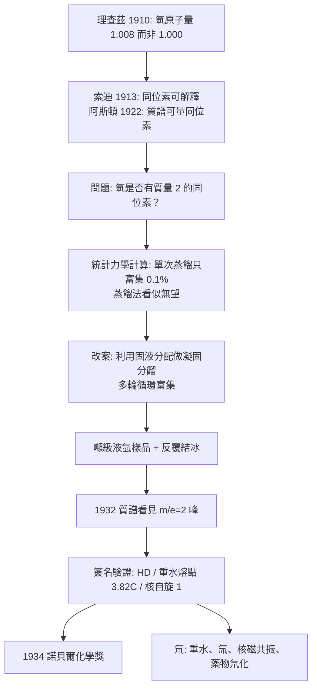

# 1934 · 尤里與重氫

> 1934 諾貝爾化學獎：哈羅德·克萊頓·尤里（Harold Clayton Urey，1893–1981，美國）——表彰「其發現重氫」。他找到了氫的第二種同位素，並在三十年後成為「生命起源於無機物」假說與古氣候學的奠基者。

## 懸案（案情提要）

1910 年，理查茲以畢生精度測出氫的原子量是 **1.008**，而不是化學家習以為的 1.000（見 [1914-理查茲與精密原子量](1914-理查茲與精密原子量.md)）。這個 0.8% 的缺口，在 1913 年被索迪命名為「同位素」的框架解釋了一半：若氫有兩種同位素，加權平均自然不是整數。

但這仍是**推論**，不是證據。1922 年阿斯頓的質譜儀讓「直接看見同位素」成為可能（見 [1922-阿斯頓與質譜儀](1922-阿斯頓與質譜儀.md)），於是懸案變得非常具體：

> **氫是否真有一個質量為 2 的同位素？如果有，它有多少？它會是什麼樣子？**

難度驚人：自然界中普通氫的重氘含量估計只有 **1 萬分之一到 5 萬分之一**（$1/10^4$–$1/5\times10^4$）；而蒸餾液態氫時，同位素間的富集因子僅約 $1/5000$ 量級——**用最笨的物理方法（蒸發）去做最精密的化學搜尋**。

偵辦人：哈羅德·尤里——在哥倫比亞大學帶領一個小組，用液態氫的蒸餾殘留物，一滴一滴地找那個「第二種氫」。

## 前因

| 年份 | 事件 |
| --- | --- |
| 1893 | 尤里生於印第安納州沃克頓；中學老師、圖書館員。 |
| 1911–1917 | 讀加州大學柏克萊分校，師從吉伯特·路易士（Gilbert N. Lewis）學熱力學；1917 年取得博士學位。 |
| 1917–1918 | 戰時在美國化學War Department從事炸藥與毒氣研究。 |
| 1923–1924 | 獲獎學金赴哥本哈根玻爾研究所，學習量子力學與同位素效應的理論——**這段訓練決定了他往後的偵查策略**。 |
| 1924–1929 | 約翰霍普金斯大學；1929 起任哥倫比亞大學化學副教授。 |
| 1931–1932 | 與布里克爾（Brickel）合作：以蒸餾法搜尋重氫，1932 年宣布發現 **deuterium（氘，${}^{2}\mathrm{H}$）**，並預言其性質（原子量為 2、核自旋為 1、能形成 $\mathrm{HD}$ 與 $\mathrm{D_2O}$）。 |
| 1934 | 獲諾貝爾化學獎。 |
| 1934–1940 | 預言驗證：重水的熔點 $3.82\,^\circ\mathrm{C}$、沸點 $101.4\,^\circ\mathrm{C}$、密度約 $1.107\ \mathrm{g/cm^3}$（由路易士與西利等人量測）；氘的核自旋 1 於 1930 年代末確立。 |
| 1940–1945 | 二戰期間主持哥倫比亞大學的**同位素分離**研究（氣體擴散法），為曼哈頓計畫的鈾濃縮提供早期技術基礎；參與「SAM 計畫」。 |
| 1953 | 與學生史丹利·米勒（Stanley Miller）進行著名的**米勒—尤里實驗**：以 $\mathrm{CH_4}$、$\mathrm{NH_3}$、$\mathrm{H_2O}$ 混合氣體通電火花，數週後得到胺基酸——生命起源化學的起點。 |
| 1950s–1970s | 以氧同位素（$^{18}\mathrm{O}/{}^{16}\mathrm{O}$）研究古溫度，開創**古氣候學**（海洋沉積物與貝殼的氧同位素溫度計）。 |
| 1970s–1980 | 參與創辦加州大學聖地牙哥分校（UCSD）理學院，擔任首任化學教授之一；晚年關注太空科學，曾分析阿波羅 11 號月岩。 |

## 調查

**偵查一：統計力學的富集因子——先算，再找。**

尤里在哥本哈根學到的同位素效應理論給出「用蒸餾找同位素」的可行性判準。對同位素比值 $R = {}^{2}\mathrm{H}/{}^{1}\mathrm{H}$，**雷利蒸餾方程**描述液相殘留的演化：

$$\frac{R}{R_0} = f^{\,\alpha - 1}, \qquad f = \text{液體剩餘分率}, \quad \alpha = \text{同位素分餾係數}$$

對氫的液態蒸發，$\alpha - 1$ 約為 $-5\times 10^{-4}$ 量級，故：

$$\frac{R}{R_0} = f^{-0.0005}$$

即使把液態氫蒸發掉 **90%**（$f = 0.1$），富集倍率僅：

$$f^{\alpha-1} = 0.1^{-0.0005} = 10^{0.0005} \approx 1.00115$$

也就是**只富集 0.115%**——距離可偵測的程度還差得遠。**結論殘酷但關鍵：單靠蒸餾不可能找到重氫。**

**偵查二：改變物理方案——「結冰」的富集。**

尤里想到一個極妙的替換：**不要蒸發整池液氫，而要讓它結冰**。氫的三相點極低（約 $-259\,^\circ\mathrm{C}$），在接近三相點的條件下，固液兩相共存，而**固相富含輕同位素**（$\alpha$ 效應在此劇烈），液相則被重同位素「濃縮」——這是普通的凝固分餾（zone refinement 的原理）。每次結冰，取出液相再重新凝固，富集倍率就疊加。

$$\text{重複分餾} \;\Rightarrow\; R \text{ 逐步上升}$$

**偵查三：規模決定成敗——用工業級的量換靈敏度。**

因為單次富集率微小，富集必須靠**巨量樣品**與**多輪循環**。尤里與布里克爾的作法是：

- 以**噸級**的液態氫（用空氣液化機與氫氣爐製備）進行；
- 讓液氫在低溫下緩慢結冰，分出「結冰的固相」與「未結冰的濃液相」；
- 濃液相再濃縮、再濃縮，直到氘含量達到**質譜儀可辨識**的程度；
- 最終以質譜儀（阿斯頓式的原理）掃描殘留氣體，尋找質量數 2 的峰。

**偵查四：簽名——不只是一條質量為 2 的線。**

1932 年 12 月 29 日與 1933 年的論文裡，尤里報導的不只是「看見 $\mathrm{D}$」，而是一整組**互相印證的簽名**：

| 觀測 | 預測 | 結果 |
| --- | --- | --- |
| 質譜上 $m/e = 2$ 的峰 | 同位素質量數 2 | 出現 |
| 比例 | 自然界約 $1:10^4$–$1:5\times10^4$ | 與估算相符 |
| $\mathrm{HD}$（質量 3）存在 | 混合 | 出現 |
| 重水的熔點、沸點、密度 | 由原子量差推算 | 由路易士與西利量測確認（熔點 $3.82\,^\circ\mathrm{C}$，高於純水的 $0\,^\circ\mathrm{C}$） |
| 核自旋 | ${}^{1}\mathrm{H}$ 為 $1/2$，${}^{2}\mathrm{H}$ 為 1 | 核磁共振實證（1930 年代末） |

**「簽名式」的證據組合是本案的偵查美學**：一個孤立的譜線可能被質疑為雜訊；一整組互相獨立的預測全部命中，則無可爭辯。

**偵查五：命名與預言的重量。**

尤里把新同位素命名為 **deuterium**（希臘語 $\delta\varepsilon\acute{\upsilon}\tau\varepsilon\rho\zeta$，「第二」），並**在發現之前就寫下它的化學預言**：應能與氫形成 $\mathrm{HD}$、形成重水 $\mathrm{D_2O}$（其熔點應略高於 $0\,^\circ\mathrm{C}$，密度約 1.1）、核自旋為整數、可用於核反應的「中子來源」（$\mathrm{D} + {}^{210}\mathrm{Po} \to {}^{3}\mathrm{H} + {}^{209}\mathrm{Po}$，製備氚的經典反應）。**多數預言在數年內逐一驗證**。

## 理論裁決

**判決一：同位素效應的統計力學解釋。** 同位素間的化學性質差異源於**振動量子化的能階差異**：原子量增加使頻率 $\nu \propto \sqrt{k/\mu}$ 降低，零點能量 $E_0 = \frac{1}{2}h\nu$ 隨之改變，於是平衡常數出現同位素依賴：

$$K_{\text{D}} \neq K_{\text{H}}, \qquad \frac{K_{\text{D}}}{K_{\text{H}}} \approx \exp\!\left[-\frac{\Delta \Delta H^\circ}{RT} + \frac{\Delta \Delta S^\circ}{R}\right]$$

這是「同位素效應」的理論基礎；**分餾係數 $\alpha$** 只是它在兩相間的表現形式。尤里的貢獻，是把這個純理論對象變成可搜尋的物理訊號。

**判決二：氫的同位素集合被定義。** 今日的氫有三种同位素：

| 同位素 | 符號 | 質量數 | 自然豐度 | 核自旋 | 穩定性 |
| --- | --- | --- | --- | --- | --- |
| 質子（輕氫） | ${}^{1}\mathrm{H}$ | 1 | 99.985% | $1/2$ | 穩定 |
| 氘（重氫） | ${}^{2}\mathrm{H}$ | 2 | 0.015% | 1 | 穩定 |
| 氚 | ${}^{3}\mathrm{H}$ | 3 | 痕跡（宇宙線產生） | $1/2$ | $t_{1/2} = 12.3$ 年 |

**注意核自旋的差異**：${}^{1}\mathrm{H}$ 的自旋 $1/2$ 使核磁共振訊號為單峰，${}^{2}\mathrm{H}$ 的自旋 1 則使耦合成 $1:2:1$ 三峰組——這正是今日 **${}^{2}\mathrm{H}$ NMR（氘核磁共振）**能與普通 ${}^{1}\mathrm{H}$ NMR 區分的物理原因（對照 [1991-恩斯特與NMR](1991-恩斯特與NMR.md)）。

**判決三：氮的同位素問題被懸置。** 尤里的實驗同時確認了氮的兩種同位素 $^{14}\mathrm{N}$ 與 $^{15}\mathrm{N}$ 的比例（阿斯頓 1930 年已發現 $^{15}\mathrm{N}$ 的存在）——為 1930 年代拉薩姆夫（Rubinson）與 Krebs 的尿素循環碳氮同位素實驗、以及 1940–50 年代的 Stable Isotope Techniques 產業鋪路（今日的 $^{15}\mathrm{N}$ 穩定同位素標記是製藥與代謝研究的常規工具）。

**判決四：同位素分離成為一門工業技術。** 尤里在二戰期間主持的同位素分離研究（熱擴散法為中心），使他成為曼哈頓計畫鈾濃縮的顧問之一，後來美國的氣體擴散法（K-25 與 K-27 級聯）沿其思路放大：

$$\text{分離因子} = \alpha \quad \text{（每級）}; \quad \text{級數} \sim \frac{\ln(R_\text{target}/R_0)}{\ln \alpha}$$

以 $^{235}\mathrm{U}/{}^{238}\mathrm{U}$ 分離因子約 1.0043 計，要達濃縮度 90% 需數千級——**這就是「少量級聯、巨量設備」的物理理由**。

## 後果

| 領域 | 影響 |
| --- | --- |
| 同位素科學 | 氘的發現使「同位素效應」成為可操作的物理與化學對象；今日的同位素標記（$^{2}\mathrm{H}$、$^{13}\mathrm{C}$、$^{15}\mathrm{N}$、$^{18}\mathrm{O}$）藥物、穩定同位素稀釋分析、追蹤實驗（用 $^{2}\mathrm{H}$ 標記碳骨架追蹤代謝）皆此譜系。 |
| 核磁共振 | 氘核自旋的發現是 NMR 的早期關鍵實驗；今日的 ${}^{2}\mathrm{H}$ NMR 與氘代藥物（用重氘取代易被代謝的氫，延長半衰期，如氘代阿托伐他汀）都建立在「氘像氫但更重」之上。 |
| 核技術 | 氘是核反應堆的中子源（${}^{2}\mathrm{H} + {}^{210}\mathrm{Po} \to {}^{3}\mathrm{H}$），重水是 CANDU 壓水堆的慢化劑與冷卻劑，${}^{3}\mathrm{H}$ 是氚標定法與核融合第一燃料（見 [1960-利比與碳-14定年](1960-利比與碳-14定年.md) 的同位素時鐘家族）。 |
| 生命起源 | **米勒—尤里實驗**（1953）是化學演化的分水嶺：從無機物產生胺基酸，今日的 RNA 世界假說、原始地球大氣模型（甲烷、氨、水、氫）與天化學皆由此延伸（見 [1989-奧特曼與RNA催化](1989-奧特曼與RNA催化.md)）。 |
| 古氣候學 | 氧同位素溫度計（$^{18}\mathrm{O}/{}^{16}\mathrm{O}$ 於貝殼與深海沉積物中）使第四紀氣候與冰期史成為定量科學，是今日全球暖化研究的歷史基準。 |
| 太空與制度 | 尤里是 UCSD 創辦科學家之一、月岩分析的參與者；他的一句「我願意去，而且不在乎回不回得來」成為科學家奉獻精神的通俗象徵；他也因二戰同位素工作的貢獻而長期捲入美國政治審查的風波。 |

## 關聯

- [1914-理查茲與精密原子量](1914-理查茲與精密原子量.md)：$A_r(\mathrm{H}) = 1.008$ 的缺口是本案的起點；其精度目標在本案被推到 $10^{-4}$ 的相對量級。
- [1921-索迪與同位素](1921-索迪與同位素.md)：同位素概念的命名者；本案的發現正是其理論預測的實證。
- [1922-阿斯頓與質譜儀](1922-阿斯頓與質譜儀.md)：偵查工具——質譜是本案的「指紋儀」。
- [1960-利比與碳-14定年](1960-利比與碳-14定年.md)：同位素時鐘的另一支——把放射性同位素用於考古年代學。
- [1991-恩斯特與NMR](1991-恩斯特與NMR.md)：${}^{2}\mathrm{H}$ 核磁共振是本案發現的技術後代。
- [2017-杜布歇與冷凍電顯](2017-杜布歇與冷凍電顯.md)：生命起源研究如今用冷凍電顯直接看見原始地球化學的產物。
