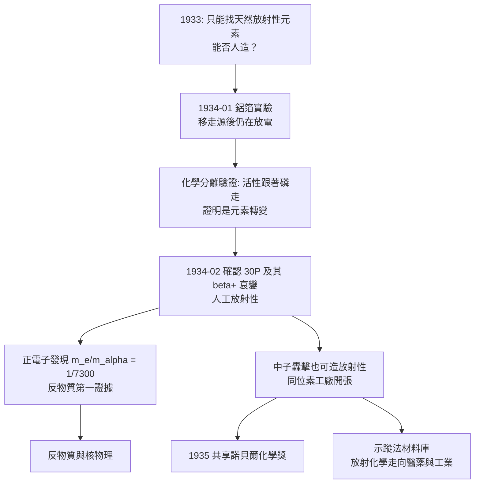

# 1935 · 約里奧-居里夫婦與人工放射性

> 1935 諾貝爾化學獎（共享）：弗雷德里克·約里奧-居里（Frédéric Joliot-Curie，1900–1956）與伊倫·約里奧-居里（Irène Joliot-Curie，1897–1956，法國）——表彰「其合成人工放射性元素之發現」。居里家族的第三、四座諾獎，也是放射化學由「發現自然元素」跨入「製造元素」的轉捩點。

## 懸案（案情提要）

1934 年之前的放射化學，其邊界寫得非常清楚：**元素是自然界給的，化學家只能找，不能造。**居里夫人分離出釙與鐳，盧瑟福證明原子會蛻變，但「人為加速原子轉變」——這句話在當時還只是幻想。

有兩樁子案懸在實驗桌上：

1. **居里夫人的遺產**：她逝世後，巴黎的鐳實驗室只剩 1 克多的鐳。**這份物料能不能讓化學家「製造」放射性？**
2. **物理學家的追問**：盧瑟福曾用 $\alpha$ 粒子轟擊氮，製造出質子（見 [1908-盧瑟福與元素蛻變](1908-盧瑟福與元素蛻變.md)），但那是「打碎」，不是「合成」——**能不能用中子或 $\alpha$ 粒子把一種元素變成另一種放射性元素，然後像化學家提煉物質一樣，把它從溶液裡分離出來？**

偵辦人：伊倫（母親的鐳學院繼承人）與弗雷德里克·約里奧-居里（居里夫人的女婿）。答案在 1934 年 1 月的一個實驗裡：他們用一張**鋁箔**做實驗，讓整個放射化學從「尋寶」變成「製藥」。

## 前因

| 年份 | 事件 |
| --- | --- |
| 1897 | 伊倫·居里出生於巴黎，數學資質突出；一戰期間任野戰醫院放射技師（母親的「小居里」隊伍），1918 年進入鐳學院。 |
| 1925 | 伊倫以「釙的 $\alpha$ 衰變」取得博士學位（導師為其母）。 |
| 1900 | 弗雷德里克·約里奧-居里生於巴黎；工程師出身，與伊倫相識於鐳學院。 |
| 1926 | 兩人結婚；開始共同研究人工放射性的可能性。 |
| 1931–1933 | 研究放射化學與 $\alpha$ 粒子在輕元素上的散射；同時研究電解質的化學與物理。 |
| 1934-01 | **鋁箔實驗**：用釙的 $\alpha$ 粒子（$\mathrm{E} \approx 5.3\ \mathrm{MeV}$）轟擊鋁箔，發現**停止照射後鋁箔仍持續放出正電子**——人造放射性的發現。 |
| 1934-02 | 確認機制：$\alpha$ 粒子撞擊 $^{27}\mathrm{Al}$ 產生 $^{30}\mathrm{P}$（放射性磷，$t_{1/2} \approx 2.5$ 分鐘），其衰變放出正電子；同時以中子轟擊發現人工放射性。 |
| 1935-12 | 與世長存的諾貝爾演講〈人工放射性〉。 |
| 1936 | 弗雷德里克任高等師範學院教授、巴黎大學物理化學教授；伊倫成為法國科學院院士（1937）、衛生部次長（1936–37）。 |
| 1948 | 主持法國第一座核反應器（ζ-1，於巴黎萨克勒的奧布里埃爾 Fermi 實驗室——亦即戰後的 CEA 原子能委員會所在）。 |
| 1956 | 弗雷德里克與伊倫同一年因骨髓增生症去世（伊倫 3 月 17 日、弗雷德里克 5 月 19 日），皆與長期的放射暴露有關。 |

## 調查

**偵查一：鋁箔實驗——一小時的直覺。**

1934 年 1 月，約里奧-居里夫婦把一片鋁箔放在 radioactive $\alpha$ 源（釙）前，用蓋革計數器監測。關鍵的操作細節：

1. 轟擊時，計數器顯示有穿透射線（$\alpha$ 粒子本身打不到計數器，需要一層薄鋁窗）；
2. 他們**把鋁箔從源前移走**，計數率**不降為零，反而維持在高檔**；
3. 把鋁箔翻面（換面朝外）、把計數器換位置，**訊號依然存在**；
4. 移走鋁箔、換一片普通鋁箔，訊號恢復正常。

**結論令人震驚：鋁箔自己變成了放射性的。**這不是物理作用，而是**化學轉變**——元素被 $\alpha$ 粒子擊中後，變成了另一種（放射性的）元素。

**偵查二：化學家的驗證——它真的是「元素」。**

真正的關鍵一步是把放射化學的標準程序拿來：把「活化」的鋁箔溶於酸，加入各種沉澱劑，看放射性跟著哪一種元素沉澱。

$$\mathrm{^{27}_{13}Al} + {}^{4}_{2}\mathrm{He} \rightarrow {}^{30}_{15}\mathrm{P} + n \quad (\text{產生放射性磷})$$

$$\mathrm{^{30}_{15}P} \xrightarrow[\;t_{1/2}\approx 2.5\ \mathrm{min}\;]{\beta^+} {}^{30}_{14}\mathrm{Si} + e^+ + \nu_e$$

實驗結果：放射性**跟著磷沉澱**（與磷酸鹽、與硝酸鹽共沉），**不跟著鋁沉澱**；且其 $\beta^+$ 衰變後，化學行為變回矽的行為。**化學家於是能像提煉磷那樣，把人造的放射性磷從溶液裡分離出來，並一滴滴地跟著它跑。**

這一步的意義：**從「放射是元素的性質」走到「放射可以化學分離」**——放射化學從描述性學科變成可操作的製備學科。

**偵查三：正電子的發現——物質的最小組成之一。**

當他們用一個磁場把正電子的軌跡彎曲、量其曲率半徑並比對 $\alpha$ 粒子時，得到：

$$\frac{m_e}{m_\alpha} = \frac{1}{7300} \quad\Rightarrow\quad m_e \approx \frac{m_\alpha}{7300} \approx 9.1\times10^{-31}\ \mathrm{kg}$$

這是**正電子（positron）**——電子在 $\beta^+$ 衰變中的對應物，也是**反物質的第一個實驗證據**（狄義拉克 1931 年正是用「帶正電的電子」解釋 $\beta^+$ 譜的連續性而預言反物質）。**物質的組成清單被加了一行。**

**偵查四：中子轟擊——通才路線。**

他們隨後證明**中子也能製造人工放射性**（1934 年）：用 $\alpha$ 粒子轟擊鈹或鋁放出中子，再以中子轟擊各種元素，產生各種放射性同位素。這意味著：

- 製造放射性的「子彈」有兩種：$\alpha$ 粒子（帶電，需克服靜電斥力，只能打擊重核）與**中子（不帶電，可直入核內，幾乎所有元素都能被打中）**；
- 產物是**放射性同位素**：同一元素、不同質量數。

這打開了兩扇門：**放射性示蹤法的材料庫**（今日的 $^{14}\mathrm{C}$、$^{32}\mathrm{P}$、$^{35}\mathrm{S}$、$^{60}\mathrm{Co}$ 皆由此路線的後代）與**中子物理**。

**偵查五：貝可勒爾的悲劇與教訓。**

約里奧-居里夫妇人工放射性的發現，使「放射現象必與元素本身相連」的前提被推翻——這對貝可勒爾（他 1896 年發現天然放射，並因此困惑於鈾鹽為何持續放電）而言是一記重擊：鈾鹽的放射並非鈾「特有」，而是其內部某種產物在放電（後來知道是 $^{238}\mathrm{U}$ 衰變系的一員）。貝可勒爾於 1896 年底去世，1935 年才由約里奧-居里的發現獲得遲來的理解——**一樁跨越四十年、跨越兩代科學家的懸案**。

## 理論裁決

**判決一：核反應的「化學方程式」寫法。** 人工放射性的發現，第一次讓核反應可以用化學反應式的形式完整書寫：

$${}^{27}_{13}\mathrm{Al} + {}^{4}_{2}\mathrm{He} \rightarrow {}^{30}_{15}\mathrm{P} + {}^{1}_{0}\mathrm{n} \quad (\text{產物具放射性})$$

**守恆律**在此完全適用：左側 $A: 27+4 = 31$，右側 $30+1 = 31$；$Z: 13+2 = 15$，右側 $15+0 = 15$。這是盧瑟福式「原子核也有化學」的正式宣告。

**判決二：$\beta^+$ 衰變與反物質。** 正電子的發現配合狄義拉克的電子方程（$\mathrm{d}^2\psi/\mathrm{d}x^2 + \dots = 0$ 的正負能量解）給出：

$$E = \pm\sqrt{p^2c^2 + m^2c^4} \;\Rightarrow\; E_{<0} = -E_{>0}$$

**負能量態的解讀即反物質**；1933 年安德森在宇宙射線中直接看見正電子（用雲霧室），四層物質（質子、中子、電子、正電子）的名單在 1930 年代中期完成。

**判決三：示蹤法的物理基礎。** 人工放射性的意義遠大於「多一種元素」：

$$\text{標記原子} \xrightarrow{\text{可被化學分離與追蹤}} \text{物質流動的量測}$$

只要把一個穩定元素換成它的放射性同位素，就能「看見」它走了哪條路、去了哪個器官、參與了哪一步反應。這套方法在 1930 年代由德海韋西發揚（見 [1943-德海韋西與同位素示蹤](1943-德海韋西與同位素示蹤.md)），並在 1946 年之後成為醫學（甲狀腺的 $^{131}\mathrm{I}$ 治療與掃描）、農業（$^{32}\mathrm{P}$ 肥料追蹤）、工業（$^{59}\mathrm{Fe}$ 磨損追蹤）與生物學（${}^{14}\mathrm{C}$ 追蹤碳流）的標準手段。

**判決四：衰變的統計律在此獲得工業級意義。** 人工放射性產物的半衰期可短到數分鐘（$^{30}\mathrm{P}$：2.5 分鐘），也可長到數千年。衰變律不變（見 [1908-盧瑟福與元素蛻變](1908-盧瑟福與元素蛻變.md)）：

$$\lambda = \frac{\ln 2}{t_{1/2}}, \qquad A(t) = A_0 e^{-\lambda t}$$

**可調的「計時器」材料庫**就此打開——這是後來所有放射性定年法的基礎。

## 後果

| 領域 | 影響 |
| --- | --- |
| 放射化學 | 從「分離天然元素」擴張為「製造放射性同位素」；人工放射性成為醫學與工業界的原料來源。 |
| 核反應堆與核能 | 中子轟擊與放射化學技術，是 1948 年法國第一座反應器（ζ-1）、以及戰後各國核計畫的技術前提；約里奧-居里夫婦主持 CEA，奠定法國核工業。 |
| 醫療 | 放射性同位素療法（碘-131 甲狀腺、鈷-60 遠距照射、磷-32 白血病治療）與核醫學影像；伊倫在放射學救護上的戰時經驗是這條線的開端。 |
| 科學史與家族 | 居里家族五座諾獎（1903 物理、1911 化學、1935 化學）——世界科學史上最密集的家族；**伊倫與弗雷德里克同年同因去世**（骨髓增生症），成為科學史上最令人心碎的註腳。 |
| 制度與女性 | 伊倫 1936 年任法國科學研究次長，是法國最早的閣員級女性之一；1937 年當選法蘭西科學院院士（其母 1911 年曾以一票之差落選）。 |
| 警戒 | 「放射線的危害」在當時幾乎無人研究，兩位得主的健康與性命是這段無知時期的沉重帳單。 |

## 關聯

- [1908-盧瑟福與元素蛻變](1908-盧瑟福與元素蛻變.md)：人工放射性的物理前提（$\alpha$ 粒子轟擊與人工核反應）。
- [1911-居里夫人與0.1克鐳](1911-居里夫人與0.1克鐳.md)：母親的鐳學院、1 克多的鐳與 1903 年的物理獎——本案的家族前卷。
- [1943-德海韋西與同位素示蹤](1943-德海韋西與同位素示蹤.md)：把人工放射性材料用到極致的示蹤術。
- [1936-德拜與偶極矩](1936-德拜與偶極矩.md)：同一時期的另一條物理化學路徑——以電學量測取代放射量測。
- [1944-哈恩與核分裂](1944-哈恩與核分裂.md)：人工放射性的方法學在柏林被推到核分裂的門檻。
- [1960-利比與碳-14定年](1960-利比與碳-14定年.md)：人工放射性開出的同位素工廠，供給了考古定年的原料。
- [1992-馬庫斯與電子轉移理論](1992-馬庫斯與電子轉移理論.md)：$\beta^+$ 衰變中正電子的產生，涉及的正是放電子的物理。
