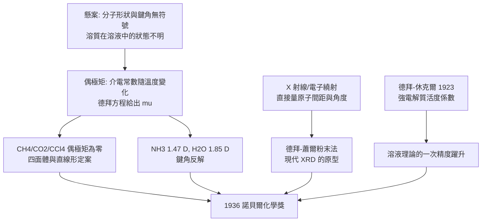

# 1936 · 德拜與偶極矩

> 1936 諾貝爾化學獎：彼得·約瑟夫·威廉·德拜（Peter Joseph William Debye，1884–1966，荷蘭／美國）——表彰「其以偶極矩研究及 X 射線、電子在氣體中之繞射研究，對分子結構之貢獻」。他用「分子有多歪」這個簡單問題，測出了整個分子科學的尺度。

## 懸案（案情提要）

1920 年代，化學家能寫出分子式、能猜出結構式，但有兩個問題懸而未決：

1. **分子「形狀」的問題**：甲烷 $\mathrm{CH_4}$ 是正四面體還是平面正方形？二氧化碳 $\mathrm{CO_2}$ 是直線還是折角？氨 $\mathrm{NH_3}$ 的錐角多大？——**結構式畫在紙上時，鍵角卻完全沒有符號表示。**更根本地說：兩個不同原子間的共價鍵，是否有極性？分子整體有沒有偶極矩？
2. **「溶液中是什麼」的問題**：溶質在溶液裡究竟是獨立的分子，還是聚集成了「雙分子」？1930 年代的溶液理論正處在這樣的混沌裡（阿瑞尼斯的解離說針對的是離子化合物，但有機分子呢？）。

偵辦人：彼得·德拜——在阿姆斯特丹（後來在蘇黎世、萊比錫、康奈爾）工作的物理化學家。他的破案工具是兩個：**偶極矩**（用電學量測分子兩端的不對稱）與**氣體繞射**（用 X 射線與電子束看見分子在空間中的樣子）。

## 前因

| 年份 | 事件 |
| --- | --- |
| 1884 | 德拜生於馬斯特里赫特；工程師之子。 |
| 1907 | 於阿姆斯特丹大學取得博士學位（後任教授，1927 年起於蘇黎世聯邦理工學院）。 |
| 1912 | 洛倫茲模型與電子理論的應用；研究電介質的極化。 |
| 1918–1920 | 與休克爾（Hückel）建立**德拜—休克爾理論**：強電解質在溶液中因離子間的靜電吸引而「成對」，活度係數可寫成：

$$\log \gamma_i = -A\,z_i^2\sqrt{I}$$

（$I$ 為離子強度）——這是溶液理論的一次精度躍升，也是「活度」概念進入化學的里程碑。
| 1921 | 創立並推廣「**偶極矩**」（dipole moment）概念，把分子視為帶電的偶極子，用於解釋介電常數、極性與溶解行為。 |
| 1929 | 用 X 射線與**電子繞射**研究氣體分子：首次以實驗量得鍵角與分子大小（$d$-spacing 的布拉格公式 $\lambda = 2d\sin\theta$ 用於分子間距的量測）。 |
| 1930–1934 | 以電子繞射研究大量氣體與液體分子；提出**德拜方程**（以偶極矩解釋介電常數）：

$$\frac{\epsilon - 1}{\epsilon + 2} = \frac{N}{3k_BT}\left(\alpha + \frac{\mu^2}{3k_BT}\right)$$

| 1932 | 以「德拜—瓦勒因子」的液化氣體散射研究（液體結構的 X 射線分析）。 |
| 1936 | 獲諾貝爾化學獎。 |
| 1940–1951 | 二戰期間在康奈爾大學研究情報科學（1941 年成立「科學研究戰爭局」的聲學研究處，是英美科學組織的一個里程碑）；戰後又在萊比錫重建物理研究所。 |
| 1954 | 退休；1959 年移居美國；1966 年逝於紐約州。 |

## 調查

**偵查一：偶極矩——分子「不對稱」的度量。**

德拜的出發點極為清晰：**如果分子中的電荷分佈不對稱，它在電場中就會「轉向」，因此介質的極化能力會隨溫度改變。**以平行板電容器量測介電常數 $\epsilon$ 隨溫度的變化，即可反推偶極矩。

德拜方程（稀溶液極性液體）：

$$\frac{\epsilon - 1}{\epsilon + 2} = \frac{N}{3\varepsilon_0 k_B T}\left(\alpha + \frac{\mu^2}{3k_B T}\right)$$

其中 $\alpha$ 為電子極化率、$\mu$ 為永久偶極矩。以 $1/T$ 對左式作圖應得直線，**斜率即給出 $\mu^2$**——這是把不可見的分子電性變成可量測量的經典設計。

**偵查二：偶極矩的絕對標尺——氣體偶極矩。**

德拜解決了一個循環論證的問題：要量液體的偶極矩，需要知道「氣體中沒有分子間作用」；但要從氣體導出絕對偶極矩，又需要一個絕對電荷尺度。1930 年代，他利用**氣體的電容（介電）與折射率的比較**確立了絕對標尺：

$$\mu_{\text{abs}} \quad \text{可由} \quad \epsilon,\ n,\ \text{與電子極化率} \ \text{的組合求出}$$

從此偶極矩有了統一的單位（D，Debye，$1\ \mathrm{D} = 3.336\times10^{-30}\ \mathrm{C\cdot m}$），化學家可以互相比較分子：

| 分子 | 偶極矩 | 結構含義 |
| --- | --- | --- |
| $\mathrm{CH_4}$ | $0$ | **正四面體，四鍵完全對稱抵消**（若為平面正方形則應非零） |
| $\mathrm{CO_2}$ | $0$ | **直線形，兩個 C=O 偶極反向抵消** |
| $\mathrm{CCl_4}$ | $0$ | 四面體對稱 |
| $\mathrm{NH_3}$ | $1.47\ \mathrm{D}$ | **三角錐形**，三個 N–H 偶極的合成不為零 |
| $\mathrm{H_2O}$ | $1.85\ \mathrm{D}$ | **折線形（鍵角 $104.5^\circ$）**，O–H 偶極不對稱 |
| $\mathrm{HCl}$ | $1.08\ \mathrm{D}$ | 極性共價鍵 |
| $\mathrm{CH_3Cl}$ | $1.87\ \mathrm{D}$ | C–Cl 鍵偶極 |
| $\mathrm{CH_4}$ vs $\mathrm{CH_3Cl}$ | $0$ vs $1.87$ | 一個氫換成氯即產生偶極——**電負度差的最直接量測** |

**偵查三：鍵角——用偶極矩反推幾何。**

對 $\mathrm{AX_3}$ 型分子，若鍵角為 $\theta$，則合成偶極矩為：

$$\mu_{\text{合}} = 2\,\mu_{\text{鍵}}\cos\frac{\theta}{2}$$

以 $\mathrm{NH_3}$ 的實測值代入 $\mu_{\text{合}} = 1.47\ \mathrm{D}$，若取每個 N–H 鍵偶極 $\mu_{\text{鍵}} = 1.31\ \mathrm{D}$，可得 $\theta \approx 107^\circ$——**幾何參數由電學數據反解**。

**偵查四：X 射線與電子繞射——直接看見分子。**

德拜的決定性一步是引入**氣體繞射**。1911 年盧瑟福與哈姆森用 $\alpha$ 粒子轟擊金箔（見 [1908-盧瑟福與元素蛻變](1908-盧瑟福與元素蛻變.md)）；德拜則把**繞射**用於分子：

- **X 射線繞射**：分子氣體的散射強度隨散射角 $2\theta$ 的變化給出分子內的原子間距（布拉格關係 $2d\sin\theta = n\lambda$，$d$ 為分子內距離）；
- **電子繞射**：德拜與蕭（Scherrer）發展**粉末繞射法**（德拜—蕭爾法）：以大量隨機取向的微晶粉末產生同心環，環的位置給出晶面間距、環的強度給出結構因子。今日的 XRD（X 射線繞射）分析幾乎全部建立在這套方法上。

**這是化學第一次「看見」分子裡的距離與角度**——把結構式從圖畫變成量測。

**偵查五：溶液中的分子行為——「鬆散聚集」假說的興衰。**

德拜的研究也讓化學家重新檢視溶質在溶液中的狀態：1930–40 年代，許多物理化學家（包括阿瑞尼斯學派）認為有機分子在溶液中多以**雙分子聚合體**存在，理由是許多溶液的依數性數據與理想值不符。德拜以介電常數與偶極矩量測反駁此說：**若雙分子以反平行方式成對，偶極矩會下降**；實測結果顯示多數溶液並無系統性下降，說明「成對假說」站不住腳（少數確有氫鍵締合者則另當別論）。這場小小的論戰，是「溶液中的分子真的像溶液裡的分子」這一現代共識的過渡。

## 理論裁決

**判決一：偶極矩成為分子結構的通用語言。** 德拜證明：**分子結構可以用兩個純量描述——電荷分佈的對稱性（偶極矩）與電子雲的形狀（極化率 $\alpha$）。** 前者回答「它有沒有頭尾」，後者回答「它有多大、多容易變形」。兩者合起來：

$$\frac{\epsilon - 1}{\epsilon + 2} = \frac{N}{3\varepsilon_0 k_B T}\left(\alpha + \frac{\mu^2}{3k_B T}\right)$$

這條式子把「結構化學」變成「可量測的物理學」，並成為今日分子模擬與溶劑效應計算的基礎輸入。

**判決二：溶劑效應的定量。** 偶極矩與溶劑的關係，給出了「相似相溶」的物理說明：

$$\mu(\text{反應中心})_{\text{有效}} = \mu_0 - \Delta\mu_{\text{溶劑}}$$

極性溶劑能「拉平」反應中心的偶極，進而改變反應速率——**這正是 1909 年奧斯特瓦德的酸鹼催化效應（見 [1909-奧斯特瓦德與催化](1909-奧斯特瓦德與催化.md)）的分子層次解釋**：溶劑改變了分子的電性，因而改變了活化能。1930–40 年代，瓦爾登（Walden）等人正是以偶極矩數據建立了溶劑效應的經驗規則。

**判決三：德拜方程式的電解質溶液理論。** 與休克爾合著的強電解質理論，把離子間的靜電交互作用寫成可計算的形式：

$$\log \gamma_i = -A z_i^2 \sqrt{I}, \qquad I = \frac{1}{2}\sum_i c_i z_i^2$$

活度係數 $\gamma$ 隨離子強度 $I$ 下降——這解釋了為什麼在稀溶液中用「濃度」近似「活度」尚可，而濃度增加時偏差急劇變大。**「活度」從此成為化學的標準語言**，並在 1920 年能斯特（見 [1920-能斯特與熱力學第三定律](1920-能斯特與熱力學第三定律.md)）的電池電動勢理論中得到電學印證（能斯特方程式正是活度形式的電化學表述）。

**判決四：繞射法的建立。** 德拜—蕭爾粉末法的邏輯極為精妙：**隨機取向的粉末產生的是「環」而非「點」，因為每個晶面取向都滿足布拉格條件。**此法使得：

- 晶體的晶面間距可由環位置算出（布拉格方程）；
- 晶胞結構由環的強度序列推得（結構因子 $|F_{hkl}|^2$）；
- 非晶體（液體、玻璃）則給出寬而平的環——德拜—瓦勒因子給出其結構相關長度。

今日的 XRD、相位分析、X 射線吸收光譜（EXAFS）、甚至電子顯微鏡的原子像（見 [1982-克盧格與電子顯微鏡](1982-克盧格與電子顯微鏡.md)）皆以此為源頭。

## 後果

| 領域 | 影響 |
| --- | --- |
| 結構化學 | 偶極矩成為判定分子幾何的標準手段；四氯化碳的偶極矩為零確認其四面體結構，成為教科書的標準例子。 |
| 溶液化學 | 德拜—休克爾理論與活度概念，使電解質溶液的定量處理成為可能；pH、溶解度、分配係數、鹽效應（$\mathrm{NaCl}$ 對溶解度的影響）皆以活度表述。 |
| 材料與結構分析 | 德拜—蕭爾粉末繞射法是 X 射線晶體學工業化的關鍵，今日的 XRD 儀器（水泥、陶瓷、半導體、藥物晶型研究）皆源於此。 |
| 物理化學 | 介電常數量測（德拜的介電常數法）成為工業上測定純度、含水量的常規方法。 |
| 科學制度 | 二戰期間德拜在康奈爾主持聲學研究（潛艇偵測與爆破的研究行政），是「科學家參與國家研究組織」的先例之一，與他在萊比錫重建物理研究所（1954）同屬德國戰後科學重建的兩處節點。 |
| 諾獎背景 | 德拜一生七次被提名（1920–1950 年代），終於在 1936 年獲獎——他是「物理化學」進入諾獎舞台的關鍵人物之一。 |

## 關聯

- [1901-凡特荷夫與物理化學](1901-凡特荷夫與物理化學.md)：物理化學的奠基者之一；德拜的偶極矩與凡特荷夫的滲透壓同屬「把化學量變成可測物理量」的運動。
- [1903-阿瑞尼斯與離子解離疑案](1903-阿瑞尼斯與離子解離疑案.md)：德拜—休克爾理論是對阿瑞尼斯解離說的精密化修正（離子在溶液中並非完全獨立）。
- [1909-奧斯特瓦德與催化](1909-奧斯特瓦德與催化.md)：溶劑效應與偶極矩解釋了酸鹼如何影響反應速率。
- [1920-能斯特與熱力學第三定律](1920-能斯特與熱力學第三定律.md)：能斯特方程式與活度系數是同一物理的電化學版本。
- [1962-佩魯茨與血紅蛋白](1962-佩魯茨與血紅蛋白.md)：蛋白質結構解析所倚賴的 X 射線繞射法，正是本案確立的技術。
- [1964-霍奇金與X射線晶體學](1964-霍奇金與X射線晶體學.md)：繞射方法在生物大分子上的頂級應用。
- [1982-克盧格與電子顯微鏡](1982-克盧格與電子顯微鏡.md)：電子繞射與電子顯微鏡是同一技術樹的兩枝。
