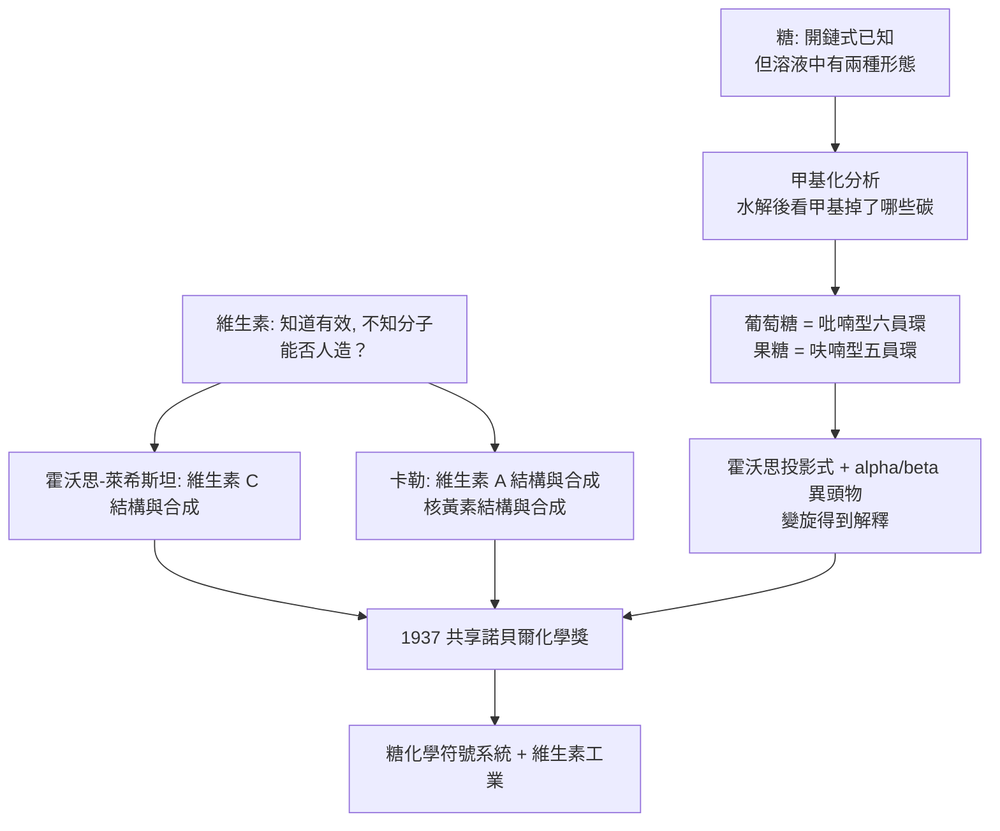

# 1937 · 霍沃思與卡勒——糖的環與維生素的工廠

> 1937 諾貝爾化學獎（共享）：瓦爾特·諾曼·霍沃思爵士（Sir Walter Norman Haworth，1883–1950，英國）——表彰「其對醣類與維生素 C 之研究」；保羅·卡勒（Paul Karrer，1889–1971，瑞士）——表彰「其對維生素，尤其是維生素 A 與 $\mathrm{B_2}$ 之研究」。同年兩位得主分別解決了「糖是什麼形狀」與「維生素能不能人造」。

## 懸案（案情提要）

1930 年代有兩樁並行的懸案：

1. **糖的形狀之謎**：葡萄糖的結構式早已寫出來了，但那是**開鏈**的形式。可是葡萄糖在水溶液中並不是開鏈——它的旋光度會隨時間變化（**變旋**），證明存在兩種能互相轉化的形態。那麼：環有多大（呋喃型五員環？吡喃型六員環？）、碳上的羥基朝上還是朝下？**糖的世界一直缺一張「立體圖」。**
2. **維生素的工廠之謎**：1930 年代初，維生素 C（抗壞血酸）、維生素 A、維生素 B$_2$ 陸續被分離，人們知道它們「有效」，卻**不知道它們是什麼分子**。更關鍵的追問是：**這些從自然界來的神奇物質，能不能在工廠裡製造？**——如果能，維生素就從「藥草」變成「藥品」，貧血、壞血病、佝僂病的救星可以工業化生產。

偵辦人：英國伯明翰大學的霍沃思（糖的立體結構）與蘇黎世的卡勒（維生素 A、$\mathrm{B_2}$）。前者的成果被稱為「霍沃思投影式」——今日每一堂有機化學課都在用。

## 前因

| 年份 | 事件 |
| --- | --- |
| 1883 | 霍沃思生於紐卡斯爾；14 歲入藥師學徒，業餘在紐卡斯爾大學旁聽化學。 |
| 1910 | 伯明翰大學博士（師從沃爾特·諾蘭斯）；與 F. B. 廷斯利（F. B. Tinsley）合作研究蔗糖與葡萄糖的甲基化分析——**本案方法的源頭**。 |
| 1927–1930 | 霍沃思提出**環狀結構假說**：葡萄糖在水溶液中主要為吡喃型（六員環）與呋喃型（五員環）平衡，並以**甲基化分析**證實環的尺寸。 |
| 1930–1932 | 發展**霍沃思投影式**：把環畫成平面多邊形（氧在右上、異頭碳在右），以粗線表示朝向觀察者；並提出**異頭物（anomer）**與 $\alpha/\beta$ 的命名。 |
| 1932 | 與瑞士的萊希斯坦（Reichstein）合作完成**維生素 C 的首次全合成**（由 D-阿拉伯糖／山梨醇出發）——史上第一個被合成的維生素。 |
| 1932–1937 | 維生素 C 的結構定案：$\gamma$-內酯 + 烯二醇結構；工業化合成法（萊希斯坦法）確立。 |
| 1935 | 卡勒與學生因特貝克（In der Beeck）完成**維生素 A 的首次合成**（並定出結構）——第二個被合成的維生素。 |
| 1932–1937 | 卡勒定出核黃素（維生素 B$_2$）結構（異咯嗪酮核 + 核糖醇側鏈）並完成合成。 |
| 1937 | 兩人共享諾貝爾化學獎。 |

## 調查

**偵查一：甲基化分析——量出糖環的大小。**

這是本案最漂亮的偵查術。原理：**把糖上所有「游離」的羥基用 $\mathrm{CH_3I}/\mathrm{Ag_2O}$ 甲基化，再水解，看哪些碳上的甲基掉了。**碳上的羥基若是游離的，就被甲基化；羥基若參與了環 formation（成醚），則不會被甲基化。

以葡萄糖為例：

$$\text{葡萄糖} \xrightarrow{\text{完全甲基化}} \text{四甲基衍生物} \xrightarrow{\text{水解}} 2,3,4,6\text{-四-O-甲基-D-葡萄糖}$$

水解後得到的是 **2,3,4,6-四甲基**葡萄糖：C1 與 C5 的位置沒有甲基——因為它們一個是異頭碳（一個 $\mathrm{OH}$ 參與成半縮醛環），一個的氧**就是環上的那個氧**。**結論：葡萄糖的環由 C1 到 C5 加一個氧構成，即六員環（吡喃型）。**

對果糖做同樣實驗，得到 **1,3,5,6-四-O-甲基-D-果糖**，缺失的是 C2 與 C5——**環氧在 C2，環由 C2 到 C5 構成，即五員環（呋喃型）**。同一個技術，一次說清了兩種糖的環型；這套「甲基化分析」至今仍是糖化學與多醣結構分析的基本武器。

**偵查二：異頭物與變旋——旋光的來歷。**

葡萄糖在溶液中有兩種形態：$\alpha$（異頭碳的 $\mathrm{OH}$ 與 C5 的 $\mathrm{OH}$ 在環的**同側**，即「順式」；$\alpha$ 與 $\beta$ 的比例隨溫度而變），$\beta$（**反式**）。兩者互相轉化即「變旋」，旋光度隨之變化：

$$\alpha\text{-葡萄糖} \rightleftharpoons \text{開鏈醛式} \rightleftharpoons \beta\text{-葡萄糖}, \qquad \alpha \approx 36\%,\ \ \beta \approx 64\% \ (\text{水溶液，25 }^\circ\mathrm{C})$$

霍沃思的投影式把這個立體問題變成可讀的圖：

$$\text{規則：環上碳的取代基「朝下」＝在環平面的下方；粗線＝朝向觀察者}$$

這套符號沿用八十年，是糖化學最有效的溝通語言。

**偵查三：維生素 C 的結構——烯二醇的抗氧化本領。**

萊希斯坦與霍沃思定出抗壞血酸的結構：**$(5R)-[(1S)-1,2\text{-二羥基乙基}]-3,4\text{-二羥基呋喃-2(5H)$-酮**——一個五員 $\gamma$-內酯，帶 **2,3-烯二醇**（enol-diol）基團：

$$\text{抗壞血酸} \rightleftharpoons \text{脫氫抗壞血酸} + 2\,\mathrm{H^+} + 2e^-$$

**結構—功能在此對上了**：烯二醇可被氧化（提供電子），故維生素 C 是強抗氧化劑，可中和游離基；壞血病正是胶原合成（脯胺酸與賴胺酸羥化）受阻的疾病，而維生素 C 正是脯胺酸羥化酶的輔因子：

$$\text{脯胺酸} + \mathrm{O_2} + \text{抗壞血酸} \xrightarrow{\text{脯氨酸羥化酶（需維生素 C）}} \text{羥脯胺酸} + \text{脫氫抗壞血酸}$$

**偵查四：卡勒的維生素 A——全共軛的視覺分子。**

卡勒定出維生素 A（視醇）的結構：一個 $\beta$-紫紅酮環（trimethylcyclohexenyl）+ 一條**全反式共軛多烯鏈**：

$$\text{視醇：} \; \beta\text{-紫紅酮環} - \mathrm{CH}=\mathrm{CH}-\mathrm{CH}=\mathrm{CH}-\cdots-\mathrm{CH_2OH} \quad (\text{約 11 個共軛雙鍵})$$

其光學性質直接來自共軛鏈長：

$$\lambda_{\max} \approx 325\ \mathrm{nm}\ (\text{維生素 A}), \qquad E \approx \frac{hc}{\lambda}$$

**共軛鏈與吸收波長的關係**是 1930 年代物理化學的重要成果；這條關係後來也用於解釋類胡蘿蔔素（β-胡蘿蔔素 11 個共軛雙鍵，$\lambda_{\max} \approx 450\ \mathrm{nm}$，呈橙色）與視覺紫紅質（11-順式，$\lambda_{\max}$ 移至 500 nm 以上）。

**偵查五：維生素的工業化——從藥草到工廠。**

| 維生素 | 結構定案 | 合成 | 工業意義 |
| --- | --- | --- | --- |
| 維生素 C（抗壞血酸） | 霍沃思、萊希斯坦（1932） | 萊希斯坦法：由山梨醇 → 山梨糖（發酵/化學氧化）→ 2-酮-L-古龍酸 → 內酯化 | 1933 年起工業化，壞血病被基本消滅 |
| 維生素 A | 卡勒（1930–31） | 卡勒法（多步） | 今日 $10^4$ 噸級的維生素 A 工業 |
| 維生素 B$_2$（核黃素） | 卡勒（1932） | 卡勒法 | 核黃素磷酸酯是 FMN/FAD 的核心（見 [1929-哈頓與發酵化學](1929-哈頓與發酵化學.md) 的輔酶故事） |

**「維生素可以人造」這句話，是二十世紀營養學與化工業的分水嶺。**

## 理論裁決

**判決一：糖的環結構與立體符號系統。** 甲基化分析的邏輯可一般化：

$$\text{游離羥基} \xrightarrow{\text{甲基化}} \text{甲醚}; \qquad \text{參與成環的羥基} \xrightarrow{\text{水解後}} \text{恢復羥基}$$

因此**「哪些碳的羥基消失」即「環的邊界」**。這套方法後來被用於澱粉、纖維素、菊糖等所有多醣的結構判定（甲基化水解分析），是「結構化學靠化學反應讀出來」的典範。

**判決二：異頭物與構象。** 環化引入了新的立體變數——異頭碳（anomeric carbon）。其羥基有兩種取向（$\alpha/\beta$），平衡比由立體效應與溶劑決定：

$$\frac{[\alpha]}{[\beta]} \rightleftharpoons K \quad (\text{水溶液中約 } 0.56:\ 1)$$

這解釋了**變旋現象**，並引出 1950 年代的**異頭效應（anomeric effect）**理論——構象分析（見 [1969-巴頓與構象分析](1969-巴頓與構象分析.md)）的重要舞台。

**判決三：烯二醇的氧化還原化學——維生素 C 的作用機制。** 維生素 C 的烯二醇可脫氫成二酮式（去氫抗壞血酸），電子因此可轉移給自由基：

$$\text{抗壞血酸} \rightarrow \text{去氫抗壞血酸} + 2\,\mathrm{H^+} + 2e^-$$

**結構（烯二醇）與功能（抗氧化）在此一一對應**——這是 1930 年代「結構決定功能」最乾淨的例子之一，也是今日食品添加劑（抗壞血酸鈉）與抗氧化的化學基礎。

**判決四：共軛鏈與光學——用波長讀出結構。** 對共軛多烯系，吸收波長隨共轕雙鍵數 $n$ 增長而系統性紅移（每增加一個共軛雙鍵約 $30$–$50\ \mathrm{nm}$）。因此：

$$\lambda_{\max}(n) \approx \lambda_0 + \Delta\lambda \cdot n$$

**「量波長即數雙鍵」**——這使得碳氫鏈的長度可以用分光光度計「讀」出來，是 1930 年代結構測定最重要的定量工具之一，也是後來阿斯托里的光譜項理論（見 [1922-阿斯頓與質譜儀](1922-阿斯頓與質譜儀.md)）的先聲。

## 後果

| 領域 | 影響 |
| --- | --- |
| 醣類化學 | 霍沃思投影式成為全球標準；糖的立體化學（構象、苷鍵、異頭效應、構象分析）自此有了一個共同的語言平台。 |
| 維生素工業 | 維生素 C、A、B$_2$ 的合成與工業化使「營養缺乏病」從糧食問題變成化工問題；1930–40 年代成為德國與瑞士化工業的新支柱產業。 |
| 醫學 | 壞血病的防治（軍隊口糧強化、抗壞血酸藥品）、維生素 A 缺乏（夜盲）的治療、腳氣病與核黃素缺乏的確認。 |
| 色譜法 | 卡勒在分離類胡蘿蔔素時發展的吸附色譜（與廷斯利傳統、萊德雷與溫斯坦的工作同源）成為天然物分離的標準手段，並直通 1952 年的層析法諾獎（見 [1952-馬丁與層析法](1952-馬丁與層析法.md)）。 |
| 物理化學 | 共軛多烯的光譜學成為結構與性質之間「可量測關係」的樣板，推動了 1940–50 年代的光譜項理論（見 [1971-赫茨貝格與分子光譜](1971-赫茨貝格與分子光譜.md)）。 |
| 科學制度 | 1937 年的化學獎首次出現「同一主題由兩國分別完成」的分享形式——維生素研究的國際化格局由此成形。 |

## 關聯

- [1902-費歇爾與醣類偵探學](1902-費歇爾與醣類偵探學.md)：費歇爾立下醣類的立體化學基礎，霍沃思補上「環與構形」的結構——同一家族案件的兩代接力。
- [1927-威蘭與膽汁酸](1927-威蘭與膽汁酸.md)：立體化學（$\alpha/\beta$、構象）的方法論共享；兩案的年代相鄰且同屬「結構決定性質」的程序。
- [1929-哈頓與發酵化學](1929-哈頓與發酵化學.md)：核黃素（維生素 B$_2$）正是輔酶 FMN/FAD 的核心——卡勒定結構、哈頓定功能。
- [1952-馬丁與層析法](1952-馬丁與層析法.md)：卡勒的吸附色譜是層析法的直系先驅。
- [1969-巴頓與構象分析](1969-巴頓與構象分析.md)：異頭效應與糖環構象的終審。
- [1965-伍德沃德與全合成](1965-伍德沃德與全合成.md)：全合成方法的另一個頂峰；萊希斯坦的維生素 C 合成即其先聲。
