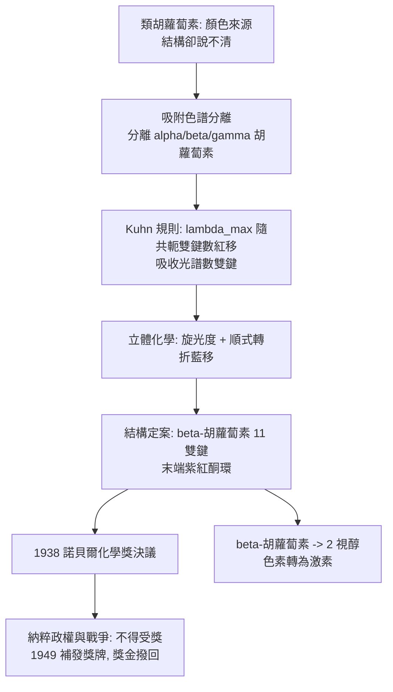

# 1938 · 庫恩與類胡蘿蔔素

> 1938 諾貝爾化學獎：里夏德·約翰·庫恩（Richard Johann Kuhn，1900–1967，奧地利／德國）——表彰「其對類胡蘿蔔素與維生素之研究」。因希特勒禁止德國人接受諾貝爾獎，這位得主**拒絕了這座獎**；戰後他仍被補授獎牌與證書，而獎金依決議留在基金裡。同時必須記下本案的另一頁：他在納粹時期與高層官員合作、並在 1936 年告發了三名猶太同事——2005 年德國化學會因此停頒「里夏德·庫恩獎章」。

## 懸案（案情提要）

1930 年代中期，天然色素與維生素的結構偵查來到最難的一段：

1. **類胡蘿蔔素的懸案**：胡蘿蔔素（carotene）給胡蘿蔔橙色、番茄紅素給番茄紅色、葉黃素給葉子黃色。它們的共同特徵是**長串共軛雙鍵**（因而呈現強烈顏色）與**大量碳氫鏈上的甲基**。但具體結構是什麼？雙鍵有幾個？在哪些位置？順反異構怎麼排？——**它們的實測值與文獻值長期對不上**。
2. **更難的活體案**：胡蘿蔔素在動物體內會變成維生素 A。**同一個分子，為什麼在植物裡是色素、在動物體內卻是激素？**轉變的機制是什麼？
3. **方法學的懸案**：這些分子太大、無法結晶、極易氧化，傳統的降解法失靈——需要一套能處理這類物質的新本領。

偵辦人：里夏德·庫恩——維也納出身、在海德堡工作的生物化學家。他靠**色譜分離、紫外可見光譜、旋光與分子折射的組合**，把類胡蘿蔔素的結構逐一拆開。

## 前因

| 年份 | 事件 |
| --- | --- |
| 1900 | 庫恩生於維也納；成長於學者之家（叔父為德國諾獎得主理查德·庫恩）。 |
| 1918–1921 | 於維也納大學在邁爾霍夫（Otto Meyerhof，1922 年醫學獎）指導下取得博士學位，研究植物色素的酵素化學。 |
| 1922 | 遷居德國，在慕尼黑隨威蘭（見 [1927-威蘭與膽汁酸](1927-威蘭與膽汁酸.md)）研究微生物的類胡蘿蔔素與光合作用；1925 年任海德堡凱撒威廉生理化學研究所（後 MPI）主任。 |
| 1926–1931 | 研究細菌的類胡蘿蔔素與光合作用色素的化學；建立**色譜分離**天然色素的方法（尤其是胡蘿蔔素的異構體分離）。 |
| 1930–1935 | 以「 Kuhn 規則」建立**共軛多烯的吸收波長與雙鍵數的經驗關係**，並以之測定色素的雙鍵數；定出 β-胡蘿蔔素與胡蘿蔔素類異構體（$\alpha$、$\beta$、$\gamma$）的結構。 |
| 1932 | 完成**維生素 A 的合成**（卡勒與因特貝克亦獨立完成）並確認其結構；庫恩另發現**視覺紫紅質的視覺反應**與光電效應（光敏化）的關聯。 |
| 1938-11 | 諾貝爾委員會決議授獎；但此時德國已納粹化、戰事將起，**希特勒明令德國公民不得接受諾貝爾獎**。 |
| 1936 | 納粹時期的紀錄：庫恩與納粹高層官員合作，並於 1936 年**告發了三名猶太同事**；其學術與職業的上升與政權的合作密切相關。 |
| 1938–1945 | 因戰事與納粹政權，庫恩的研究所被軍方徵用（研究維生素、藥物與燃料），其科學生涯被迫中斷。 |
| 1938–1949 | 庫恩在戰時**拒絕接受**該獎項；他在手寫信中甚至把「把諾貝爾獎頒給德國人」描述為「邀請違反元首的命令」。戰後他仍被補授獎牌與證書，獎金則依決議留在諾貝爾基金會。 |
| 1947 | 庫恩與同事在拉普維奇的實驗裡重獲自由，但仍受學術冷遇。 |
| 2005 | 德國化學會（GDCh）宣布停頒「里夏德·庫恩獎章」——科學社群對其納粹時期行為的正式清算。 |
| 1967 | 逝於海德堡。 |

## 調查

**偵查一：色譜——把「看起來一樣」的色素分開。**

類胡蘿蔔素是多種異構體的混合物，色相近、性質相近，傳統分餾與結晶無能為力。庫恩以**吸附色譜**（以碳酸鈣、氧化鋁等固定相吸附，用石油醚之類的沖洗劑梯度沖洗）把它們分層分離：

$$\text{混合物} \xrightarrow{\text{吸附}} \text{各色帶} \xrightarrow{\text{沖洗}} \text{各純組分} \xrightarrow{\text{旋光 + 吸收光譜}} \text{逐一鑑定}$$

這套方法使「$\alpha$-、$\beta$-、$\gamma$-胡蘿蔔素」的區分成為常規，並為後來的層析法諾獎（見 [1952-馬丁與層析法](1952-馬丁與層析法.md)）鋪平道路。

**偵查二：光譜計數——用波長數雙鍵。**

庫恩最重要的定量工具是**吸收光譜與共軛鏈長的關係**。對含 $n$ 個共軛雙鍵的多烯：

$$\lambda_{\max}(n) \approx \lambda_0 + \Delta\lambda\,(n-1), \qquad \Delta\lambda \approx 30\ \mathrm{nm}\ (\text{典型})$$

實測對照：

| 色素 | 共軛雙鍵數 | $\lambda_{\max}$ | 顏色 |
| --- | --- | --- | --- |
| 維生素 A（視醇） | 11（其中部分在環內） | 約 325 nm | 淡黃 |
| β-胡蘿蔔素 | 11 | 約 450 nm | 橙 |
| 番茄紅素 | 11 | 約 470 nm | 紅 |
| 葉黃素 | 10 | 約 445 nm | 黃 |

**「數波長」即「數雙鍵」**——庫恩以此規則確認了各色素的共軛系統，並藉由推算剩餘氫原子數與分子式配合，反推出骨架組成。這是 1930 年代最有效率的結構判定技巧之一。

**偵查三：立體化學——順反異構與「轉折點」。**

胡蘿蔔素類色素有大量幾何異構體（每個雙鍵可為順式或反式）。庫恩以**旋光度**與**光譜位移**雙重判讀：順式雙鍵會使共軛鏈「彎折」，破壞平面性，使 $\lambda_{\max}$ 明顯藍移。

$$\lambda_{\max}(\text{全反式}) > \lambda_{\max}(\text{含順式})$$

這條「順式使共軛系統轉折並藍移」的規則，成為日後立體異構判定（尤其是類胡蘿蔔素、維生素 A 的順反異構與其生物活性差異）的通用工具。**重要的實例**：天然維生素 A 主要是全反式，而 $13$-順式異構物的活性顯著較低。

**偵查四：色素轉為維生素——生物化學的接榫。**

庫恩以實驗證明：$\beta$-胡蘿蔔素在動物體內可被轉變為維生素 A，而**轉變的關鍵是「多切掉一截」**：

$$\beta\text{-胡蘿蔔素} \xrightarrow{\text{酶促切割（中心裂解）}} 2\,\text{維生素 A（視醇）分子}$$

這解釋了「胡蘿蔔素是維生素 A 的前驅物」——**同一分子在植物體內是色素，在動物體內是激素**，差別只在酶與切割位置。

**偵查五：光化學與視覺——把色素與生理接上線。**

庫恩在 1930 年代研究植物與細菌色素的光化學，並提出色素在**光電效應**中的作用——這是光合作用光化學與視覺理論的前哨。1930 年代末，他的實驗顯示色素在光照射下可發生電子轉移；這條線在 1960 年代的視覺生理學（視紫紅質的泵浦循環）中以更精確的形式重生（見 [1977-普里高津與耗散結構](1977-普里高津與耗散結構.md) 對耗散與循環的另一種解讀）。

## 理論裁決

**判決一：共軛多烯的「庫恩規則」。** 以 Hückel 分子軌域（見 [1966-馬利肯與分子軌域](1966-馬利肯與分子軌域.md)）為語言，簡單共軛鏈（$\mathrm{C=C}$ 數 $n$）的最低 $\pi \to \pi^*$ 躍遷能量約隨鏈長平方根下降：

$$\Delta E \approx \frac{hc}{\lambda_{\max}} \propto \frac{1}{n}, \quad \lambda_{\max} \approx \text{const} \times (n + \text{const})$$

庫恩把它轉成**實用的數雙鍵工具**（每多一個共軛雙鍵，$\lambda_{\max}$ 紅移約 $30$–$50\ \mathrm{nm}$）。**這條規則是 1930 年代「光譜＋結構」典範的代表作**，並在 1940–50 年代被赫茨貝格的分子光譜理論正式化（見 [1971-赫茨貝格與分子光譜](1971-赫茨貝格與分子光譜.md)）。

**判決二：立體效應對光學的影響——共軛系統的幾何學。** 順式雙鍵引入「轉折」，破壞共軛系統的平面共軛，使有效共軛長度下降：

$$\lambda_{\max}(\text{全反式}) - \lambda_{\max}(\text{順式}) \approx 30\text{–}60\ \mathrm{nm}$$

這解釋了：
- $\beta$-胡蘿蔔素（全反式，450 nm）與其順式異構體（更藍）的顏色差；
- 維生素 A 的 $13$-順式異構體活性較低、且在體內的代謝路徑不同。

**判決三：前驅物與激素的統一。** 「胡蘿蔔素 → 維生素 A」的酶促裂解，確立了**同一分子在不同生物體內扮演不同角色**的觀念：角色由**酶的專一性**決定，而非由分子本身決定。這是生化學「同一分子、多種功能」觀念的早期表述。

**判決四（案件倫理）：科學的中立不能被政治污染——本案最沉重的一頁。** 1938 年授獎決議在戰時引發兩難：納粹政權禁止德國人接受諾貝爾獎，庫恩因此**拒絕受獎**（他並非受害者，而是執行了這項禁令的一方）。同時必須記錄他自己的紀錄：與納粹高層官員合作、1936 年告發三名猶太同事。戰後他仍獲得獎牌與證書，而德國化學會在 2005 年停頒以其命名的獎章。

**這段插曲是科學史教科書上少見的「制度與科學交錯」案例**：一個人的科學貢獻與其國家的政治命運被綁在一起，而判決歸判決，人歸人——**科學獎章能表彰工作，卻無法為人品背書。**

## 後果

| 領域 | 影響 |
| --- | --- |
| 天然色素 | β-胡蘿蔔素（食物著色劑 E160a）、番茄紅素、葉黃素、蝦紅素的結構與工業生產；類胡蘿蔔素的**共車多烯模型**成為有機化學的經典案例。 |
| 維生素 A 與視覺 | 維生素 A 的結構、全合成與立體異構（13-順式）確立；維生素 A 缺乏症（夜盲、乾眼）防治；$11$-順式視黃醛與視紫紅質的循環是視覺理論的核心。 |
| 色譜 | 天然產物的吸附色譜分離成為標準操作，直通 1952 年的諾貝爾層析法。 |
| 光化學 | 色素的光化學與光電效應，為 1940–50 年代的葉綠素光化學與 1960 年代的視覺循環理論鋪路。 |
| 科學制度與史 | 庫恩的案例成為「諾貝爾獎與政治」的最著名案例；維也納—海德堡的生物化學傳統（邁爾霍夫 → 庫恩 → 韋爾德 → 布賴特納）成為科學遷徙的典範；2005 年 GDCh 停頒庫恩獎章，則是科學社群對自身歷史的一次公開清算。 |

## 關聯

- [1927-威蘭與膽汁酸](1927-威蘭與膽汁酸.md)：庫恩的早期師承環境（慕尼黑威蘭實驗室）；類固醇與類胡蘿蔔素同屬異戊二烯衍生物的兩支。
- [1937-霍沃思與維生素C](1937-霍沃思與維生素C.md)：維生素研究的同一年、同一主題的另一份卷宗；卡勒的維生素 A 合成與庫恩的獨立合成互相印證。
- [1930-漢斯費歇爾與血紅素](1930-漢斯費歇爾與血紅素.md)：色素結構方法的典範；胡蘿蔔素與卟啉、葉綠素同屬「色素王國」。
- [1971-赫茨貝格與分子光譜](1971-赫茨貝格與分子光譜.md)：庫恩的經驗規則被提升為分子光譜的量子理論。
- [1966-馬利肯與分子軌域](1966-馬利肯與分子軌域.md)：Hückel 軌域法為共軛多烯光譜提供理論基礎。
- [1946-薩姆納與酵素結晶](1946-薩姆納與酵素結晶.md)：前驅物→激素的「酶專一性」觀念在此獲得蛋白質級的證據。
