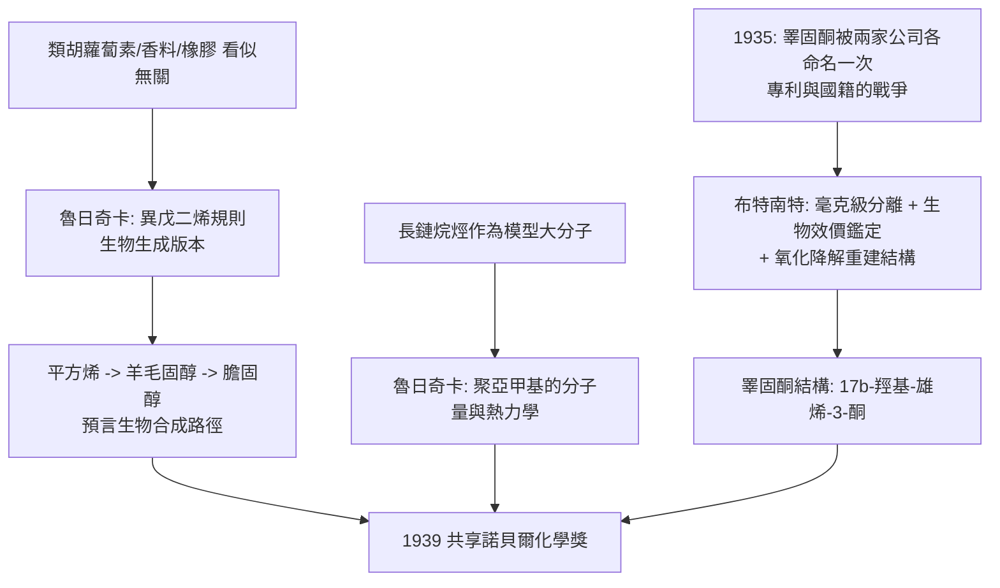

# 1939 · 布特南特與魯日奇卡——激素與異戊二烯的會師

> 1939 諾貝爾化學獎（共享）：阿道夫·弗里德里希·約翰·布特南特（Adolf Butenandt，1903–1995，德國）——表彰「其對性激素之研究」；萊奧波德·魯日奇卡（Leopold Ruzicka，1887–1976，克羅埃西亞／瑞士）——表彰「其對聚亞甲基與高等萜烯之研究，包括男性性激素的首次化學合成」。兩案在同一年揭示了同一件事：激素與色素，竟是同一套積木搭出來的。

## 懸案（案情提要）

1930 年代的生物化學裡，有兩椿被人為綁在同一個物質上的懸案：

1. **激素的物質**：睪丸與卵巢裡的「分泌物」被稱為雄性激素與雌性激素。它們確實能改變動物發育，但**它們是什麼分子？**1935 年，德國的先靈（Schering）與瑞士的西巴（Ciba）各自從男性尿液中取得數毫克的結晶雄性激素，並各自分頭命名——**同一個分子，兩個名字，兩份專利**。這不只是科學問題，更是專利與國籍的戰場。
2. **色素與香料的通則**：類胡蘿蔔素、維生素 A、橡膠、樹脂、萜烯香精——這些物質五花八門，卻共享同一種「碳骨架氣味」。**它們是否由同一種建築積木搭成？**

偵辦人：布特南特（慕尼黑，激素的化學）與魯日奇卡（蘇黎世、萜烯與聚亞甲基）。

## 前因

| 年份 | 事件 |
| --- | --- |
| 1887 | 魯日奇卡生於克羅埃西亞的武科瓦尔；中學即自學化學並翻譯德文化學教科書。 |
| 1910 | 入蘇黎世聯邦理工學院（ETH），受施陶丁格（見 [1953-施陶丁格與高分子](1953-施陶丁格與高分子.md)）影響，1911 年畢業，後赴德國慕尼黑受教於威蘭（見 [1927-威蘭與膽汁酸](1927-威蘭與膽汁酸.md)）。 |
| 1920s | 與威蘭共同確立**生物生成的異戊二烯規則**：所有萜類由 $\mathrm{C_5}$ 單元（異戊二烯）構成——萜烯王國的結構法典（見 [1910-瓦拉赫與萜類家族樹](1910-瓦拉赫與萜類家族樹.md)）。 |
| 1926 | 從頭足動物（海綿）的類胡蘿蔔素入手，證明動物界的類胡蘿蔔素與植物界同構。 |
| 1929–1935 | 布特南特在慕尼黑（溫道斯實驗室出身，見 [1928-溫道斯與維生素D](1928-溫道斯與維生素D.md)）自男性尿液中分離出**雄酮（androsterone）**，1935 年分離出**睪固酮（testosterone）**並結構定案。 |
| 1935 | 魯日奇卡在 ETH 完成**由膽固醇出發的部分合成睪固酮**——人類第一次用化學方法從天然固醇造出具體內活性的激素（歷史上的「部分全合成」）。 |
| 1935 | 同一年的尷尬：先靈的睪固酮與西巴的「雄烯二酮」被證明是同一物；德瑞公司（德國）與西巴（瑞士）為專利與名稱打了多年官司，最後在西巴獲頒「第一個男性性激素的化學合成」榮譽的背景下折衷。 |
| 1930s | 魯日奇卡研究**聚亞甲基**（長鏈烷烴，$\mathrm{C_nH_{2n+2}}$，$n$ 達數百）：作為「模型聚合物」，用滲透壓與分餾研究其分子量分布；並研究高階萜烯（$\mathrm{C_{20}}$、$\mathrm{C_{30}}$、$\mathrm{C_{40}}$）：平方烯、叶紅素、胡蘿蔔素。 |
| 1939 | 兩人共享諾貝爾化學獎；因納粹政府的禁令，德國得主一度拒絕受獎，戰後於 1949 年接受。 |
| 1940s–1960s | 布特南特任馬克斯・普朗克學會主席（1960–72），研究昆蟲性費洛蒙；1959 年定出家蠶性費洛蒙結構並命名 **bombykol**。 |

## 調查

**偵查一：激素的濃度難題——從噸級生物材料中找毫克物質。**

雄性激素在尿中的濃度極低：處理數千公升尿液方能取得數毫克晶體。偵查手段必須同時解決三件事：

1. **追蹤活性（生物鑑定）**：以大鼠的**大角陰囊反應**（caput cornus assay）判定樣品的雄性激素效價——這是一種「以生物效價取代質量」的定量法；
2. **高效分離**：酸化、萃取、鹽析、柱層析與結晶的串聯；
3. **化學鑑定**：元素分析、分子量、旋光、紫外吸收、**與已知衍生物（如縮酮、酯化產物）比較**。

$$\text{雄酮（androsterone）} = 3\alpha\text{-羥基-5\alpha\text{-雄烷-17-酮}\ (\mathrm{C_{19}H_{30}O_2})$$

$$\text{睪固酮（testosterone）} = 17\beta\text{-羥基-雄烯-3-酮}\ (\mathrm{C_{19}H_{28}O_2})$$

**結構判定的關鍵一步是「雙鍵位置」**：雄酮與睪固酮相差一個雙鍵與位置異構（$5\alpha$ vs $\Delta^4$），只能靠**氧化降解＋還原對照**逐步逼近；布特南特在溫道斯實驗室的做法是把激素降解為已知類固醇，再以氧化還原反應逐步「重建」。

**偵查二：生物合成的線索——從尿到腺體。**

激素最初是從尿液中發現的，線索指向體內的合成場所。1930 年代的實驗逐步證實：睪固酮由**睪丸的間質細胞（萊迪希細胞）**製造，並由睪固酮與雌烯二酮（estrone）在體內相互轉化（雄激素與雌激素的「相互轉化」）。

**偵查三：異戊二烯規則的勝利——平方烯與類固醇。**

魯日奇卡在 1930 年代最傑出的推論是：**類固醇骨架也由異戊二烯單元構成**—— $\mathrm{C_{19}$、$\mathrm{C_{21}$ 的固醇，其碳骨架可由 $\mathrm{C_{30}$ 的平方烯（squalene）經「折疊—環化—脫羧」產生，並在過程中失去三個碳：

$$\text{平方烯（}2\times\mathrm{C_{15}}\text{，由 6 個異戊二烯單元）} \xrightarrow{\text{環化}} \text{羊毛固醇} \xrightarrow{-3\,\mathrm{CO_2}} \text{膽固醇（}\mathrm{C_{27}\text{）}$$

這就是**生物生成的異戊二烯規則**的完整版本，也是 20 世紀最雄心勃勃的結構生物學預測之一：它**預言**了從簡單前驅物到複雜分子的建構路徑。

**偵查四：生物生成的立體化學問題——「反應能否給出立體專一的產物」。**

魯日奇卡與後人注意到：平方烯環化成固醇時，若沒有酵素引導，會產生大量立體異構物（多個手性中心的組合）。但自然界只產生**單一**立體異構物（例如天然的 $\beta$-胡蘿蔔素是全反式）。因此他提出一個驚人的問題（1930–50 年代）：

$$\text{立體專一性來自「酵素的三維模板」，而非化學本身}$$

**「酵素立體專一性的生物合成解釋」**這個問題，要到 1950 年代的立體化學（威爾金森的均相催化與其立體效應，見 [1973-菲舍爾與二茂鐵](1973-菲舍爾與二茂鐵.md)）與 1960 年代的構象分析（見 [1969-巴頓與構象分析](1969-巴頓與構象分析.md)）才被回答。**魯日奇卡的問題先於答案五十年。**

**偵查五：聚亞甲基——聚合物的「模型化合物」。**

魯日奇卡以費托—托普什法合成的長鏈烷烴作為「模型大分子」，研究：

- 用**分餾（分級蒸餾）**分離不同鏈長的級分，測其分子量；
- 用**滲透壓法**（見 [1901-凡特荷夫與物理化學](1901-凡特荷夫與物理化學.md)）測分子量；
- 觀察其**熱力學行為**（熔點隨鏈長上升、溶解行為、結晶性）。

這套「以已知結構的小分子研究大分子性質」的方法，正是後來施陶丁格（見 [1953-施陶丁格與高分子](1953-施陶丁格與高分子.md)）建立高分子學的技術路線。

## 理論裁決

**判決一：異戊二烯規則（生物生成版）。** 萜烯與類固醇的碳骨架規則可寫為：

$$\text{碳骨架} = \underbrace{n \times \mathrm{C_5}}_{\text{異戊二烯單元}} - \underbrace{3\,\mathrm{CO_2}}_{\text{環化後脫羧}}$$

並配合「頭尾相接（head-to-tail）」與「頭頭相接（head-to-head）」兩種接合規則：**頭尾相接**給出異戊二烯的正常鏈（葉綠醇的植醇尾、胡蘿蔔素的鏈），**頭頭相接**則給出平方烯那樣的 C$_{30}$ 對稱結構：

$$\text{平方烯：} \; 2\times(\mathrm{C_{15}}) \text{ 頭頭相接} \;\Rightarrow\; \text{「偶數」碳骨架}$$

這條規則在 1950–60 年代被放射性標記實驗全面驗證（用 $^{14}\mathrm{C}$ 標記乙酸，證明生物體以乙酸為碳源合成異戊二烯），並在 1960 年代由布洛赫（Bloom）與萊嫩（Lynen）確立的**甲羥戊酸—異戊烯焦磷酸（IPP）途徑**給出分子機制（他們獲 1964 年醫學獎）。**魯日奇卡的規則預言了生物學的一個基本代謝路徑。**

**判決二：立體專一性的問題陳述。** 對烯丙基型中間物的環化，立體化學給出「立體化學的混亂」：一個 $\mathrm{C_{30}$ 前驅物經環化可產生上百種立體異構的固醇。自然界卻只給一種。魯日奇卡由此提出原則性問題：**化學本身不提供選擇，選擇必須由酵素提供。**這是「立體專一性」概念在生物學中的最早表述之一。

**判決三：聚合物的分子量測量路線。** 魯日奇卡的聚亞甲基工作建立了「大分子分子量」的操作方案：

$$\frac{\pi V}{RT} = \frac{m}{M} \;\Rightarrow\; M = \frac{mRT}{\pi V}$$

配合**分級蒸餾**（依鏈長分離）與**滲透壓**，他得到了數百鏈長的烷烴級分，並觀察到隨鏈長增加：**熔點上升、密度趨近極限值、溶解行為改變**——**這正是今日「聚合物的分子量分布與性質」的先驅觀測。**

**判決四：激素作為藥物的第一條路。** 睪固酮的化學帶來了「荷爾蒙替代療法」：1935–40 年代，先靈的丙酸睪固酮（testosterone propionate）上市，用於男性性腺功能低下；而 1951 年魯日奇卡的學生、同事德雷拉西（Djerassi）在墨西哥 Syntex 合成**炔諾酮（norethisterone / norethynodrel）**，開啟口服避孕藥——**「荷爾蒙」從實驗室走進藥房的完整路徑**。

## 後果

| 領域 | 影響 |
| --- | --- |
| 內分泌學 | 性激素的結構確立使「荷爾蒙 = 特定分子」的觀念普及；睪固酮、雌二醇、黃體酮的臨床使用開啟了荷爾蒙治療時代。 |
| 避孕藥 | 1950–60 年代的口服避孕藥（德雷拉西的 19-去甲睪固酮衍生物）直接承自睪固酮的結構；魯日奇卡的實驗室是這條線的發源地。 |
| 生物合成 | 異戊二烯規則與平方烯環化成固醇的預言，在 1950–60 年代由放射性標記與酵素研究證實，成為生化學最漂亮的「預言—驗證」案例之一。 |
| 香精與香料 | 合成香葉醇、香葉烯、檸檬烯、紫罗兰酮等，使香水工業擺脫對天然原料的依賴；魯日奇卡的 $\mathrm{C_{10}$–$\mathrm{C_{40}}$ 萜烯結構是這整個產業的骨架。 |
| 高分子科學 | 聚亞甲基的模型研究為施陶丁格的高分子論提供實證；其「異戊二烯單元」的觀念也成為 1950 年代立體規整聚合（齊格勒—納塔）的理論背景（見 [1963-齊格勒與納塔](1963-齊格勒與納塔.md)）。 |
| 昆蟲學 | 布特南特 1959 年定出家蠶性費洛蒙 bombykol 的結構——**昆蟲性費洛蒙的第一個結構**，開啟了昆蟲行為的化學通訊研究。 |
| 科學制度與史 | 1939 年獎因納粹禁令而一度無人領獎（布特南特 1949 年接受）；布特南特於納粹時期加入政權並主持 Kaiser Wilhelm 研究所的戰時研究（1940 年代的「諾貝爾獎得主納粹化」議題之一），戰後去納粹化並長期主持馬克斯・普朗克學會。 |

## 關聯

- [1910-瓦拉赫與萜類家族樹](1910-瓦拉赫與萜類家族樹.md)：異戊二烯規則的經驗版由瓦拉赫建立，本案完成其生物生成版。
- [1927-威蘭與膽汁酸](1927-威蘭與膽汁酸.md)：魯日奇卡的師承（威蘭實驗室）與類固醇骨架的同一塊地圖。
- [1928-溫道斯與維生素D](1928-溫道斯與維生素D.md)：布特南特的博士導師；維生素 D 與性激素同屬類固醇王國的分支。
- [1953-施陶丁格與高分子](1953-施陶丁格與高分子.md)：聚亞甲基的模型研究是高分子學成立的技術前提。
- [1955-迪維尼奧與催產素](1955-迪維尼奧與催產素.md)：多肽激素的合成——性激素（小分子）之後的另一條荷爾蒙戰線。
- [1963-齊格勒與納塔](1963-齊格勒與納塔.md)：異戊二烯單元在催化劑手中被立體規整聚合，天然橡膠的工業翻版。
- [1969-巴頓與構象分析](1969-巴頓與構象分析.md)：魯日奇卡的「立體專一性從何而來」之問的最終答卷。
