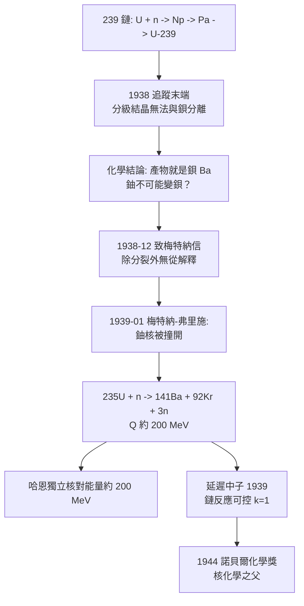

# 1944 · 哈恩與核分裂

> 1944 諾貝爾化學獎：奧托·哈恩（Otto Hahn，1879–1968，德國）——表彰「其發現放射性元素之核分裂，以及由此發現之鏈反應系列之演化」。核化學之父；也是唯一一位在戰後被盟軍拘禁的諾貝爾化學獎得主。

## 懸案（案情提要）

1934 年底，德國柏林一間被稱為「木工房」的實驗室裡，奧托·哈恩與弗里茨·施特拉斯曼在追一個**化學上不可能的現象**。

故事從哈恩的老本行——放射化學——說起：用中子轟擊鈾，鈾會先變成鎿（Np），再變成鎂（Pa），再變成鈾-239；這條「239 鏈」在 1934–35 年已被哈恩與梅特納寫入論文。但 1938 年，當哈恩與施特拉斯曼仔細追蹤這條鏈的末端時，**化學證詞出現了裂縫**：

- 他們用**分級結晶**（氯化鋇與氯化鑭的分級）嘗試把「鐳」從反應產物中分離出來；
- 結果發現：那個「鐳」的活性，**無論用多少化學手段都無法與鋇分開**——它跟鋇一起沉澱、一起結晶、一起表現化學性質；
- 更怪的是，鋇的放射性會**隨時間增長**（母體衰變不斷餵養它）。

化學家的直覺是絕對的：**如果一個東西的化學行為完全等同於鋇，那它就是鋇。**但這在當時是荒謬的——按照元素周期表，鈾（$Z=92$）無論如何不可能變成鋇（$Z=56$），中間要消失 36 個質子！連哈恩自己都在信中猶豫：「我們也許該假設，鐳的同位素並沒有衰變成鋇……那麼除了分裂還能是什麼呢？」

**元素可以被劈開——這就是核分裂。**物理學家梅特納與弗里施在 1939 年 1 月給出解釋：鈾核被中子撞開了。

## 前因

| 年份 | 事件 |
| --- | --- |
| 1879 | 哈恩生於法蘭克福；祖父為帝國宰相俾斯麥（Otto von Bismarck）之子。 |
| 1901 | 馬爾堡大學博士；同年赴倫敦大學學院隨拉姆齊（見 [1904-拉姆齊與稀有氣體家族](1904-拉姆齊與稀有氣體家族.md)）研究放射化學，發現放射性鈾（鈾 $Z$）與鈦（Th）之間的「衰變系」關係；1905–06 年赴蒙特婁麥吉爾大學隨盧瑟福（見 [1908-盧瑟福與元素蛻變](1908-盧瑟福與元素蛻變.md)），發現數種放射性同位素（鐳、釷、鎂、鈾），並發現**原子反衝**現象。 |
| 1912 | 柏林威廉皇帝化學研究所（KWI）成立；哈恩主持放射化學部；梅特納加入。 |
| 1918 | 哈恩與梅特納分離出壽命最長的鎂同位素（$^{231}\mathrm{Pa}$）。 |
| 1917–1918 | 一戰服役，並在哈伯主持的毒氣部隊（見 [1918-哈伯與合成氨](1918-哈伯與合成氨.md)）服役於西線，參與第一次伊普雷戰役的化學戰。 |
| 1918–1938 | 與梅特納合作，發現鐳、釷、鎂、鈾的同位素；發現**核 isomerism**（核同質異能）現象。 |
| 1934–1936 | 與施特拉斯曼合作研究中子轟擊鈾與釷的產物（該鏈即「239 系」）。 |
| 1936 | 哈恩開創**鉀-銣定年法**（以 $^{87}\mathrm{Rb} \to {}^{87}\mathrm{Sr}$ 的衰變計時）——地質年代學的先聲之一。 |
| 1938-12 | 哈恩與施特拉斯曼完成鋇／鑭的化學判定，撰寫致梅特納的著名信件。 |
| 1939-01 | 梅特納與弗里施發表核分裂的物理解釋；弗里施從生物學借來「fission（分裂）」一詞。 |
| 1939-01 | 哈恩與施特拉斯曼發表化學證據論文（*Über den Nachweis und das Verhalten der bei der Bestrahlung des Urans mittels Neutronen entstehenden Erdalkalimetalle*）。 |
| 1939–1945 | 二戰期間哈恩在德國核計畫中工作（主要是**核分裂產物的清點與分析**），並參與發現**延遲中子**（1939）。 |
| 1945-07 至 1946-01 | 在英國被盟軍拘禁於「牧場莊莊園」（Farm Hall），與另外九位德國科學家同囚。 |
| 1948–1960 | 重建德國科學：任馬克斯・普朗克學會首任主席（1948–60）、凱撒威廉學會末任主席；1957 年參與《哥廷根宣言》；1959 年共同創立**德國科學家聯盟**。 |

## 調查

**偵查一：分級結晶——化學家的最終審問。**

哈恩與施特拉斯曼的實驗技術是放射化學的標準武器：把反應產物轉成氯化物，用**分級結晶**（利用溶解度差異逐步濃縮）與**分級沉澱**（用硫酸鋇、碳酸鹽等在不同條件下分組沉澱）來「抓」那個放射性物質。他們的做法與辨認一條未知鏈的方法完全一致：

1. 對每一級分餾物測量**放射性**；
2. 測量**衰變半衰期**（用時間分辨的活度曲線）；
3. 觀察**化學共沉**行為；
4. 與已知元素（鋇、鑭、鐳、鈾）比對。

**關鍵觀測**：所謂「鐳」的級分，**無論分級多少次都無法與鋇分離**（放射性始終跟著鋇的化學行為走），而且衰變曲線顯示它**在生長**——說明它有一個正在衰變的母體。

**偵查二：化學證詞的翻譯——「鋇」的確認。**

1938 年 12 月 17 日，施特拉斯曼寫給哈恩的信裡有一句關鍵的化學推理：既然無法把這個放射性物質與鋇分開，那麼**它本身就是鋇**（而不是鐳）。此前，物理學家曾建議：這個「鐳」也許是由錒（Ac，$Z=89$）經 $\alpha$ 衰變而來（$89 \to 88 \to 56$，$\mathrm{Ra}$ 的祖先鏈是 $^{238}\mathrm{U} \to {}^{234}\mathrm{Th} \to {}^{234}\mathrm{Pa} \to {}^{230}\mathrm{Th} \to {}^{226}\mathrm{Ra}$）。哈恩與施特拉斯曼排除了這條路：若產物是鐳系的錒，就應能與鐳系元素分離；但它與鋇完全無法分離。

$$\text{1938-12 的化學結論：}\quad \text{產物是鋇（Ba）而非鐳（Ra）}$$

**偵查三：物理解釋——核被劈開。**

梅特納（1938 年被迫流亡瑞典）與弗里施於 1939 年 1 月用玻爾模型計算：鈾-235 核在中子撞擊下形變、裂成兩塊較輕的核，如：

$${}^{235}_{92}\mathrm{U} + {}^{1}_{0}\mathrm{n} \rightarrow {}^{141}_{56}\mathrm{Ba} + {}^{92}_{36}\mathrm{Kr} + 3\,{}^{1}_{0}\mathrm{n} + \text{能量}$$

質量虧損與能量：

$$\Delta m \approx 0.2\ \mathrm{u} \quad\Longrightarrow\quad E = \Delta m c^2 \approx 0.2 \times 931.5\ \mathrm{MeV} \approx 190\ \mathrm{MeV}$$

哈恩後來以化學數據獨立估算裂變能量，約 200 MeV——**與 $E=mc^2$ 的預測相符**。1939 年 1 月，弗里施在倫敦一次會議上聽到哈恩的化學結果，當晚用玻爾公式算出同樣的數字，並借用生物學的「分裂」一詞命名此現象。

**偵查四：鏈反應的物理化學——一個失控的懸案。**

分裂釋放的中子會再引發其他鈾核分裂：

$$n_{\text{中子}} \xrightarrow{\text{被吸收}} \text{裂變} \xrightarrow{\text{釋放 2–3 中子}} \text{再分裂}$$

哈恩與其同事在 1939 年發現**延遲中子**（裂變產物衰變後才釋放的中子），這在物理上是關鍵的：它讓反應堆可以「可控」——控制棒吸收部分中子即可把增值因子 $k$ 壓到 1 以下：

$$k = \frac{\text{每代釋放的中子數} \times \text{被下一代吸收的比例}}{} \quad \text{（}k<1 \text{ 次臨界、} k=1 \text{臨界、} k>1 \text{超臨界）}$$

哈恩在 1939 年 12 月致信希特勒，報告裂變產物可被中子繼續引發——這封信被希姆萊（Heisenberg）與物理學家們解讀為「德國可能製造反應堆」，**成了德國核計畫的技術起點，也成了哈恩在戰後被拘禁的原因之一**。

## 理論裁決

**判決一：質量虧損與裂變能。** 核反應的能量產出來自**質量的微小虧損**——這是愛因斯坦 1905 年公式的第一次大規模化學／物理驗證：

$$E = \Delta m\,c^2, \qquad 1\ \mathrm{u}\ c^2 = 931.5\ \mathrm{MeV}$$

對 $^{235}\mathrm{U}$ 的裂變：$\Delta m \approx 0.2\ \mathrm{u}$，故 $E \approx 190$–$200\ \mathrm{MeV}$；每莫耳鈾約 $1.9\times10^{11}\ \mathrm{J}$——**相當於燃燒 20 噸煤**。這是化學家第一次測出「原子裡儲存了多少能量」，也第一次說明：能量的來源不是反應鍵，而是**核內的質量差**。

**判決二：裂變產物的統計——放射化學的「元素週期表」被重寫。**

$$\text{裂變產物} \approx 36\text{–}50\text{ 種元素的同位素} \quad (\text{鋇、銫、鈰、銫、碘、氙、鉍等})$$

產物的質量分布呈「雙峰」（輕峰約 95、重峰約 140），這在 1946 年由特里爾（Trillel）以質譜儀量測證實，成為「裂變產物產額曲線」的標準圖。**化學家第一次能像清點戰利品那樣，清點一場核反應的全部產物**——這是哈恩在戰時被徵用的工作（清點德國的核分裂產物），也是核燃料經濟與放射化學的基礎。

**判決三：鏈反應與臨界性。** 分裂反應的自持條件可寫為：

$$k_{\text{eff}} = \nu\,p\,f - 1$$

其中 $\nu$ 為每次裂變釋放的中子數（2–3）、$p$ 為中子被鈾吸收的概率、$f$ 為引起裂變的比例。**$k_{\text{eff}} = 0$ 為次臨界、$=1$ 為臨界、$>1$ 為超臨界**——這三個數字統治了核反應堆與核武器的全部物理。

**判決四：證據鏈的典範——化學與物理的分工。** 核分裂的發現是科學史上最漂亮的協作案件之一：

- **化學**（哈恩、施特拉斯曼）提供了**識別**（那是鋇）；
- **物理**（梅特納、弗里施）提供了**解釋**（核被劈開）與**能量核算**（$E=mc^2$）；
- **統計**（弗里施借來「分裂」這個詞）提供了**命名**。

而 1944 年的諾貝爾化學獎只頒給哈恩一人——**這是史上對科學共同體最不完美的一次分配**，1938 年被迫流亡的梅特納（猶太人）與1939 年離德的弗里施皆被排除在外。

## 後果

| 領域 | 影響 |
| --- | --- |
| 核能與武器 | 核分裂帶來反應堆與原子彈（1945 年廣島與長崎）；今日全球約 440 座核反應堆提供近 10% 的世界電力；亦帶來核訝豫、國際原子能機構與核不擴散體系。 |
| 核化學 | 裂變產物化學成為獨立分支：放射性同位素的分離（鍶-90、銫-137、碘-131、鈰-90）與其醫療、能源、農業用途。 |
| 地球科學 | 哈恩早年的鉀-銣定年（$^{87}\mathrm{Rb} \to {}^{87}\mathrm{Sr}$）是地質年代學的開端之一，與後來的鉀-氫定年並列。 |
| 科學制度與道德 | 哈恩拒絕參與納粹的「猶太人清洗」，戰後被盟軍拘禁於牧場莊；戰後他重建德國科學（馬克斯・普朗克學會首任主席），並於 1957 年參與《哥廷根宣言》、1959 年創立德國科學家聯盟——**他是「科學家的社會責任」這一論述的先驅之一**。 |
| 歷史註記 | 他在戰爭期間參與德國核計畫（主要在分裂產物清點），這段歷史至今仍是科學史與軍事史的爭議點。 |

## 關聯

- [1908-盧瑟福與元素蛻變](1908-盧瑟福與元素蛻變.md)：哈恩在麥吉爾的導師；「原子會變」的原理出自該案。
- [1918-哈伯與合成氨](1918-哈伯與合成氨.md)：哈恩一戰時在哈伯的毒氣部隊服役——同一批德國科學家，同一場戰爭，兩種歷史評價。
- [1943-德海韋西與同位素示蹤](1943-德海韋西與同位素示蹤.md)：核分裂後放射性示蹤劑的供給暴增，是本案的直接後果之一。
- [1935-約里奧-居里與人工放射性](1935-約里奧-居里與人工放射性.md)：人工放射性與核物理的接榫。
- [1946-薩姆納與酵素結晶](1946-薩姆納與酵素結晶.md)：同年化學獎的另一份卷宗——同樣是「把不可見者變成可結晶、可稱量」的偵查。
- [1954-鮑林與化學鍵](1954-鮑林與化學鍵.md)：核裂變的能量與鍵能語言，是理解化學鍵尺度的延伸。
