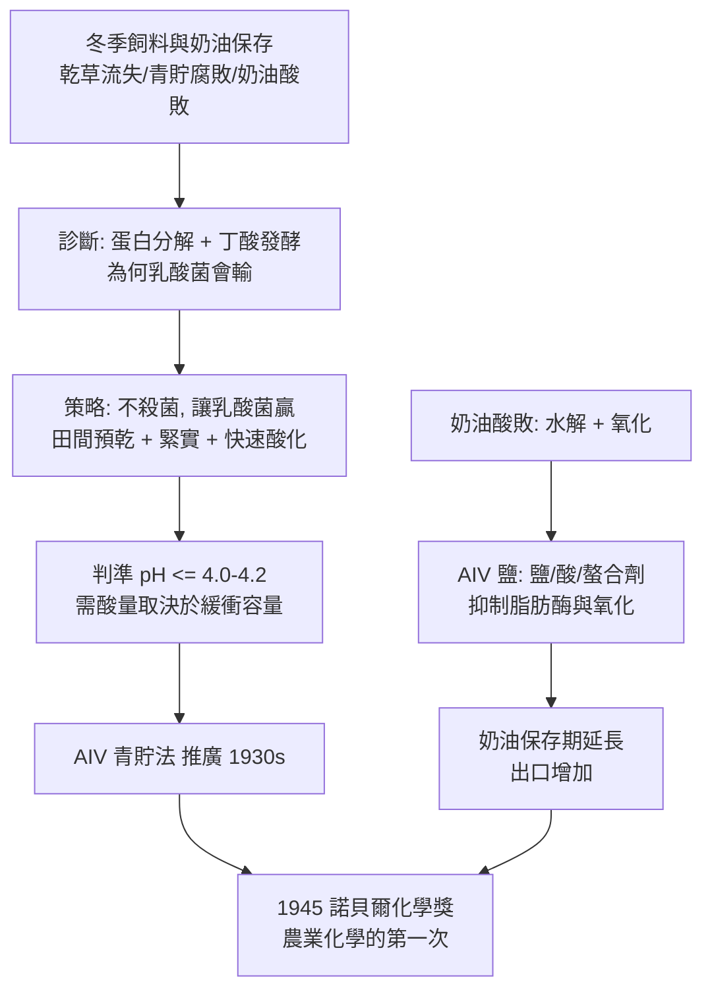

# 1945 · 維爾塔寧與飼料保存

> 1945 諾貝爾化學獎：阿爾圖里·伊爾馬里·維爾塔寧（Artturi Ilmari Virtanen，1895–1973，芬蘭）——表彰「其在農業與營養化學上的研究與發明，尤其是其飼料保存方法」。化學獎史上少數直接關乎「牛吃什麼」的一次頒獎。

## 懸案（案情提要）

在北歐，冬季是畜牧業的最大敵人。

- 牛要產奶，就得吃草料；但夏季的青草到了冬季就沒了。**乾草的營養流失極高**：暴曬乾燥過程中，維生素 A 大量分解、蛋白質在田間就開始被微生物分解，牛奶產量因此在冬天掉一半。
- 另一條老辦法是**青貯（silage）**：把青草切碎、壓實埋在坑或塔裡，讓乳酸發酵把酸性拉高，微生物活動停止，草料得以保存。但這是一場**與失控的發酵賽跑**：若乳酸發酵跟不上，蛋白質分解菌與丁酸發酵菌就會得勢，產生惡臭、降低蛋白質價值，嚴重時整倉腐敗。
- 而**奶油**這一端：它容易酸敗（氧化水解生成游離脂肪酸與醛類而變味），且品質批次不穩定，難以出口。

懸案的本質：**能不能用化學把「發酵這場賽跑」控制成必定贏？**

偵辦人：芬蘭化學家維爾塔寧——他的答案是：**控制條件，讓正確的菌先跑到終點。**

## 前因

| 年份 | 事件 |
| --- | --- |
| 1895 | 維爾塔寧生於卡累利阿地峽；父為鄉村教師，家境清寒。 |
| 1919 | 於赫爾辛基大學取得博士學位（研究植物生理與土壤磷酸鹽的植物可利用性）。 |
| 1920s | 維爾辛基技術大學（Viipuri）教授，主持「植物化學」研究；建立「植物營養化學」的實驗方法。 |
| 1920s–1930s | 研究豆科植物根瘤菌的固氮作用（生物固氮的化學機制）；研究植物的呼吸與糖代謝。 |
| 1930s | 發展**青貯飼料保存法（AIV 法）**並在芬蘭全面推廣；同期研究奶油保存。 |
| 1932–1939 | 推廣 **AIV 鹽**（含氯化鈉、醋酸與檸檬酸鈉的混合鹽）作為奶油保存添加劑，使芬蘭奶油得以大量出口。 |
| 1945 | 獲諾貝爾化學獎（因戰時交通與隔離，獎章遲至 1946 年才頒發）。 |
| 1940s–1960s | 芬蘭科學院院長、國際科學聯盟等組織領導；1960 年後推動維生素、飼料添加劑的農業化學研究。 |
| 1973 | 逝於赫爾辛基。 |

## 調查

**偵查一：先量清楚「敵人」是誰——青貯的失敗模式分類。**

維爾塔寧第一步不是找添加劑，而是**診斷**：把青貯失敗的機制分類，確認要防範的三種敗因：

1. **蛋白質分解（proteolysis）**：蛋白質被蛋白酶分解為胺基酸與胺，營養價值下降，並生成丁酸等臭味物；
2. **丁酸發酵（butyric fermentation）**：產丁酸菌把乳酸發酵成丁酸，pH 下降緩慢、氣味惡劣；
3. **乾物質不足**：若收割時含水量過高（< 25–30% 乾物質），滲透壓太高，乳酸菌也無法生長。

**診斷的結論決定了策略：不是「殺死所有微生物」，而是「讓正確的菌（乳酸菌）先跑贏」。**

**偵查二：控制 pH——把競賽變成計時賽。**

乳酸菌是耐酸的，一旦乳酸累積、pH 降至約 4 以下，蛋白酶與丁酸菌的活性被抑制，發酵自動停止。核心判準：

$$\mathrm{pH} \le 4.0\text{–}4.2 \;\Rightarrow\; \text{丁酸發酵與蛋白分解停止}$$

因此 AIV 法的工程要點是：**（1）田間預乾（wilt）**，把乾物質提高到 25–35%，使滲透壓降低、乳酸菌得以繁殖；（2）**緊密壓實、排除空氣**（好氧菌與黴菌需要氧氣，厭氧發酵才是友軍）；（3）**快速酸化**——加入糖漿（molasses，餵食乳酸菌）或甲酸等有機酸直接拉低 pH。

化學量化的部分：**達到目標 pH 所需的酸量，取決於草料的緩衝容量**：

$$\text{所需酸量} = \frac{\text{總緩衝容量} \times (pH_{\text{起}} - pH_{\text{終}})}{V}$$

這解釋了為何同樣的糖漿添加量對不同草料效果迥異——**緩衝容量是關鍵變數**，這也是 1920–30 年代「植物化學」訓練（分析土壤與植物的酸鹼性）在農學上的直接應用。

**偵查三：青貯的化學——同型乳酸發酵的產物分析。**

優質青貯的糖被乳酸菌轉為乳酸：

$$\mathrm{C_6H_{12}O_6} \rightarrow 2\,\mathrm{CH_3CH(OH)COOH} \quad (\text{同型乳酸發酵})$$

乳酸的解離：

$$\mathrm{CH_3CH(OH)COOH} \rightleftharpoons \mathrm{CH_3CH(OH)COO^-} + \mathrm{H^+}$$

**每產生一分子乳酸就釋放一個 $\mathrm{H^+}$**——這正是 pH 下降的化學機制，也是「青貯等於自我酸化」的本質。品質指標：乳酸／醋酸比值（>1 為佳）、pH、乾物質、可消化能與蛋白質保留率。

**偵查四：奶油這條線——AIV 鹽與氧化抑制。**

奶油的敗敗機制是**水解酸化**（脂肪酶把三酸甘油酯水解成游離脂肪酸）與**氧化**（不飽和脂肪酸的雙鍵被氧化，生成醛類與酮類的異味）。維爾塔寧的 AIV 鹽以氯化鈉（降低水分活度、抑制脂肪酶）、醋酸（酸化）、檸檬酸鈉（螯合金屬離子、抑制氧化催化劑）三重作用**延長奶油的保存期並穩定風味**：

$$\text{脂肪酶的水解} \xrightarrow[\text{酸性} + \text{低水分} + \text{金屬螯合}]{} \text{被抑制}$$

結果：**芬蘭奶油出口量在 1930 年代大幅增加**——這是一個實驗室配方改變國家出口結構的案例。

## 理論裁決

**判決一：青貯是一場受控的微生物競賽。** 維爾塔寧的判決極具工程智慧：

$$\text{保存成功} \iff \text{乳酸發酵的酸化速度} > \text{蛋白酶與丁酸菌的競爭速度}$$

這把「發酵」從不可控的腐敗，重新定義為**可被條件設定的生化程序**——這是後來「發酵工程」（見 [1907-畢希納與無細胞發酵](1907-畢希納與無細胞發酵.md) 與 [1929-哈頓與發酵化學](1929-哈頓與發酵化學.md)）的農業版先聲。

**判決二：化學添加劑的雙重功能——營養與保存。** 糖漿不只是「加速酸化」：它是乳酸菌的**食物**，也是草料可發酵糖分的補充。添加劑的選擇因此有化學上的雙重判準：

$$\underbrace{\text{可被乳酸菌利用的糖}}_{\text{生物效應}} + \underbrace{\text{直接降低 }pH\text{ 的酸}}_{\text{化學效應}}$$

這是 1940–50 年代「飼料添加劑」產業（維生素、胺基酸、抗生素殘留、酵素製劑）的開端。

**判決三：保存工藝的數學化——緩衝容量作為設計變數。** 維爾塔寧把「加多少酸／糖漿」從經驗變成可計算的問題：

$$\text{乳酸（以乳酸桿菌每克糖消耗 1 mol 乳酸估算）} \approx \frac{\text{目標 } \Delta pH \times \text{緩衝容量}}{\text{需要的乳酸桿菌活性}}$$

這套計算在 1960–70 年代被電腦化的青貯模型取代，但原理未變——**今天的青貯配方軟體仍是這條判準的延伸**。

**判決四：維生素的保存——營養化學的另一面。** 維爾塔寧的實驗室同時研究維生素的穩定性，發現維生素 A 在乾草曝曬與儲存中大量分解（這也是 1920–30 年代「維生素 A 缺乏症在牛群中流行」的技術原因）；他的青貯法因保留了葉黃素與胡蘿蔔素（維生素 A 的前驅物），**同時解決了飼養問題與營養問題**。

## 後果

| 領域 | 影響 |
| --- | --- |
| 畜牧業 | AIV 青貯法成為北歐與全球溫帶地區的標準冬季飼料保存法；配合甜菜渣、玉米青貯，使高泌乳牛得以在冬季維持產量。 |
| 食品工業 | AIV 鹽使奶油保存與出口成為可能；奶油工業的化學添加劑體系自此建立。 |
| 農業化學 | 諾貝爾化學獎第一次以「農業與營養」為事由，使「化學服務糧食」進入諾獎敘事。 |
| 固氮研究 | 維爾塔寧早期對豆科植物根瘤菌固氮的研究，與 1960 年代生物固氮的分子時代（固氮酶結構）構成同一條線的兩端。 |
| 制度 | 芬蘭以諾貝爾化學獎得主的身份，在戰後重建的歐洲科學體系中扮演了「小型國家如何以科學立足」的樣板；其後芬蘭的木材化學（紙漿）與環境政策同樣具代表性。 |
| 生態註記 | 青貯技術也帶來後續的環境議題（青貯汁液與氨的排放——氨是農業的氮污染源之一，見 [1961-卡爾文與光合作用](1961-卡爾文與光合作用.md) 與 [1918-哈伯與合成氨](1918-哈伯與合成氨.md) 的全球氮循環圖景）。 |

## 關聯

- [1907-畢希納與無細胞發酵](1907-畢希納與無細胞發酵.md)：發酵從「活的酵母」變成「可控制的生化程序」的源頭；維爾塔寧的青貯是把同一套原理用在田間。
- [1929-哈頓與發酵化學](1929-哈頓與發酵化學.md)：發酵的酵素與輔酶機制；青貯的「正確菌群」正是乳酸發酵的應用。
- [1928-溫道斯與維生素D](1928-溫道斯與維生素D.md)：維生素 A 與 D 的發現背景，正是維爾塔寧的飼料營養研究面對的實務問題。
- [1937-霍沃思與維生素C](1937-霍沃思與維生素C.md)：維生素工業化與維護動物體內維生素營養的另一端。
- [1961-卡爾文與光合作用](1961-卡爾文與光合作用.md)：農業化學的另一端——把光合作用的效率提升到全球糧食的極限。
