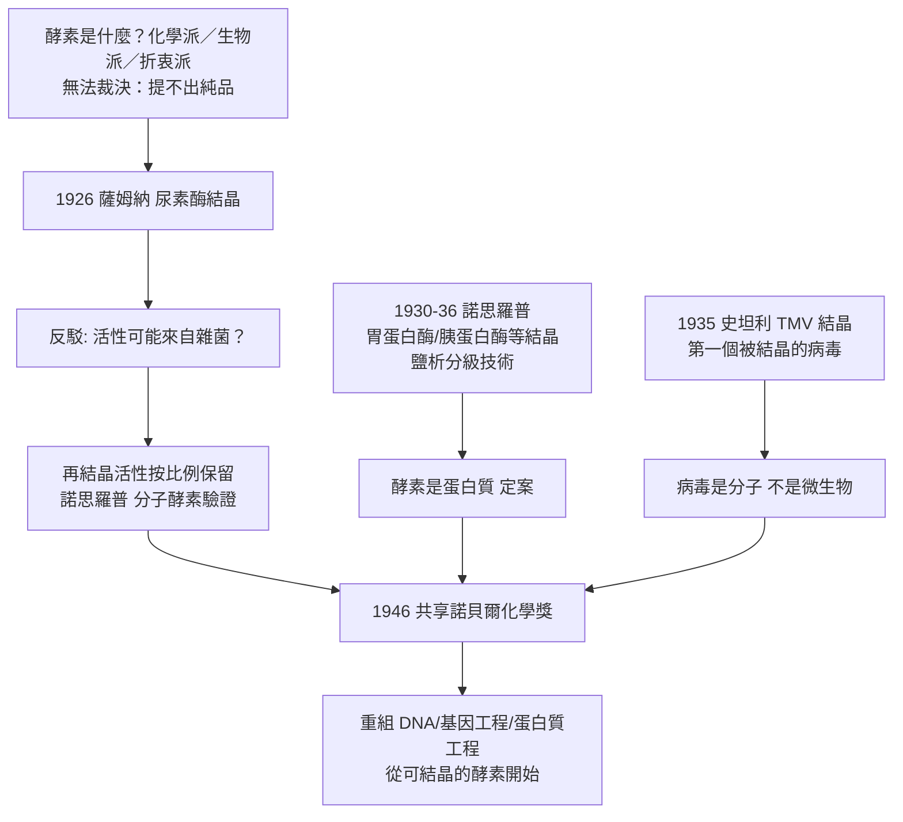

# 1946 · 薩姆納、諾思羅普與史坦利——酵素與病毒的結晶

> 1946 諾貝爾化學獎（共享）：詹姆斯·巴徹勒·薩姆納（James B. Sumner，1887–1955，美國）、約翰·霍華德·諾思羅普（John H. Northrop，1891–1987，美國）與溫德爾·梅迪·史坦利（Wendell M. Stanley，1904–1971，美國）——薩姆納因「發現酵素可以結晶」，諾思羅普與史坦利因「以純化形式製備酵素與病毒蛋白」。三座獎頒給同一個結論：**酵素是蛋白質，病毒是分子。**

## 懸案（案情提要）

1920 年代末的生物化學有一場「百年戰爭」，戰場上的核心是**酵素的本質**：

- **化學派**：酵素是某種小分子催化劑（可溶、可擴散、能透過半透膜）；
- **生物學派**：酵素是蛋白質——巨大的膠體，有酵素活性只是因為它吸附了活性物質；
- **折衷派**：酵素是「酶」（zymase）一類的特殊膠體，活性來自其蛋白質部分，但蛋白質本身不是酵素。

而爭議無法裁決，因為**沒有人能把酵素單獨挑出來看一眼**。酵素溶液是混濁的、不能結晶的、會變質的。

第二樁懸案更奇：**病毒是什麼？**1930 年代，人們已知病毒能繁殖、能遺傳、會引起疾病，卻無法確定它是「活的微生物」還是「化學分子」。如果病毒能被**結晶**，那它就不是微生物——它是化學品。

偵辦人：康奈爾的薩姆納（1926 年）、諾思羅普（1930 年代）與史坦利（1935 年）。三人的成果合起來構成一句話：**酵素與病毒都可以被裝進瓶子裡。**

## 前因

| 年份 | 事件 |
| --- | --- |
| 1887 | 薩姆納生於波士頓；哈佛畢業後於康奈爾大學（自 1914 年）任教。 |
| 1910s–20s | 薩姆納研究尿素酶（jack bean urease）：嘗試各種結晶條件，1924 年得到「針狀、極純淨」的結晶——但當時他無法證明酵素活性確實來自晶體本身。 |
| 1926 | 薩姆納發表尿素酶的結晶與其酵素活性；並以「酵素活性與晶體質量成正比、晶體可再結晶」作為證據。 |
| 1920s | 諾思羅普在普林斯頓（後為洛克斐勒研究所）以「**鹽析**」（加硫酸銨使蛋白質依溶解度差異分級沉澱）精製蛋白質，並發展低溫真空乾燥技術。 |
| 1930–1936 | 諾思羅普與 colleagues 結晶了**胃蛋白酶、凝乳酶、胰蛋白酶、胰凝乳蛋白酶**；同時研究細菌蛋白質與病毒的蛋白質性。 |
| 1935 | 史坦利（與諾思羅普、魯斯（Ruska））**結晶菸草花葉病毒（TMV）**——史上第一個被結晶的病毒；並以化學方法證明 TMV 的核酸部分（以酵素消化蛋白質後仍具感染力），確立病毒是**核蛋白**。 |
| 1938 | 魯斯卡與克林格勒以電子顯微鏡首次拍到 TMV 的桿狀粒子（見 [1982-克盧格與電子顯微鏡](1982-克盧格與電子顯微鏡.md)）。 |
| 1946 | 三人共享諾貝爾化學獎（薩姆納未列於首位——評審委員會判定諾思羅普與史坦利的工作更為重要，這是史上著名的排序爭議之一）。 |
| 1940s–50s | 史坦利轉入病毒學（轉煙草花葉病研究，1956 年分離出 TMV 的核酸並證明其單獨即具感染力）；諾思羅普研究流感病毒蛋白並推動小兒麻痺疫苗工作（與恩德斯、韋勒、羅賓斯合作，該三人獲 1954 年醫學獎）。 |

## 調查

**偵查一：尿素酶結晶——把酵素從渾水裡抓出來。**

薩姆納的實驗是一場對抗天然界的耐力賽。刀豆尿素酶的提純步驟大致如下：

$$\text{刀豆粉} \xrightarrow{\text{水萃取}} \text{萃取液} \xrightarrow{\text{硫酸銨分級鹽析}} \text{酵素濃縮液} \xrightarrow{\text{透析}} \text{去除鹽} \xrightarrow{\text{冷卻} + \text{乙醇}} \text{結晶}$$

關鍵在於**冷**：尿素酶在室溫下會逐漸變質，必須在 $0$–$4\,^\circ\mathrm{C}$ 下操作；而結晶需要「慢慢長大」——這正是 1930 年代薩姆納在康奈爾的牛奶場裡，用牛奶罐與冰箱做了一套「田間實驗室」的原因（他曾說過一句名言：「我並不缺少想法，我缺少的是設備。」）

**偵查二：反對意見與它的破解——「活性來自雜菌」的質疑。**

這是本案最大的法律攻防。批評者的論點完全合理：**結晶時任何微量的微生物都可能被帶進去，酵素活性可能來自它們，而非晶體本身。**

薩姆納的回應構成了一套完整的邏輯防線：

1. **活性與晶體量成正比**：把晶體重結晶（再溶解、再沉澱、再結晶），活性隨之按比例增加——雜菌假說無法解釋「活性跟著晶體走」。
2. **晶體在顯微鏡下是均質的**：不是菌叢。
3. **對照實驗**：煮沸的晶體（變性）無活性；已知酵素抑制劑能抑制晶體的活性。
4. **後來的正統驗證**：諾思羅普製備出**「分子酵素」（molecular enzyme）**——在溶液中以超速離心與電泳可分離出具有活性的單一蛋白質分子族群（見 [1926-斯韋德貝里與超速離心機](1926-斯韋德貝里與超速離心機.md)）；最終由 1972 年的核糖核酸酶實驗給出終局（見 [1972-安芬森與核糖核酸酶](1972-安芬森與核糖核酸酶.md)）。

**偵查三：鹽析的數學——蛋白質分離的定量工具。**

諾思羅普的核心技術是**硫酸銨分級鹽析**：蛋白質的溶解度隨鹽濃度下降（與小分子相反），且不同蛋白質的「析出鹽濃度」不同：

$$\log\frac{S}{S_0} = -k_s\,I \quad (\text{Setschenow 方程，} I = \text{離子強度})$$

於是以逐級加鹽、逐級收集沉澱的方式，把混合蛋白質按溶解度分級——**這是今日蛋白質純化（硫酸銨分級、鹽析、層析）的操作手冊的第一頁**。

**偵查四：病毒的結晶——把「活的」變成「死的」。**

1935 年史坦利把菸草花葉病毒（TMV）製成結晶：數千片菸草葉磨漿、鹽析、離心、重結晶，得到可称量的針狀晶體。接下來是那個決定性的實驗：

$$\text{蛋白質部分} \xrightarrow{\text{蛋白酶消化}} \text{失去感染力} \quad ; \quad \text{核酸部分} \xrightarrow{\text{分離}} \text{仍具感染力（1956 年史坦利證實）}$$

**若病毒能結晶，它就不是微生物，而是分子。** 這是把生物學拉進化學的一次決定性操作——「病毒學」自此有了化學的基礎。

**偵查五：酵素動力學的收尾——把活性寫成方程式。**

純化後的酵素第一次能被精密地做動力學分析，結果立刻對上了 Michaelis–Menten 方程：

$$v = \frac{V_{\max}[S]}{K_m + [S]}, \qquad V_{\max} = k_{\text{cat}}[E]_0$$

「比活性」（每毫克蛋白質的酵素單位）成為純度的指標：

$$\text{比活性} = \frac{\text{酵素單位}}{\text{蛋白質總量 (mg)}}$$

純化到比活性不再上升，即為純品——**這是 1940–50 年代蛋白質化學的品質標準，也是所有生化實驗室至今使用的指標。**

## 理論裁決

**判決一：酵素 = 蛋白質。** 薩姆納與諾思羅普的證據鏈給出的判斷：

$$\text{酵素} \equiv \text{具有催化活性的蛋白質}$$

其物理基礎在於蛋白質的三維結構能提供**形狀專一」的活性部位**（費歇爾 1894 年的鎖鑰學說在此獲得實體證據，見 [1902-費歇爾與醣類偵探學](1902-費歇爾與醣類偵探學.md)）：

$$\text{蛋白質摺疊} \;(\text{安芬森定律，見 1972}) \;\Longrightarrow\; \text{活性口袋} \;\Longrightarrow\; \text{專一性催化}$$

**判決二：病毒 = 核蛋白（或核酸）。** 史坦利的結晶實驗确立了病毒的化學本質，並導出「病毒是不是生命」的著名提問：**能結晶的東西，若仍能繁殖，則「生命」的界線必須重新劃定。**這是分子生物學最深刻的問題之一。

**判決三：純化的操作化——純度的新定義。** 純化不再靠「外觀清澈」，而靠**比活性恆定**：

$$\text{純品判準} = \text{進一步純化後，比活性不再上升}$$

這條判準把蛋白質化學從「技藝」變成「可驗證的程序」，並成為 1970 年代基因工程的第一步（先把目標蛋白分離、測活性，再去克隆其基因）。

**判決四：低溫技術的必要性。** 純化過程中最殘酷的發現是：**酵素是脆弱的。**變性（高溫、強酸鹼、界面活性劑、有機溶劑）會破壞活性位。因此必須：

- 全程低溫（$0$–$4\,^\circ\mathrm{C}$）；
- 避免界面（不起泡沫，界面會使蛋白質變性）；
- 控制 pH（緩衝液）；
- 避免重金屬離子與蛋白酶（加 EDTA、抑酶劑）。

**「純化」的每一個操作細節，都是在對抗蛋白質的解體**——這是 1940 年代蛋白質化學留下的最重要的操作遺產。

## 後果

| 領域 | 影響 |
| --- | --- |
| 蛋白質化學 | 純化、常量電泳、超速離心、鹽析、結晶四件套成為標準；「比活性」成為品質指標。 |
| 分子生物學 | 酵素可結晶 → 可測定結構 → 可改造 → 可重組；基因工程（1973 年）的技術路線由此打開（見 [1973-菲舍爾與二茂鐵](1973-菲舍爾與二茂鐵.md) 的工業催化與 [2000-白川英樹與導電聚合物](2000-白川英樹與導電聚合物.md) 的材料合成思維的另一面）。 |
| 病毒學與疫苗 | 病毒的化學本質確立後，疫苗製造可從「用活病毒」轉向「用純化抗原」，小兒麻痺疫苗（1955 年沙克疫苗）與後來的疫苗平台皆以此為前提。 |
| 結構生物學 | 純化 → 結晶 → X 射線結構的流水線打通（見 [1962-佩魯茨與血紅蛋白](1962-佩魯茨與血紅蛋白.md)、[1964-霍奇金與X射線晶體學](1964-霍奇金與X射線晶體學.md)）。 |
| 科學史註記 | 1946 年諾貝爾委員會把薩姆納列在第三位，儘管他獨自完成了「酵素可結晶」的核心發現——此一排序在化學界長期被視為不公，也說明諾獎委員會的判斷本身是有爭議的過程。 |

## 關聯

- [1902-費歇爾與醣類偵探學](1902-費歇爾與醣類偵探學.md)：鎖與鑰的「鎖」，在本案被證明就是蛋白質。
- [1907-畢希納與無細胞發酵](1907-畢希納與無細胞發酵.md)：酵素存在的證明（酒化酶）到酵素本體的分離（尿素酶結晶），是同一條線的兩端。
- [1926-斯韋德貝里與超速離心機](1926-斯韋德貝里與超速離心機.md)：分離「分子酵素」的必需工具；薩姆納與諾思羅普的純化成果離不開它。
- [1972-安芬森與核糖核酸酶](1972-安芬森與核糖核酸酶.md)：本案開啟的蛋白質化學，在 26 年後以「序列決定結構」的終審收束。
- [2018-阿諾德與定向演化](2018-阿諾德與定向演化.md)：酵素從被研究對象變成可設計的工業催化劑——本案方法學的現代終點。
