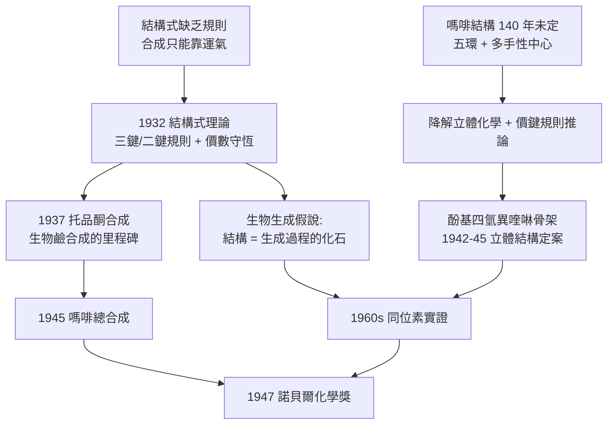

# 1947 · 羅賓遜與生物鹼的結構革命

> 1947 諾貝爾化學獎：羅伯特·羅賓遜爵士（Sir Robert Robinson，1886–1975，英國）——表彰「其對具有生物學重要性的植物產物之研究，尤其是對生物鹼的研究」。他證明了嗎啡的結構，並提出「結構式理論」，把合成化學變成可設計的學問。

## 懸案（案情提要）

1940 年代的天然產物化學有一樁最著名的疑案：**嗎啡。**

- 它是已知最強的鎮痛藥之一，但它的**結構自 1805 年以來沒有人能定案**——它被分離了、用「異构體」的觀點猜過幾十種結構、被命名過「嗎啡」與「可待因」的關係一團亂；
- 它的骨架是**五個環**：一個苯環、一個含氮環、一個橋環、一個烯環——環的接法有多種可能，降解碎片又互相矛盾；
- 更糟的是：**化學家連「怎麼做」都不知道**。嗎啡是多環立體結構，立體化學家無法「畫」出正確的三維構形。

第二樁懸案是方法論的：**有機化學家能不能「設計」分子？**在 1940 年之前，合成幾乎都是「先有目標結構，再想辦法拼」的過程；大多數天然產物的結構根本無法合成，因此「結構未定」就等於「無法合成」——這是一個惡性循環。

偵辦人：羅伯特·羅賓遜。他做了兩件事：定了嗎啡的結構，並提出**結構式理論**，讓化學家能在紙上「設計」出可行的合成路徑。

## 前因

| 年份 | 事件 |
| --- | --- |
| 1886 | 羅賓遜生於德比郡；14 歲入藥師學徒，自學化學。 |
| 1902–1906 | 在曼徹斯特隨佩恩（Perkin）學有機化學；1906 年即以「巴西木素與聖東海木素的花色素苷」獲得博士學位——**他早年的成名之作就是研究植物色素**。 |
| 1910s | 研究生物鹼（蒼耳寧、番木鱗鹼等），並在結構式理論上開創新路。 |
| 1922 | 任曼徹斯特大學化學講座（1928 年轉牛津）；研究生物鹼的生物合成（這在當時是全新的問題意識）。 |
| 1932 | **結構式理論**（Robinson's structural theory）：以「價鍵理論」規範三鍵、二鍵、環、橋環的書寫規則，使結構式成為可檢驗、可比較的對象。 |
| 1937 | **完成托烷（tropane）生物鹼的結構推定與合成**（與他學生 S. G. 阿代（S. G. Agard）合作，托品酮的合成）——生物鹼合成史上第一座里程碑；此合成後來成為古柯鹼（可卡因）工業合成的起點。 |
| 1942–1945 | 與員工 J. W. 康（John W. Cornforth）合作，完成**嗎啡的立體結構**（含各手性中心的相對構型）與**總合成**——生物鹼結構工作的頂點。 |
| 1945 | 出版《天然產物之生物合成》（*The Constituents of Natural Products*），提出**生物鹼的生物生成假說**。 |
| 1947 | 獲諾貝爾化學獎。 |
| 1950s | 與康福特（Cornforth）、科爾斯（Kornblum）等人建立**生物生成原理**的系統表述；此原理在 1960–70 年代被生化的同位素實驗全面驗證（見 [1969-巴頓與構象分析](1969-巴頓與構象分析.md)）。 |

## 調查

**偵查一：嗎啡的結構——五環骨架的拼圖。**

羅賓遜的方法不是盲目的降解，而是**用已知碎片「訂做」可能的結構，再檢驗其可預測性**：

1. 嗎啡的降解產物（如甲醇酚性含氮環衍生物）指示含氮六員環；
2. **乙醯化後的降解實驗**顯示有 N-甲基與一個次甲基橋；
3. **氫化／還原**實驗給出雙鍵與羰基的位置；
4. 綜合以上，羅賓遜提出**酚基四氫異喹啉骨架**與其中的橋環結構。

結構骨架（平面簡化）：

$$\text{嗎啡核心} = \text{酚基}\ + \text{含氮六員環}\ + \text{橋環（}-\mathrm{CH_2}-\text{橋）} + \text{烯環}\ (\mathrm{C=C})$$

其立體結構的定案靠的是**降解立體化學**與**X 射線衍射的驗證**（1920–50 年代的 X 射線晶體學最終確認了羅賓遜的結構）。

**偵查二：結構式理論——讓「結構」成為可運算的對象。**

羅賓遜最大的貢獻是方法論：他把「結構式」從一幅畫升格為**一套有規則的記號系統**，並提出判定原則：

- **價數守恆**：每個碳的鍵數與形式電荷須自洽；
- **三鍵 (three-bond) 與二鍵 (two-bond) 的規則**：多環系統中，橋頭原子若參與三鍵則必為三鍵型碳（$sp^2$，平面），否則結構不穩定；
- **立體化學的可行性**：結構式必須能對應一個真實存在的立體構形。

$$\text{結構式} \;+\; \text{價鍵規則} \;+\; \text{立體可行性} \;\Longrightarrow\; \text{可被檢驗的化學假說}$$

這套規則把結構判定從「直覺」變成「推論」，並讓「若此結構為真，則降解應如何」成為可預測、可檢驗的問題——**今日的「逆合成分析」正是這套思維的現代版**（見 [1990-科里與逆合成分析](1990-科里與逆合成分析.md)）。

**偵查三：立體合成的可行性——嗎啡總合成的難度。**

嗎啡的總合成（1945）是當時有機化學最艱難的目標之一：五個環、四個以上的手性中心（其中包括一個「橋頭」立體中心與一個無法用普通方法建立的立體化學難題——**橋環上的立體中心幾乎不能靠普通加成反應建立**）。羅賓遜與康福特的解法是**從一個已有的立體骨架「改造」而非從零建立**——這正是托品酮合成所奠定的策略。

**偵查四：生物生成假說——從結構走向生成機制。**

1945 年的《天然產物之構成》一書中，羅賓遜提出一個極具野心的想法：**天然產物的結構不是偶然的，它反映了植物體內的生物合成步驟。**他以嗎啡為例提出「鄰位酚基氧化偶聯（oxidative coupling）」假說：

$$\text{兩個酪胺衍生單元} \xrightarrow{\text{酚-酚偶聯（氧化）}} \text{嗎啡骨架（含 C–C 新鍵）}$$

**「結構是生成過程的化石記錄」**——這是 20 世紀有機化學最具影響力的思想之一，並在 1960 年代由博希（Borschy）、甘特（Battersby）等人的同位素實驗證實：嗎啡的兩個氮原子確實來自兩個酪胺（tyramine）單元。

**偵查五：花色素苷與植物色素——早年成名作。**

羅賓遜 1906 年的博士工作即在花色素苷（anthocyanins）：他確定了花青素（cyanidin）之類色素的結構，證明**同一母核（$2$-苯基苯並吡喃，即 flavylium）因 B 環的取代與 3 位羥基的甲基化，可生成數百種不同花色**——植物色素的「通用母核 + 取代基」模式首次被建立。

## 理論裁決

**判決一：結構式的邏輯化——「價鍵守恆 + 立體可行性」。** 羅賓遜的規則可總結為：

$$\text{任何結構假說必須滿足：}\; \underbrace{\sum \text{價數}}_{=\text{碳的價數總和}} = \text{常數}, \qquad \underbrace{\text{橋頭三鍵原子}}_{\text{必須為 }sp^2, \text{平面}}$$

**這使得「結構猜測」成為可被推翻的假說**：只要與價鍵規則或立體化學衝突，即可立刻否決。1910–40 年代有機化學的「結構大猜謎」（如維生素、激素、嗎啡）之所以能夠快速推進，正是因為有了這套可操作的規則。

**判決二：立體合成的策略學——「先有骨架，再造立體」。** 羅賓遜的托品酮與嗎啡合成確立了至今通用的策略：

$$\text{策略} = \underbrace{\text{建立環系骨架}}_{\text{可由已知酮、酯縮合等完成}} + \underbrace{\text{在既有骨架上改造立體}}_{\text{立體專一反應}}$$

此策略在 1950–60 年代被擴展：伍德沃德（見 [1965-伍德沃德與全合成](1965-伍德沃德與全合成.md)）合成可的松、葉綠素（費歇爾）、前列腺素與魯日奇卡的 $\mathrm{C_{20}}$ 萜烯（維生素 A）皆用此法。

**判決三：生物生成原理（biogenetic principle）。** 羅賓遜的總結性命題是：

$$\text{天然產物的結構} \;\text{反映}\; \text{其生物合成的前驅物與步驟}$$

這條原理的實踐形式是**「結構回推反應序列」**：先問「什麼前驅物經什麼官能基轉化可得此結構」，再以同位素實驗檢驗。這套方法在 1950–70 年代被整個天然產物化學採用，並產生了兩個諾獎級成果：伍德沃德對維生素 B$_{12}$ 合成路徑的「生物合成啟發」（1965），以及由**萜烯環化酶**研究帶出的類異戊二烯生物合成（見 [1939-布特南特與魯日奇卡](1939-布特南特與魯日奇卡.md) 中魯日奇卡的預言）。

**判決四：植物色素的母核模型。** 羅賓遜早年的花色素苷工作確立：

$$\text{花色素苷} = \underbrace{\text{flavylium（2-苯基苯並吡喃）母核}}_{\text{同一骨架}} + \underbrace{\text{B 環取代} + \text{3 位甲基化/羟基化}}_{\text{決定顏色與穩定性}}$$

這與後來花青素結構的完整確認（1980–90 年代）一致，是「同一母核 + 取代基決定性質」的植物色素法則。

## 後果

| 領域 | 影響 |
| --- | --- |
| 天然產物化學 | 生物鹼（嗎啡、可待因、古柯鹼、煙鹼、奎寧）、花色素苷、類胡蘿蔔素與類固醇的結構判定方法學自此確立；二次大戰期間英美科學家合作破解盤尼西林（青黴素）與嗎啡等結構，正是此方法的頂級運用。 |
| 合成化學 | 結構式理論使「合成設計」成為可能；托品酮合成開啟了天然產物全合成的工業可能（可卡因的工業合成、維生素 A 的大規模生產）。 |
| 生物化學 | 生物生成原理引導了天然產物的生物合成研究，1960–70 年代由同位素實證（嗎啡的酪胺雙單元假說被證實）；此思想直通今天的「化學遺傳學」與合成生物學。 |
| 藥理 | 嗎啡的結構確立，使類鴉片藥物的結構—活性關係研究成為可能（1940–60 年代的鎮痛劑合成、1960 年代的芬太尼、2000 年代的阿片類受體結構研究）。 |
| 學術制度 | 1947 年的諾貝爾化學獎同時授予康福思（康福特）的博士訓練，使英國的天然產物化學成為世界中心；羅賓遜、康福特、伍德沃德構成一條清晰的師承線。 |

## 關聯

- [1902-費歇爾與醣類偵探學](1902-費歇爾與醣類偵探學.md)：費歇爾的立體異構計數與降解—重建法，是羅賓遜結構工作的直接方法論前身。
- [1939-布特南特與魯日奇卡](1939-布特南特與魯日奇卡.md)：性激素的結構與生物生成問題，與嗎啡的生物生成假說是同一時代的兩條平行線。
- [1946-薩姆納與酵素結晶](1946-薩姆納與酵素結晶.md)：蛋白質化學的興起，為生物生成原理提供了新的實施工具（酵素逐步反應）。
- [1965-伍德沃德與全合成](1965-伍德沃德與全合成.md)：伍德沃德的維生素 B$_{12}$ 合成直接沿用羅賓遜的生物生成思路，並把它推到史無前例的規模。
- [1990-科里與逆合成分析](1990-科里與逆合成分析.md)：把「可設計」系統化、演算法化的現代版本。
- [1975-康福思與普雷洛格](1975-康福思與普雷洛格.md)：羅賓遜的學生康福思（與普雷洛格共享 1975 年化學獎）在酵素立體化學上的成就，是師承線的下一代。
