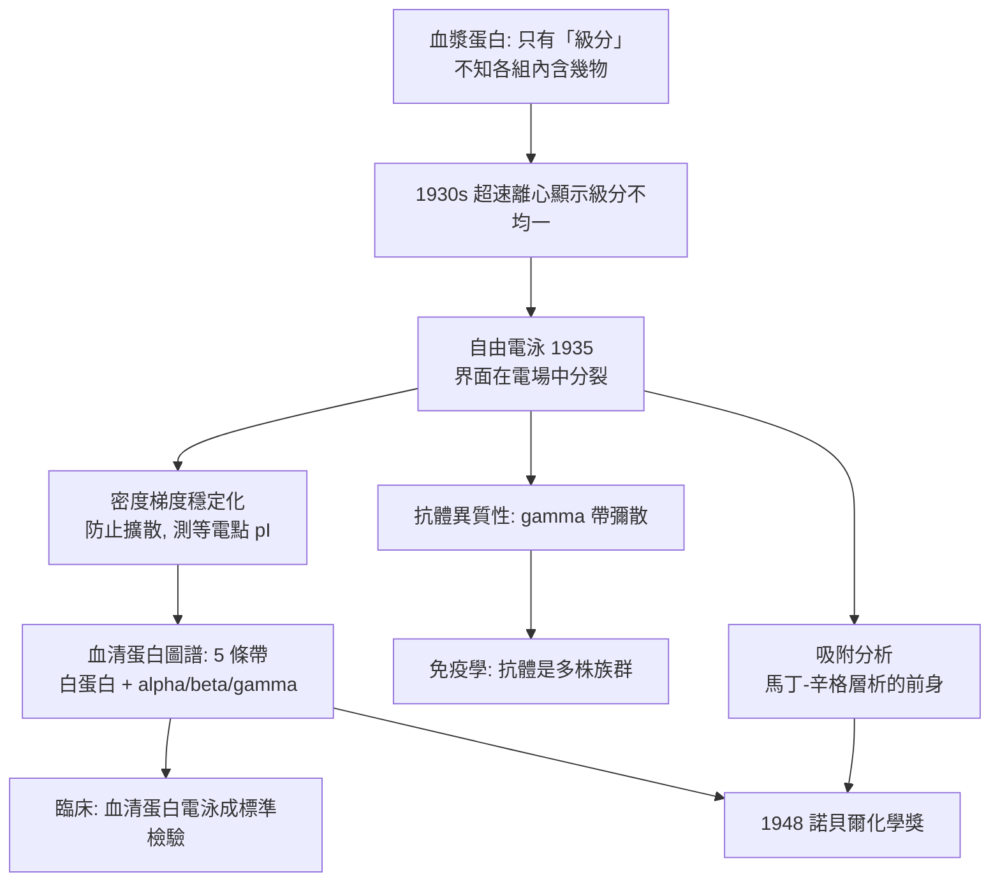

# 1948 · 蒂塞利烏斯與電泳——血液成分的照相

> 1948 諾貝爾化學獎：阿爾內·威廉·考林·蒂塞利烏斯（Arne Wilhelm Kaurin Tiselius，1902–1971，瑞典）——表彰「其對電泳與吸附分析之研究，尤其是其關於血清蛋白複雜性質的發現」。他讓科學家第一次「看見」血液裡的蛋白質族群。

## 懸案（案情提要）

1930 年代的生理化學對血液的理解極為粗糙：「血漿裡有蛋白質」——僅此而已。但醫學界需要的答案要細得多：

- ** Cohn 的分離**：1930 年代，美國的愛德華·科恩（Edward Cohn）用**硫酸銨分級鹽析**把血漿分成數個級分——「白蛋白」（albumin）與「球蛋白」（globulin）之分由此建立，後來更細分出 $\alpha$、$\beta$、$\gamma$ 球蛋白；抗體被證明存在於 $\gamma$ 球蛋白中。
- 但 Cohn 的方法是**「分組」而非「看清」**：每一組裡究竟有多少種不同的蛋白質？每種佔多少？分子量多少？它們彼此相似到什麼程度？——**鹽析的級分是「一群」，不是「一物」**，而且蛋白質在溶液中的行為會隨濃度改變（聚集、與其他蛋白結合），讓「溶液」的定義本身就變得可疑。

最刺眼的懸案：**血漿蛋白的「均一性」問題**。1935 年，蒂塞利烏斯在斯德哥爾摩用超速離心機測血漿，發現同一個「級分」在超速離心場中呈現**不均勻的分布**——裡面藏著多種成分。

偵辦人：蒂塞利烏斯。他的答案是：**用電場，把蛋白質按電荷與大小分開，直接看見它們的分布。**

## 前因

| 年份 | 事件 |
| --- | --- |
| 1902 | 蒂塞利烏斯生於斯德哥爾摩；父為數學家。 |
| 1922 | 於斯德哥爾摩大學取得化學博士學位（研究蛋白質的物理化學）。 |
| 1925–1926 | 在德國達姆施塔特的諾獎得主弗里德里希·霍夫曼（F. Hoffmann）實驗室研究蛋白質的物理化學；返國後主持蛋白質研究。 |
| 1930s | 發展**自由電泳**（moving boundary electrophoresis）與**吸附分析**；1935 年發表「血清蛋白的組成」——尿素與血清蛋白的電泳圖譜。 |
| 1937 | 取得烏普薩拉大學（見 [1926-斯韋德貝里與超速離心機](1926-斯韋德貝里與超速離心機.md) 的斯韋德貝里實驗室）有機化學教授職。 |
| 1940s | 主持蛋白質研究；戰時研究血液循環中的蛋白質（血漿蛋白的臨床研究）。 |
| 1948 | 獲諾貝爾化學獎（1948 年 12 月頒發；因戰後通貨問題，獎金以瑞典克朗與其他貨幣混合支付）。 |
| 1950s–60s | 建立 Uppsala 蛋白質研究的世界據點；Tiselius 指導蛋白質研究、細胞表面免疫學（血型抗原）；1964 年起任諾貝爾基金會主席（1964–1971）。 |

## 調查

**偵查一：自由電泳——讓蛋白質在電場中排隊。**

蒂塞利烏斯的裝置極簡：用兩支玻璃管（T 型管）灌入緩衝液，蛋白質溶液在中央形成一個銳利的界面；在電場下，各種蛋白質因**電荷（遷移率）與大小（摩擦係數）**不同而以不同速度移動，界面因而**分裂成多個邊界**。

遷移率的定義：

$$u_i = \frac{v_i}{E} \quad (\text{單位電場下的移動速度})$$

在自由溶液中，蛋白質的遷移率可寫成：

$$\frac{u_i}{u_0} = \frac{\alpha_i}{\alpha_0}\cdot\frac{f_0}{f_i}\cdot\frac{T_0}{T}$$

（電荷因子的比值 $\times$ 摩擦係數的比值 $\times$ 黏度修正）。**關鍵：即使電荷相同、只要摩擦係數（形狀與大小）不同，遷移率就不同**——這是「以電場分離」的物理基礎。

**偵查二：濃度梯度穩定化——讓分離看得見。**

自由電泳的問題是：蛋白質在溶液中擴散，界面會模糊。蒂塞利烏斯的關鍵改良是**濃度梯度**（用兩種不同濃度的緩衝液製造密度梯度），使蛋白質自動「歸位」到自己的等電點附近：

$$\text{等電點} \; pI:\quad \text{當 } pH = pI \text{ 時，淨電荷為零，遷移率為零}$$

密度梯度不僅防止擴散，還使**等電點**（每種蛋白質電荷為零的 pH）成為可測量的特徵量——這是蛋白質純化的第四把鑰匙（鹽析、透析、超速離心、**等電聚焦**）。

**偵查三：電泳圖譜——血液的「分層照相」。**

1935 年，蒂塞利烏斯發表血清蛋白的電泳圖譜，得到當時最著名的生物學圖像之一：四到五條帶（白蛋白、$\alpha_1$、$\alpha_2$、$\beta$、$\gamma$ 球蛋白），**相對面積即各成分的比例**：

$$\text{面積}_i \propto \text{濃度}_i \times \text{遷移率}_i$$

$$\text{白蛋白} \;(\mathrm{pI} \approx 4.7)\quad \alpha_1 \;(4.9)\quad \alpha_2 \;(5.0\text{–}5.5)\quad \beta \;(5.5\text{–}6.5)\quad \gamma \;(6.5\text{–}8.0)$$

**這張圖從此改變了醫學**：肝功能（白蛋白/球蛋白比）、腎病（$\alpha_2$ 上升）、感染與發炎（$\alpha_1$ 上升）、多發性骨髓瘤（狹窄的 M 帶）、妊娠期（$\beta$ 上升）——**「血漿蛋白圖」成為臨床檢驗的標準項目**（今日的「血清蛋白電泳」仍在每間醫院執行）。

**偵查四：抗體的化學身分——一個大發現。**

1930 年代末，蒂塞利烏斯與奧丁（Odin）發現：**免疫後的家兔血清，其 $\gamma$ 球蛋白區域的電泳帶**不僅濃度上升，而且**變寬並出現多重疊帶**——這是抗體**異質性（heterogeneity）** 的直接證據：每一種抗原產生一族不同的免疫球蛋白。

$$\text{抗原} \rightarrow \text{多株 B 細胞} \rightarrow \text{多種免疫球蛋白} \quad (\text{電泳帶寬化、彌散)}$$

這是一個「反直覺」的發現：**免疫系統的精準，不在於製造一把完美契合的鎖，而在於製造成千上萬把略有差異的鎖。**此觀念在 1950–60 年代由奧得姆（Jerne）的選擇性免疫學理論接續（見 [1960-利比與碳-14定年](1960-利比與碳-14定年.md) 同期的免疫學轉折）。

**偵查五：吸附分析——不靠電場的另一條路。**

蒂塞利烏斯另開發**吸附分析**：以吸附劑（如羥基磷灰石、矽膠、氧化鋁）按吸附強弱分離蛋白質混合物——這是 1952 年馬丁與辛格（見 [1952-馬丁與層析法](1952-馬丁與層析法.md)）所獲諾獎的**直接前身**（層析 = 色譜 =  adsorption analysis 的延伸）。

## 理論裁決

**判決一：電泳遷移率的物理學。** 蛋白質在電場中的運動由兩個力平衡決定：電場力 $qE$ 與黏滯阻力（Stokes 阻力 $6\pi\eta r v$）：

$$q_i E = 6\pi \eta r_i v_i \;\Longrightarrow\; u_i = \frac{v_i}{E} = \frac{q_i}{6\pi \eta r_i}$$

$$\boxed{\;u_i \;\propto\; \frac{\text{淨電荷 } q_i}{\text{摩擦係數 } f_i}\;}$$

**這就是「分離的兩個把手」：電荷與大小。**兩者都可被化學手段調節——緩衝液 pH 決定電荷（$\mathrm{pH} = pI$ 時電荷為零）、尿素或鹽影響摩擦與構形。這使蛋白質的分離從「靠運氣的鹽析」變成「可調參數的工程」。

**判決二：等電點作為蛋白質的物理身分證。** 每種蛋白質的電荷隨 pH 變化：

$$\text{當 } pH < pI:\ \text{淨正電} \quad;\quad pH > pI:\ \text{淨負電}$$

等電點是蛋白質的**常數特徵**（由胺基酸組成決定），可用等電聚焦精確測定（解析度可達 $\Delta pI \approx 0.01$）。**這正是 1960 年代以來蛋白質身分鑑定（用於血液製品的批次檢驗、 Down 症候群的診斷等）的基礎。**

**判決三：群體分析的統計學。** 電泳圖譜揭示的關鍵概念是**「均一 vs 非均一」**：

| 概念 | 電泳表現 | 意義 |
| --- | --- | --- |
| 均一（homogeneous） | 單一銳利帶 | 純品（如單一晶體酵素） |
| 非均一（heterogeneous） | 多帶或彌散帶 | 混合物（血漿、抗體） |

**「測量對象從分子轉向族群」**——這是 1940–60 年代生物化學的方法論轉向：人們開始接受「蛋白質在生物體內以族群形式存在」這個事實，並發展出統計式的描述語言（分布、比例、異質性）。此概念在 1960 年代延伸到細胞生物學（細胞表面抗原的異質性），並在 1980 年代的單株抗體技術中反轉為應用（**用單株抗體製造均一的抗體**——克隆選擇說的實用化）。

**判決四：分離技術的家族化。** 蒂塞利烏斯的工作把蛋白質分離的五件工具集於一族：

$$\text{透析（粗分）} \to \text{鹽析（分級）} \to \text{電泳（按電荷/大小）} \to \text{超速離心（按質量）} \to \text{層析（按吸附力）} \to \text{等電聚焦（按 } pI \text{）}$$

今日的蛋白質純化協議，就是這套工具的菜單。

## 後果

| 領域 | 影響 |
| --- | --- |
| 臨床醫學 | 血清蛋白電泳成為肝、腎、發炎、多發性骨髓瘤、淋巴瘤等疾病的標準檢驗；血型抗原研究（蒂塞利烏斯與後來的免疫遺傳學）建立了 ABO 系統的化學基礎。 |
| 免疫學 | 抗體的異質性被電泳「看見」，導向「多株免疫球蛋白」的正確圖像，為 1950 年代的選擇性免疫學理論與 1980 年代的單株抗體技術鋪路。 |
| 蛋白質化學 | 等電點成為蛋白質的身分證；等電聚焦成為標準純化步驟；群體分析的概念方法論延續至今。 |
| 層析法 | 吸附分析直接演變成 1952 年馬丁與辛格獲獎的分配層析與紙層析，是全部色譜技術的源頭之一。 |
| 科學制度 | 蒂塞利烏斯 1964–1971 年任諾貝爾基金會主席，是諾貝爾獎制度化的重要推手（與其恩師霍夫曼、以及烏普薩拉蛋白質學派的國際網絡）。 |

## 關聯

- [1926-斯韋德貝里與超速離心機](1926-斯韋德貝里與超速離心機.md)：同一門派（烏普薩拉）的相鄰兩案——一個用離心看質量分布，一個用電場看電荷分布，共同解決「蛋白質是什麼」的問題。
- [1935-約里奧-居里與人工放射性](1935-約里奧-居里與人工放射性.md)：放射性示蹤與免疫學的交會（放射性標記抗體），是蒂塞利烏斯方法學的延伸。
- [1943-德海韋西與同位素示蹤](1943-德海韋西與同位素示蹤.md)：放射性標記抗體的示蹤版本，是電泳＋同位素雙重武器的結合。
- [1952-馬丁與層析法](1952-馬丁與層析法.md)：直接繼承本案「吸附分析」的一篇卷宗。
- [1958-桑格與胰島素序列](1958-桑格與胰島素序列.md)：電泳是序列分析中追蹤碎片的必備工具（桑格的分離肽段用的正是電泳與層析）。
- [1960-利比與碳-14定年](1960-利比與碳-14定年.md)：同期科學的另一種「測量族群」的方法——以放射性比例測量微量成分。
