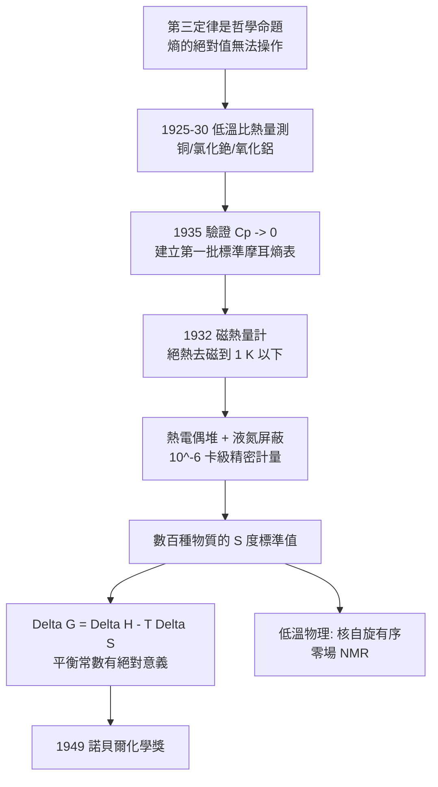

# 1949 · 吉奧克與絕對零度的地平線

> 1949 諾貝爾化學獎：威廉·弗朗西斯·吉奧克（William Francis Giauque，1895–1982，加拿大／美國）——表彰「其對接近絕對零度時物質性質的研究」。他把第三定律（見 [1920-能斯特與熱力學第三定律](1920-能斯特與熱力學第三定律.md)）從哲學命題變成了一把溫度尺。

## 懸案（案情提要）

1940 年代，物理化學界有兩個「做不到」的量測：

1. **熵的絕對值**：能斯特與普朗克的第三定律說「完美晶體在 $0\ \mathrm{K}$ 的熵為零」，這給了熵一個起點。但要把一把尺真正造出來，需要**在接近絕對零度時測量熱容**，並藉此得到所有物質的標準摩耳熵——問題是，在 $1\ \mathrm{K}$ 附近的量測極其困難（雜訊、輻射散熱、熱傳導差）。
2. **低溫下的化學**：許多化學問題只在低溫才會「凍結」——反應速率趨於零、平衡移動到極限、可測量最乾淨的狀態。但低溫下的熱力學數據極度匱乏。

偵辦人：威廉·吉奧克——柏克萊的化學教授，與同事 G. J. 布羅森鮑姆（B. J. Brodersen）一起證明：**銅、氯化銫、氧化鋁在 $1\ \mathrm{K}$ 以下的比熱可用磁性鹽（順磁性鹽）的技術精確量出**——第三定律從此可以被「操作」。

## 前因

| 年份 | 事件 |
| --- | --- |
| 1895 | 吉奧克生於加拿大安大略省；祖父是法國人，父親為小麥農。 |
| 1910s–1920s | 於華盛頓大學（西雅圖）與加州大學取得學位；1923 年任柏克萊化學教授；1927 年加入加拿大皇家學會。 |
| 1925–1930 | 研究低温熱化學：量測 $15$–$300\ \mathrm{K}$ 的比熱，檢驗能斯特熱定理。 |
| 1932 | 引入**順磁性鹽熱量計**（adiabatic demagnetization），開啟 $1\ \mathrm{K}$ 以下的世界。 |
| 1935 | 完成銅、氯化銫、氧化鋁等的**低溫比熱量測**，驗證第三定律並計算標準摩耳熵（$S^\circ$），建起第一批標準熵表。 |
| 1936–1949 | 量測數百種物質的標準摩耳熵；建立《國際臨界量表》的低溫部分。 |
| 1949 | 獲諾貝爾化學獎。 |
| 1960s | 研究順磁性鹽在超低溫下的核自旋Ordering（磁性有序化，1950 年代）——獲得「核自旋排列」與零場核磁共振的相關發現。 |

## 調查

**偵查一：先量「基線」——把第三定律的預測拿來對帳。**

第三定律的可驗證預測是：**任何物質的 $C_p$ 在低溫都趨於零，且 $\lim_{T\to 0}S = 0$。**吉奧克的做法是對多種物質做「比熱—溫度」測量，並檢查其**積分熵**：

$$S(T) = \int_0^T \frac{C_p(T')}{T'}\,dT'$$

對完美晶體，$S(0)=0$；對有「殘餘熵」的物質（玻璃、混亂的晶格），$S(0) > 0$——這是第三定律的**唯一實測反例**，且反例本身極有訊息：**秩序是前提，混亂是例外**（見 [1920-能斯特與熱力學第三定律](1920-能斯特與熱力學第三定律.md)）。

**偵查二：磁熱量計——用磁場把溫度「拉」到零。**

要達到 $1\ \mathrm{K}$ 以下，液氦蒸發冷卻已不足夠（$4.2\ \mathrm{K}$ 是液氦的最低溫）。吉奧克的方案是**絕熱去磁**：

順磁性鹽（如硫酸釓銨、硫酸甲胺）中的磁性離子，具有與溫度相關的磁化：

$$\frac{M}{H} = \frac{C}{T} \quad (\text{居里定律，} C = \text{莫耳居里常數})$$

在極低溫（約 $1\ \mathrm{K}$）下施加外磁場 $H_{\text{ext}}$，使自旋取向（微觀「熵的儲備」）被「磁化」排整齊；然後**絕熱撤除磁場**，自旋有序度崩塌，系統的熵以**可觀測的溫升**顯現：

$$\text{撤磁過程：}\quad T \text{ 上升} \;\Rightarrow\; \text{用 } C_H \text{ 與 } \Delta H \text{ 反推 } C_H \text{ 的極低溫值}$$

$$\text{可達溫度} \approx T_0 \cdot \sqrt{\frac{H_0}{H_f}} \;\xrightarrow{\text{無限小 } H_f}\; 0$$

**這是化學家第一次能主動「製造」接近絕對零度的溫度**——不是靠蒸發液氦，而是靠磁場與自旋。

**偵查三：熱量的精密計量——$10^{-6}$ 級的量測。**

磁熱量計的輸出極小：一次去磁過程可能只對應毫卡量級的熱量，因此需要：

- **熱電偶堆**（數百對熱電偶串聯以提高靈敏度）；
- **氮化液氮**（$77\ \mathrm{K}$）的保護輻射屏與多次屏蔽；
- **碳電阻溫度計**（作為次級溫標）；
- **極嚴格的熱絕緣與振動隔離**。

$$C = \frac{Q}{\Delta T}, \qquad \text{以 } \Delta T \sim 0.001\ \mathrm{K} \text{ 的溫升對應毫卡量熱}$$

這套技術後來成為**國立標準局（NBS，現 NIST）的低溫熱量計標準**。

**偵查四：化學收益——標準熵表與低溫化學。**

有了 $S^\circ$，化學家終於能算出任意反應的：

$$\Delta_r G^\circ = \Delta_r H^\circ - T\Delta_r S^\circ, \qquad \Delta_r S^\circ = \sum \nu_i S_i^\circ$$

例如：$2\,\mathrm{H_2} + \mathrm{O_2} \rightarrow 2\,\mathrm{H_2O(l)}$，由標準熵表得 $\Delta_r S^\circ = -326.7\ \mathrm{J/(mol\cdot K)}$，配合 $\Delta_r H^\circ = -571.6\ \mathrm{kJ/mol}$，即可判斷在不同溫度下的自發性與平衡常數：

$$\Delta_r G^\circ(298) = \Delta_r H^\circ - T\Delta_r S^\circ = -571.6 - 298\times(-0.3267) \approx -474.3\ \mathrm{kJ/mol}$$

$$K = e^{-\Delta_r G^\circ/RT} = e^{474300/(8.314\times 298)} \approx 10^{83}$$

**「平衡常數」的數值第一次有了「絕對」的意義**——它是從可量測的、比熱整合出來的，不是從經驗常數表抄來的。

## 理論裁決

**判決一：第三定律的可操作化。** 能斯特的定理原本只是「$T\to 0$ 時 $\Delta S \to 0$」的極限敘述；吉奧克的工作給出了它的**可操作版本**：

$$\text{只要量出 } C_p(T) \text{ 在最低溫的行為，即可由 } S(T) = \int_0^T \frac{C_p}{T}dT \text{ 得到絕對熵}$$

這把「無法實測的絕對量」變成「可由有限測量外推的量」——**這是物理化學方法論的重大進展：把不可達的邊界變成可逼近的目標。**

**判決二：去磁制冷的能量學。** 順磁性系統的熵隨磁場變化（磁場做功改變自旋有序度）：

$$\Delta S_{\text{mag}} = \Delta H \int_0^{H} \left(\frac{\partial M}{\partial T}\right)_{H} dH \quad\text{或等價地}\quad \Delta S \approx \Delta H \cdot \frac{C}{T^2}\cdot H$$

在 $T \sim 1\ \mathrm{K}$、$C/T^2$ 極大的條件下，即使極小的磁場變化也能造成可觀的溫升——**「用磁場取走熵」**成為現實。也因此，去磁製冷**不能**用於核對熵零點（因為過程本身必然帶來熵變），這是其在技術上不能做到 $0\ \mathrm{K}$ 的內在原因——與第三定律的不可達原理互相印證。

**判決三：低溫量測的標準化。** 吉奧克建立的可追溯性鏈條：

$$\text{ITS-90 溫標（1990）} \;\supset\; \text{ITS-90 的低溫段} \;\supset\; \underbrace{\text{磁熱量計的 } C_p \text{ 標準}}_{\text{吉奧克起點}} \;\supset\; \text{碳電阻、銻鉻合金等次級溫標}$$

**溫度不再是「感覺」，而是可溯源的量**——這是現代計量科學的根基，也是 2019 年國際计量大会重新定義開爾文（2019 年 5 月 20 日起，以玻爾茲曼常數固定定義）的百年鋪墊。

**判決四：低溫化學的新問題域。** 在低溫下：

- 反應速率 $\to 0$（阿瑞尼斯方程式，見 [1903-阿瑞尼斯與離子解離疑案](1903-阿瑞尼斯與離子解離疑案.md)）：$k = A e^{-E_a/RT}$，$T\to 0$ 時 $k\to 0$；
- 平衡向放熱側移動（凡特荷夫方程式，見 [1901-凡特荷夫與物理化學](1901-凡特荷夫與物理化學.md)）；
- 因此低溫提供了「化學反應的暫停鍵」——**在反應進行到一半時凍住，捕捉中間體**。這是化學家第一次能「凍結」反應並逐一檢查中間產物，1940–50 年代的多種反應機構研究受益於此。

## 後果

| 領域 | 影響 |
| --- | --- |
| 熱力學資料 | 標準摩耳熵表成為化學的基本資料集；今日的 NIST 熱化學資料庫與 1998 年諾貝爾化學獎（密度泛函理論，見 [1998-科恩與量子化學](1998-科恩與量子化學.md)）的計算熱力學，都建立在這套實測基礎上。 |
| 低溫物理 | 順磁性去磁成為超低溫的標準技術；吉奧克的核自旋有序研究帶出**零場核磁共振**與核偶極有序化，直接通向今日的**低溫 NMR 與量子感測**（也見 [1991-恩斯特與NMR](1991-恩斯特與NMR.md)）。 |
| 計量科學 | 低溫熱量計成為國際溫標的基準段之一；2019 年 SI 基本常數改版（開爾文由玻爾茲曼常數定義）即此技術傳統的終點。 |
| 天體物理與宇宙論 | 低溫下的比熱與熵，是星體結構模型（Debye 模型、Hertzsprung–Russell 圖）與宇宙學（早期宇宙的核合成、CMB 溫度史）的物理基礎。 |
| 學術制度 | 吉奧克的學生中有 **Herbert C. Brown**（1979 年化學獎，氫硼化反應）與 **Glenn Seaborg**（1951 年化學獎，超鈾元素）——柏克萊化學系在戰後成為美國化學的堡壘。 |

## 關聯

- [1920-能斯特與熱力學第三定律](1920-能斯特與熱力學第三定律.md)：本案是第三定律的實作卷宗——從定理到溫度尺。
- [1901-凡特荷夫與物理化學](1901-凡特荷夫與物理化學.md)：$\Delta G = \Delta H - T\Delta S$ 的兩項都需要標準熵表才能算。
- [1903-阿瑞尼斯與離子解離疑案](1903-阿瑞尼斯與離子解離疑案.md)：低溫使反應速率歸零，是「凍結中間體」的技術前提。
- [1909-奧斯特瓦德與催化](1909-奧斯特瓦德與催化.md)：低溫下的平衡與催化劑表面吸附研究。
- [1979-布朗與維蒂希](1979-布朗與維蒂希.md)：吉奧克門生布朗的氫硼化，正是「在極低溫下以不穩定中間體進行反應」的現代實例。
- [1998-科恩與量子化學](1998-科恩與量子化學.md)：計算化學為標準熱力學數據提供了新來源，與本案互補。
