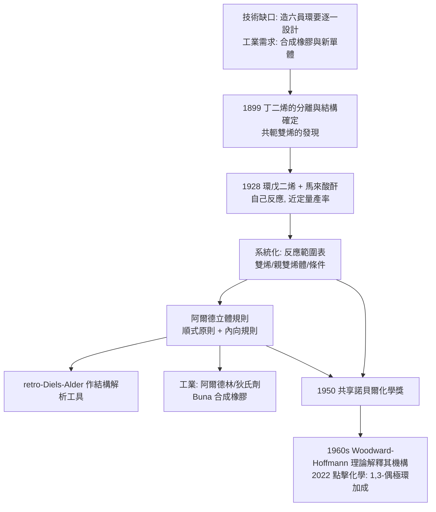

# 1950 · 迪爾斯與阿爾德——環的萬能鑰匙

> 1950 諾貝爾化學獎：奧托·保羅·赫爾曼·迪爾斯（Otto Paul Hermann Diels，1876–1954）與庫爾特·阿爾德（Kurt Alder，1902–1958，德國）——表彰「其發現雙烯合成」。化學家終於有了可以「一鍵造六員環」的工具。

## 懸案（案情提要）

1930 年代的有機化學面對一個技術上的空缺與一個工業上的需求：

**技術面**：要造一個六員碳環，方法屈指可數，而且每一個都要量身訂做——Robinson 稠合、丙二酸酯合成、酸酐縮合……**能不能有一個通吃的辦法，把「一個雙烯 + 一個親雙烯體」變成六員環？**

**工業面**：橡膠是戰爭的戰略物資——天然橡膠產於東南亞，受英荷壟斷，價格飛漲。1930 年代德國與蘇聯各自攻关「合成橡膠」，而其中的核心問題是：**有了丁二烯，怎麼讓它聚合成有用的高分子？**（答案要等到 1950 年代的齊格勒—納塔催化劑才出現，見 [1963-齊格勒與納塔](1963-齊格勒與納塔.md)）。而另一條路是：**用雙烯先造出有用的環狀化合物**，再由它們衍生出聚合物。

偵辦人：迪爾斯與他的學生阿爾德。1930 年代初，迪爾斯在研究「用煤製造人造橡膠」的課題時，注意到一個簡單的實驗：**環戊二烯與順丁烯二酸酐放在一起，會自己反應，產出一個固體。**

## 前因

| 年份 | 事件 |
| --- | --- |
| 1876 | 迪爾斯生於柏林；於柏林大學隨費歇爾（Otto Fischer）學習，後隨埃米爾·費歇爾（見 [1902-費歇爾與醣類偵探學](1902-費歇爾與醣類偵探學.md)）從事有機化學研究（酞顏料）。 |
| 1899 | 於基爾大學（H. Kilpe 實驗室）開始研究**乙炔的加成與聚合**，1900 年自松節油熱解產物中分離出**丁二烯**（$\mathrm{C_4H_6}$）並確定其結構——**共軛雙烯的發現**，正是本案反應的燃料。 |
| 1906 | 以煤焦油（苯胺與乙炔）製造「丁苯橡膠」的實驗（Buna 計畫的源頭之一），並證明其結構。 |
| 1907–1910 | 與阿爾德（Alder）在基爾共同發展「**雙烯合成**（Diels–Alder reaction）**：共軛雙烯 + 親雙烯體 → 六員環烯」。 |
| 1920s | 阿爾德在基爾大學與迪爾斯合作，建立該反應的**立體化學規則**（順式原則、內向規則）。 |
| 1930s–1940s | 迪爾斯任柏林**凱撒威廉煤炭研究所**（KWI-Kohle）所長（1941 起）；阿爾德在化工巨頭工作；二人皆為德國化學工業的技術骨幹。戰時的煤煉油與合成橡膠計畫，把共軛雙烯的化學推到戰略位置。 |
| 1950 | 兩人共享諾貝爾化學獎。 |
| 1954 / 1958 | 迪爾斯逝於基爾；阿爾德逝於慕尼黑。 |

## 調查

**偵查一：一次「自己發生」的觀察。**

迪爾斯與阿爾德的實驗極簡：把環戊二烯（diene）與馬來酸酐（dienophile）在乙醚中混合，靜置——**產物自己結晶出來，產率接近定量**。這種「混合即反應」的直覺性，正是它日後能被千百萬人使用的關鍵。

反應通式：

$$\text{共軛雙烯} + \text{親雙烯體} \longrightarrow \text{六員環烯} \; (-\text{2 個 } \pi \text{ 鍵} \to 2 \text{ 個 } \sigma \text{ 鍵})$$

**偵查二：立體化學的兩條規則——本案最精密的部分。**

阿爾德的實驗證明了雙烯合成的**立體專一性**：

1. **順式原則（Alder cis principle）**：親雙烯體上兩個取代基的相對關係**在產物中保留**。例如順式馬來酸酐（兩個羧基同側）給出順式產物，反式給出反式產物：

$$\text{立體專一：} \; \text{親雙烯體的立體化學} \longrightarrow \text{產物的立體化學（不變）}$$

2. **內向規則（Alder endo rule）**：當親雙烯體帶有吸電子基（$\mathrm{C=O}$、$\mathrm{C}\equiv\mathrm{N}$）時，**內向（endo）產物**（次級基團朝向橋下）為動力學主要產物：

$$\text{endo} > \text{exo} \quad (\text{動力學控制}) ; \qquad \text{高溫下可逆 } \Rightarrow \text{更穩定的 exo 產物}$$

這兩條規則是阿爾德與其合作者（尤其 H. H. H. S. 沃爾德、Reinhold）用大量實驗建立的**經驗規則**，在 1960 年代被 Woodward–Hoffmann 理論與量化計算解釋。

**偵查三：反應範圍的系統化。**

迪爾斯與阿爾德在 1928 年發表的系統研究，把「哪些雙烯、哪些親雙烯體、哪些條件」整理成完整的反應表：

| 反應類型 | 雙烯 | 親雙烯體 | 產物 |
| --- | --- | --- | --- |
| 標準雙烯合成 | 1,3-丁二烯 | 乙烯 | 環己烯 |
| 高度活化的親雙烯體 | 環戊二烯 | 馬來酸酐 | 順式-1,2,3,6-四氫鄰苯二甲酸酐（近定量） |
| 帶官能基的親雙烯體 | 丁二烯 | 丙烯酸 $\mathrm{CH_2{=}CHCOOH}$ | 環己-3-烯甲酸 |
| 芳香族親雙烯體 | 丁二烯 | 苯醌 | 雙環加成物 |
| 逆向 | 環己烯 | 高溫 | 裂解回雙烯 + 烯（retro-Diels–Alder） |

**「retro-Diels–Alder」尤其重要**：它提供了**環狀化合物的結構解析工具**——把產物加熱，看它裂成什麼雙烯與親雙烯體，就知道它原來是什麼環。

**偵查四：工業應用的第一頁。**

- **農藥**：六氯環戊二烯 + 馬來酸酐 → 醛類衍生物，即**阿爾德林（aldrin）與狄氏劑（dieldrin）**（殺蟲劑，1940s–60s 大量使用，後因環境毒性禁用）。
- **合成橡膠與塑料**：雙烯合成的產物（環己烯類）可衍生出多種單體；德國的 Buna 合成橡膠計畫正是以丁二烯為核心（見 [1931-博施與貝吉烏斯](1931-博施與貝吉烏斯.md) 的高壓技術）。
- **藥物與天然產物**：許多藥物分子含有六員環，其工業合成路徑常包含雙烯合成步驟。

## 理論裁決

**判決一：反應的自由能與溫度窗口。** 雙烯合成的熱力學特徵：

$$\Delta_r H \approx -100\ \text{至}\ -150\ \mathrm{kJ/mol}\ (\text{放熱}), \qquad \Delta_r S < 0 \ (\text{3 分子} \to 1 \text{ 分子})$$

$$\Delta_r G = \Delta_r H - T\Delta_r S$$

放熱使低溫有利；但低溫下反應速率慢——**又是那個熟悉的「平衡 vs 速率」兩難**（見 [1918-哈伯與合成氨](1918-哈伯與合成氨.md)）。實際的折衷點通常在 $20$–$150\,^\circ\mathrm{C}$ 之間；室溫下即自發進行的反應被稱為「**自催化的**」（如環戊二烯 + 馬來酸酐），這是它的工業魅力所在。

**判決二：機構的立體化學——六電子的環加成。** 迪爾斯—阿爾德反應被 Woodward 與霍夫曼（1965 年的「保留軌域對稱性」理論，見 [1981-福井與前沿軌域](1981-福井與前沿軌域.md)）以選擇定則解釋：

$$\underbrace{\text{6 電子（}4\pi + 2\pi\text{）}}_{\text{雙烯 4 個} + \text{親雙烯體 2 個}} \quad \xrightarrow{\text{熱}} \quad \text{suprafacial–suprafacial（允許）}$$

雙烯的 4 個 $\pi$ 電子與親雙烯體的 2 個 $\pi$ 電子在過渡態形成環狀的 6 電子循環，符合 Hückel 的 $4n+2$（$n=1$）規則，故**熱允許、協同（concerted）、無中間體**——這解釋了為什麼它具有完美的立體專一性：

$$\text{觀察到的立體專一性} \Longleftarrow \text{協同機構（一步完成，無翻轉）}$$

**判決三：內向規則的解釋——次級軌道作用。** 阿爾德的內向規則長期是經驗規則，直到 1960–70 年代才由計算與過渡態理論解釋：吸電子基的 $\pi^\ast$ 軌道能與雙烯剩餘的 $\pi$ 軌道產生**次級交互作用**，在 endo 過渡態中能量較低：

$$\text{endo 過渡態} \;:\; \underbrace{\pi_{\text{雙烯}}}_{\text{一級}} + \underbrace{\pi_{\text{親雙烯體}}}_{\text{一級}} + \underbrace{\pi_{\text{吸電子基}} \leftrightarrow \pi_{\text{雙烯殘餘}}}_{\text{次級}} \Rightarrow \Delta G^\ddagger_{\text{endo}} < \Delta G^\ddagger_{\text{exo}}$$

**判決四：逆反應——結構解析的工具。** Retro-Diels–Alder 使「六員環的生成歷史」可被反推：

$$\text{環己烯類產物} \xrightarrow{\Delta} \text{雙烯} + \text{親雙烯體} \quad\Longrightarrow\quad \text{結構假說可被裂解實驗直接檢驗}$$

這是 1950–70 年代天然產物結構判定的重要手段（例如許多萜類與甾體的結構都靠逆雙烯合成得到證實）。

## 後果

| 領域 | 影響 |
| --- | --- |
| 合成化學 | 雙烯合成是**使用最廣泛的有機反應之一**：藥物（前列腺素、類固醇、維生素 D 的合成路徑）、材料（聚馬來酸酐、環氧樹脂固化劑）、天然產物全合成皆用之。 |
| 工業與農業 | 阿爾德林／狄氏劑（殺蟲劑，曾大量使用，後因持久性與毒性禁用）；Buna 合成橡膠的單體路線；馬來酸酐—丁二烯的加成物用於樹脂與黏著劑。 |
| 理論化學 | 雙烯合成的機構問題，是 Woodward–Hoffmann 選擇定則的**第一號測試案例**，並在 1981 年成為諾獎的核心內容之一（見 [1981-福井與前沿軌域](1981-福井與前沿軌域.md)）。 |
| 藥品開發 | 雙烯合成與它的「生物等價體」——**1,3-偶極環加成（点击化学的原型）**——構成今日藥物發現的兩大主力反應；2022 年的點擊化學獎（見 [2022-貝爾托西與點擊化學](2022-貝爾托西與點擊化學.md)）正是這條譜系的現代一環。 |
| 科學史註記 | 迪爾斯與阿爾德均在德國的化學工業體系中任職；戰時的煤化工與合成橡膠工作與納粹經濟動員相連，其歷史評價至今仍在被檢視——這是「科學成果與其制度土壤」的典型案例。 |

## 關聯

- [1902-費歇爾與醣類偵探學](1902-費歇爾與醣類偵探學.md)：迪爾斯的師承圈（埃米爾·費歇爾實驗室）與丁二烯研究。
- [1905-拜耳與靛藍案](1905-拜耳與靛藍案.md)：稠環與環系合成的德國傳統；雙烯合成是「造環」技術的系統化。
- [1912-格林納與薩巴捷](1912-格林納與薩巴捷.md)：兩個碳的接合方法（格氏）與六員環的接合方法（雙烯），是有機合成的兩條主幹。
- [1931-博施與貝吉烏斯](1931-博施與貝吉烏斯.md)：丁二烯與合成橡膠的工業背景（高壓煤化工提供原料）。
- [1963-齊格勒與納塔](1963-齊格勒與納塔.md)：雙烯合成的下一課——雙烯的立體規整聚合。
- [1981-福井與前沿軌域](1981-福井與前沿軌域.md)：雙烯合成的機構由選擇定則正式解釋。
- [2022-貝爾托西與點擊化學](2022-貝爾托西與點擊化學.md)：環加成家族的現代分支。
