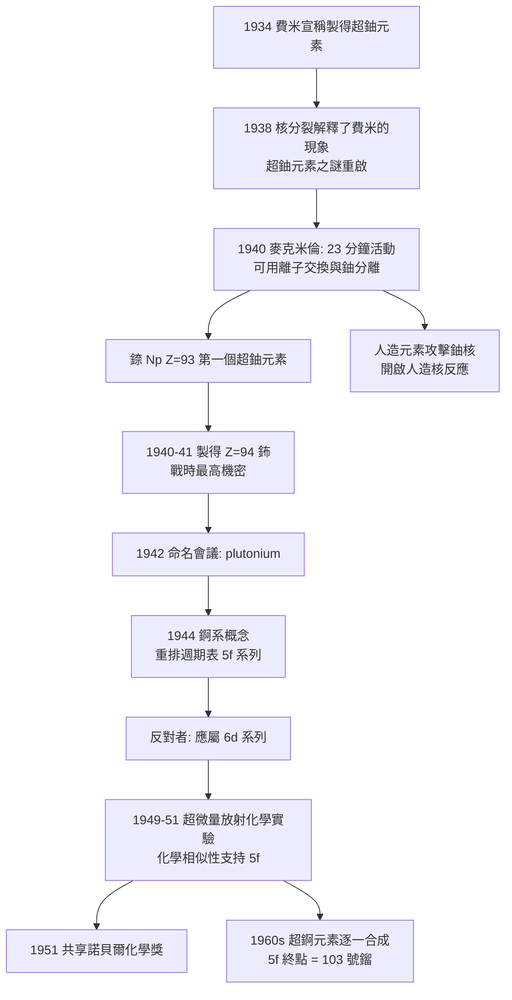

# 1951 · 麥克米倫與西博格——把元素表往外延伸

> 1951 諾貝爾化學獎：埃德溫·馬蒂森·麥克米倫（Edwin Mattison McMillan，1907–1991）與格倫·西奧多·西博格（Glenn Theodore Seaborg，1912–1999，美國）——表彰「其發現超鈾元素」。第一個鈾後元素（錼）的誕生，以及「錒系」概念的提出，兩件事出自同一座實驗室。

## 懸案（案情提要）

1934 年，恩里科·費米在羅馬用中子轟擊鈾，宣稱製造了「超鈾元素」（ausonium 與 hesperium），並因此獲 1938 年諾貝爾物理獎。1938 年底，哈恩與施特拉斯曼發現核分裂（見 [1944-哈恩與核分裂](1944-哈恩與核分裂.md)）——**費米的「超鈾元素」其實是裂變產物的誤認**。這樁誤認在科學界留下了一個具體的懸案：

> **鈾之後還有沒有元素？如果有，它們在哪裡、如何證明？**

而且問題更深：若鈾後元素存在，它們的化學性質應當如何？週期表的末端要怎麼畫？玻爾早年的預測說它們應「像稀土元素那樣成群出現」，但無人能驗證——**因為證明的門檻極高**：新元素必須與所有已知元素**化學分離**，還要有可測的半衰期與原子序。

偵辦人：麥克米倫（發現錼）與西博格（把錒系的概念推到盡頭，把元素表外推了一大段）。

## 前因

| 年份 | 事件 |
| --- | --- |
| 1907 | 麥克米倫生於加州紅木市；於加州理工學院取得學位（1933 年普林斯頓博士），後加入勞倫斯的柏克萊輻射實驗室。 |
| 1930s | 麥克米倫在勞倫斯的**迴旋加速器**（見 [1932-朗繆爾與表面化學](1932-朗繆爾與表面化學.md) 同代的加速器技術）協助建立，並以中子實驗發現 $^{15}\mathrm{O}$ 與 $^{10}\mathrm{Be}$。 |
| 1939–1940 | 在柏克萊重做費米的實驗；**1940 年**以中子轟擊 $^{238}\mathrm{U}$，發現一個約 23 分鐘半衰期、可與鈾化學分離的新放射性元素——**錼（neptunium，Np，$Z=93$）**，第一個超鈾元素（與艾貝爾森合作）。 |
| 1940–1941 | 西博格、麥克米倫、肯尼迪、沃爾等人以 $^{238}\mathrm{U}(\mathrm{n},\gamma)$ 再捕獲中子後 $\beta$ 衰變，製得 **$Z=94$ 的元素**（鈰，plutonium），**因戰時保密而直到 1945 年才公開**。 |
| 1944 | 西博格提出**錒系概念（actinide concept）**：鈾後元素應像稀土元素（鑭系）一樣形成一族「f 區」元素——**這是把週期表重新排列的主張**。 |
| 1949–1950 | 合成並證明錒系元素的化學相似性（以示蹤與微量分離技術），主張 5f 系列的排列；當時反對者不少（認為應屬於 6d 系列）。 |
| 1951 | 兩人共享諾貝爾化學獎（西博格 32 歲時獲獎，是最年輕的諾貝爾化學獎得主之一）。 |
| 1950s–70s | 西博格團隊繼續合成鎦、錇、鐦、鉑等，並在 1959 年主張把「超錒系」也納入同一概念。 |
| 1997 | 第 104 號元素命名為 **rutherfordium（𬬻，Rf）**（見 [1908-盧瑟福與元素蛻變](1908-盧瑟福與元素蛻變.md)）。 |

## 調查

**偵查一：證明新元素的四道門檻。**

西博格後來把「新元素的證明條件」總結為四條，這是本案最實用的理論貢獻：

1. **化學分離**：必須能與所有已知元素分離（不同的化學性質）；
2. **一致的半衰期**：單一放射性核素（單一 $t_{1/2}$ 與單一衰變模式）；
3. **原子序的確認**：以 X 射線光譜（$L$ 系列、$M$ 系列特徵線）或質譜確認 $Z$；
4. **命名與存檔**：提交命名並由 IUPAC 核准。

$$\text{新元素} = \text{可分離} + \text{單一核素} + \text{光譜確認} Z + \text{命名}$$

**偵查二：23 分鐘的元素——錼的辨認。**

麥克米倫與艾貝爾森在 1940 年的實驗：

- 以中子轟擊 $^{238}\mathrm{U}$，產生 $^{239}\mathrm{U} \to {}^{239}\mathrm{Np} \to$（$\beta^-$）$^{239}\mathrm{Pu}$；
- 發現產物的半衰期約 **23 分鐘**（後來確定為 $^{239}\mathrm{Np}$，$t_{1/2} \approx 2.35$ 天——這裡有個歷史插曲：最初報告的 23 分鐘半衰期實際屬於 $^{239}\mathrm{Np}$ 的子核或另一核種，後來修正）；
- **化學分離**：以**離子交換法**（Dowex 樹脂，硝酸鹽／鹽酸梯度淋洗）把新元素從鈾與其他產物中分離，證明其化學性質不同於已知元素；
- 1939 年用它製成「錼的 α 放射源」去撞擊鈾——**首次以人造元素攻擊鈾核**，開啟了「人造核反應」時代。

**偵查三：鈽的誕生與戰時保密——科學與國安的交錯。**

1940 年底起，柏克萊團隊逐步製得 $^{239}\mathrm{Pu}$，並在 1942 年 5 月的「元素命名會議」上，由西博格提出「plutonium（鈽）」之名（pluto，冥王星）。然而：

- 元素 94 及其製造方法被列為**最高機密**（曼哈坦計畫的一部分）；
- 保密的理由是戰略性的：鈽可作為炸藥材料；
- 保密的代價是科學上的：無法由國際組織協調命名與發現權，直到 1945 年 8 月（杜魯門聲明）後才公開；
- 更麻煩的是：戰後鈽的「發現權」在美國、加拿大與英國之間長期爭議（西博格與他的合作者、加拿大原子能公司、英國的哈恩與斯特拉斯曼相關實驗的先後）。

**偵查四：錒系概念的提出——重畫週期表。**

西博格 1944 年的主張（並在 1949–1951 年間以實驗支持）：

$$\text{錒系（Actinides）} = \mathrm{Ac}, \mathrm{Th}, \mathrm{Pa}, \mathrm{U}, \mathrm{Np}, \mathrm{Pu}, \mathrm{Am}, \mathrm{Cm}, \mathrm{Bk}, \mathrm{Cf}, \ldots$$

理由是**化學相似性**：後面的元素（Am、Cm、Bk…）在溶液中的化學行為極為相近，難以分離，只能用極微量的示蹤技術研究。這與稀土元素（鑭系）如出一轍，因此應有對應的「f 區」排列：

$$\text{電子組態：} \; \mathrm{Ac}:\ [\mathrm{Rn}]\,6d^1 7s^2 \;\to\; \mathrm{Th}:\ [\mathrm{Rn}]\,6d^2 7s^2 \;\to\; \ldots \; \mathrm{Lr}:\ [\mathrm{Rn}]\,5f^{14} 7s^2 7p^1$$

**爭議的核心**：錒系應屬於「5f 系列」還是「6d 系列」？若屬 6d，則其化學行為應更像鉑系（第 8 族），但實測顯示它們更像稀土——**實驗站在西博格這一邊**。1960 年代後，隨著超錒元素的逐一合成，分界線愈來愈清晰（最后一个 5f 元素是 103 號鎦）。

**偵查五：為什麼「超鈾元素」如此難做——量的極端。**

製造與辨識超鈾元素的難度，是本案最值得記錄的技術面：

$$\text{產量} \sim 10^{-12}\ \mathrm{g}\ (\text{一個原子層級的樣品})$$

因此必須發展：
- **超微量化學**：以 $^{239}\mathrm{Pu}$ 等作「示蹤」或以 $\mathrm{Pu}^{4+}$ 的還原性在低溫下研究；
- **逆相層析與萃取**：分離差僅數百分點的化學行為；
- **以放射強度代替質量**的偵測（$A = \lambda N$）。

**這套「超微量放射化學」技術，正是 1943 年德海韋西（見 [1943-德海韋西與同位素示蹤](1943-德海韋西與同位素示蹤.md)）所確立的示蹤方法在無機領域的推廣。**

## 理論裁決

**判決一：新元素的證明條件（四門檻）。** 西博格的四條判準成為核化學的通用程式：

$$\boxed{\text{新元素} \iff \text{可分離} + \text{單一核素} + \text{原子序確認} + \text{命名核准}}$$

其中「化學分離」是化學家的獨特貢獻：**放射性只能告訴你「有東西」，分離才能告訴你「它是誰」。**這也解釋了為何歷史上「同時獨立發現」的爭議層出不窮。

**判決二：錒系概念——週期表的第二次革命。** 西博格的主張把 5f 系列納入週期表，使元素表從「八個角落」變成「兩條 f 系列」：

| 區塊 | 元素 | 填入的軌域 |
| --- | --- | --- |
| s 區 | IA, IIA | $ns$ |
| p 區 | IIIA–VIIA, 0 族 | $np$ |
| d 區 | IIIB–IIB | $(n-1)d$ |
| f 區（鑭系） | 鑭系元素（57–71） | $(n-2)f$ |
| f 區（錒系） | 錒系元素（89–103） | $5f$ |

**化學相似性是這張表的證據來源**：錒系的化學行為與鑭系平行（同為 $f$ 區元素的結果：$f$ 電子屏蔽差強、化學性質主要由外層 $d$、$s$ 電子決定），因此「難以分離」不是缺陷，而是**同族的必然**。這條邏輯在 1980–90 年代被進一步推展（超錒系是否屬於 f 區的爭議，直到 2016 年 IUPAC 命名鈕（Nh）、鏌（Mc）、鿬（Ts）、鿫（Og）時仍有餘波）。

**判決三：放射化學的超微量技術。** 處理 $10^{-12}\ \mathrm{g}$ 級樣品，需要把「以放射強度取代質量」：

$$A = \lambda N \;\Longrightarrow\; N = \frac{A}{\lambda}, \qquad m = N \cdot \frac{M}{N_A}$$

因此**計數器讀數即樣品中原子數**，質量只是換算值。這套邏輯使超微量研究成為可能，並在 1960 年代發展出**放射化學的超錒元素化學**（Am、Cm 的化學性質首度被測定）。

**判決四：戰時保密對科學史的教訓。** 鈽的祕密延宕了公開確認與命名協調，造成了跨國的發現權爭與長達數十年的「誰先發現」的迷宮（美、加、英、德）。這是科學史上「國家機密優先於科學社群程序」的典型案例，與 1938 年哈恩—梅特納—弗里施的分配不公（見 [1944-哈恩與核分裂](1944-哈恩與核分裂.md)）形成對照：**同樣的物理發現，因戰爭與制度而有了兩種命運。**

## 後果

| 領域 | 影響 |
| --- | --- |
| 核化學 | 超鈾元素化學（Np、Pu、Am、Cm…）成為獨立學科；「超微量放射化學」技術至今用於核廢料處理、環境放射監測與考古測定。 |
| 週期表 | 錒系概念的確立是週期表現代形態的完成；2016 年的 IUPAC 命名（113–118 號）沿用此概念架構。 |
| 核武器與能源 | 鈽是核武與核能反應堆（MOX 燃料）的核心材料；西博格團隊同時負責分離鈽的工業方法（以硝酸鹽處理、鈰為載體的共沉法）。 |
| 醫療 | $^{241}\mathrm{Am}$（銨-241）用作心臟起搏器與煙霧探测器電源；$^{252}\mathrm{Cf}$ 用於中子源；核醫學的放射性核素半數來自錒系。 |
| 科學制度 | 西博格主張的「元素發現權應包含命名權」引發長期的 IUPAC 命名規則改革（1990s 至今的命名爭議），並確立了元素命名的國際程序。 |
| 科學傳記 | 西博格是極少數在世時即有傳記（《西博格自傳》）並親自見證多個元素以其名字命名的諾獎得主；也是少數主張「科學家應參與公共政策」而進入政界（1960–70 年代美國能源部副部長）的科學家。 |

## 關聯

- [1908-盧瑟福與元素蛻變](1908-盧瑟福與元素蛻變.md)：放射性原子序與核化學的框架；錼的原子序確認沿用其光譜方法。
- [1922-阿斯頓與質譜儀](1922-阿斯頓與質譜儀.md)：確認新元素原子序的質譜方法。
- [1943-德海韋西與同位素示蹤](1943-德海韋西與同位素示蹤.md)：示蹤技術在超微量放射化學中的延伸。
- [1944-哈恩與核分裂](1944-哈恩與核分裂.md)：費米的「超鈾元素」誤認，正是由核分裂的發現所釐清。
- [1957-托德與核苷酸](1957-托德與核苷酸.md)：同一柏克萊世代的另一條線——核酸化學與放射標記的結合。
- [1964-霍奇金與X射線晶體學](1964-霍奇金與X射線晶體學.md)：以 X 射線確認新元素的原子序，是四門檻的第三條。
