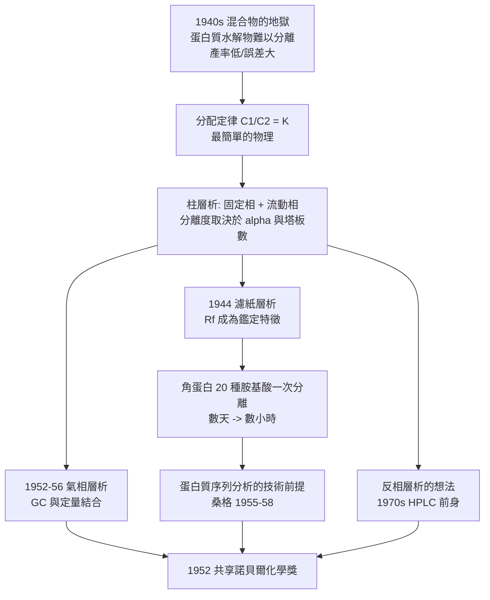

# 1952 · 馬丁與辛格——把混合物放進一根柱子裡

> 1952 諾貝爾化學獎：阿徹·約翰·波特·馬丁（Archer John Porter Martin，1910–2002）與理查·勞倫斯·米林頓·辛格（Richard Laurence Millington Synge，1914–1994，英國）——表彰「其發明分配層析法」。今日所有蛋白質組學實驗室裡那根柱子，源頭在此。

## 懸案（案情提要）

1940 年代，生物化學面對的是**混合物的地獄**。蛋白質的純化靠的是鹽析、電泳、超速離心（見 [1926-斯韋德貝里與超速離心機](1926-斯韋德貝里與超速離心機.md)、[1948-蒂塞利烏斯與電泳](1948-蒂塞利烏斯與電泳.md)），但這些方法都有同一個致命缺陷：

- **產率低**：每一輪分級都丟掉大部分樣本；
- **無法處理「數十種成分共存」的情形**：以當時的胺基酸分析方法，蛋白質水解物中有 20 種胺基酸，要一個一個分離並定量，簡直是一場災難；
- **無法處理「結構相近但性質不同」的物質**：如各種胺基酸衍生物、各種類固醇。

更急迫的應用壓力來自一個具體的專案：**想弄清蛋白質的胺基酸序列，就必須先能把它的水解碎片分離、定量、鑑別。**而 1940 年代的蛋白質水解物分析，一次實驗要跑好幾天，且誤差大到難以支持序列判定。

偵辦人：馬丁與辛格。他們的解法聽起來簡單得不可思議：**讓混合物在兩種互不相溶的液體之間「分家」，再讓它們沿著一根柱子慢慢走。**

## 前因

| 年份 | 事件 |
| --- | --- |
| 1910 / 1914 | 馬丁生於倫敦（劍橋出身，父親是書商，業餘在劍橋的「綠松石山實驗室」做化學實驗）；辛格生於哈拉德郡。 |
| 1932 | 馬丁於劍橋完成博士學位（研究植物色素的色層分析），隨即進入一個研究蛋白質與醣類的單位。 |
| 1937–1941 | 馬丁在「蛋白質研究委員會」工作（李斯特研究所與（MRC）合作）；辛格加入（辛格本人有色盲，因此研究工作偏向「以化學方法而非視覺判讀」的方向——這段個人特質成了科學史上的佳話）。 |
| 1941 | 辛格在佩頓（Penton）實驗室研究蛋白質水解物中的胺基酸分離，首用**分配層析**（partition chromatography）分離乙醯化胺基酸。 |
| 1944 | 馬丁與辛格發表《Partition chromatography》（*Biochemical Journal*），提出以**濾紙**為載體的分配層析；應用於水解物的胺基酸分離，並在 1945 年前後完成羊毛角蛋白的胺基酸組成分析。 |
| 1945–1946 | 辛格在佩頓以柱層析分離肽段；為理解色層行為而研究**分配定律**。 |
| 1946 | 馬丁與辛格遷往倫敦，在韋爾斯研究所（Teddington）持續發展層析技術；馬丁亦發明**氣相層析**（1952–55，與辛格共同發表於 1956 年，即著名的「Martin & Synge 1956 氣相層析論文」）。 |
| 1952 | 兩人共享諾貝爾化學獎。 |
| 1950s–1970s | 層析法成為化學與生物化學的基礎技術；馬丁因此獲 numerous 榮譽（爵士、皇家獎章）；辛格後轉入生物化學的教學與學術管理（曾任《Biochemical Journal》與 Royal Society 的職務），並推動「生物化學的科學期刊標準化」。 |

## 調查

**偵查一：分配的物理——「溶劑萃取」不過是分配定律。**

一切從一個簡單的事實開始：**某物質會在兩種互不相溶的液體間按一定比例分配。**分配定律：

$$\frac{C_1}{C_2} = K \quad (\text{分配係數，定義於兩相的濃度之比})$$

例如乙醯化的胺基酸，在**水相（固定相）**與**有機相（流動相）**之間有各自的 $K$ 值；$K$ 越大，越偏好有機相（溶出快）。

**偵查二：柱層析——讓混合物「走」一根柱子。**

把某一相固定在多孔載體上，另一相流動；樣品在頂端注入，沿柱下行，各成分以不同速度移動：

$$\text{移動速度} \propto \frac{1}{K_{\text{有效}}}, \qquad \text{分離度} \sim \frac{\sqrt{N}}{4}\cdot\frac{\alpha - 1}{\alpha}\cdot\frac{k_2}{1 + k_2}$$

（$N$ 為理論塔板數、$\alpha$ 為選擇性 $\alpha = K_2/K_1$、$k_2$ 為容量因子。）**只要選擇合適的固定相與流動相，讓各成分的 $\alpha \neq 1$，分離就會發生。**

**偵查三：濾紙層析——把柱子變便宜。**

1944 年的關鍵改良：**用濾紙代替柱子**。濾紙纖維吸附水相，溶劑沿紙張上行（**上行層析**），各成分依其 $K$ 值以不同速度爬升：

$$R_f = \frac{\text{成分移動的距離}}{\text{溶劑前緣移動的距離}}$$

$R_f$ 是每種物質的**特徵常數**（在固定條件下），可用來**鑑定**未知物（與薄層層析、層析譜的「標準品比對」完全同源）。

**偵查四：蛋白質水解物的分離——實戰成績單。**

這是分層析的成名戰。1944 年馬丁與辛格用**紙層析**分離羊毛角蛋白水解物中的 20 種胺基酸：

| 實驗 | 傳統方法 | 分配層析 |
| --- | --- | --- |
| 分離 20 種胺基酸 | 逐一分別水解與測量，數天 | 一次展開數小時，圖譜一次呈現 |
| 樣本量 | 克級 | 毫克級 |
| 定性 | 熔點、旋光等間接指標 | $R_f$ 直接比對 |
| 產率 | 低（每步有損） | 高 |

**結果：一夜之間，蛋白質的胺基酸組成分析從一門技藝變成一張圖譜。**這直接推動了「以水解片段定序」的策略（見 [1958-桑格與胰島素序列](1958-桑格與胰島素序列.md)）。

**偵查五：氣相層析——把分子送上氣相。**

馬丁與辛格在 1952–1956 年把分配原理推展到**氣相**：樣品汽化後由載氣（氦或氮）帶動，通過填充載體的柱，以分配（氣液分配）達成分離：

$$R_t = t_R' + t_M \quad\Longrightarrow\quad \text{調整保留時間} \ t_R' = t_R - t_M$$

**氣相層析把「分離」與「定量」合而為一**（配合火焰離子化偵測器 FID），成為 1950 年代末以後整個分析化學與石油化學的標準工具。今日的氣相層析—質譜聯用（GC-MS）源自此。

**偵查六：反向層析——把兩相對調。**

辛格提出：**如果親水的是固定相，就做「反相層析」**（固定相為非極性鍵合相，流動相為極性溶劑）。此想法在 1940 年代並未通行，但今日的**反相 HPLC**（高效液相層析）是蛋白質組學分離的主軸——**概念在 1950 年代播種，技術在 1970 年代成熟**。

## 理論裁決

**判決一：分離科學的通用語言。** 馬丁與辛格把「分離」從手工技藝變成**有理論支撐、可設計的過程**。三個可調參數：

| 參數 | 意義 | 設計對應 |
| --- | --- | --- |
| $\alpha$（選擇性） | 兩成分的分配係數比 | **選固定相與流動相的化學性質**（極性、官能基、酸鹼性） |
| $N$（塔板數） | 柱的效率 | 載體顆粒大小、柱長、流速 |
| $k$（容量因子） | 成分在柱中的滯留程度 | 溶劑強度 |

**分離度方程**把三者組合成一個設計公式：

$$\frac{\sqrt{N}}{4}\cdot\frac{\alpha-1}{\alpha}\cdot\frac{k_2}{1+k_2}$$

這意味著：**任何化學分離問題，都可以先問「我要的是 $\alpha$ 嗎？」**——這是分離科學的「設計思維」，今日的層析方法開發（選擇固定相與溶劑系統以利用分子間作用差異）完全依此邏輯。

**判決二：物理化學原理的工業化。** 分配定律是物理化學的基礎（相平衡，見 [1920-能斯特與熱力學第三定律](1920-能斯特與熱力學第三定律.md) 的相律），而馬丁與辛格把它變成**分離的機器**。這是 20 世紀化學最典型的模式：**基礎原理 → 裝置 → 產業**。層析技術今日每年支撐的價值以千億美元計（製藥、生物技術、食品檢驗、環境監測）。

**判決三：分離作為結構研究的策略。** 分層析改變了結構生物學的研究策略：從「把整個分子拿下來」轉為「**把分子拆成碎片，再由碎片拼回來**」：

$$\text{蛋白質} \xrightarrow{\text{水解}} \text{肽段} \xrightarrow{\text{層析分離}} \text{單一肽段} \xrightarrow{\text{定序}} \text{序列片段} \xrightarrow{\text{重疊法}} \text{全序列}$$

桑格的胰島素定序正是這條流水線（見 [1958-桑格與胰島素序列](1958-桑格與胰島素序列.md)）；DNA 序列的定序（桑格法，見 [1980-伯格與重組DNA](1980-伯格與重組DNA.md)）也用同一原理。

**判決四：方法的傳播力。** 層析法的影響力可由三個事實衡量：它是**蛋白質組學**（proteomics）的基本工具；它是**DNA 定序**（桑格定序）的基本工具；它是**氣相質譜**（今日 GC-MS、揮發物分析、環境監測）的基本工具。**一項方法能同時進入三個不同的革命，是科學史上罕見的。**

## 後果

| 領域 | 影響 |
| --- | --- |
| 生物化學 | 層析取代鹽析與電泳成為蛋白質、核酸、醣類分離的主力；蛋白質組學與糖組學皆以此為基礎。 |
| 藥物分析與製藥 | HPLC（1960–70 年代由儀器商普及層析原理而成）成為藥物含量測定、雜質分析與製程控制的標準；GMP 的含量測定條款即以 HPLC 為核心。 |
| 石油與環境 | 氣相層析使石油餾分分析、揮發性有機物（VOCs）監測、食品安全檢測成為常規。 |
| 基因定序 | 桑格定序法（1977）以單股 DNA 的層析為核心，開啟了基因組學時代（見 [1980-伯格與重組DNA](1980-伯格與重組DNA.md)）。 |
| 科學制度 | 辛格推動生物化學期刊的標準化與科學出版倫理（他曾長期擔任《生化學期刊》編輯，並大力倡導「數據與方法的充分報告」），這是科學傳播倫理的早期推動者。 |
| 個人特質的啟示 | 辛格有色盲——他被迫（或說因此選擇）以化學量測取代視覺判讀，反而催生了以數值（$R_f$、$t_R$）為核心的客觀分離科學。**限制有時會改寫方法論。** |

## 關聯

- [1901-凡特荷夫與物理化學](1901-凡特荷夫與物理化學.md)：相平衡與分配定律是層析的物理底層。
- [1926-斯韋德貝里與超速離心機](1926-斯韋德貝里與超速離心機.md)：蛋白質分離的第一代工具；層析是第二代，並與其並用至今。
- [1946-薩姆納與酵素結晶](1946-薩姆納與酵素結晶.md)：純化技術的另一條線；結晶與層析是蛋白質分離的姊妹方法。
- [1958-桑格與胰島素序列](1958-桑格與胰島素序列.md)：層析技術最重要的下游成果。
- [2024-貝克與蛋白質設計](2024-貝克與蛋白質設計.md)：蛋白質設計的迭代流程（設計—合成—純化—量測）完全建立在層析與質譜的組合之上。
