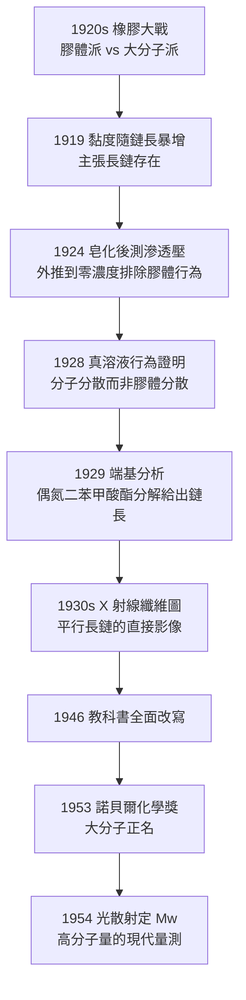

# 1953 · 施陶丁格與大分子的正名

> 1953 諾貝爾化學獎：赫爾曼·施陶丁格（Hermann Staudinger，1881–1965，德國）——表彰「其對高分子化學的發現，尤其是對大分子概念的證明」。他堅持了三十年的主張終於被接受：**澱粉、橡膠、蛋白質不是「膠體」，而是分子。**

## 懸案（案情提要）

1920 年代，有機化學界有一場持續了半個世紀的「橡膠大戰」。

- **膠體派**（以德國物理化學家為主，席格蒙迪等人，見 [1925-席格蒙迪與膠體化學](1925-席格蒙迪與膠體化學.md)）：澱粉、橡膠、蛋白質是**膠體**——由許多小分子聚集而成的鬆散分散系，其性質由粒子的物理狀態決定，分子量因批次而異，無法用化學式表示。
- **化學派**（以施陶丁格為代表）：這些物質有**固定的分子量**與**確定的結構**，是真正的**大分子（Makromolekül）**。

兩派都有實驗證據，都不肯退讓。爭點集中在幾個無法迴避的問題上：

1. **分子量**：如果澱粉是膠體，它的分子量就會隨樣品、隨濃度、隨歷史而變；若是分子，則有一個**可測且固定的值**。
2. **可溶性與黏度的行為**：膠體的溶解會膨脹成黏稠的分散系，且有明顯的**滯後現象**（Thixotropy）——若是分子，為何會有黏彈性？
3. **能否用「化學的辦法」處理它**：如果它是分子，就應該能像小分子那樣被合成、被降解、被分析。

偵辦人：赫爾曼·施陶丁格。他花了三十年，用滲透壓、黏度、分子量分布與 X 射線，最後以一次**史無前例的分子量量測**定案。

## 前因

| 年份 | 事件 |
| --- | --- |
| 1881 | 施陶丁格生於德國弗倫斯堡（後屬波森／今波茲南）；父親是法國籍的教授。 |
| 1903 | 慕尼黑大學博士（師從亨·邁爾），研究羰基化合物（**乙烯酮 ketene** 的發現，1912 首次製得，後成為制藥與化工的重要試劑）。 |
| 1906–1912 | 蘇黎世聯邦理工學院教授；研究馬來酸酐的加成反應（**施陶丁格反應**：烯酮與二苯亞甲基酮的加成）。 |
| 1919 | 於瑞士德國化學研究會（ETH）報告**「新的有機化合物」**研究——主張「苯甲酸酯與丙二酸氫酯的縮合產物」是**極長的開鏈碳鏈**（提出「大分子」概念），並以此解釋**聚苯甲酸酯的黏度隨分子鏈長增加而極速上升**。 |
| 1920s | 面對膠體派的強烈反對（韋爾、克蘭姆等）；1924 年以**纖維素衍生物的分子量量測**反擊；1925 年獲德國化工學會的「費利克斯·哈曼克獎章」時發表「有機化學的危機」演講，維護大分子學說。 |
| 1926 | 與沃爾菲（Walrf）合作發表《膠體化學的批判性論述》。 |
| 1928 | 與亨德利克（Hawley）等證明：**聚苯甲酸酯的溶液黏度顯示流動而非分散行為**，即它是真溶液（分子分散），而非膠體。 |
| 1929 | 埃斯特（Ester）與施陶丁格發現**偶氮二苯甲酸酯的分解**：$N_2$ 的釋放使殘餘鏈的端基可被證明，開啟「活性鏈」的證明路線。 |
| 1935 | 發表「大分子化學」總論，系統論述其立場。 |
| 1937–1940s | 戰時研究（橡膠、磷酸酯、殺蟲劑），1939 年與魯日奇卡（見 [1939-布特南特與魯日奇卡](1939-布特南特與魯日奇卡.md)）共同定出除蟲菊素 I 與 II 的結構，開啟 1960–70 年代擬除蟲菊酯的產業。 |
| 1946 | 發表《有機化學的基礎》（*Grundlagen der organischen Chemie*）第四版，全面以大分子觀點改寫教科書。 |
| 1953 | 獲諾貝爾化學獎。 |
| 1954 | 與西蒙（Simon）用**光散射**測定蛋白質的分子量，確立 $\bar{M}_w$ 的測定方法。 |
| 1965 | 逝於弗倫斯堡。 |

## 調查

**偵查一：黏度——第一份「長鏈」的證據。**

施陶丁格的策略極為巧妙：**不去爭論分子量，先從「溶液行為」下手。**若某物的溶液顯示出真正的分子分散（而非膠體分散），它就必是分子。

他的觀察：合成聚酯（由丙二酸氫酯與苯甲酸酯縮合的高聚物）的溶液黏度，隨「聚合度」急遽上升：

$$\text{滲透壓法測得的分子量} \; M \;\propto\; \text{鏈長}, \qquad \eta_{\text{相對}} \;\sim\; M^{3.4}\ (\text{Mark-Houwink 式的早期觀察})$$

**黏度的三次方級暴增，正是「長鏈分子互相纏繞」的必然結果**——這在物理上是「蛇形鏈」的統計力學：

$$\eta \propto N^{3.4}\quad (\text{剛性鏈}), \qquad \eta \propto N^3\ (\text{理想鏈})$$

**偵查二：滲透壓——量出「固定的分子量」。**

施陶丁格用滲透壓法測量分子量（見 [1901-凡特荷夫與物理化學](1901-凡特荷夫與物理化學.md) 的 $\pi V = nRT$）。但膠體派有一個合理的反駁：**膠體的滲透壓極小、且隨濃度不守 Ideal 行為，因此不能用滲透壓求分子量。**

施陶丁格的反擊（1924 年）：**用能溶成真溶液的衍生物做測量**——把聚苯甲酸酯的酯基皂化（皂化＝鹼水解），得到能在水中形成真溶液的聚羧酸鈉鹽，其滲透壓行為符合凡特荷夫定律：

$$\frac{\pi}{c} \xrightarrow[c \to 0]{} \frac{RT}{M} \quad\Longrightarrow\quad M = \frac{RT}{\pi/c}\Big|_{c\to 0}$$

**「外推到零濃度」的極限斜率**，正是排除膠體行為的關鍵：膠體的 $\pi/c$ 不隨 $c\to 0$ 收斂到 $RT/M$。

**偵查三：端基分析——證明鏈是「有限長」的。**

這是施陶丁格最富巧思的一步：**如果高分子是鏈，它必有端點；端點的量可以算出鏈長。**

他與亨德利克利用**偶氮二苯甲酸酯的熱分解**：

$$\mathrm{R{-}N{=}N{-}COOR'} \xrightarrow{\Delta} \mathrm{R^\bullet} + {}^{}\mathrm{N_2} + \mathrm{R'OCO^\bullet} \xrightarrow{} \text{鏈增長}$$

生成的氮氣是「鏈端」的標記物。以端基的定量測量反推聚合度：

$$\bar{X}_n = \frac{\text{單體莫耳數}}{\text{端基莫耳數}} \quad (\text{鏈長})$$

**端基分析 + 滲透壓 = 兩條獨立路徑給出同一個分子量**，大分子論在 1940 年代宣告確立。

**偵查四：X 射線——把長鏈「看見」。**

1920–30 年代的 X 射線繞射研究（美國的卡爾（Karl）等人）發現：**拉伸的纖維有明顯的「纖維圖樣」（fiber diagram），呈現沿纖維方向的長條狀斑點與層線**——這正是平行排列的長鏈分子的衍射特徵。

$$\text{沿鏈方向的層線} \;\Rightarrow\; \text{鏈的重複單元長度} \; c = \text{單元投影長度}$$

**「X 射線纖維圖 = 長鏈分子的直接影像」**——這是 1920–30 年代支持大分子學說最有力的物理證據（德國的赫爾姆（Hermann）等人）。

**偵查五：黏度的滯後與鬆弛——高分子特有的現象。**

施陶丁格還注意到高分子溶液的**黏度隨時間變化**（剪切變稀、靜置後回復），這是「纏繞結構」被打斷與重建的表現：

$$\eta(t) \;\to\; \eta_{\infty} \quad (\text{分子鏈重新纏繞，時間尺度為松弛時間}\ \tau)$$

**「黏彈性」成為高分子的定義性特徵之一**——這是化學家第一次觀察到「物質的機械性質隨時間尺度變化」的現象。

## 理論裁決

**判決一：高分子的兩種分子量。** 大分子最重要的技術後果，是**分子量不再是單一數字，而是一個分布**：

$$\bar{M}_n = \sum_i N_i M_i \quad (\text{數均}), \qquad \bar{M}_w = \frac{\sum_i N_i M_i^2}{\sum_i N_i M_i} \quad (\text{重均})$$

$$\bar{M}_w \ge \bar{M}_n, \qquad \text{分散係數} \; Đ = \frac{\bar{M}_w}{\bar{M}_n} \ge 1$$

**這個「分布」觀念是化學史上少數由一場論戰直接催生的概念**，並成為所有聚合反應動力學（鏈增長、鏈終止、分布寬度）與材料設計的語言。

**判決二：Mark–Houwink 方程——分子量與性質的定量關係。** 施陶丁格與同事發現：

$$\boxed{\;[\eta] = K\,M^{a}\;}$$

（$[\eta]$ 為特性黏度、$K$ 與 $a$ 為與溶劑、溫度、鏈剛性相關的參數，典型 $a$ 為 $0.5$–$0.8$。）

**這條方程是今日高分子工業的基礎**：由一件樣品的黏度即可估分子量，進而預測熔融加工性、溶液性質與機械強度。

**判決三：Schulz–Zimm 分布——鏈長分布的統計模型。** 自由基聚合的動力學給出：

$$\text{分布} \Rightarrow \text{數目分布} \; f(x) = x^{n-1}\frac{n^n \exp(-n)}{(n-1)!}$$

這是「每條鏈長度不同」的統計表達，源自 1930–40 年代的聚合動力學（Flory 與其他人）。**「沒有兩條鏈一樣長」**成為高分子的根本事實，也是所有平均量存在的理由。

**判決四：高分子科學的成立——化學的一個新分支。** 施陶丁格的判決可總結為：

$$\text{高分子} = \text{具有確切分子量分布的長鏈共價大分子} \quad (\text{不是膠體})$$

這一定義把「高分子」從化學家的直覺提升為可研究的對象，並直接催生了 1950–60 年代的**高分子科學**：Flory 的統計力學（1974 年化學獎，見 [1974-弗洛里與高分子物理化學](1974-弗洛里與高分子物理化學.md)）、Ziegler–Natta 催化（見 [1963-齊格勒與納塔](1963-齊格勒與納塔.md)）、Bunn 的直鏈聚乙烯結構、Carothers 的尼龍方程。

## 後果

| 領域 | 影響 |
| --- | --- |
| 材料工業 | 塑料（PE、PP、PVC、PS）、合成纖維（尼龍、聚酯）、橡膠、黏合劑、涂料——整個高分子工業的科學合法性與設計基礎。 |
| 生物化學 | 蛋白質、多醣、核酸皆為高分子；大分子的分子量與構形，開啟了結構生物學（見 [1954-鮑林與化學鍵](1954-鮑林與化學鍵.md) 的 $\alpha$ 螺旋）與 DNA 的結構研究。 |
| 藥劑學 | 聚合型藥物載體、控釋劑型、PEG 修飾蛋白質（ polyethylene glycolylation，用於延長蛋白質半衰期），皆源於高分子概念。 |
| 工業化學 | 乳膠、黏著劑、膜分離技術。今日的**膜分離**（超濾、透析）直接依賴「分子量截止值」的概念。 |
| 科學史地位 | 施陶丁格是「三十年不合群」的典範：1920 年代起與主流對抗，直到 1940–50 年代才被接受。他於 1953 年獲獎時的高齡與晚來的承認，使「大分子之爭」成為科學史上著名的典範案例。 |

## 關聯

- [1901-凡特荷夫與物理化學](1901-凡特荷夫與物理化學.md)：滲透壓定律是施陶丁格量測分子量的工具；也是他對抗膠體派的戰場。
- [1925-席格蒙迪與膠體化學](1925-席格蒙迪與膠體化學.md)：本案的對手陣營——膠體派的核心人物席格蒙迪也在 1925 年獲獎。
- [1926-斯韋德貝里與超速離心機](1926-斯韋德貝里與超速離心機.md)：蛋白質的分子量量測，與施陶丁格的方法論互補。
- [1939-布特南特與魯日奇卡](1939-布特南特與魯日奇卡.md)：施陶丁格與魯日奇卡共同定出除蟲菊素結構，並合作發表分子量觀點。
- [1963-齊格勒與納塔](1963-齊格勒與納塔.md)：大分子概念在工業上的最高回報——立體規整聚合。
- [1974-弗洛里與高分子物理化學](1974-弗洛里與高分子物理化學.md)：高分子統計力學的集大成，把施陶丁格的定性主張推成定量理論。
